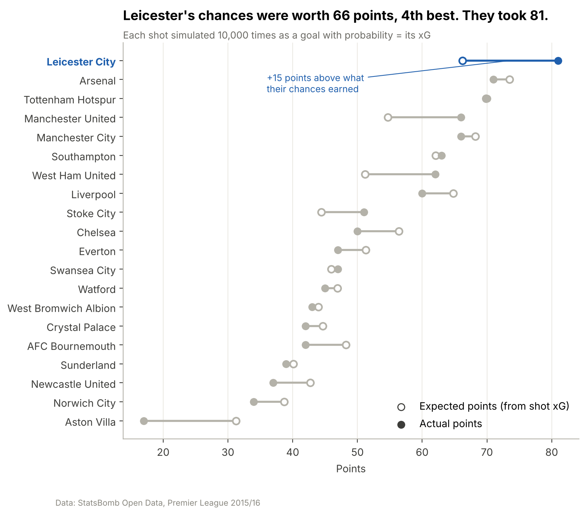
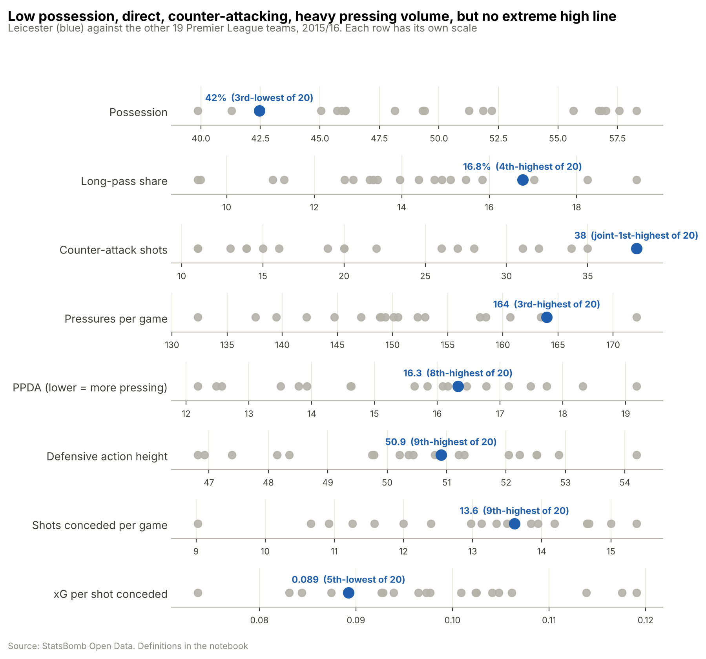
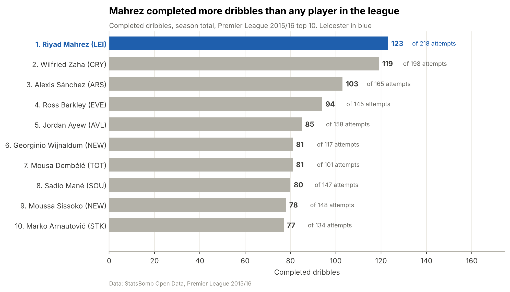
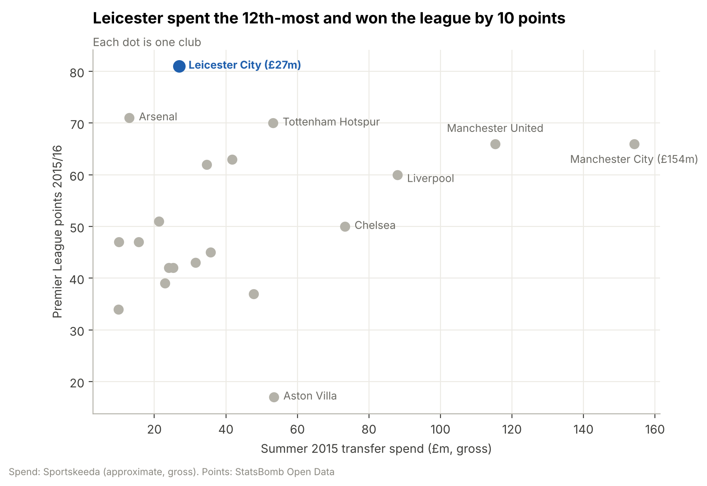
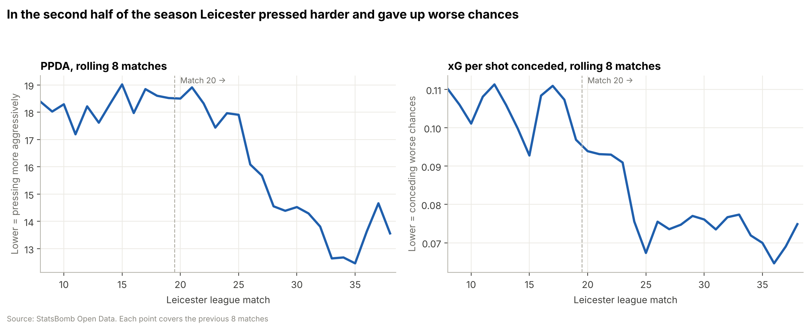

# The 5000–1 Season: how Leicester City won the Premier League

> **A data analysis of Leicester City's 2015/16 title**, using 1.3 million StatsBomb match events, official Premier League (Opta) stats and published tactical analysis.
>
> Part of [**football-analytics**](../README.md) · Author: **Hammad** · Python · pandas · matplotlib · mplsoccer · Jupyter

**📰 Read the article: [`docs/ARTICLE.md`](docs/ARTICLE.md)**: every chart with what it shows and what it means ([PDF version](reports/Leicester_2015-16_article.pdf))



---

## The question

Before the 2015/16 season, bookmakers gave Leicester City **5000–1** odds to win the Premier League. The previous season they had been bottom from November to April and finished 14th. Then they won the league by 10 points. **How?**

## Key findings

| | Finding |
| --- | --- |
| 📈 | **A 4th-place team on chances, champions on points.** Their shots were worth 66 expected points; they took **81**, the biggest gap in the league. |
| 🧱 | **Defence made the difference after Christmas.** They conceded **11 goals in the last 19 games** from chances worth 20 goals. From January they pressed harder and gave up only poor chances. |
| ⚡ | **Little of the ball, very fast attacks.** 42% possession (3rd-lowest), yet **67% of their shots came within 15 seconds** of winning the ball, the highest in the league. |
| 🔁 | **The same XI every week.** **33** line-up changes all season, the fewest in the league (next: Spurs, 56). |
| ⭐ | **Vardy and Mahrez were 1st and 2nd for goals + assists** (29 and 27), ahead of Kane and Agüero. |
| 🛡️ | **Kanté was 1st in the league** for tackles, interceptions and ball recoveries. Fuchs led for blocks; Huth was 2nd for clearances. |
| 💷 | **Spent 12th-most (~£27m).** Kanté, Fuchs, Huth and Okazaki cost **£15.6m** together, against **£154m** spent by Man City. |
| 🚀 | **Vardy went from 5 league goals to 24, Mahrez from 4 to 17.** Vardy took more than twice as many shots, of the same quality, and stopped under-finishing. |
| 🧠 | **Ranieri kept Pearson's direct style but made it lethal.** The same number of passes (13,343 vs 13,370) produced **48% more xG**. |

## Explore the project

| Read | What's inside |
| --- | --- |
| 📰 [**The article**](docs/ARTICLE.md) · [PDF](reports/Leicester_2015-16_article.pdf) | All 28 charts, each explained, plus lessons for clubs, data and sources |
| ✅ [Findings log](docs/results.md) | 48 numbered findings, each with its evidence and a confidence rating |
| ⚽ [Tactics: Pearson → Ranieri](docs/tactics_pearson_to_ranieri.md) | What Ranieri changed and kept, with every claim sourced |
| 📓 [Notebooks](notebooks/README.md) | Seven notebooks, one per question, all re-runnable |
| 📊 [Chart gallery](reports/figures/README.md) | Every figure with a one-line takeaway |
| 🗂️ [Data dictionary](../docs/dataset.md) | Sources, cleaning steps and validation checks (shared across the repo) |
| 🧭 Decision records | [Why StatsBomb data](../docs/decisions/0001-use-statsbomb-open-data.md) · [Why the 2015/16 season](docs/decisions/0002-premier-league-2015-16.md) |

## Highlights

| | |
| --- | --- |
|  |  |
|  |  |

## Data

| Source | What it contains | Used for |
| --- | --- | --- |
| [StatsBomb Open Data](https://github.com/statsbomb/open-data) | Premier League 2015/16: 380 matches, 1,305,608 on-ball events with locations and xG | All 2015/16 player and team analysis |
| [Premier League stats](https://www.premierleague.com/en/stats) (Opta) | Season totals for Leicester players and the club, 2014/15 and 2015/16 (`data/external/`) | Comparing the two seasons |
| [Understat](https://understat.com) (via [a public copy](https://github.com/douglasbc/scraping-understat-dataset)) | xG for every shot, 2014/15 and 2015/16 | Comparing both seasons on one model |
| EA Sports PPI via Sky Sports | Distance covered | Running analysis |

| Dataset | Size |
| --- | --- |
| Matches | 380 (20 teams) |
| On-ball events | 1,305,608 |
| Players | 550 (327 with 900+ minutes) |

Raw and processed data (~80 MB) aren't stored in the repo; the scripts below rebuild them in about five minutes. A sample is in [`data/sample/`](data/sample/player_season_2015_16.csv).

## Folder structure

```
Leicester-City-2015-16-Miracle/
├── README.md                  ← you are here
├── docs/
│   ├── ARTICLE.md             ← the main read: every chart, explained
│   ├── results.md             ← 48 numbered findings with evidence
│   ├── tactics_pearson_to_ranieri.md
│   └── decisions/
├── notebooks/                 ← 02–08: one notebook per question (+ the scripts that build them)
├── reports/
│   ├── figures/               ← all 28 charts
│   ├── Leicester_2015-16_article.pdf
│   └── make_article_pdf.py    ← rebuilds the PDF from ARTICLE.md
└── data/
    ├── external/              ← Premier League (Opta) stats copied from premierleague.com
    └── sample/                ← sample of the season player table
```

Shared code (`src/football_analytics/`) and the downloaded StatsBomb data (`data/raw`, `data/processed`) live at the [repo root](../README.md).

## How to run

From the repo root (one-time setup is in the [main README](../README.md#setup)):

```bash
python -m football_analytics.data 2 27   # download Premier League 2015/16 (~4 min)
python -m football_analytics.clean       # clean events, compute minutes played (~15 s)
python -m football_analytics.understat   # download Understat shots for 2014/15 and 2015/16 (~5 s)
cd Leicester-City-2015-16-Miracle
jupyter lab                              # open notebooks/ and run 02 → 08
python reports/make_article_pdf.py       # rebuild the article PDF
```

## Skills used

| Area | What this project shows |
| --- | --- |
| **Python and data handling** | pandas on 1.3M events; a reusable download-and-clean pipeline; parsing scraped Premier League pages into tables |
| **Statistics and modelling** | Monte Carlo simulation (10,000 replays per match) for expected points; per-90 rates; position-based percentiles; rolling averages |
| **Football metrics** | xG, expected points, PPDA, pressures, defensive action height, xGChain, xA, possession and directness measures |
| **Data quality** | Three independent sources cross-checked (StatsBomb, Understat, Opta); validation checks; documented limitations and confidence ratings |
| **Visualisation** | 28 charts in matplotlib and mplsoccer: pitch maps, league top-10 leaderboards, dumbbell, percentile and timeline charts |
| **Communication** | A chart-by-chart article, a numbered findings log, decision records, and reproducible notebooks |

## Next steps

- **Test whether overperformance lasts.** Use several seasons of Understat data to check how often teams that beat their expected points by 10+ keep doing it the next year.
- **Build a role-based recruitment search.** Turn the "buy for a role" lesson into a tool: pick a role's key metrics and rank every player in the league by them, with fees alongside.
- **Compare other surprise seasons.** Run the same notebooks on other over-achievers, using any season StatsBomb releases as open data.
- **Make it interactive.** Put the league leaderboards into a dashboard where any metric can be selected.

## Progress

Tracked on my GitHub Project board **Portfolio** (Area: Football analytics).

## Acknowledgements

Event data provided by [StatsBomb](https://statsbomb.com/) Open Data. Season statistics from the [Premier League](https://www.premierleague.com/) (Opta). Tactical context from the sources listed in the [article's appendix](docs/ARTICLE.md#appendix-data-method-and-sources).
