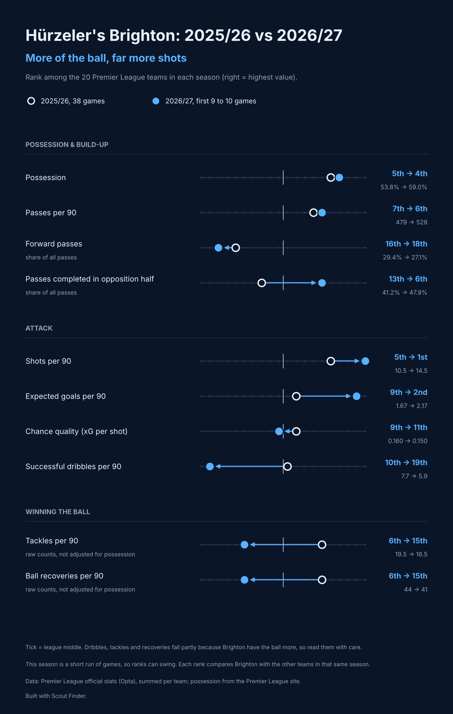
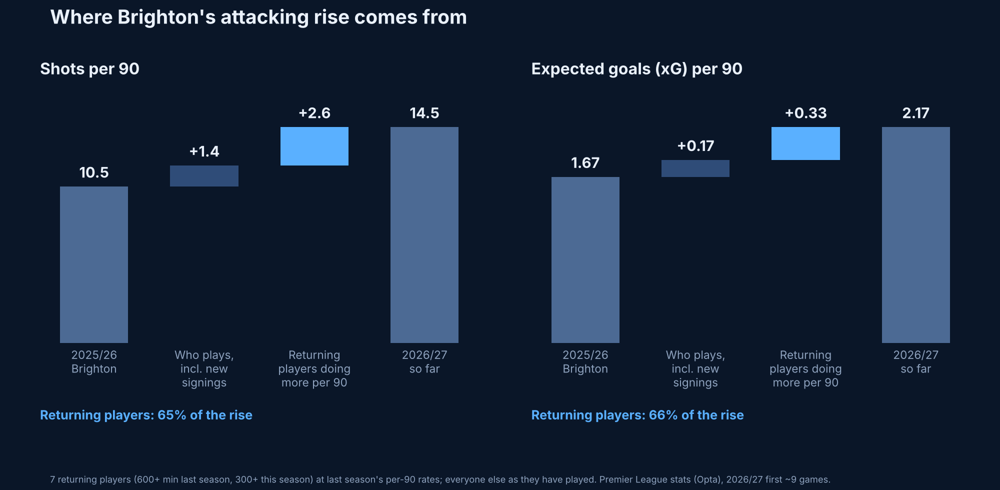

# Fabian Hürzeler, Brighton 2025/26 vs 2026/27

What changed at Brighton between last season and the first 9 to 10 games of this one, and why. Were it his tactics, the players bought and sold, or new signings who simply shoot more in his side?

> Part of [**football-analytics**](../../README.md) › [**Managers**](../README.md) · Author: **Hammad** · Python · pandas · matplotlib

**📖 [Read the report](docs/ARTICLE.md)** · **🌐 [Styled HTML version](docs/report.html)** (download and open in a browser)

[](docs/ARTICLE.md)

## Key findings

| | 2025/26 | 2026/27 so far |
| --- | --- | --- |
| Shots per 90 | 10.5 (5th) | **14.5 (1st)** |
| xG per 90 | 1.67 (9th) | **2.17 (2nd)** |
| xG per shot | 0.160 | 0.150 |
| Possession | 53.8% | 59.0% |
| Dribbles per 90 | 7.7 | 5.9 |

- **Returning players explain about 65% of the rise in shots and 66% of the rise in xG.** Letting them shoot at last season's rates gives 11.9 shots per 90, against 14.5 actual.
- **The signings did not shoot their way in.** Eight arrivals took 19% of the shots in 21% of the minutes. Luka Vušković (14 shots, a centre-back) is the only outlier.
- **The sales matter.** Players who left or barely play took 42% of last season's shots and 52% of its xG.
- **Same press, different roles.** Brighton led the league in high turnovers last season and again after four games this season. What changed is who plays No. 10, centre-forward and the wings.



## Limits

Only 9 to 10 league games this season, uneven fixtures, and no line-up or position data beyond single match articles. Some role changes look forced by injuries (Mitoma) and sales (Welbeck), not planned.

## Run it

From this folder:

```bash
pip install pandas matplotlib
python scripts/rank_change.py
python scripts/bridge.py
```

## Data

Premier League official player and team stats (Opta), summed per team and player; possession from the league's team table; summer 2026 transfers from [Scout Finder](../../Tools/Scout-Finder/). As of 15 November 2026.
