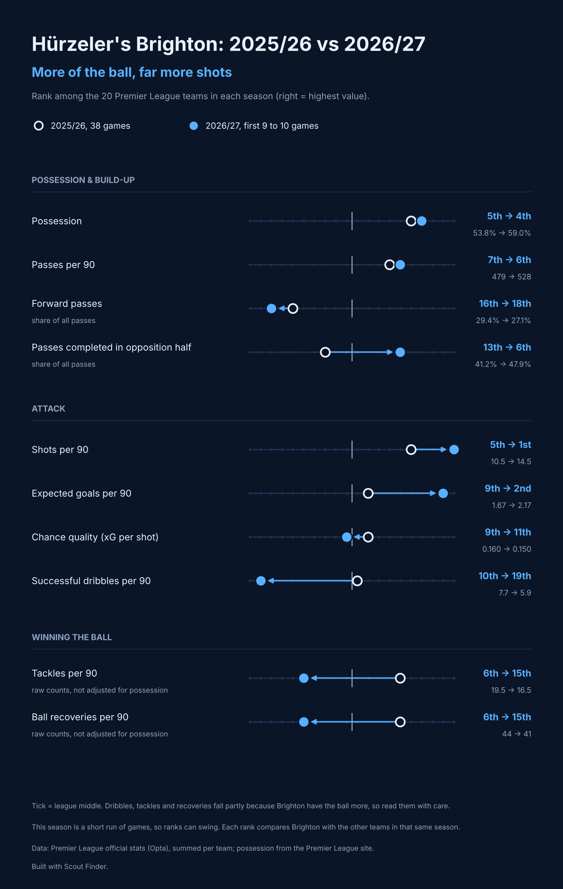
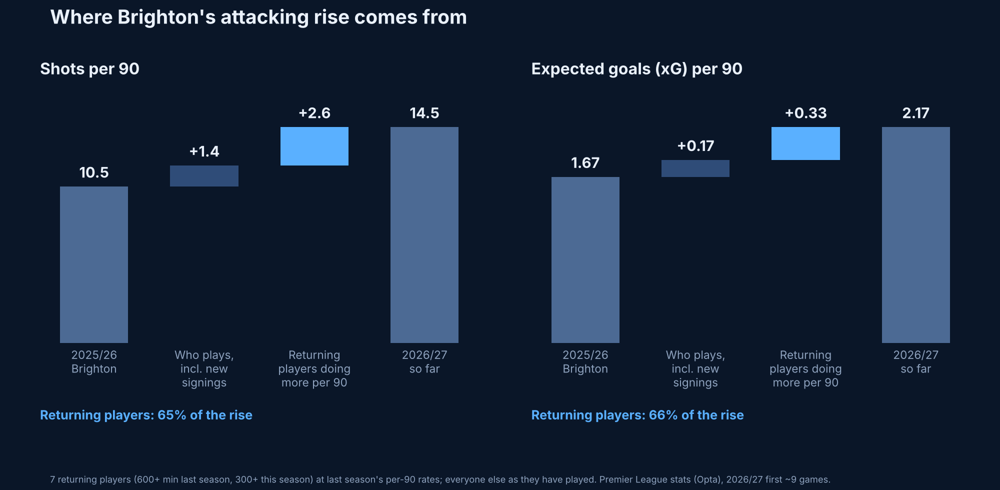

# Hürzeler's Brighton: what changed, and why

*Hammad · 15 November 2026*

## Bottom line

The attack changed mainly because the same pressing system is being run through different roles, not because of signings. Between roughly two-thirds and four-fifths of the rise in shots and expected goals (xG) comes from players who were already at Brighton doing more per 90 minutes. The summer signings are mostly defenders and took 19% of the shots in 21% of the minutes.

The sales matter too: the players who left or have barely played this season took 42% of last season's shots and 52% of its xG, so Brighton are producing more with a different front line.

Confidence is moderate. It is 10 league games, the fixture list is uneven, and the data does not show positions or line-ups. Some of the "tactics" effect may be role changes forced by injuries, not a planned new system.

## What changed on the pitch

Brighton keep the ball more and shoot far more, but with slightly weaker chances and far fewer dribbles. Against the other 19 Premier League teams, shots per 90 went from 5th to 1st and xG per 90 from 9th to 2nd (2025/26 is 38 games; 2026/27 is the first 9 to 10).

- **More territory, slower build-up.** Possession rose from 53.8% to 59.0%. The share of passes completed in the opposition half went from 41% to 48% (13th to 6th), while forward passes fell from 29.4% to 27.1% of all passes.
- **Volume, not quality.** Shots per 90 rose from 10.5 to 14.5, but xG per shot slipped from 0.160 to 0.150. Pascal Groß and Charalampos Kostoulas both scored from long range against Arsenal.
- **Results.** 22 points from 10 games (7 wins, 1 draw, 2 defeats), 26 goals scored and 7 conceded, 2nd behind Arsenal as of 8 November.

## Who left and who arrived

Brighton lost their top scorer, their most-used defender and their holding midfielder, and the signings are mostly defenders. Goalkeeper Carl Rushworth also left for Coventry for £22m.

**Left, or barely played this season**

| Player | Position | What happened | Min 25/26 | xG 25/26 |
| --- | --- | --- | ---: | ---: |
| Danny Welbeck | Forward | Sold to Chelsea, £5m | 2,263 | 12.4 |
| Jan Paul van Hecke | Centre-back | Sold to Spurs, £51–52m | 3,211 | 3.3 |
| Carlos Baleba | Midfielder | Sold to Manchester United, about £65m | 1,662 | 0.7 |
| Kaoru Mitoma | Winger | Out injured (hamstring) | 1,721 | 4.1 |
| Yankuba Minteh | Winger | 8 minutes this season, reason not found | 2,398 | 3.8 |
| Brajan Gruda | Midfielder | Loan to RB Leipzig | 715 | 1.7 |
| Joël Veltman | Defender | Free to West Ham | 1,050 | 1.1 |
| James Milner | Midfielder | Leaving, per FourFourTwo | 778 | 1.0 |

**Arrived**

| Player | Position | Fee | Min 26/27 | Shots | xG |
| --- | --- | --- | ---: | ---: | ---: |
| Luka Vušković | Centre-back | £46m plus £4m add-ons (club record) | 888 | 14 | 1.3 |
| Chema Andrés | Defensive midfielder | £15.5m | 453 | 4 | 0.5 |
| Costinha | Right-back | £11m | 354 | 3 | 0.3 |
| Pascal Struijk | Centre-back | £20m | 156 | 2 | 0.3 |
| Jaouen Hadjam | Left-back | Undisclosed | 37 | 1 | 0.1 |
| Promise David | Forward | Loan | 23 | 1 | 0.4 |
| Zadok Yohanna | Winger | £21.5–24m | 12 | 0 | 0.0 |
| Femi Azeez | Winger | £12.5–15m | 0 | 0 | 0.0 |

Fees come from Scout Finder's transfer list and press reports, which differ for some deals (shown as ranges). Mitoma's injury is from a Vavel report; I did not find a cause for Minteh's absence.

## The same-players test

Players who stayed are shooting and creating more per 90 minutes, which is the clearest sign that the system or their roles changed. Ayari, De Cuyper and Groß more than doubled their xG per 90, and Gómez, Ayari and De Cuyper all shoot more often (Boscagli's rise starts from near zero).

| Player | Minutes 25/26 | Minutes 26/27 | Shots per 90 | xG per 90 |
| --- | ---: | ---: | ---: | ---: |
| Diego Gómez | 2,136 | 877 | 1.31 → 2.05 | 0.27 → 0.14 |
| Yasin Ayari | 1,924 | 746 | 1.40 → 2.17 | 0.13 → 0.26 |
| Maxim De Cuyper | 1,414 | 827 | 0.57 → 1.31 | 0.12 → 0.27 |
| Pascal Groß | 1,636 | 881 | 0.66 → 1.12 | 0.08 → 0.31 |
| Olivier Boscagli | 800 | 785 | 0.11 → 0.34 | 0.00 → 0.02 |
| Ferdi Kadioglu | 3,134 | 520 | 0.63 → 0.69 | 0.06 → 0.03 |
| Lewis Dunk | 2,837 | 749 | 0.60 → 0.12 | 0.05 → 0.00 |

To size the effect, I let these returning players shoot at last season's per-90 rates, counted everyone else as they have actually played, and compared. Result: 11.9 shots per 90, against 10.5 last season and 14.5 actual. So the returning players explain about 65% of the rise in shots (2.6 of 4.0) and about 66% of the rise in xG (0.33 of 0.50). Counting all 11 players with 600+ minutes last season, including tiny samples such as Jack Hinshelwood's 158 minutes, raises those shares to 79% and over 100%.

Some of this is role change. Vavel reports De Cuyper, a left-back, playing as a left winger while Mitoma is injured, and Total Football Analysis has Groß starting from the No. 10 position against Arsenal.

## The new-players test

The signings did not shoot their way into the team. The eight arrivals who have played took 21% of the minutes, 19% of the shots (25 of 131) and 15% of the xG (3.0 of 19.7), so they contribute roughly in proportion to their playing time, or less.

The one outlier is Luka Vušković: a centre-back with 14 shots in 888 minutes. No striker or winger has been signed who plays. Zadok Yohanna has 12 minutes and Femi Azeez none.

The attack instead runs through players already at the club: Groß (3.0 xG), Kostoulas (2.6), Hinshelwood (2.5), De Cuyper (2.4) and Ayari (2.2) lead the squad in xG. Kostoulas had only 353 minutes last season and now starts up front, in place of Welbeck, who scored 13 league goals last year.

Where the signings do fit Hürzeler's style is behind the ball. Total Football Analysis has Vušković and Struijk stepping out onto Arsenal's Ødegaard and Havertz, and Vušković giving a short option in build-up. That is a plausible fit with a high press, but it is one match, not a pattern.

## What Hürzeler himself changed

This season's Brighton press high and keep the ball in the opposition half. Last season they led the league in high turnovers (192, ahead of Arsenal's 179), per Albion Analytics, so the pressing principle looks unchanged and the next section covers what did change.

After four league games, The Analyst had Brighton with the lowest PPDA in the league (6.6, meaning the fewest opposition passes allowed per defensive action), the most high turnovers (41), the highest possession (71.1%) and the furthest average start to their passing sequences (46.9m from their own goal). It warns that red cards and extra-man minutes inflate some of these.

The Arsenal win on 19 September shows the other side. Brighton had only 40.3% of the ball, took 17 shots worth 1.33 xG, and won the ball in the final third nine times. Total Football Analysis describes a diamond build-up, a goalkeeper playing 25 of 40 passes long (62.5%), a mid-block that drops into a 5-1-4, man-oriented marking, and quick forward play after winning the ball. Two of the three goals were from 20 to 25 yards.

Taken together, that suggests a team that sets up to win the ball high or win second balls and then shoots early, not one that only holds possession. It is also consistent with more shots of lower quality per shot, as seen in the numbers above.

## Same system, different roles?

The evidence points to the same principles with a rearranged cast: the press and the width are unchanged, while the positions around the No. 10, the centre-forward and the wings are filled by different players. That fits what Hürzeler said in July 2025: he wants flexibility and expects the shape to follow the players.

| Area | 2025/26 | 2026/27 | Same or changed |
| --- | --- | --- | --- |
| Base shape | Flexible 4-2-3-1 with rotations (Vavel) | An August preview expected a 4-2-3-1; against Arsenal, a diamond build-up and a 5-1-4 mid-block (Total Football Analysis, one match) | Not confirmed as changed |
| Press | Man-oriented high press; most high turnovers in the league (192) | Most high turnovers again (41 after four games) and the lowest PPDA | Same |
| Width | 3.8 successful open-play crosses per 90 (3rd) | 3.6 per 90 (4th) | Same volume, different crossers: Minteh (31) and Kadioğlu (17) then; Groß (9), Boscagli (7) and De Cuyper (6) now |
| No. 10 | Hinshelwood from the winter, after Groß returned from Dortmund; four goals and three assists | Groß starts there against Arsenal; Hinshelwood has one start | Changed |
| Centre-forward | Welbeck, 13 league goals | Kostoulas starts, 9 starts in 10 games | Changed (sale) |
| Wide attackers | Minteh and Mitoma made 93 of the team's 266 successful dribbles (35%) | Mitoma injured, Minteh 8 minutes; De Cuyper plays on the left wing | Changed (injury) |
| Holding midfield | Baleba, with Groß, Ayari or Wieffer | Chema Andrés, Ayari, Gómez | Changed (sale) |

Two things follow. First, the fall in dribbles from 7.7 to 5.9 per 90 is mostly a personnel effect: the two players who produced over a third of last season's dribbles are barely playing. Second, a June 2026 season review credits last winter's change (Groß back, Hinshelwood to No. 10) for giving the side "a clearer identity", so the current set-up builds on that, not on a break with it.

What I cannot say is whether the 5-1-4 and the diamond are a new default or an Arsenal-specific plan. That needs line-ups from several matches.

## Verdict

| Question | Answer | Evidence |
| --- | --- | --- |
| Was it his tactics? | Mostly roles within a similar system, with a caveat | Returning players explain 65–79% of the rise in shots and about two-thirds or more of the rise in xG. Some role changes look forced by injuries (Mitoma) and sales (Welbeck), not planned. |
| Did he buy players who suit his style? | In defence, plausibly; in attack, no | Vušković, Struijk and Chema Andrés fit a high press and build-up. No attacker or winger signed has played much. |
| Did the new players just shoot more in his side? | No | Arrivals took 19% of shots in 21% of minutes. Vušković (14 shots) is the only outlier. |

The fairest summary: Hürzeler kept most of the core, replaced a centre-back and the holding midfielder with players who plausibly fit, and the existing midfielders and left-back now shoot more because of where they play and how the team attacks.

## Caveats

- **Small sample.** This season is 9 to 10 games, so ranks can swing. The player stats cover about 9 matches of minutes, while the possession figure counts 10.
- **No positions or line-ups.** Role changes come from two match articles, not from tracking or average-position data.
- **Simple method.** The same-players test ignores opponent strength and game state, and some players have under 900 minutes this season.
- **Fixtures are uneven.** They include Arsenal, Manchester City and Liverpool, but also newly promoted Coventry.
- **Not found.** The reason for Minteh's absence, and any 2026/27 formation data beyond one match article.
- **What would settle it:** match-by-match line-ups and positions, to see who plays where and whether the shape changed.

Data: Premier League official stats (Opta), summed per team and player; Scout Finder's summer 2026 transfer list. As of 15 November 2026, with the results page last updated on 8 November.

## Sources

- [FourFourTwo: Brighton 2026/27 preview](https://www.fourfourtwo.com/team/brighton-staggered-to-the-conference-league-finish-line-last-season-but-will-they-enjoy-the-fruits-of-their-labour-brighton-2026-27-season-preview)
- [Vavel: Brighton results](https://www.vavel.com/en/data/brighton-hove-albion/results/)
- [The Analyst: Brighton pressing](https://theanalyst.com/articles/brighton-pressing-machine-arsenal-test-premier-league-stats)
- [The Analyst: Brighton v Arsenal](https://theanalyst.com/articles/brighton-vs-arsenal-stats-premier-league-09-2026)
- [Total Football Analysis: Brighton v Arsenal](https://totalfootballanalysis.com/tactical-analysis/brighton-arsenal-tactical-analysis)
- [Vavel: Brighton's transfer window](https://www.vavel.com/en/football/2026/09/02/brighton-hove-albion/1269971-seagulls-looking-to-fly-high-after-busy-transfer-window.html)
- [Vavel: Brighton 3-0 Arsenal](https://www.vavel.com/en/football/2026/09/19/brighton-hove-albion/1272155-brighton-3-0-arsenal-pressed-into-submission-and-ended-their-unbeaten-run.html)
- [Albion Analytics: 2025/26 season in review](https://www.brightonandhovealbion.com/media-article/mft-albion-analytics-2025-26-season-review-june-2026)
- [Albion: Hürzeler on his tactical approach, July 2025](https://www.brightonandhovealbion.com/media-article/mft-interviews-fabian-hurzeler-tactical-approach-july-2025)
- [Vavel: Brighton 2026/27 preview](https://www.vavel.com/en/football/2026/08/17/brighton-hove-albion/1268232-brighton-2026-27-season-preview-the-return-to-europe.html)
