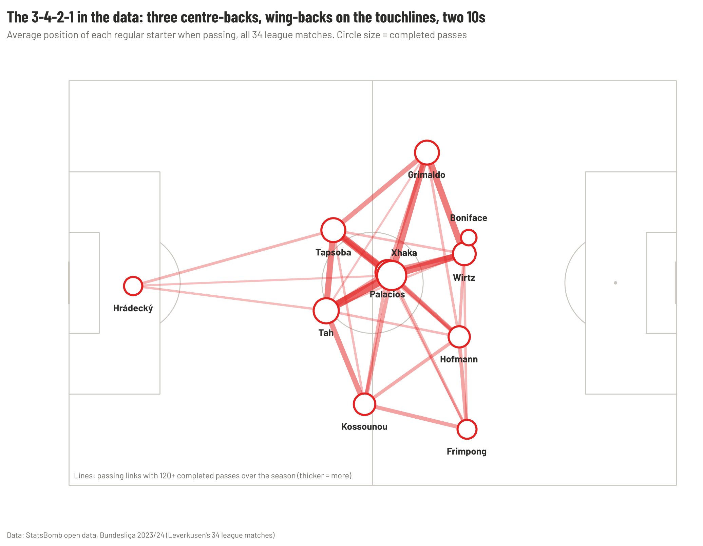

# 🧠 Managers

Projects about a manager's ideas: how a coach sets up a team, and whether the data backs up what people say about him. Part of [**football-analytics**](../README.md).

| Project | Season | Question | Read |
| --- | --- | --- | --- |
| 🔴 [**Xabi Alonso 23-24**](Xabi-Alonso-23-24/) | Leverkusen, 2023/24 | How did Xabi Alonso's Leverkusen go a whole Bundesliga season unbeaten? | [Article](Xabi-Alonso-23-24/docs/ARTICLE.md) · [PDF](Xabi-Alonso-23-24/reports/Leverkusen_2023-24_Alonso_article.pdf) · [One-page report](Xabi-Alonso-23-24/reports/Leverkusen_build_up_one_page.pdf) |

Data: [StatsBomb open data](https://github.com/statsbomb/open-data), Bundesliga 2023/24 (Leverkusen's matches). Download with `python -m football_analytics.data 9 281`.
