# Xabi Alonso 23-24

How Xabi Alonso's Bayer Leverkusen went a whole Bundesliga season unbeaten: his ideas, tested against StatsBomb event data for all 34 league matches. A twelve-chart report on his ideas and on whether they deserved to go unbeaten, plus a one-page build-up report.

> Part of [**football-analytics**](../../README.md) › [**Managers**](../README.md) · Author: **Hammad** · Python · pandas · matplotlib · mplsoccer · Jupyter

**📄 [The one-page report (PDF)](reports/Leverkusen_build_up_one_page.pdf)** · **📖 [Xabi Alonso 23-24: how Leverkusen went unbeaten](docs/ARTICLE.md)** ([PDF](reports/Leverkusen_2023-24_Alonso_article.pdf))

## The question

**How does Leverkusen get the ball from the goalkeeper into midfield?**

[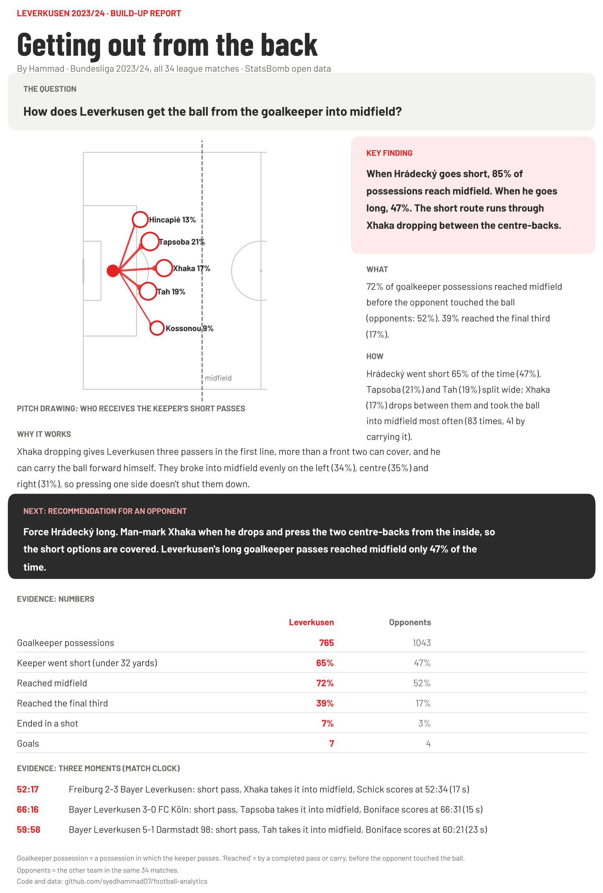](reports/Leverkusen_build_up_one_page.pdf)

## Key findings

| | Leverkusen | Their opponents |
| --- | --- | --- |
| Goalkeeper possessions | 765 | 1,043 |
| Keeper went short (under 32 yards) | **65%** | 47% |
| Reached midfield, before the opponent touched the ball | **72%** | 52% |
| Reached the final third | **39%** | 17% |
| Ended in a shot | **7%** | 3% |
| Goals | **7** | 4 |

- **Short works, long doesn't.** When Hrádecký went short, 85% of possessions reached midfield; when he went long, 47%.
- **The shape:** Tapsoba (21% of his short passes) and Tah (19%) split wide, and Xhaka (17%) dropped between them.
- **Xhaka is the key.** He took the ball into midfield more than anyone (83 times, 41 by carrying it).
- **No favourite side.** They broke into midfield on the left (34%), centre (35%) and right (31%) almost equally.
- **Recommendation for an opponent:** force Hrádecký long by man-marking Xhaka and pressing the centre-backs from the inside.

**Alonso's style, in the data** ([article](docs/ARTICLE.md)):
- **Control:** 62% of all passes on average, 88% completed; more of the ball in 28 of 34 games. Yet the 3-0 win over Bayern came with 39%.
- **High regains:** 31% of their ball recoveries came in the attacking third (opponents 20%).
- **Wing-backs:** Grimaldo had the most goal contributions in the squad (10 goals, 13 assists); Frimpong was fourth (16).
- **Central:** 16.1 passes into the box per match (opponents 7.6), half through the middle; only 16% were crosses.
- **"Xabi time":** 8 stoppage-time goals, 0 conceded, worth 9 points. Without them, 3 of the 6 draws were defeats.

**Did they deserve to go unbeaten?** ([verdict](docs/ARTICLE.md#the-verdict--did-they-deserve-to-go-unbeaten))
- Their chances were worth **75 points**; they took **90**. They scored 89 from 72.7 xG and conceded 24 from 27.8.
- In **6 games** they'd have lost at least a third of the time on their chances, and lost none.
- Replaying the season 10,000 times, they lost **4.8 games on average** and went unbeaten in **0.3%** of seasons (about 1 in 345).

## Charts

| | |
| --- | --- |
| [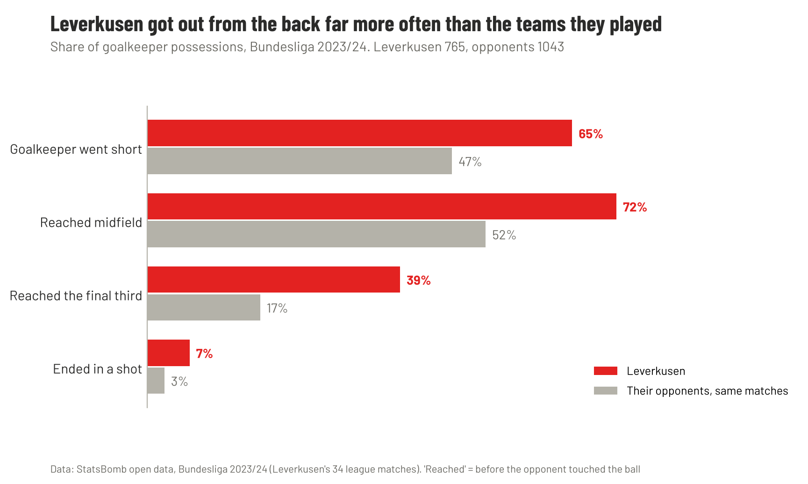](reports/figures/01_leverkusen_vs_opponents.png) | [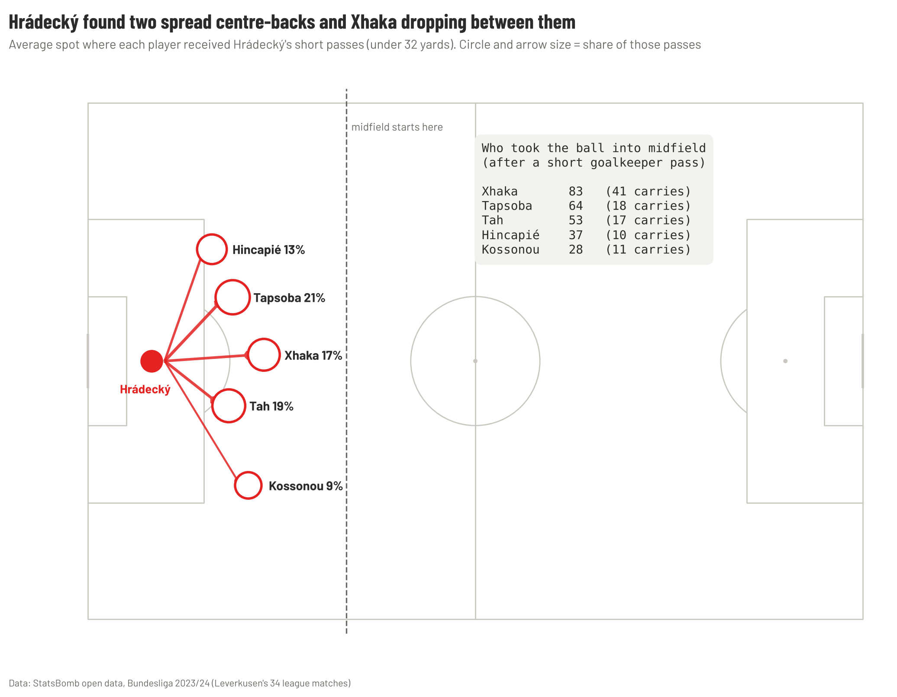](reports/figures/02_where_the_keeper_passes_go.png) |
| **1 ·** Leverkusen vs their opponents | **2 ·** Who receives the keeper's short passes |

[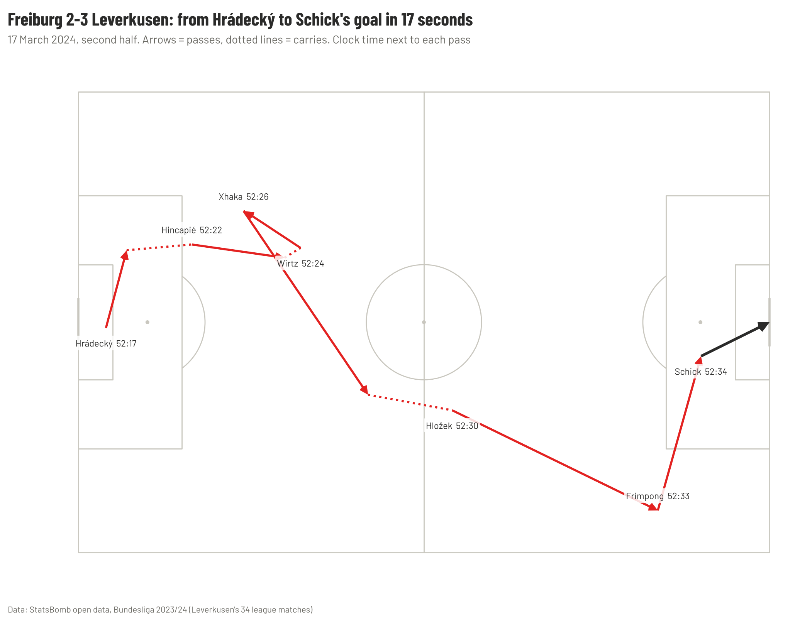](reports/figures/03_freiburg_goal_sequence.png)

**3 ·** Freiburg 2-3 Leverkusen, 17 March 2024: from Hrádecký to Schick's goal in 17 seconds.

### Xabi Alonso's style ([read the article](docs/ARTICLE.md))

| | |
| --- | --- |
| [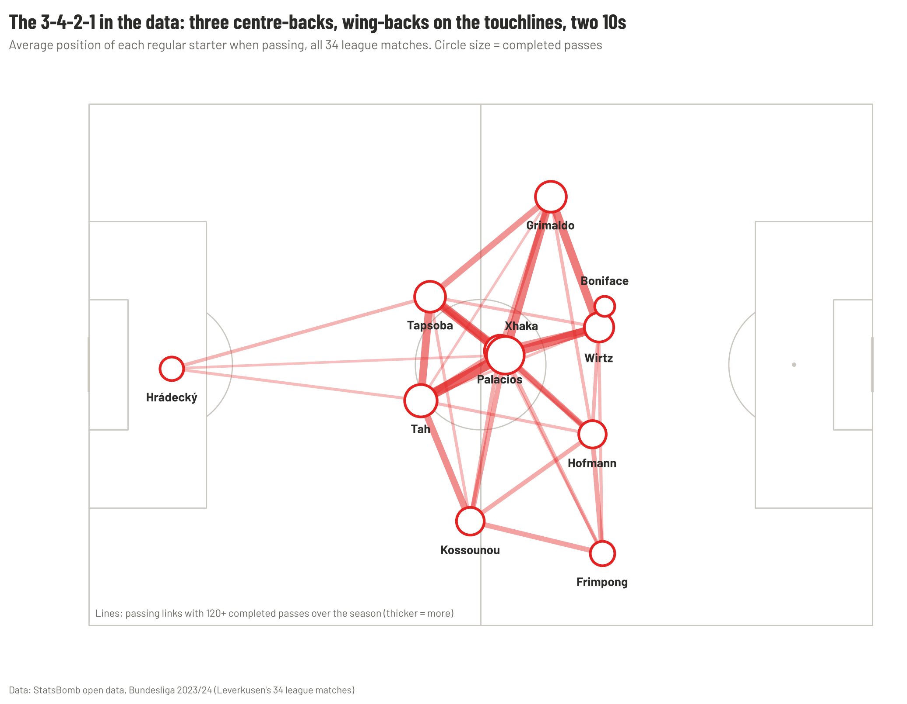](reports/figures/04_shape_pass_network.png) | [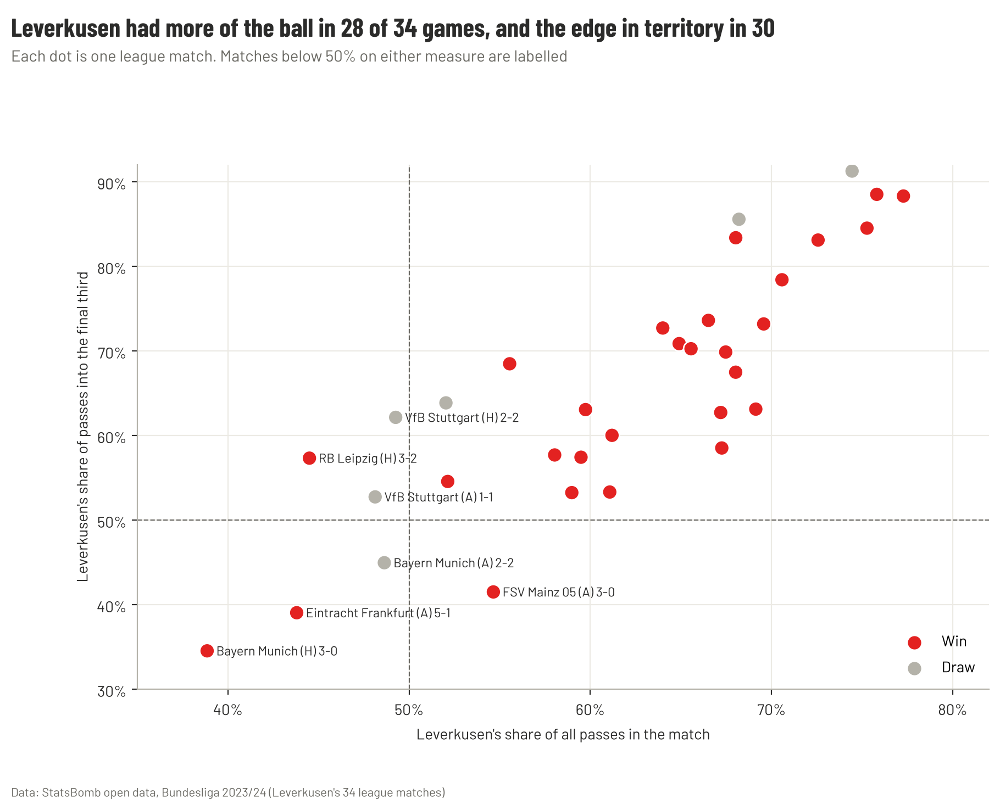](reports/figures/05_control_by_match.png) |
| **4 ·** The 3-4-2-1 in the data | **5 ·** More of the ball in 28 of 34 games |
| [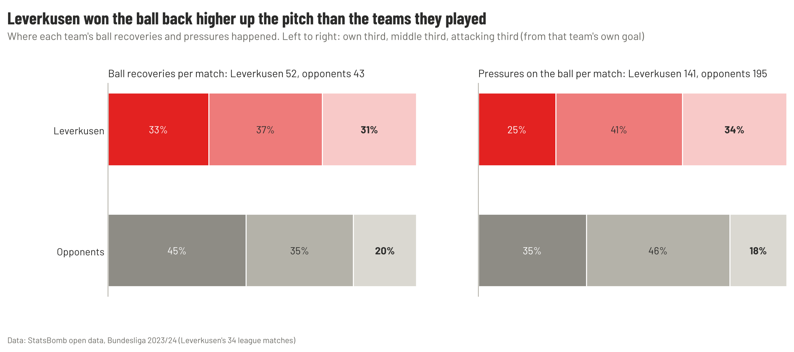](reports/figures/06_where_they_win_the_ball.png) | [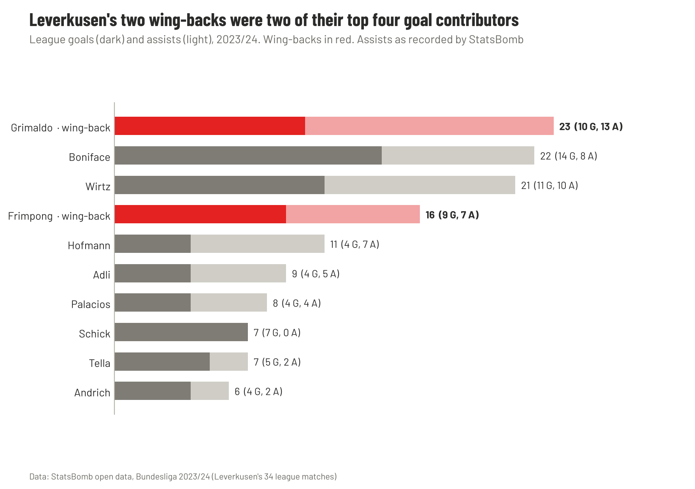](reports/figures/07_wingback_goal_contributions.png) |
| **6 ·** Winning the ball back high | **7 ·** Wing-backs among the top four goal contributors |
| [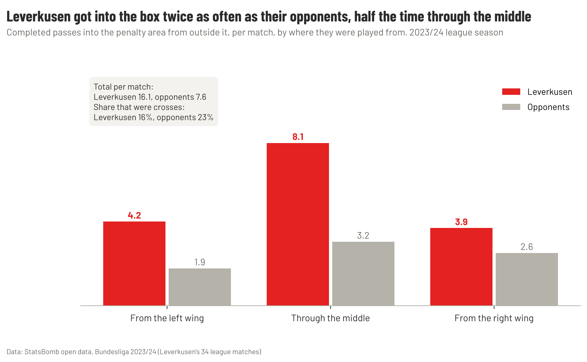](reports/figures/08_passes_into_the_box.png) | [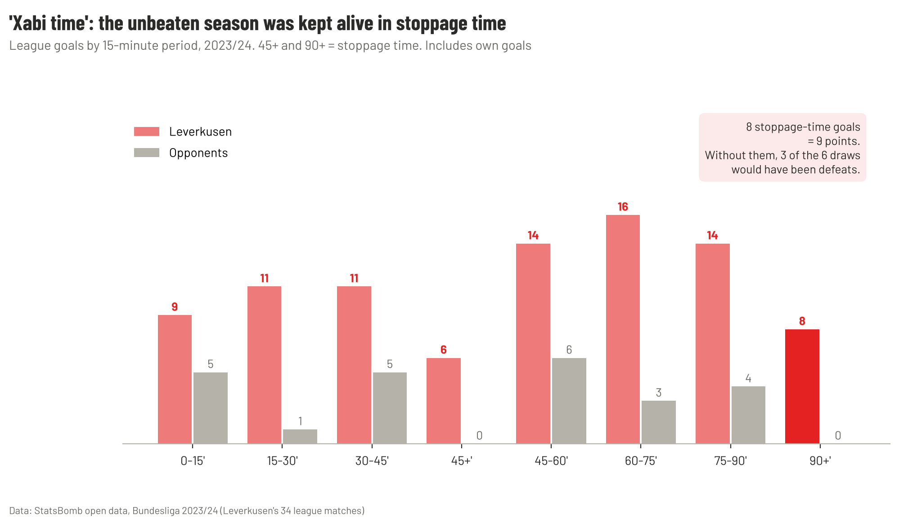](reports/figures/09_goals_by_minute.png) |
| **8 ·** Half of all box entries through the middle | **9 ·** "Xabi time": 8 stoppage-time goals, 9 points |

### The verdict

| | |
| --- | --- |
| [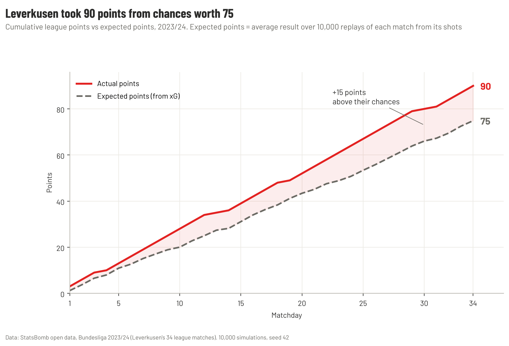](reports/figures/10_points_vs_expected_points.png) | [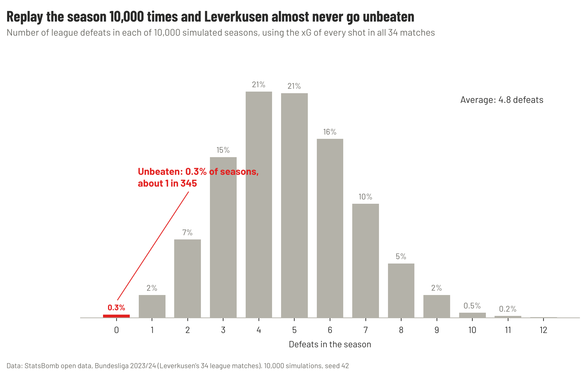](reports/figures/12_simulated_defeats.png) |
| **10 ·** 90 points from chances worth 75 | **12 ·** Unbeaten in 0.3% of 10,000 simulated seasons |

[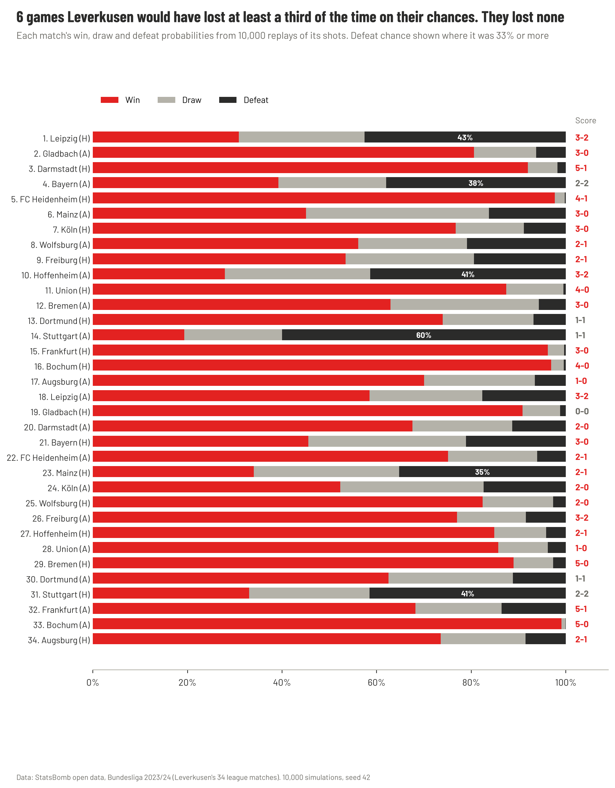](reports/figures/11_match_probabilities.png)

**11 ·** Every match's win, draw and defeat probabilities.

## Method

- **Data:** [StatsBomb open data](https://github.com/statsbomb/open-data), Bundesliga 2023/24 (competition 9, season 281): Leverkusen's 34 league matches, 137,765 events.
- **Goalkeeper possession:** a possession in which the team's goalkeeper makes a pass, counted from his first pass.
- **Keepers:** Hrádecký started 749 of Leverkusen's 765 goalkeeper possessions; Kovář the other 16. The report calls them all Hrádecký's.
- **Short:** that pass is under 32 yards.
- **Reached midfield / final third:** a completed pass or carry ending at least 40 / 80 yards from the team's own goal line, **before the opponent touched the ball**.
- **Opponents:** the same measures for the other team in the same matches. StatsBomb's open data only covers Leverkusen's games, so this isn't a league average.
- **Limits:** event data has no player positions off the ball, so the "why" (Xhaka creating a spare passer) is inferred from where passes were received, not measured directly.

## How to run

From the repo root, after the [setup](../../README.md#setup):

```bash
python -m football_analytics.data 9 281          # download the data (~20 s)
cd Managers/Xabi-Alonso-23-24
python notebooks/build_01_build_up.py && python notebooks/build_02_alonso_style.py && python notebooks/build_03_deserved.py
jupyter nbconvert --to notebook --execute --inplace notebooks/01_build_up.ipynb notebooks/02_alonso_style.ipynb notebooks/03_deserved.ipynb
```

The notebook writes the charts to `reports/figures/` and the one-page report to `reports/`.

## Folder structure

```
Xabi-Alonso-23-24/
├── README.md                              ← you are here
├── docs/
│   └── ARTICLE.md                         ← the report: 7 ideas + the verdict, 12 charts
├── notebooks/
│   ├── build_01_build_up.py               ← builds notebook 01
│   ├── 01_build_up.ipynb                  ← build-up analysis, charts 1–3, the one-page report
│   ├── build_02_alonso_style.py           ← builds notebook 02
│   ├── 02_alonso_style.ipynb              ← Alonso's style, charts 4–9
│   ├── build_03_deserved.py               ← builds notebook 03
│   └── 03_deserved.ipynb                  ← expected-points simulation, charts 10–12
└── reports/
    ├── Leverkusen_build_up_one_page.pdf   ← the report
    ├── Leverkusen_build_up_one_page.png
    ├── Leverkusen_2023-24_Alonso_article.pdf ← the article as a PDF
    ├── make_article_pdf.py                ← builds that PDF
    └── figures/                           ← 12 charts
```
