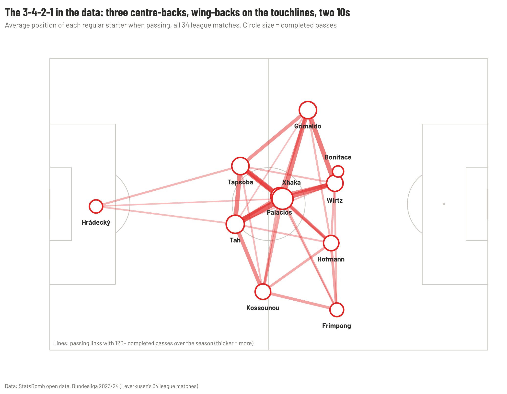
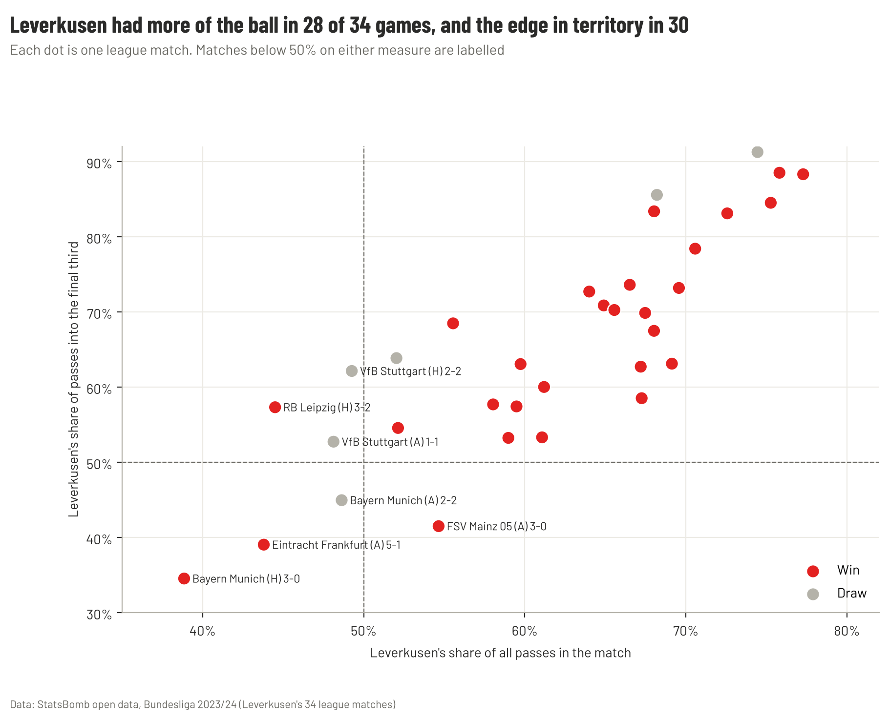
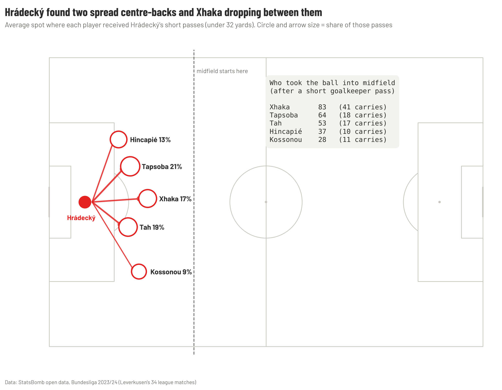
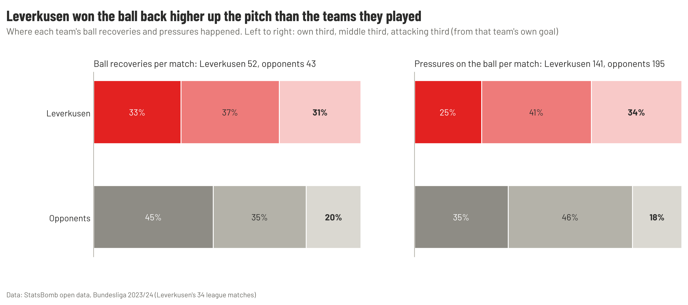
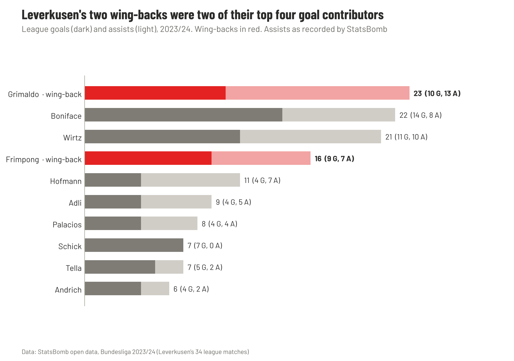
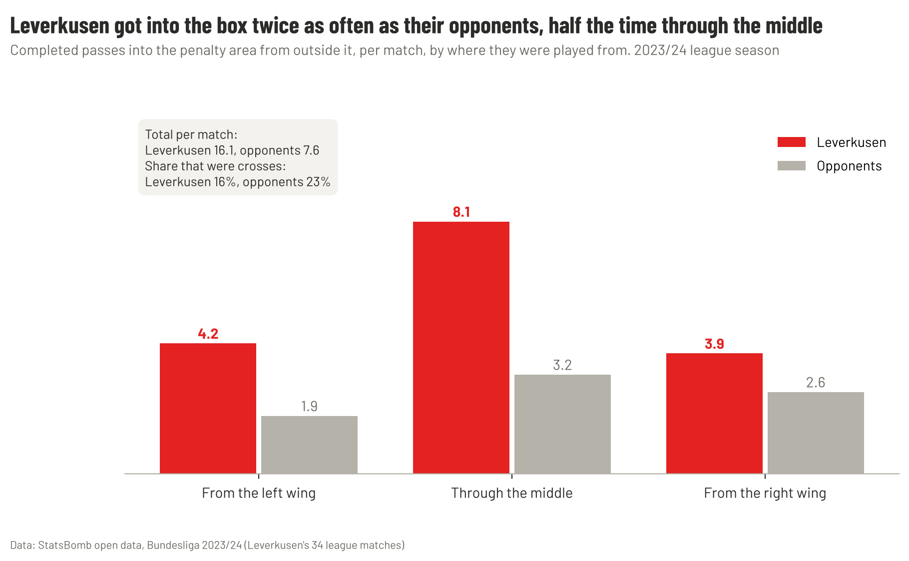
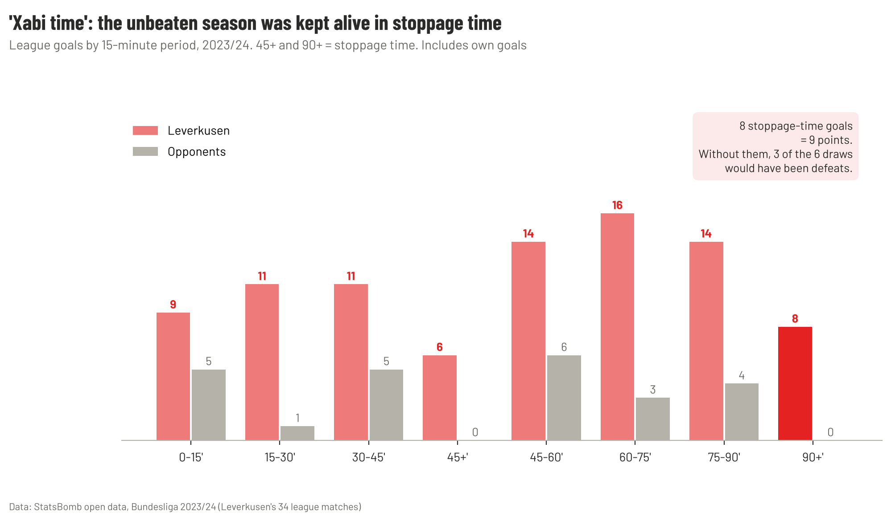
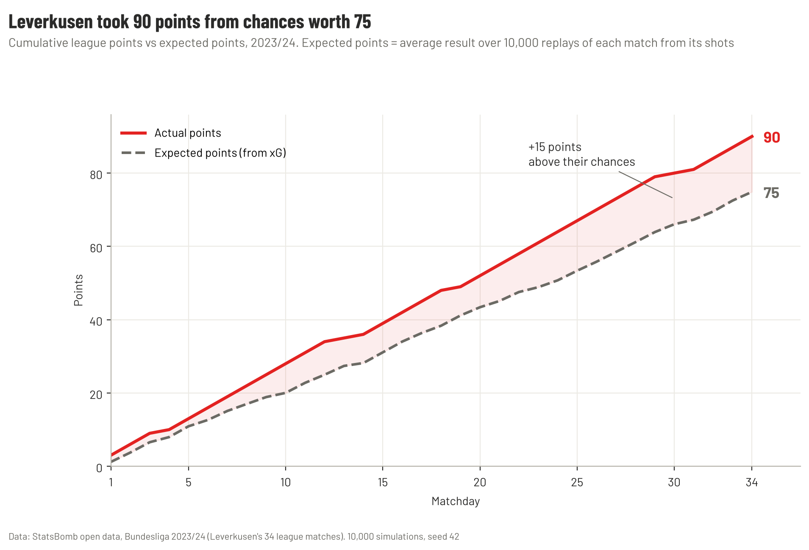
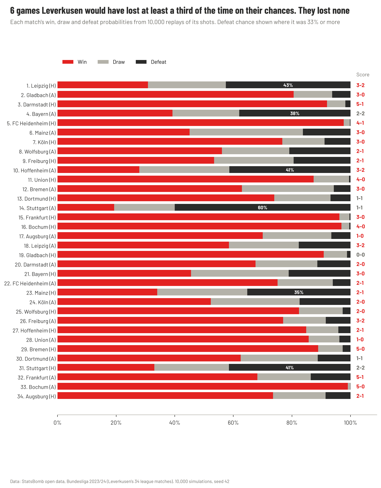
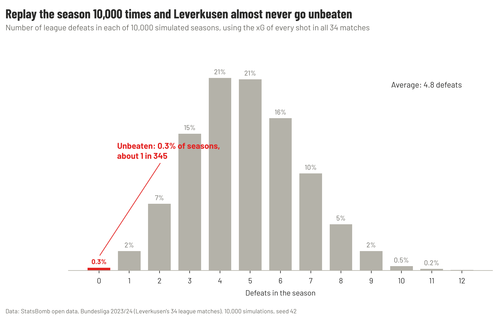

# Xabi Alonso 23-24: how Leverkusen went unbeaten

**Seven of Xabi Alonso's ideas, tested in the data, and one honest question: did they deserve it? Twelve charts.**

*By Hammad · Data: StatsBomb open data, all 34 of Leverkusen's 2023/24 Bundesliga matches · Each idea is described from published analysis, then tested against the data*

---

## The season in numbers

| | |
| --- | --- |
| **Record** | 28 wins, 6 draws, 0 defeats: the first unbeaten season in Bundesliga history |
| **Points** | 90 |
| **Goals** | 89 scored, 24 conceded |
| **Share of all passes** | 62% on average; more than half in 28 of 34 games |
| **Pass completion** | 88% (opponents 80%) |
| **Goals in stoppage time** | 8, worth 9 points |
| **Expected points** | 75 (what their chances were worth) |
| **Chance of going unbeaten on those chances** | 0.3%, about 1 season in 345 |

> **The short version.** Alonso's Leverkusen controlled games with the ball, built patiently from the goalkeeper, attacked through the middle with two wing-backs pushed high, and won the ball back in the opponent's half. That made them the best team in almost every game they played. Going **unbeaten** took something extra: finishing 16 goals above their chances, and three draws rescued in stoppage time. Replay their season from its chances 10,000 times, and they go unbeaten in only 29.

## The question

Bayer Leverkusen had never won the Bundesliga. In 2023/24 they won it without losing a game, the first team ever to do so. **How?**

This report answers in two parts:
- **Ideas 1–7:** what Xabi Alonso built. Each idea is described from published analysis, then tested against the data.
- **The verdict:** whether the results matched the performances, using an expected-points simulation of every match.

---

## The coach

Xabi Alonso played under some of the most influential coaches of his era: Rafael Benítez at Liverpool, José Mourinho and Carlo Ancelotti at Real Madrid, and Pep Guardiola at Bayern Munich. He has said he joined Bayern in 2014 partly to watch Guardiola's methods up close, and that Ancelotti's man-management had the biggest impact on him as a coach. His own summary: "You learn from that but you need to build your own personality."

Analysts describe his style as a mix of the two schools he played in: **Guardiola's possession play** and **Mourinho's defensive organisation and counter-attacking**. He is seen as a pragmatist who adapts the system rather than following one ideology.

His coaching path was short and fast:

| Years | Job |
| --- | --- |
| 2018–2019 | Real Madrid youth teams |
| 2019–2022 | Real Sociedad B (Segunda División B) |
| October 2022 | Bayer Leverkusen, his first senior job, replacing Gerardo Seoane |
| 2023/24 | Unbeaten Bundesliga champions; German Cup winners |

---

## Idea 1 · The shape: 3-4-2-1

In his first season Alonso mostly used a 3-4-3. In 2023/24 he settled on a **3-4-2-1**: three centre-backs, two wing-backs, a double pivot of Xhaka and Palacios, Wirtz and Hofmann as two number 10s behind Boniface. Without the ball, it became a back five.

*Figure 4 · Average position of each regular starter when passing, all 34 matches. Lines join players who completed 120+ passes to each other.*

**What the data shows.** The shape is clear even averaged over a season. Tapsoba, Tah and Kossounou form the back three around the halfway line. Xhaka and Palacios sit together in the centre, and **Xhaka completed more passes than anyone (3,045)**. The wing-backs are the highest players on each side: Grimaldo on the left and Frimpong on the right are level with or ahead of the two 10s. The thickest lines run from the centre-backs into Xhaka and from Xhaka out to Grimaldo: the ball goes through the middle and then wide.

---

## Idea 2 · Control the ball, control the game

Alonso's teams dominate the ball in compact triangles. Published early-season figures put Leverkusen at 58% possession and a league-high 90% pass completion.

*Figure 5 · Each dot is one match: Leverkusen's share of all passes (across) and of passes into the final third (up).*

**What the data shows.** Leverkusen made **713 passes per match to their opponents' 440**, completed **88%** of them (opponents 80%), and had more of the ball in **28 of 34 games**. They had more of the passes into the final third in **30**.

The exceptions are the interesting part. Their **biggest win of the season, 3-0 at home to Bayern, came with only 39% of the passes**, their lowest share all season. Against the strongest teams, Alonso was happy to give up the ball and counter. This is the Mourinho half of the mix.

---

## Idea 3 · Build from the goalkeeper

This is the question answered in the [one-page report](../reports/Leverkusen_build_up_one_page.pdf).

*Figure 2 · Where each player received the goalkeeper's short passes, and who took the ball into midfield.*

**What the data shows.** Hrádecký went short 65% of the time (opponents 47%). Tapsoba and Tah split wide and Xhaka dropped between them. 72% of Leverkusen's goalkeeper possessions reached midfield before the opponent touched the ball (opponents 52%), and **85% did when the keeper went short**, against 47% when he went long. See figures 1–3.

---

## Idea 4 · Win the ball back high, but patiently

Alonso's Leverkusen were not a gegenpressing team. Coaches' Voice notes that in his first season they allowed more passes per defensive action than most of the league. The midfield delayed the ball so the wing-backs could recover, and the press steered opponents towards the touchline rather than charging at them.

*Figure 6 · Where each team's ball recoveries and pressures happened, by third.*

**What the data shows.** Leverkusen applied fewer pressures per match than their opponents (141 to 195), but that is mostly because the opponents had far less of the ball to press. **Where** they pressed is the point: **34% of their pressures and 31% of their ball recoveries came in the attacking third**, against 18% and 20% for their opponents. They didn't press more; they pressed higher, and they won the ball back more often (52 recoveries per match to 43).

---

## Idea 5 · Wing-backs as attackers

In a 3-4-2-1 the wing-backs provide all the width, so the 10s can play inside. Alonso picked two attacking full-backs for the job: Álex Grimaldo on the left and Jeremie Frimpong on the right.

*Figure 7 · League goals and assists, 2023/24 (as recorded by StatsBomb).*

**What the data shows.** **Grimaldo had more goal contributions than anyone in the squad: 10 goals and 13 assists**, more than the striker Boniface (22) and Wirtz (21). Frimpong was fourth with 16 (9 goals, 7 assists). Two of Leverkusen's top four attackers were, on the team sheet, defenders.

---

## Idea 6 · Through the middle, not round the outside

Alonso's teams prefer to progress centrally. In his first season Leverkusen had the second-lowest number of crosses in the Bundesliga.

*Figure 8 · Completed passes into the penalty area from outside it, per match, by where they were played from.*

**What the data shows.** Leverkusen completed **16.1 passes into the box per match, more than twice their opponents' 7.6**, and **half of them came through the middle** (8.1 per match). Only **16%** were crosses, against 23% for their opponents. Because they had so much more of the ball, they still crossed more often in total (12.9 crosses per match to 7.3), but crossing was the back-up plan, not the main one.

---

## Idea 7 · Never lose: "Xabi time"

Leverkusen's habit of scoring in the last minutes became a catchphrase in Germany. Across all competitions they scored 15 goals after the 90th minute that season.

*Figure 9 · League goals by 15-minute period. 45+ and 90+ = stoppage time.*

**What the data shows.** In the league alone they scored **8 stoppage-time goals and conceded none**. Those goals were worth **9 points**:

| Match | Score | Late goal changed |
| --- | --- | --- |
| Leverkusen vs Stuttgart | 2-2 | Defeat → draw |
| Bayern vs Leverkusen | 2-2 | Defeat → draw |
| Dortmund vs Leverkusen | 1-1 | Defeat → draw |
| Leverkusen vs Hoffenheim | 2-1 | Draw → win |
| Leipzig vs Leverkusen | 2-3 | Draw → win |
| Augsburg vs Leverkusen | 0-1 | Draw → win |

**Without stoppage time, the invincible season would have had three defeats.** Their second-half record was even stronger than their first: 52 of their 89 goals came after half-time, against 13 conceded.

---

## The verdict · Did they deserve to go unbeaten?

Ideas 1–7 show a team that controlled almost every game. But did the performances add up to *34 games without a defeat*? To find out, I replayed every match 10,000 times. Each shot becomes a goal with a probability equal to its xG, so each replay gives a new score built from the same chances.

*Figure 10 · Actual points vs expected points through the season.*

**They were the best team, clearly.** Leverkusen created **72.7 xG and conceded 27.8**, and had the better chances in **29 of their 34 games**. Their chances were worth **75 points**, 2.2 per game, the output of a very strong side.

**But they took 90.** The gap opened early and kept growing. It came from both boxes: they scored **89 goals from 72.7 xG** (16 above their chances) and conceded **24 from 27.8 xG** against (4 fewer than expected). Add the 8 stoppage-time goals from Idea 7, and that is where the extra 15 points came from.

*Figure 11 · Each match's win, draw and defeat probabilities from 10,000 replays.*

Figure 11 shows how close the run came to ending. In **six games** Leverkusen would have lost at least a third of the time on their chances, and they lost none of them:

| Match | Score | Chance of defeat on the chances |
| --- | --- | --- |
| Stuttgart (A), matchday 14 | 1-1 | **60%** |
| Leipzig (H), matchday 1 | 3-2 | 43% |
| Hoffenheim (A), matchday 10 | 3-2 | 41% |
| Stuttgart (H), matchday 31 | 2-2 | 41% |
| Bayern (A), matchday 4 | 2-2 | 38% |
| Mainz (H), matchday 23 | 2-1 | 35% |

*Figure 12 · Defeats in each of 10,000 simulated seasons.*

Across 10,000 simulated seasons, Leverkusen lost **4.8 games on average**. They went unbeaten in **0.3%** of them, about **one season in 345**, and reached 90 points in fewer than 1%.

> **Verdict.** Leverkusen deserved the title: on their chances they were a 75-point team, and no simulation needed luck to make them very good. Going *unbeaten* was different. That needed elite finishing, a goalkeeper and defence that beat their expected goals, and the habit of scoring last. Some of that is skill, some of it is luck, and the data can't fully separate the two.

**Two reasons the simulation may be too harsh.** First, teams that are winning often sit back and take fewer shots, so xG tends to undersell dominant sides. Second, the replays treat each shot as independent, so they can't model a team that keeps attacking until it scores, which is exactly what "Xabi time" describes.

**What happened next.** In 2024/25 Leverkusen finished **second with 69 points**, and Alonso left at the end of the season. In my [Chelsea 2016/17 project](../../../Premier-League/Chelsea-2016-17-Conte/), Conte's champions also took about 17 points more than their chances were worth, and finished 5th the next year. Seasons this far above expectation are rarely repeated.

---

## What clubs can learn

1. **One clear shape, with roles everyone understands.** Alonso stuck with the 3-4-2-1, and a whole season of averages in Figure 4 still looks like the team sheet.
2. **Build the attack around a deep passer.** Xhaka made the most passes and was the link from defence to attack, both from the goalkeeper and in open play.
3. **Use full-backs who can attack.** Grimaldo and Frimpong scored or assisted 39 goals between them.
4. **Possession is a tool, not a rule.** The best result of the season came with 39% of the ball.
5. **Fitness and belief at the end.** Nine points came after the 90th minute. That is depth, conditioning and mentality as much as tactics.
6. **Judge the performances, not just the results.** Leverkusen were a 75-point team that took 90. Planning the next season around the 90 would mean planning on the finishing and the late goals happening again.

---

## Appendix

### Data and method

| Source | What it gives | Used for |
| --- | --- | --- |
| [StatsBomb open data](https://github.com/statsbomb/open-data), Bundesliga 2023/24 | Every event in Leverkusen's 34 league matches (137,765 events) | Every number and chart in this article |

- **Opponents** means the other team in Leverkusen's matches. The open data only covers Leverkusen's games, so it is not a league average.
- **Average positions** (Figure 4) are where each player made his passes, over the whole season. They show the shape on the ball, not without it.
- **Thirds** are measured from each team's own goal line (0–40, 40–80, 80–120 yards).
- **Passes into the box** are completed passes ending in the penalty area that started outside it; "left wing" and "right wing" are the 18 yards nearest each touchline.
- **Goals** include own goals scored by opponents (3). Assists are as recorded by StatsBomb.
- **Expected points:** each match replayed 10,000 times (seed 42). Every shot is a goal with probability equal to its StatsBomb xG, penalties included; own goals aren't shots, so they aren't simulated. The same replays, added up across all 34 matches, give 10,000 simulated seasons.

### Limitations

- Event data records what happens on the ball. It can't show off-ball movement, so the press and the shape without the ball are inferred from where actions happened.
- Fewer pressures per match partly reflects how little of the ball opponents had; the useful comparison is where pressures happened, not how many.
- The descriptions of Alonso's ideas come from published analysis, not from the coach himself, except where quoted.

- The simulation ignores game state (teams that lead often stop attacking) and treats every shot as independent, so it tends to undersell dominant teams. Read the 0.3% as "very unlikely", not as a precise figure.

### Sources

- [Xabi Alonso at Bayer Leverkusen](https://learning.coachesvoice.com/cv/xabi-alonso-bayer-leverkusen-liverpool/), Coaches' Voice
- [Xabi Alonso: manager profile, style of play, formations, philosophy](https://www.goal.com/en-gb/news/xabi-alonso-manager-profile-style-of-play-formations-philosophy/bltfe8a9e2f46675370), Goal
- [Years of learning from the best to help Alonso at Real Madrid](https://www.thescore.com/news/3291075), theScore (AFP)
- [Xabi Alonso's Bayer Leverkusen tactics](https://www.bundesliga.com/en/bundesliga/news/xabi-alonso-bayer-leverkusen-tactics-25350), bundesliga.com
- [Leverkusen midfield analysis: Xhaka, Andrich, Palacios](https://www.bundesliga.com/en/bundesliga/news/bayer-leverkusen-midfield-tactical-analysis-xhaka-andrich-palacios-26871), bundesliga.com
- [The statistics behind Leverkusen's historic unbeaten Bundesliga title win](https://www.aljazeera.com/sports/2024/5/19/the-statistics-behind-leverkusens-historic-unbeaten-bundesliga-title-win), Al Jazeera
- [2024/25 season review, part II](https://www.bayer04.de/en-us/news/bayer04/202425-season-review-part-ii-from-title-dreams-to-goodbye-tears), Bayer 04 Leverkusen
