# Christian Eriksen: the most productive midfielder nobody talks about?

Christian Eriksen's six and a half seasons at Tottenham, measured against every Premier League midfielder of his time: output, expected goals and assists, shooting, risk, how much he was on the ball, what the people around him said, and the same model of who the PFA Team of the Year voters reward that I used for David Silva.

> Part of [**football-analytics**](../../README.md) › [**Players**](../README.md) · Author: **Hammad** · Python · pandas · scikit-learn · matplotlib · Jupyter

**📖 [Read the report](docs/ARTICLE.md)** ([PDF](reports/Christian_Eriksen_article.pdf)) · a follow-up to [David Silva: The Most Under-Rated Great?](../David-Silva-Man-City/)

**⚖️ [Compare him yourself in Midfield Matchup](https://syedhammad07.github.io/football-analytics/Projects/Midfield-Matchup/)**, or find who plays like him in [Player Style Finder](https://syedhammad07.github.io/football-analytics/Projects/Player-Style-Finder/).

[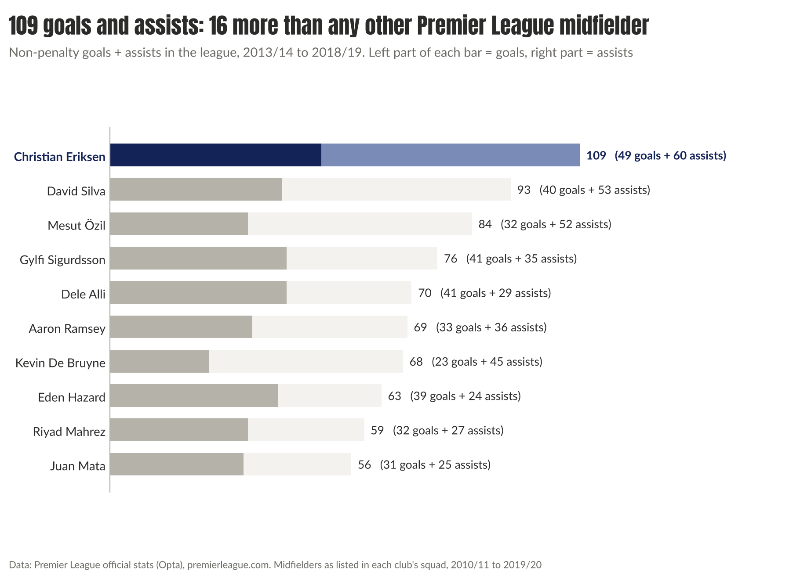](docs/ARTICLE.md)

## Key findings

- **The most productive midfielder of his time:** from 2013/14 to 2018/19, the most non-penalty goals plus assists of any Premier League midfielder (109; Silva 93, Özil 84), plus the most assists (60), chances created (487), set-piece goals (7) and shots (369).
- **The ever-present, always on the ball:** the most games (206), starts (196) and minutes (17,132) of any midfielder, 2nd for touches (15,100) and 4th for completed passes in the opposition half (6,737).
- **Every season, near the top:** top 10 for chances created per 90 in all six seasons, and top 10 for non-penalty goals per 90 in five.
- **Better than expected:** 60 assists from 43.0 expected assists (+17, the most of any midfielder) and 49 goals from 40.1 expected goals, beating his xG in five of six seasons.
- **The other Silva:** per 90 he and David Silva were almost identical (0.26 v 0.25 non-penalty goals, 2.56 v 2.59 chances created). The difference was style: Eriksen shot more and from further out (0.11 xG per shot v 0.19) and risked the ball more (20.6 losses per 90, 5th most of 105, v 16.0).
- **What they said:** Pochettino compared him with De Bruyne and Silva; Thomas Frank, Ten Hag, Kane, Redknapp, Pat Nevin, Scholes and Schweinsteiger praised his brain and calm; Carragher gave the case against (all sourced in the report).
- **The model:** chances created, his best number, carries almost no weight with the voters. He was picked once in six seasons, about what the model expects (1.0). 2016/17, when it rated him the 4th most likely midfielder, was the closest miss.

## Charts

| | |
| --- | --- |
| [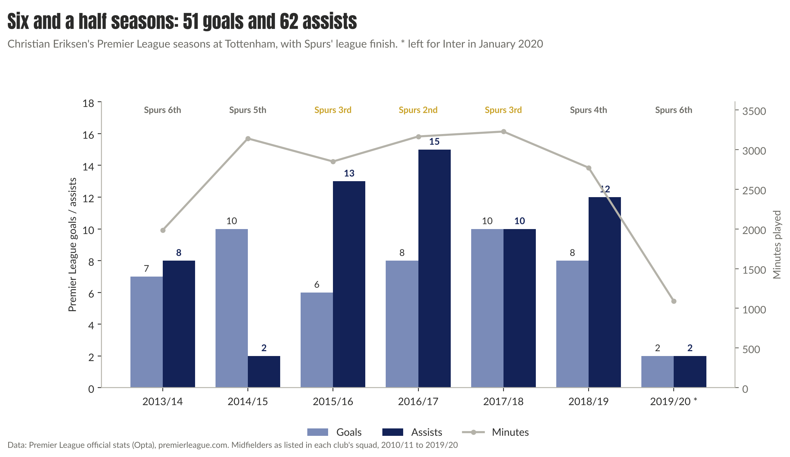](reports/figures/01_career_by_season.png) | [](reports/figures/02_goals_and_assists.png) |
| **1 ·** Six and a half seasons at Spurs | **2 ·** Goals + assists leaders, 2013/14 to 2018/19 |
| [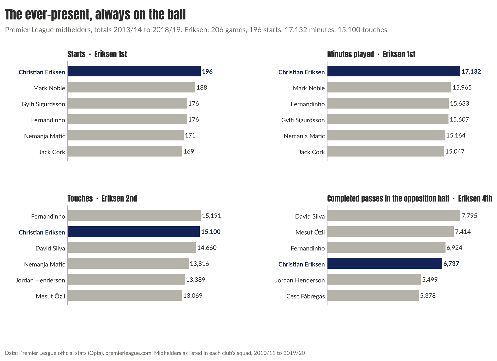](reports/figures/03_ever_present.png) | [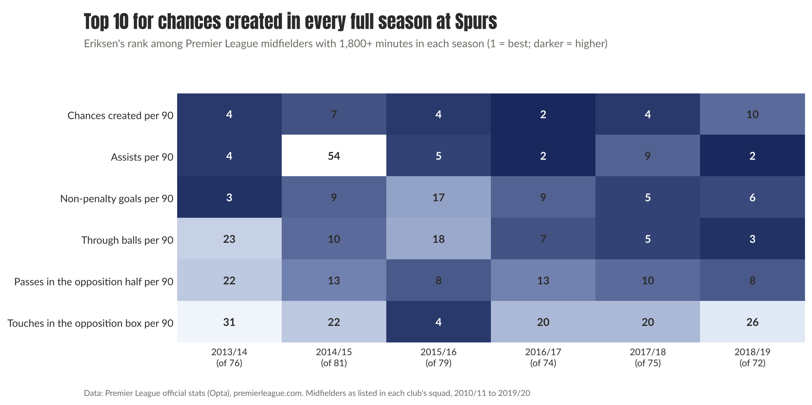](reports/figures/04_rank_every_season.png) |
| **3 ·** The ever-present, always on the ball | **4 ·** His rank in every season |
| [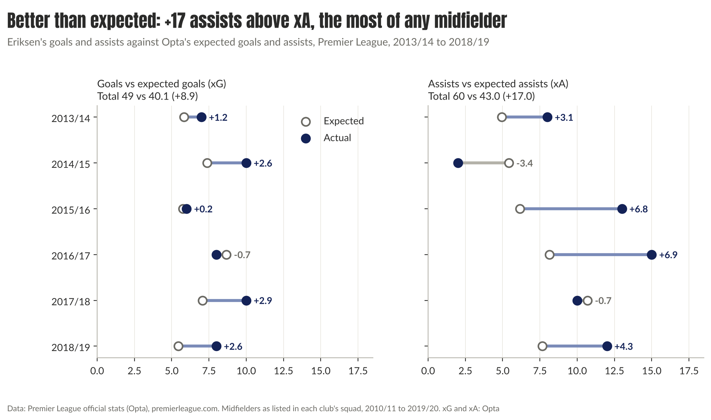](reports/figures/05_beating_expected.png) | [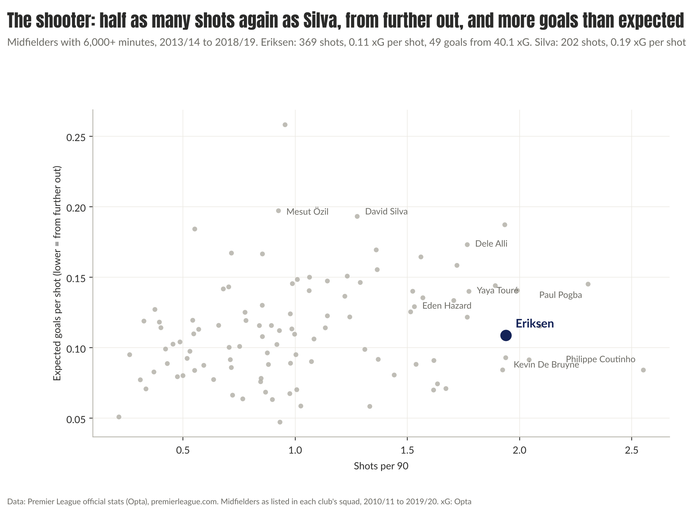](reports/figures/06_shooting.png) |
| **5 ·** Goals and assists against xG and xA | **6 ·** The shooter |
| [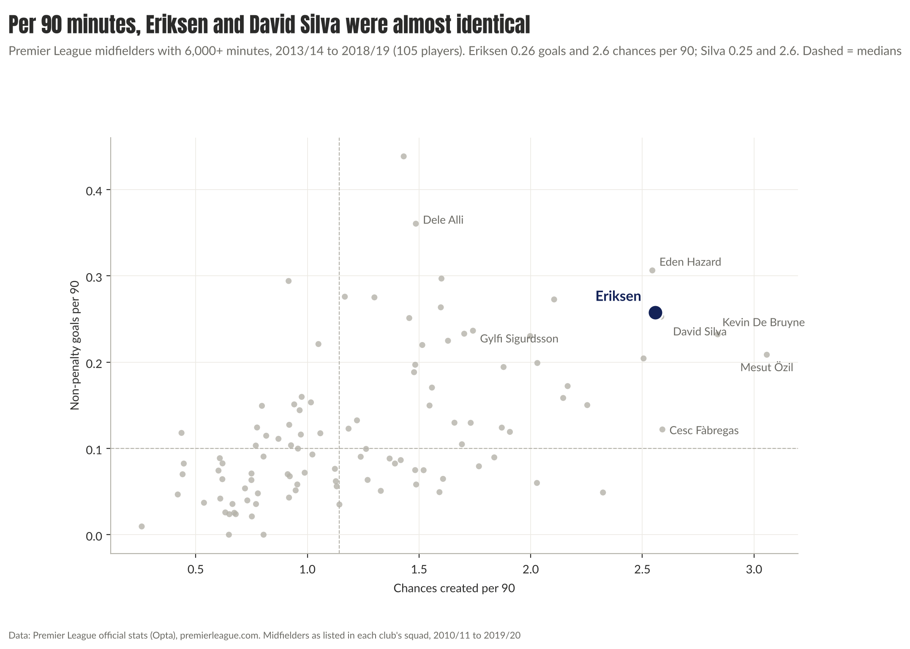](reports/figures/07_eriksen_and_silva.png) | [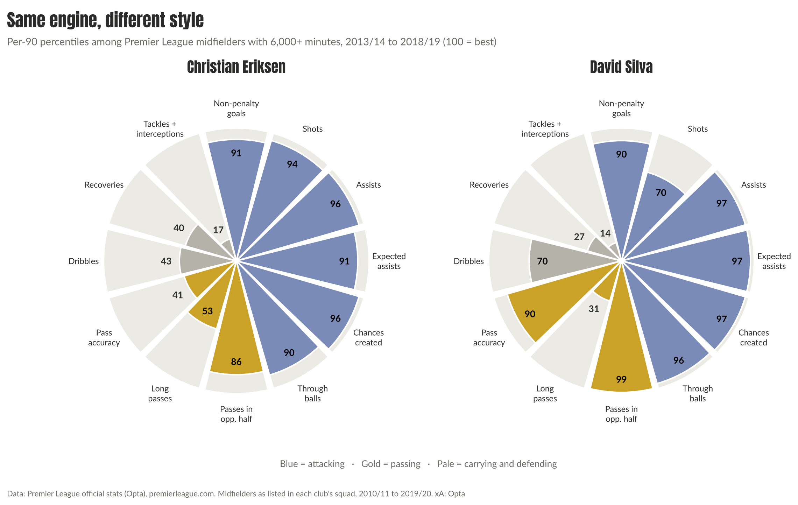](reports/figures/08_pizzas.png) |
| **7 ·** Per 90, almost identical to Silva | **8 ·** Same engine, different style |
| [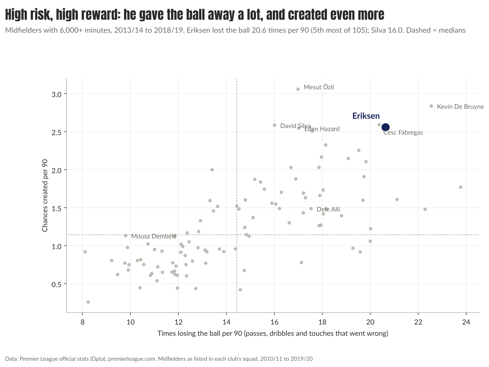](reports/figures/09_risk_and_reward.png) | [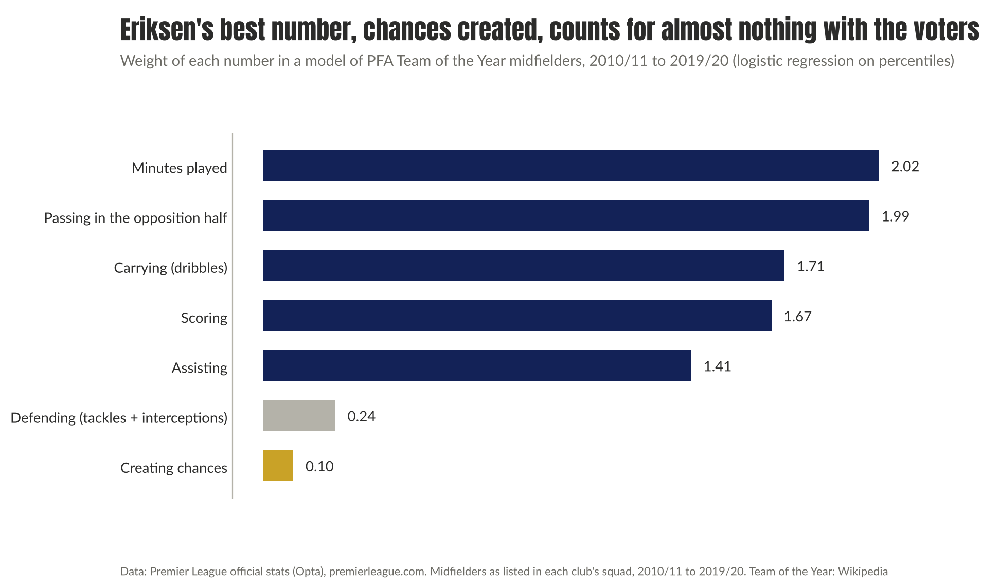](reports/figures/10_what_voters_reward.png) |
| **9 ·** High risk, high reward | **10 ·** What the Team of the Year rewards |
| [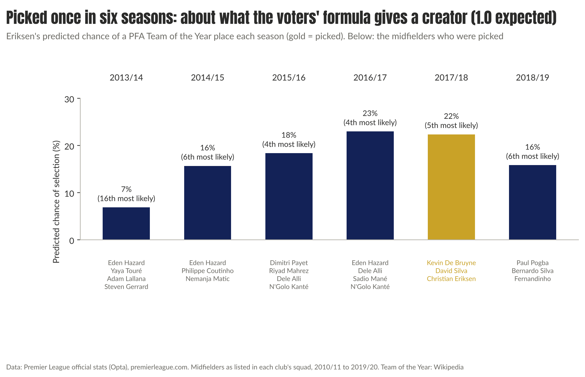](reports/figures/11_selection_by_season.png) | |
| **11 ·** His chance of selection, season by season | |

## Method

- **Opta data:** season stats for every player listed as a midfielder in a Premier League squad, 2010/11 to 2019/20, from the public stats API behind premierleague.com (the same files as the David Silva report), including Opta's expected goals and assists. In [`data/external/`](data/external/).
- **The window:** Eriksen's six full Spurs seasons, 2013/14 to 2018/19. Six-season comparisons use midfielders with 6,000+ minutes (105 players); season ranks use midfielders with 1,800+ minutes.
- **The model:** logistic regression on six per-90 percentiles plus minutes; each season predicted by a model trained on the other nine (held-out AUC 0.87). Team of the Year midfielders from Wikipedia.
- **Quotes:** every quote is linked to its source at the end of the report.
- **Limits:** only players listed as midfielders are compared; the data can't see where shots came from, deliveries or big-game moments; 36 selections is a small sample.

## How to run

From this folder (Python with pandas, scikit-learn, matplotlib, nbformat, nbconvert and reportlab):

```bash
python notebooks/build_01_creator.py && python notebooks/build_02_style.py && python notebooks/build_03_recognition.py
jupyter nbconvert --to notebook --execute --inplace notebooks/01_creator.ipynb notebooks/02_style.ipynb notebooks/03_recognition.ipynb
# the navy charts for the PDF
for n in 01_creator 02_style 03_recognition; do REPORT_THEME=dark jupyter nbconvert --to notebook --execute notebooks/$n.ipynb --output /tmp/$n.ipynb; done
python reports/make_article_pdf.py
```

All the data is already in `data/external/`, so nothing needs downloading.

## Folder structure

```
Christian-Eriksen-Spurs/
├── README.md                               ← you are here
├── docs/ARTICLE.md                         ← the report
├── notebooks/
│   ├── setup_cell.py                       ← shared first cell: colours, fonts, data loading
│   ├── build_01_creator.py → 01_creator.ipynb          ← charts 1–4 and 7
│   ├── build_02_style.py → 02_style.ipynb              ← charts 5, 6, 8 and 9 (xG, shooting, pizzas, risk)
│   └── build_03_recognition.py → 03_recognition.ipynb  ← charts 10–11 (the Team of the Year model)
├── data/external/                          ← Opta season stats and Team of the Year midfielders
├── assets/fonts/                           ← Anton and Lato (SIL Open Font License)
└── reports/
    ├── figures/                            ← white charts (this README)
    ├── figures_dark/                       ← navy charts (the PDF)
    ├── make_article_pdf.py
    └── Christian_Eriksen_article.pdf
```
