# Christian Eriksen: the most productive midfielder nobody talks about?

**Six and a half seasons at Tottenham, measured against every Premier League midfielder of his time: output, expected goals and assists, shooting, risk, what the people around him said, and who gets recognised. Eleven charts, and my own take at the end.**

*By Hammad · Data: Premier League official stats (Opta) for every Premier League midfielder, 2010/11 to 2019/20. The main comparison is Eriksen's six full Spurs seasons, 2013/14 to 2018/19*

<!-- cover-kpi: 109 | Goals + assists | most of any PL midfielder, 2013/14 to 2018/19 -->
<!-- cover-kpi: 487 | Chances created | most of any midfielder -->
<!-- cover-kpi: +17 | Assists above xA | most of any midfielder -->
<!-- cover-kpi: 0 | Trophies at Spurs | one PFA Team of the Year -->

---

## The career in numbers

| | |
| --- | --- |
| **At Spurs** | August 2013 to January 2020, six and a half Premier League seasons |
| **League games / goals / assists** | 226 / 51 / 62 |
| **Trophies at Spurs** | None. Runner-up: 2015 League Cup, 2016/17 league, 2019 Champions League |
| **Best season** | 2016/17: 8 goals and 15 assists as Spurs finished second with 86 points |
| **PFA Team of the Year** | 2017/18, once |
| **Premier League career** | 300 games and 54 goals for Spurs, Brentford and Manchester United |

> **The short version.** From 2013/14 to 2018/19, no Premier League midfielder produced more than Christian Eriksen: the most non-penalty goals plus assists (109, sixteen more than David Silva), the most assists, chances created, set-piece goals and minutes. He beat his expected assists by 17, the most of any midfielder, and his expected goals by 9. Per 90 minutes his output was almost identical to Silva's; the difference was style. He shot more, from further out, and took more risks with the ball. The voters picked him once, about what their formula gives a creator. He won nothing at Spurs, and how he's remembered now has more to do with that, and with one terrible night in 2021, than with how good he was.

## The question

When people talk about that Spurs side, it's Kane, Son, Dele and Pochettino; Eriksen is the name that comes after. My view going in: **Eriksen is one of the most under-rated players of the Premier League era.** **Chapters 1–3** measure his output against every midfielder of his time; **Chapter 4** looks beyond goals and assists, at expected goals and shooting; **Chapter 5** compares him with David Silva; **Chapter 6** is what people said; **Chapters 7–8** ask whether he was recognised then, and why he's left out now.

---

## Chapter 1 · Six and a half seasons

<!-- kpi: 226 | League games | August 2013 to January 2020 -->
<!-- kpi: 51 / 62 | Goals / assists | no penalties -->
<!-- kpi: 6 of 6 | Seasons with 10+ G+A | 2013/14 to 2018/19 -->

Eriksen arrived from Ajax in the summer of 2013, part of the squad Spurs bought with the Gareth Bale money, and left for Inter in January 2020. In between he barely missed a game.

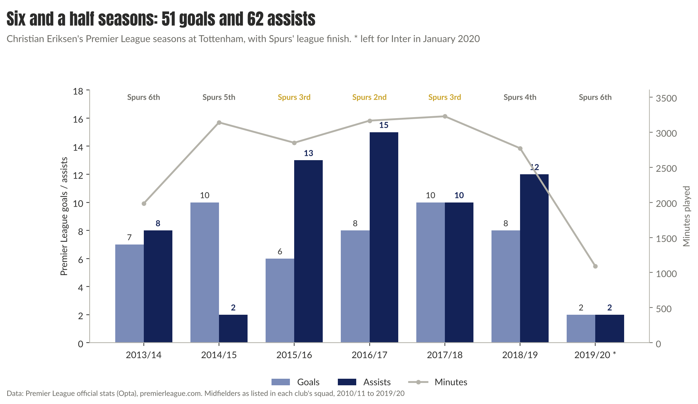

*Figure 1 · Premier League goals, assists and minutes by season, with Spurs' league finish.*

The pattern is the opposite of a one-season wonder. He never had a 20-goal or 20-assist season, but from 2013/14 to 2018/19 he had **double figures for goals plus assists every year**, and from 2014/15 he played **2,700+ minutes every season**. The only dip in his assists, 2014/15, came in his best goalscoring year (10 goals). His peak, 2016/17, was also Spurs' best league season of the era: second, with 86 points.

---

## Chapter 2 · The most productive midfielder of his time

<!-- kpi: 109 | Goals + assists | Silva 93, Özil 84 -->
<!-- kpi: 196 | Starts | most of any midfielder -->
<!-- kpi: 15,100 | Touches | 2nd of any midfielder -->

Add up the six full seasons and compare him with every midfielder in the league over the same years.

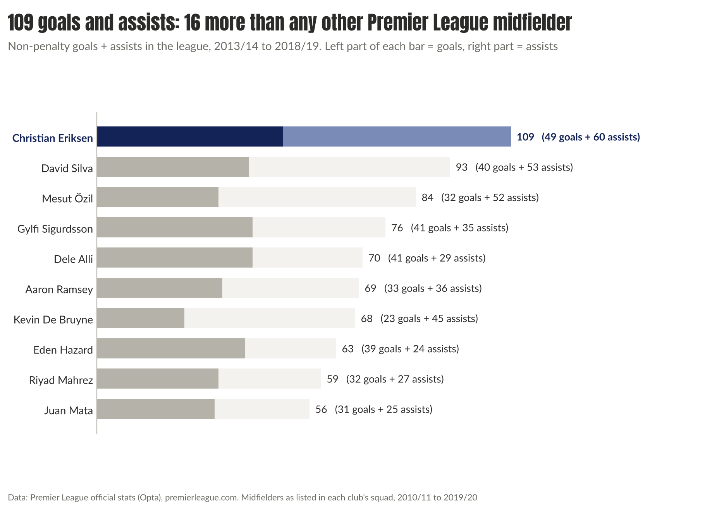

*Figure 2 · Most non-penalty goals + assists by a Premier League midfielder, 2013/14 to 2018/19.*

He led every midfielder in the league for **goals + assists (109)**, **assists (60)**, **chances created (487**, ahead of Özil's 469 and Silva's 409) and **set-piece goals (7)**. He scored no penalties at all.

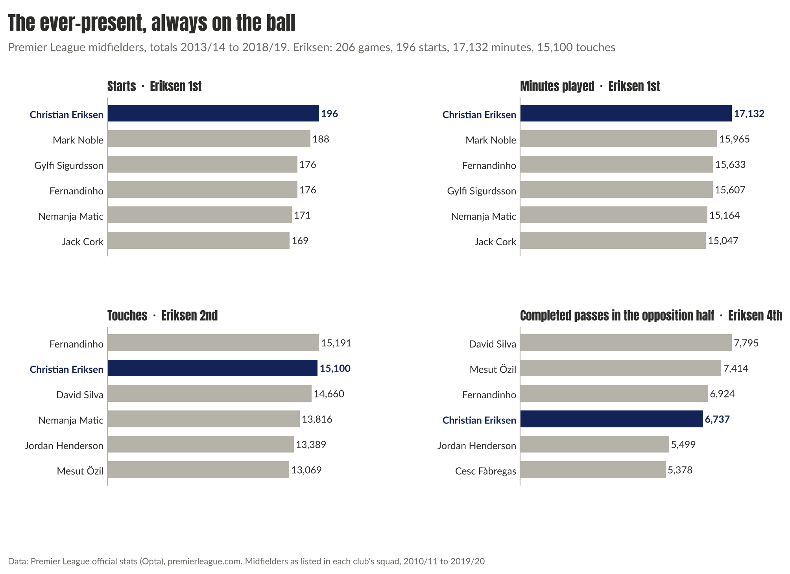

*Figure 3 · Most starts, minutes, touches and completed passes in the opposition half by a Premier League midfielder, 2013/14 to 2018/19.*

And he did it while playing more than anyone. **The ever-present:** the most league games (**206**), the most starts (**196**, eight more than Mark Noble) and the most minutes (**17,132**, more than a thousand clear of Noble and almost 2,900 more than Silva) of any midfielder. He started 196 of his 206 games. Part of being a great creator is simply being on the pitch, and nobody was on it more.

**Always on the ball:** **15,100 touches**, second only to Fernandinho (15,191), City's holding midfielder, and ahead of Silva (14,660). And **6,737 completed passes in the opposition half**, 4th behind Silva, Özil and Fernandinho. For such a quiet player, he was on the ball more than almost any midfielder in the league.

---

## Chapter 3 · Every season, near the top

<!-- kpi: Top 10 | Chances created per 90 | in all six seasons -->
<!-- kpi: Top 10 | Non-penalty goals per 90 | in five of six -->
<!-- kpi: 2nd | Best rank, chances and assists | 2016/17 -->

Totals can hide a player who had one huge year. So I ranked Eriksen against every regular midfielder (1,800+ minutes) in each season separately, per 90 minutes.

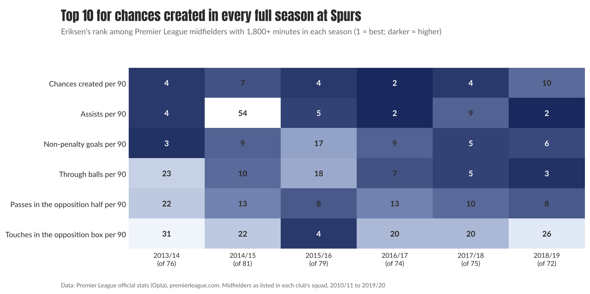

*Figure 4 · Eriksen's rank among Premier League midfielders with 1,800+ minutes, season by season, per 90 minutes.*

For **chances created per 90** he was in the **top 10 in all six seasons**: 4th, 7th, 4th, 2nd, 4th and 10th, out of 72 to 81 midfielders each year. For **non-penalty goals per 90** he was top 10 in five of six. That's the unusual part. Most creators don't score, and most scoring midfielders don't create. Eriksen did both, year after year.

The weak spots are as clear. He wasn't a player who lived in the box (20th to 31st for touches there most seasons), and in 2014/15 his assists collapsed even though his chances created didn't. That's what happens when the finishing in front of you dries up, and a good reason to judge creators by chances, not assists.

---

## Chapter 4 · Better than expected

<!-- kpi: +17.0 | Assists above xA | 60 from 43.0, most of any midfielder -->
<!-- kpi: +8.9 | Goals above xG | 49 from 40.1, 5th of 105 -->
<!-- kpi: 369 | Shots | 1.9 per 90, 7th of 105 -->

Goals and assists can flatter a player who happened to have good finishers around him, or a lucky year. Opta's **expected goals (xG)** and **expected assists (xA)** measure the quality of the chances instead: how often a shot from that spot, or a pass of that kind, usually ends in a goal.

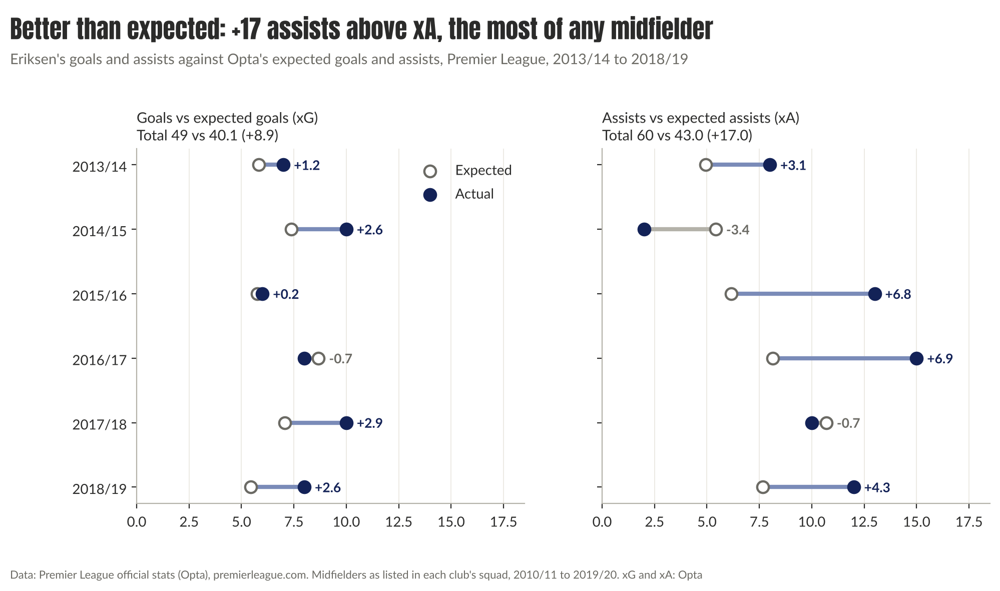

*Figure 5 · Goals and assists against expected goals and assists, season by season, 2013/14 to 2018/19.*

Over six seasons, his passes were worth **43.0 expected assists**, and he got **60**: **17 more than expected, the most of any midfielder** (Dele Alli was next with +14). Some of that is Harry Kane, who finished chances better than almost anyone. But 2014/15 shows the other side: with the same quality of passing he got two assists, 3.4 fewer than expected. Over six seasons the luck evens out; the +17 mostly doesn't.

He also beat his **expected goals** by almost nine (**49 goals from 40.1 xG**, 5th of 105 midfielders), in five of his six seasons. That's not one lucky year. That's a player who could finish.

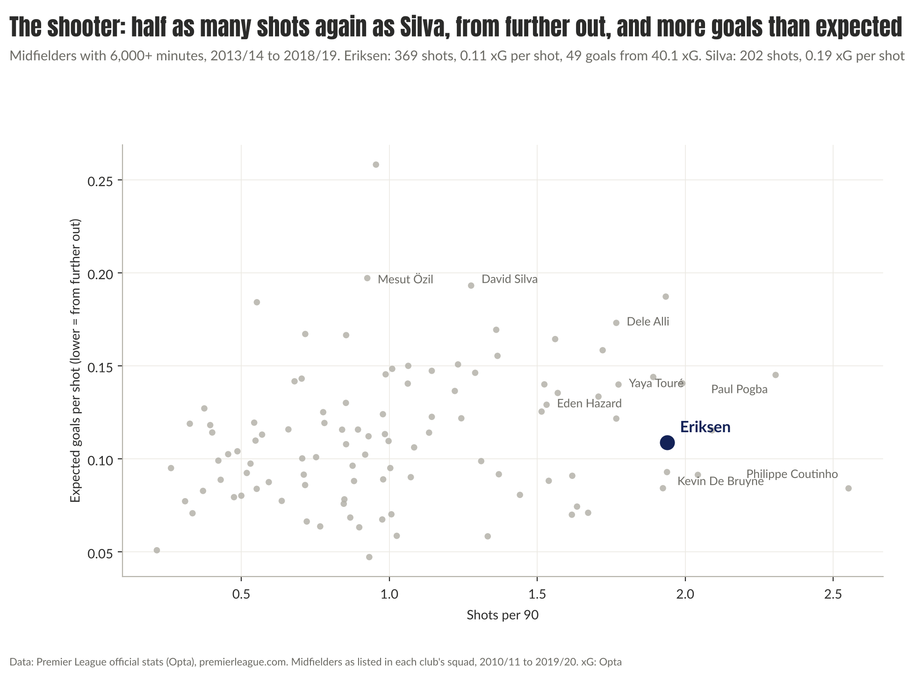

*Figure 6 · Shots per 90 against expected goals per shot, midfielders with 6,000+ minutes, 2013/14 to 2018/19.*

And how he scored was different. He took **1.9 shots per 90**, 7th among 105 midfielders, and almost twice Silva's 202 shots in total (**369**). His average shot was worth **0.11 xG**, against Silva's 0.19: Silva shot rarely and from close in, Eriksen often and from further out. Shots from distance usually go in less than one time in ten, and he still scored more than the model expected. That's the "Golazo" nickname in numbers.

---

## Chapter 5 · The other Silva

<!-- kpi: 0.26 v 0.25 | Non-penalty goals per 90 | Eriksen v Silva -->
<!-- kpi: 2.56 v 2.59 | Chances created per 90 | Eriksen v Silva -->
<!-- kpi: 20.6 v 16.0 | Times losing the ball per 90 | Eriksen v Silva -->

The comparison that surprised me most was with David Silva, the subject of my last report.

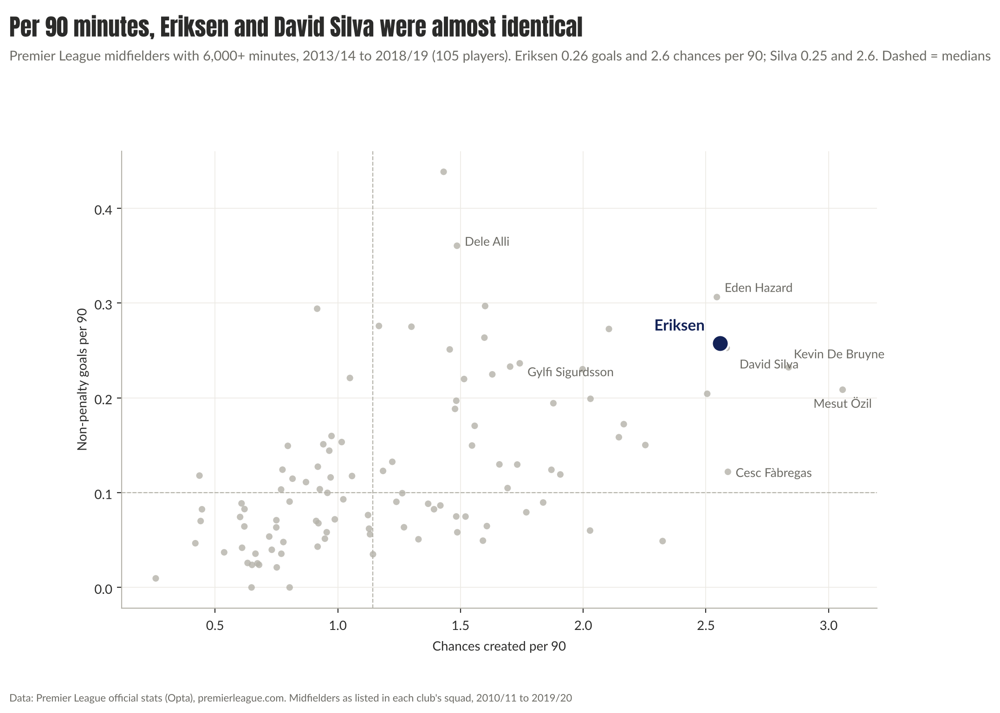

*Figure 7 · Chances created and non-penalty goals per 90, midfielders with 6,000+ minutes, 2013/14 to 2018/19.*

Over the same six seasons, Eriksen scored **0.26 non-penalty goals per 90** and created **2.56 chances per 90**. Silva: **0.25** and **2.59**. On the chart they sit almost on top of each other, in the top-right corner, alongside Hazard, De Bruyne and Özil.

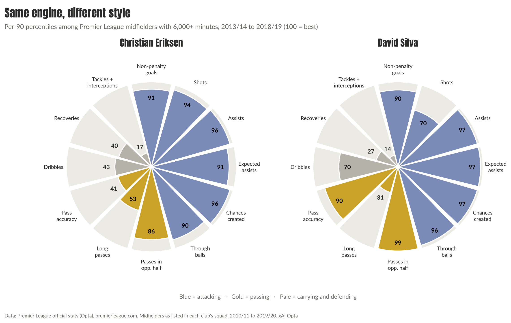

*Figure 8 · Twelve per-90 numbers as percentiles among midfielders with 6,000+ minutes, 2013/14 to 2018/19.*

The pizzas show the same engine with different styles. For scoring, assisting, expected assists and chances created, both are in the 90s. The differences are around the edges: Eriksen **shot far more** (94th percentile to 70th) and played more **long passes** (53rd to 31st); Silva **passed far more accurately** (90th to 41st), **passed more in the opposition half** (99th to 86th) and **dribbled more** (70th to 43rd).

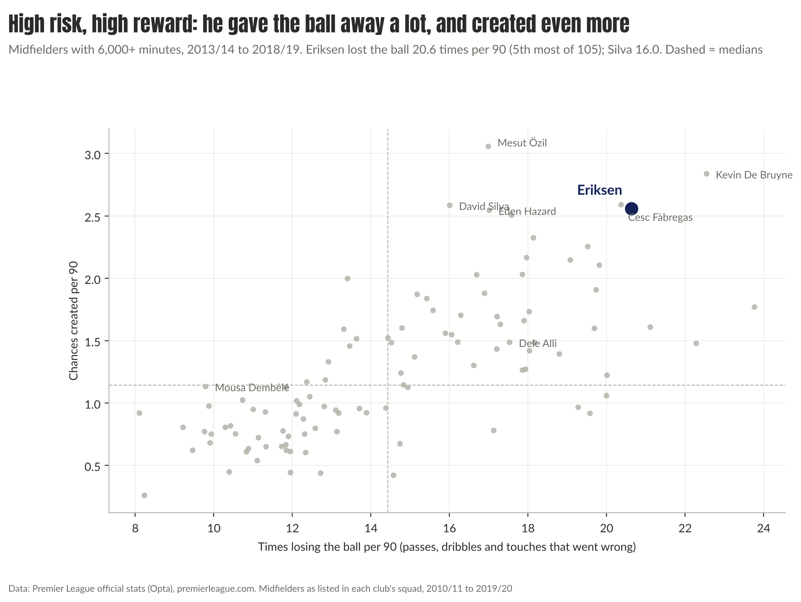

*Figure 9 · Times losing the ball per 90 against chances created per 90, midfielders with 6,000+ minutes, 2013/14 to 2018/19.*

That's the real difference. Silva kept the ball; Eriksen risked it. He lost possession **20.6 times per 90**, the 5th most of 105 midfielders, against Silva's 16.0, and his passing accuracy (81%) was below the midfield average. But almost everyone who created as much as him, De Bruyne, Fàbregas, Özil and Silva included, lost the ball more often than the typical midfielder. The ball you lose is the price of the pass that splits a defence. For a creator, it's a cost worth paying.

If Silva is under-rated, and I think he is, then a player who matched his output for six years in a weaker team, while playing more minutes, has a strong case too.

---

## Chapter 6 · What they said

<!-- kpi: 3 | Managers quoted | Pochettino, Frank, Ten Hag -->
<!-- kpi: 6 | Players and pundits | teammates, rivals and TV -->
<!-- kpi: 1 | Dissenting voice | Jamie Carragher -->

Kept short; the sources are at the end.

**His managers:**

> "you can compare Christian with special players like De Bruyne or David Silva" — **Mauricio Pochettino**, April 2018, after Eriksen was left off the PFA Player of the Year shortlist

> "You can give it to Christian and he'll always find a solution." — **Thomas Frank**, Brentford manager, after a 4-1 win at Chelsea in April 2022

> "I think Christian Eriksen is the best in the midfield" — **Erik ten Hag**, Manchester United manager, August 2022

Pochettino also called him **one of the best creative players in the league**, a player who always stepped up in big games; the squad's nickname for him was "Golazo". Frank, who'd coached him in Denmark's under-17s, later called him probably **the biggest signing in Brentford's modern history**.

**Teammates, pundits and other players:**

> "He is a fantastic player." — **Harry Kane**, to BBC Sport

> "Christian Eriksen is the most under-rated player in the Premier League." — **Jamie Redknapp**, Sky Sports pundit

> "His brain is like a computer!" — **Pat Nevin**, on BBC 5 Live, December 2018, who also called him world class

> "Perfect example of a player who plays with intelligence" — **Paul Scholes**, after Eriksen joined Manchester United

> "He has the vision, he has the brain" — **Bastian Schweinsteiger**, to Manchester United's club media

> "I don't think Spurs fans fully appreciated him" — **Wayne Bridge**, former Chelsea and Manchester City defender

Kane also joked on talkSPORT that the more chances Eriksen made for him, the better. In June 2021, the day after Eriksen collapsed at Euro 2020, **Son Heung-min** scored for South Korea, held up the number 23, Eriksen's Spurs shirt number, and spoke into the camera: "Christian Eriksen, I love you." **Gary Neville** said in 2022 that he could play for any of the top six; his Denmark manager **Kasper Hjulmand** said nothing could stress him on a pitch.

Not everyone agreed. In 2019, with Eriksen linked with Real Madrid, **Jamie Carragher** said on Sky Sports that he was a really good player for Tottenham but "not quite good enough to play for Madrid". That's the honest case against him, and even it starts from "really good". The pattern is the same as with Silva: the people around him talk about his brain, his calm and his decisions, and the word "under-rated" keeps coming up.

---

## Chapter 7 · Was he recognised at the time? A model

Every year, the players vote for a PFA Team of the Year. If we learn what the voters usually reward, we can ask how often Eriksen *should* have been picked.

**The model** is the one from my Silva and Touré reports: a logistic regression on six per-90 numbers (scoring, assisting, creating, passing in the opposition half, dribbling, defending) and minutes, all as percentiles within the season. It separates selected from non-selected midfielders well on held-out seasons (AUC 0.87, 757 seasons, 36 selections).

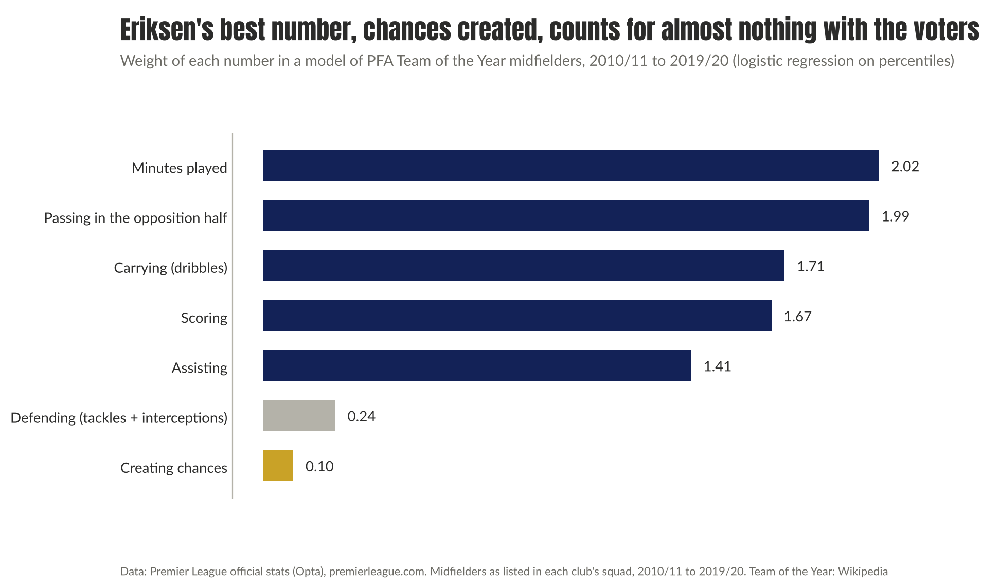

*Figure 10 · How much each number matters for predicting selection, 2010/11 to 2019/20.*

The first finding is the same as for Silva: **creating chances, Eriksen's best number, carries almost no weight (0.10)**. The voters reward minutes, passing high up the pitch, dribbling and scoring. Chances created are mostly credited to the scorer.

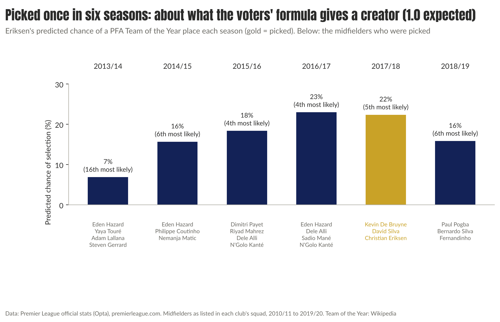

*Figure 11 · Eriksen's predicted chance of selection each season, and the midfielders who were picked.*

The model gives Eriksen **1.0 expected selections** over six seasons. He got exactly **one**, in 2017/18 alongside De Bruyne and Silva. So by the voters' own standards he wasn't robbed. The closest call was **2016/17**, his best season, when the model rated him the 4th most likely midfielder (23%) and the midfielders picked were Hazard, Dele Alli, Kanté and Mané.

That's the real problem. The voters' formula doesn't value the thing Eriksen did best. A midfielder who led the league in goals plus assists for six years earned a 7–23% chance a season, because most of his value was in the pass before the goal.

---

## Chapter 8 · Why he's left out

The numbers say he was the most productive midfielder of his era. So why isn't he remembered that way? I think there are four reasons.

**No trophies.** Spurs finished 3rd, 2nd, 3rd and 4th in his best years, lost a League Cup final and a Champions League final, and won nothing. The all-time lists are written by trophies, and that Spurs team has none.

**The spotlight was elsewhere.** Kane scored the goals, Dele got the headlines, Son became the fan favourite and Pochettino got the credit for the system. The player who connected them all was the quietest one.

**He left early and quietly.** He moved to Inter in January 2020, in the last year of his contract, after a season in which his form dipped and his future dominated the coverage. The last memory of him at Spurs is a transfer saga, not his peak.

**One night changed how he's remembered.** In June 2021 he suffered a cardiac arrest playing for Denmark at Euro 2020. He survived, and eight months later he was playing in the Premier League again, for Brentford and then Manchester United. It's one of the bravest comebacks in football. But since then, he has been talked about as an inspiration more often than as a footballer, and his Spurs years have faded behind it.

---

## The verdict

> **Is Christian Eriksen under-rated?** Yes. From 2013/14 to 2018/19 he was the most productive midfielder in the Premier League: the most goals plus assists, the most assists, the most chances created and the most minutes, top 10 for creating every season. Per 90 he matched David Silva almost exactly. The voters picked him once, which is all their formula gives a creator, and he won nothing at Spurs. The managers and players who worked with him rate him as highly as anyone. The all-time conversation mostly forgets him.

**Under-rated by the people who worked with him: no. Under-rated by the voters' formula, and in the all-time conversation: yes.**

---

## My take

*This section is opinion, not analysis.*

I picked Eriksen because he's one of the most under-rated players I've seen, and the numbers made that case more strongly than I expected. I knew he was good. I didn't know he out-produced every midfielder in the league for six years, including the players who get talked about as the best of the era.

The Silva comparison is what stays with me. I spent my last report arguing that Silva is under-rated, and here's a player whose per-90 output is almost the same, who played more minutes, in a team with less around him, and who gets talked about even less.

For me, he belongs in any serious conversation about the best creative midfielders of the Premier League era.

---

## What clubs can learn

1. **Availability is a skill.** 196 starts in 206 games, and the most minutes of any midfielder. A creator who is always on the pitch is worth more than a better one who isn't.
2. **Judge creators by chances, not assists.** Eriksen's assists fell from 8 to 2 in 2014/15 while his chances created rose. The finishing changed, not the player.
3. **Look for players who create and score.** Top 10 for chances and for non-penalty goals in the same season is rare. Eriksen did it in five of six seasons.
4. **Don't let award votes set the price.** The voters' formula barely counts chances created, so a creator's market reputation can lag far behind his output.
5. **Set pieces are a weapon.** Seven set-piece goals, the most of any midfielder, plus the deliveries for others. A specialist can be worth a handful of points a season.

---

## Method and data

- **Opta data:** season stats for every player listed as a midfielder in a Premier League squad, 2010/11 to 2019/20, from the public stats API behind premierleague.com (the same files as the David Silva report). Files in [`data/external/`](../data/external/).
- **The window:** Eriksen's six full Spurs seasons, 2013/14 to 2018/19. His half-season in 2019/20 appears in Figure 1 only.
- **Expected goals and assists:** Opta's xG and xA as published by the Premier League's stats API, summed over each season.
- **Losing the ball:** Opta's possession lost (failed passes, dribbles, controls and other touches) per 90.
- **Per 90 and ranks:** each number per 90 minutes, ranked among regular midfielders (1,800+ minutes) in the same season. Six-season comparisons use midfielders with 6,000+ minutes (105 players).
- **The model:** logistic regression on six per-90 percentiles plus minutes; each season predicted by a model trained on the other nine (held-out AUC 0.87). Team of the Year midfielders from Wikipedia.
- **Limits:** only players listed as midfielders are compared, so wide forwards listed as forwards (Son, Salah, Sterling) aren't in the tables; the data can't see goals from distance, free-kick deliveries or big-game moments; 36 selections is a small sample for the model.

## Sources

**Quotes**
- Pochettino comparing Eriksen with De Bruyne and Silva, April 2018 (via ESPN): [Sports Illustrated](https://www.si.com/soccer/2018/04/21/spurs-boss-boldly-compares-christian-eriksen-star-man-city-duo-kevin-de-bruyne-david-silva)
- Pochettino, "one of the best creative players": [FourFourTwo](https://fourfourtwo.com/news/eriksen-one-premier-leagues-best-pochettino)
- Pochettino after Juventus 2-2, February 2018: [The42](https://the42.ie/pochettino-eriksen-praise-3850939-Feb2018)
- "Golazo" nickname: [Yahoo Sport](https://uk.news.yahoo.com/christian-eriksen-reminded-us-why-120000467.html)
- Thomas Frank after Chelsea 1-4 Brentford: [Yahoo Sport](https://au.sports.yahoo.com/unbelievable-christian-eriksen-lauded-brentford-091637590.html)
- Thomas Frank, "biggest signing", February 2024: [Eurosport](https://www.eurosport.com/football/premier-league/2023-2024/exclusive-brentford-boss-thomas-frank-says-christian-eriksen-was-biggest-signing-in-premier-league-c_sto10024756/story.shtml)
- Erik ten Hag, August 2022: [Manchester United](https://www.manutd.com/en/news/detail/erik-ten-hag-feels-christian-eriksen-will-flourish-in-midfield-for-reds)
- Harry Kane to BBC Sport: [HITC](https://www.hitc.com/harry-kane-praises-tottenham-hotspur-teammate-christian-eriksen/)
- Harry Kane on talkSPORT: [HITC](https://www.hitc.com/we-have-an-understanding-harry-kane-thinks-player-spurs-are-looking-at-is-fantastic/)
- Son Heung-min's message, June 2021: [Yahoo Sport](https://uk.news.yahoo.com/christian-eriksen-latest-heung-min-082446604.html)
- Jamie Redknapp: [Yahoo Sport](https://uk.news.yahoo.com/tottenham-apos-christian-eriksen-most-092400019.html)
- Pat Nevin on BBC 5 Live, December 2018: [Sports Illustrated](https://www.si.com/soccer/2018/12/08/pat-nevin-heaps-praise-tottenhams-world-class-playmaker-christian-eriksen)
- Paul Scholes: [Sportskeeda](https://www.sportskeeda.com/football/news-perfect-example-player-plays-intelligence-plays-brains-paul-scholes-singles-manchester-united-star-special-praise)
- Bastian Schweinsteiger: [TEAMtalk](https://www.teamtalk.com/manchester-united/world-cup-winner-loves-high-iq-man-utd-star-proven-erik-ten-hag-wrong)
- Wayne Bridge: [GiveMeSport](https://www.givemesport.com/1789309-tottenham-latest-news-spurs-fans-never-fully-appreciated-badly-missed-109cap-star)
- Gary Neville on The Overlap, 2022: [Football365](https://www.football365.com/news/neville-names-bottom-half-premier-league-player-liverpool-stupid-sign)
- Kasper Hjulmand (via Ekstra Bladet): [Sportskeeda](https://sportskeeda.com/football/that-man-stressed-football-pitch-national-team-coach-hails-world-class-manchester-united-star-clear-everything-pitch)
- Jamie Carragher on Real Madrid, 2019: [FourFourTwo](https://www.fourfourtwo.com/news/tottenham-hotspur-christian-eriksen-jamie-carragher-not-good-enough-real-madrid)

**Records**
- Spurs record (226 games, 51 goals, 62 assists): [Sports Illustrated](https://www.si.com/fannation/soccer/futbol/news/christian-eriksen-man-united-sign-creative-genius-and-epl-great)
- Premier League career (300 games, 54 goals): [premierleague.com](https://premierleague.com/players/4845/Fred/stats)
- Career and the return after Euro 2020: [Wikipedia](https://en.wikipedia.org/wiki/Christian_Eriksen)
