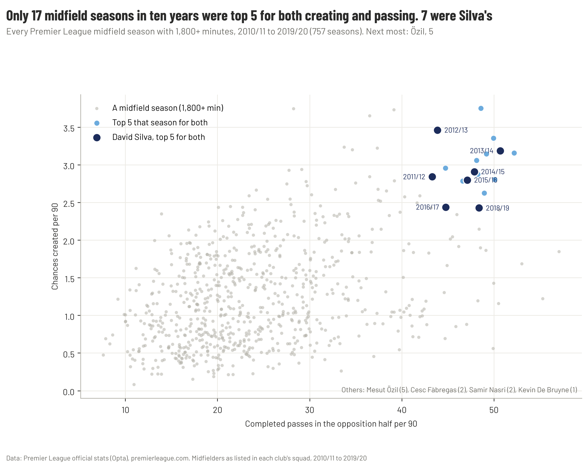
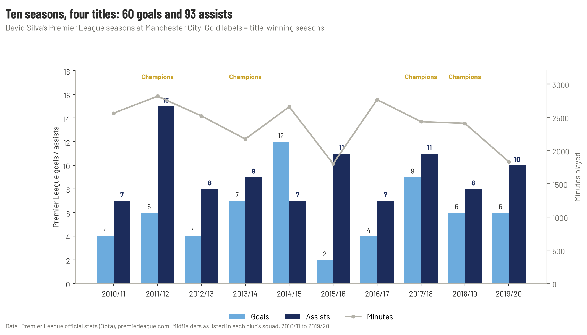
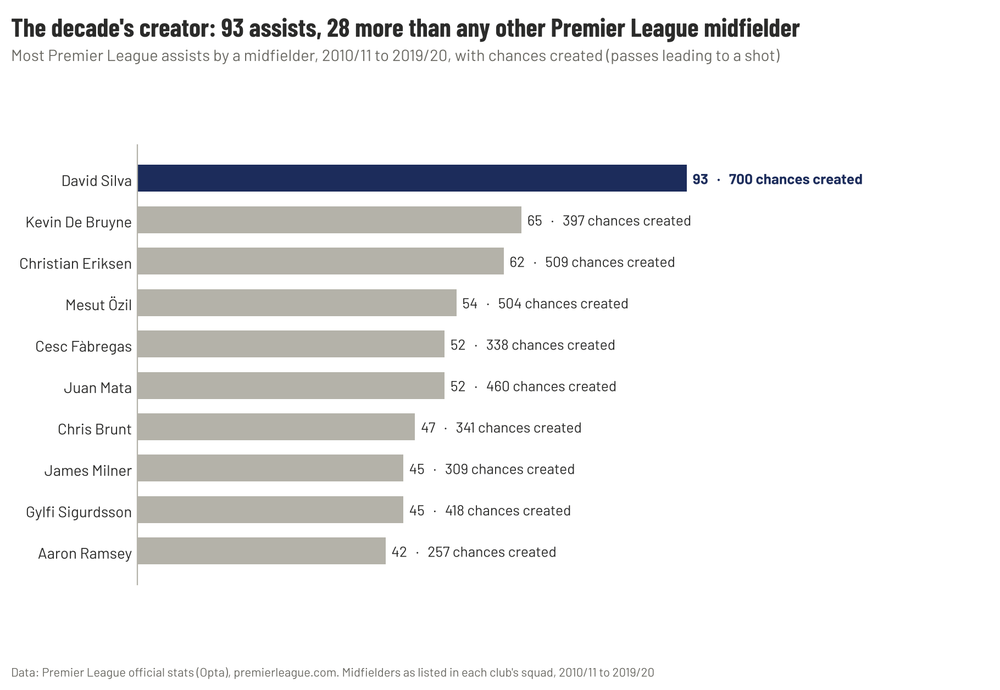
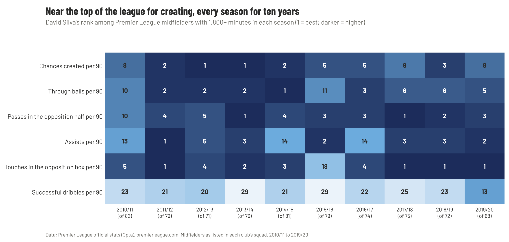
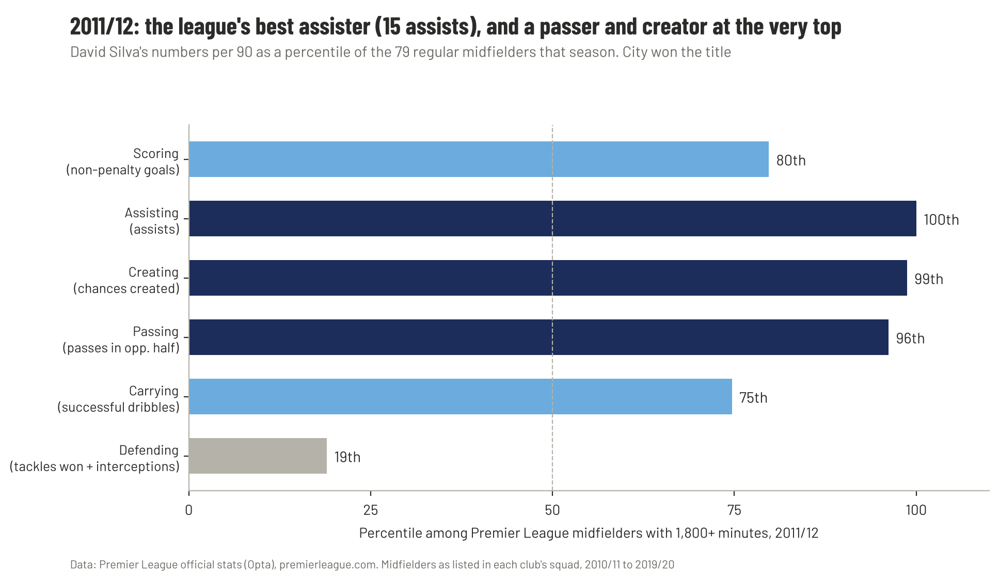
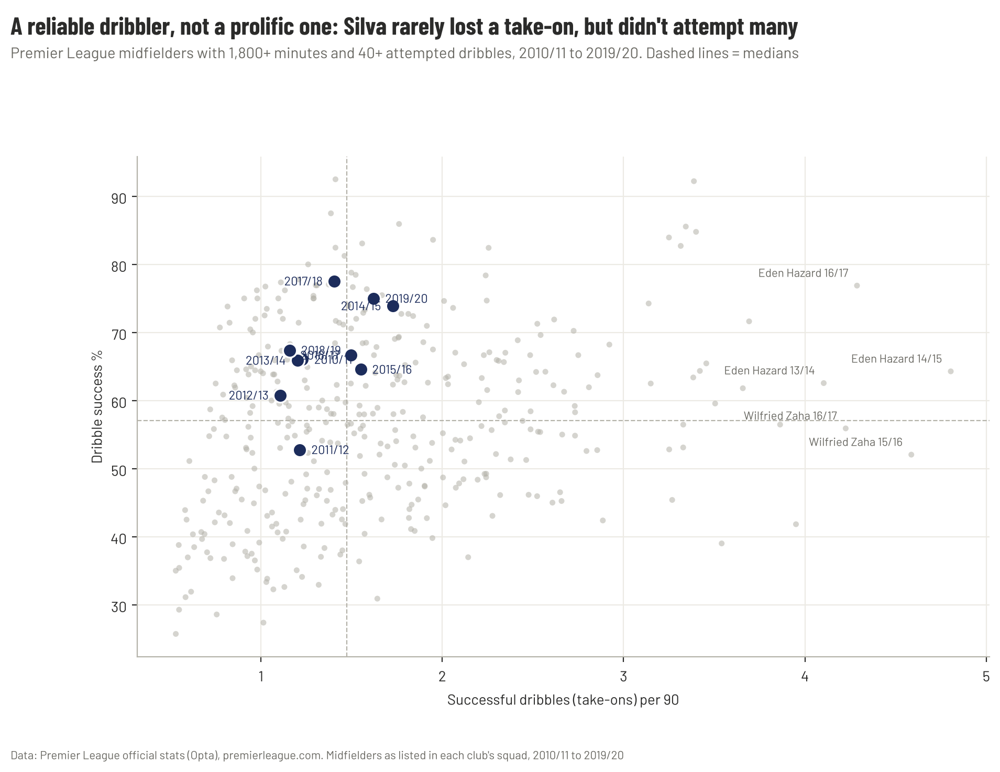
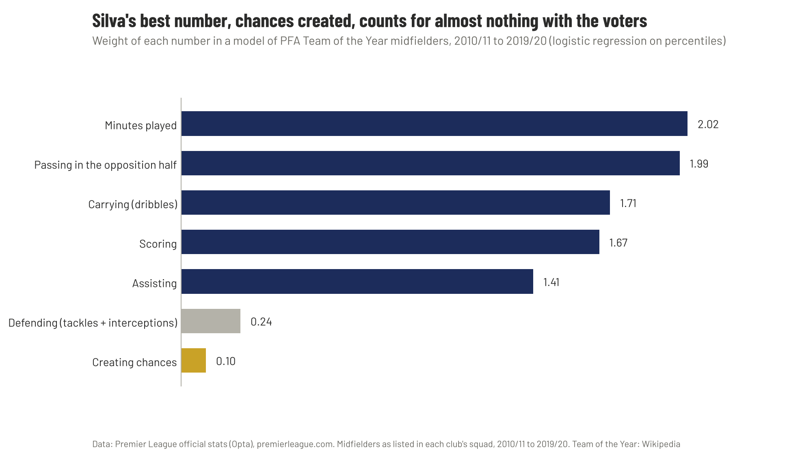
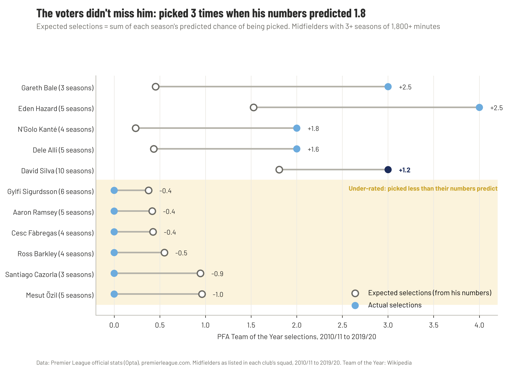
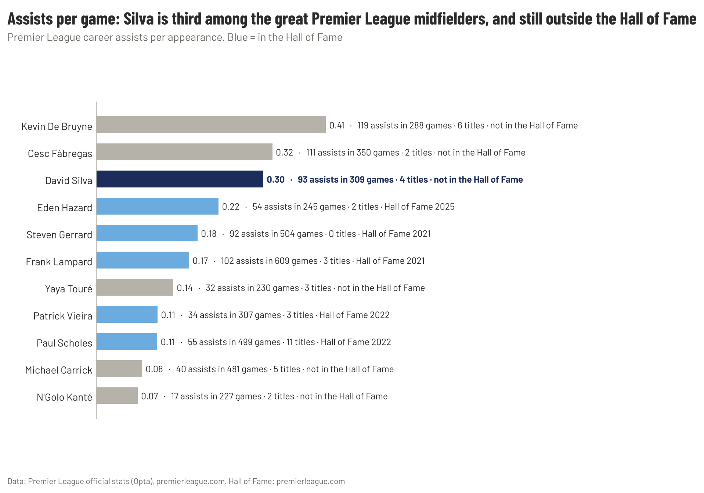

# David Silva: the most under-rated great of the Premier League?

David Silva's ten seasons at Manchester City, compared with every Premier League midfielder of the 2010s, what his teammates and rivals said about him, and a simple model of who the PFA Team of the Year voters reward.

> Part of [**football-analytics**](../../README.md) › [**Players**](../README.md) · Author: **Hammad** · Python · pandas · scikit-learn · matplotlib · Jupyter

**📖 [Read the report](docs/ARTICLE.md)** ([PDF](reports/David_Silva_article.pdf)) · a follow-up to [Yaya Touré: Was He Under-Rated?](../Yaya-Toure-Man-City/)

**⚖️ [Compare him yourself in Midfield Matchup](https://syedhammad07.github.io/football-analytics/Projects/Midfield-Matchup/)**, or find who plays like him in [Player Style Finder](https://syedhammad07.github.io/football-analytics/Projects/Player-Style-Finder/).

[](docs/ARTICLE.md)

## Key findings

- **The decade's creator:** 93 Premier League assists from 2010/11 to 2019/20, 28 more than any other midfielder (De Bruyne, 65). Also the most chances created (700) and through balls (310).
- **Every season, near the top:** top 10 for chances created per 90 in all ten seasons, first in 2012/13 and 2013/14; top 5 for passes in the opposition half in nine.
- **A rare profile:** of 757 regular midfield seasons, only 17 were top 5 for both chances created and passing in the opposition half. Seven were Silva's; Özil had five.
- **The dribbler question:** reliable, not prolific. Top 16 for dribble success every season, but only 13th–29th for successful dribbles per 90. His escapes were turns and passes, which Opta doesn't count as dribbles.
- **What the players said:** Agüero, De Bruyne, Bernardo Silva, Carragher, Neville, Lampard, Shearer and others rank him among the league's best ever (sourced in the report).
- **The model:** the voters reward minutes, passing, dribbling and goals, and give almost no weight to chances created, Silva's best number. Even so they didn't miss him: picked 3 times against 1.8 expected. Özil and Cazorla were the under-rated ones.
- **The all-time conversation:** 0.30 assists per game, third among the great midfielders behind De Bruyne and Fàbregas, ahead of Hazard (0.22), Gerrard (0.18) and Lampard (0.17). Shortlisted for the Hall of Fame in 2024 and 2025 and not inducted.

## Charts

| | |
| --- | --- |
| [](reports/figures/01_career_by_season.png) | [](reports/figures/02_decade_assists.png) |
| **1 ·** Ten seasons at City | **2 ·** The decade's assist leaders |
| [](reports/figures/03_rank_every_season.png) | [](reports/figures/04_profile_2011_12.png) |
| **3 ·** His rank in every season | **4 ·** The 2011/12 profile |
| [](reports/figures/06_dribbling.png) | [](reports/figures/07_what_voters_reward.png) |
| **6 ·** Reliable, not prolific: the dribbling test | **7 ·** What the Team of the Year rewards |
| [](reports/figures/08_expected_vs_actual_selections.png) | [](reports/figures/09_all_time_assists_per_game.png) |
| **8 ·** Expected vs actual selections | **9 ·** Against the all-time greats, per game |

## Method

- **Opta data:** season stats for every player listed as a midfielder in a Premier League squad, 2010/11 to 2019/20 (757 seasons with 1,800+ minutes), from the public stats API behind premierleague.com. In [`data/external/`](data/external/).
- **Ranks:** each number per 90 minutes, ranked among regular midfielders (1,800+ minutes) in the same season.
- **The model:** logistic regression on six per-90 percentiles (scoring, assisting, creating, passing in the opposition half, dribbling, defending) plus minutes; each season predicted by a model trained on the other nine (held-out AUC 0.87). Team of the Year midfielders from Wikipedia.
- **Quotes:** every quote is linked to its source at the end of the report.
- **Limits:** only players listed as midfielders are compared; the model can't see team success or big moments; 36 selections is a small sample.

## How to run

From this folder (Python with pandas, scikit-learn, matplotlib, nbformat, nbconvert and reportlab):

```bash
python notebooks/build_01_creator.py && python notebooks/build_02_recognition.py
jupyter nbconvert --to notebook --execute --inplace notebooks/01_creator.ipynb notebooks/02_recognition.ipynb
python reports/make_article_pdf.py
```

All the data is already in `data/external/`, so nothing needs downloading.

## Folder structure

```
David-Silva-Man-City/
├── README.md                               ← you are here
├── assets/fonts/                           ← Barlow (SIL Open Font License)
├── data/external/
│   ├── pl_midfielders_2010-2018.csv        ← Opta season stats, every PL midfielder 2010/11–2017/18
│   ├── pl_midfielders_2018-2020.csv        ← the same for 2018/19 and 2019/20
│   ├── pfa_team_of_the_year.csv            ← Team of the Year midfielders, 2010/11 to 2021/22
│   ├── pl_midfielder_heights.csv           ← listed height of each midfielder
│   └── pl_career_midfield_greats.csv       ← career totals and Hall of Fame status, great PL midfielders
├── docs/
│   └── ARTICLE.md                          ← the report: 7 chapters, verdict and my take, 9 charts, sourced quotes
├── notebooks/
│   ├── setup_cell.py                       ← shared first cell
│   ├── build_01_creator.py / 01_creator.ipynb          ← career, creation, ranks, dribbling: charts 1–6
│   └── build_02_recognition.py / 02_recognition.ipynb  ← the voting model and the all-time table: charts 7–9
└── reports/
    ├── David_Silva_article.pdf
    ├── make_article_pdf.py
    └── figures/                            ← 9 charts
```
