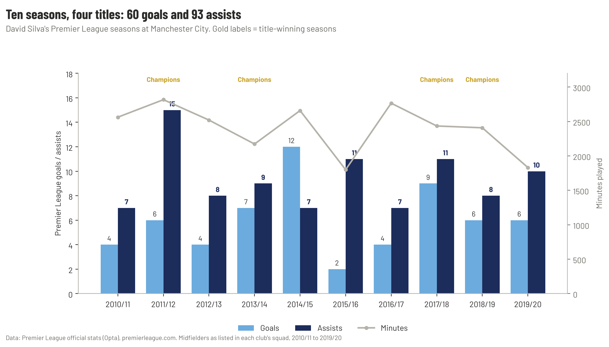
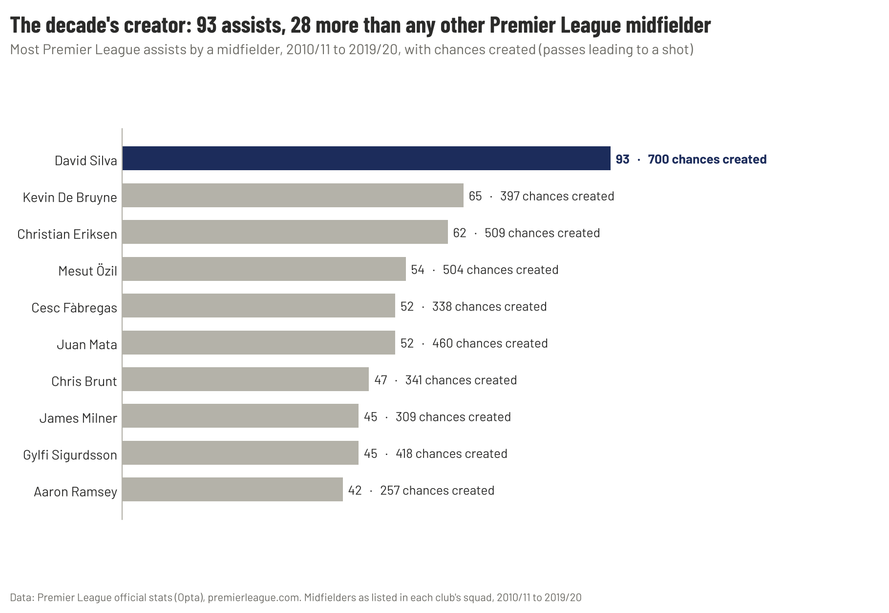
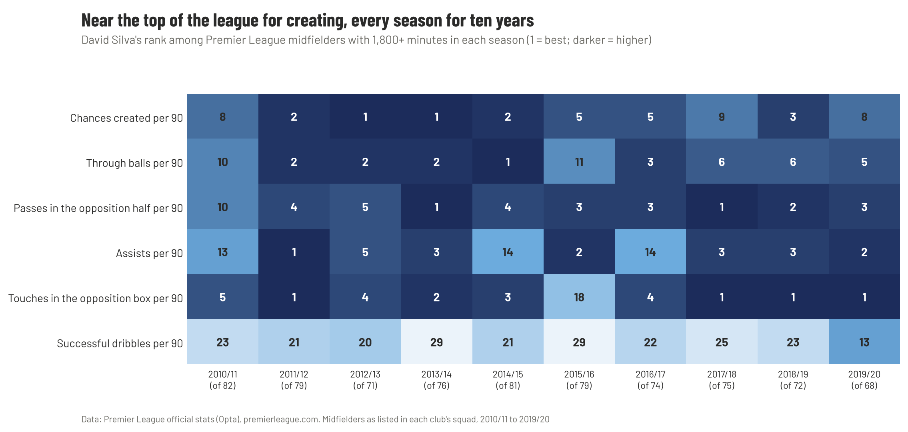
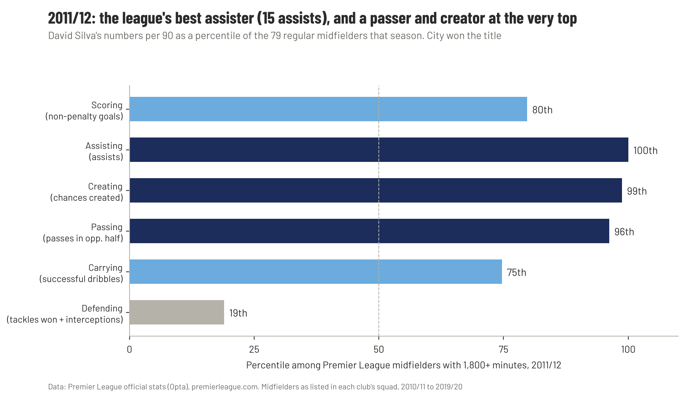
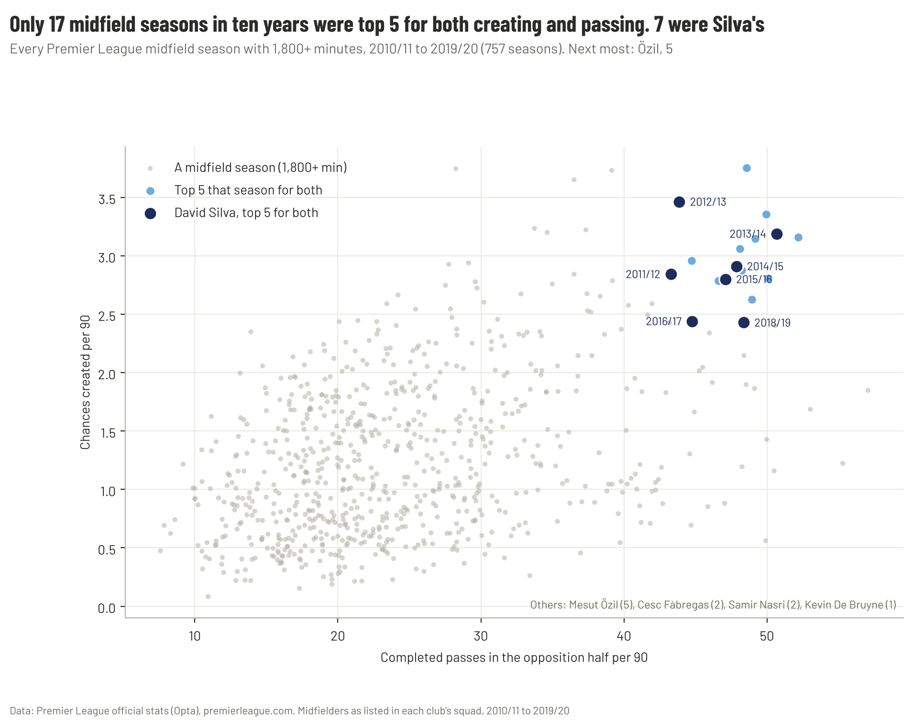
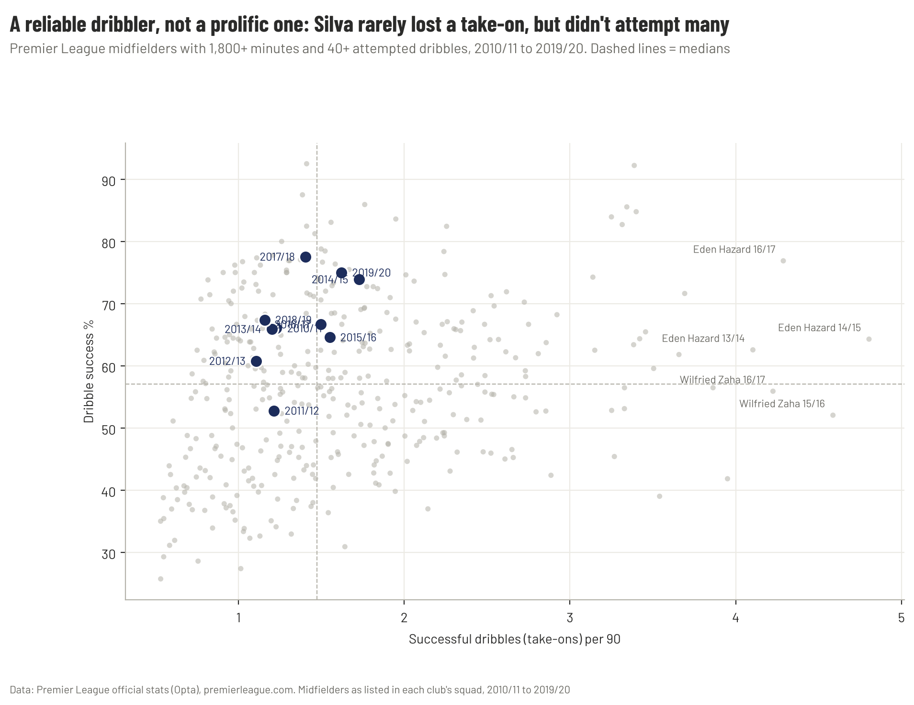
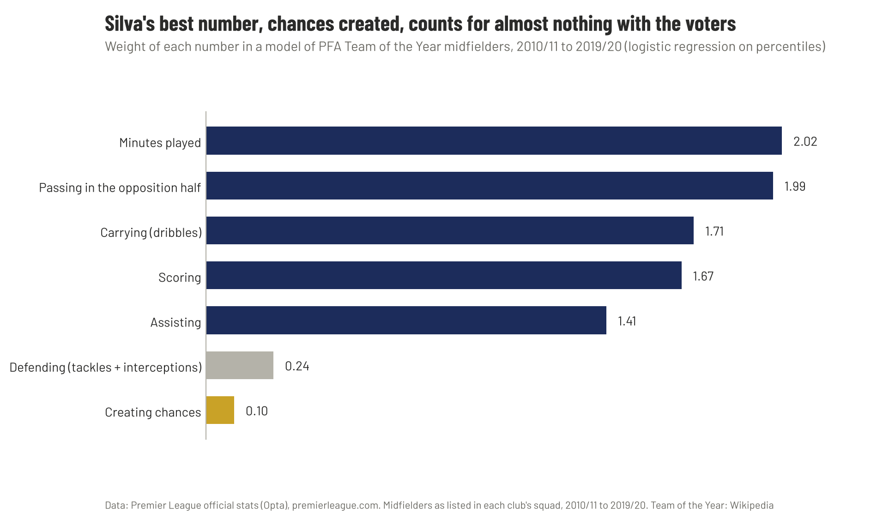
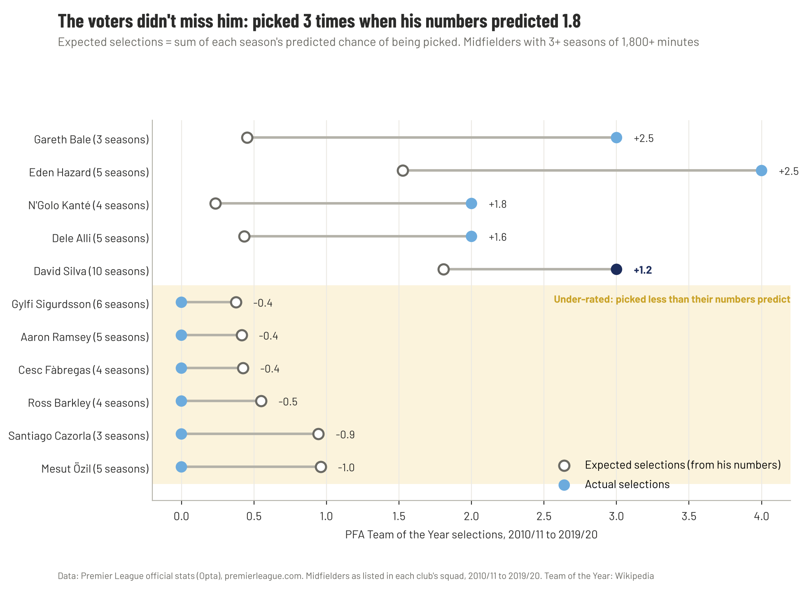
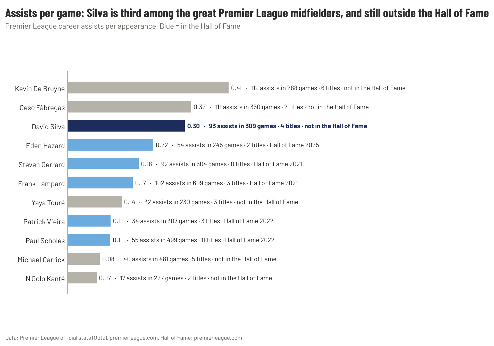

# David Silva: the most under-rated great of the Premier League?

**Ten seasons at Manchester City, official stats for every Premier League midfielder of the decade, what the players who shared a pitch with him said, and a simple model of who gets recognised. Nine charts, and my own take at the end.**

*By Hammad · Data: Premier League official stats (Opta) for 757 regular midfielder-seasons, 2010/11 to 2019/20*

---

## The career in numbers

| | |
| --- | --- |
| **At City** | 2010–2020, ten Premier League seasons |
| **League games / goals / assists** | 309 / 60 / 93 |
| **Trophies** | 4 Premier League titles, 2 FA Cups, 5 League Cups |
| **Best season** | 2011/12: 15 assists, the most in the league from midfield, and City's first title in 44 years |
| **PFA Team of the Year** | 2011/12, 2017/18 and 2019/20 |
| **Premier League Hall of Fame** | Shortlisted in 2024 and 2025. Not inducted |

> **The short version.** David Silva was the Premier League's creator of the 2010s. No midfielder made more assists, created more chances or played more through balls in that decade, and in seven seasons he was top five in the league for both creating chances and passing in the opposition half, a combination only 17 midfield seasons managed in ten years. The players who played with and against him rate him among the best the league has had. The voters who picked the PFA Team of the Year treated him fairly at the time. But the people who decide the league's all-time lists, and the Hall of Fame, still leave him out, even though his assists per game beat Gerrard's, Lampard's and Hazard's.

## The question

When people list the best players the Premier League has ever had, David Silva is usually missing, or somewhere near the bottom of the list. Yet whenever his name does come up, everyone seems to agree he was brilliant. That gap is what this report is about.

My view going in: **Silva is under-rated, and badly neglected in the conversation about the greatest Premier League players.** I also remember him as a dribbler, a player who glided past people. I wanted to test both against the numbers, and to collect what the players themselves said about him.

**Chapters 1–4** compare what Silva did with every Premier League midfielder of 2010/11 to 2019/20, including how much of a dribbler he was; **Chapter 5** is what his teammates and rivals said; **Chapter 6** asks whether he was recognised at the time; **Chapter 7** is how he's rated now.

---

## Chapter 1 · Ten seasons

Silva joined from Valencia in the summer of 2010, weeks after winning the World Cup with Spain. City hadn't won a major trophy since 1976. By the time he left in 2020 they had won four league titles, and he had played in every one of them.

*Figure 1 · Premier League goals, assists and minutes, season by season. Title-winning seasons marked.*

The shape is very different from Yaya Touré's one huge peak. Silva never had a 20-goal season, and he only reached double figures for goals once (12 in 2014/15). What he had was **ten seasons in a row of 7 to 15 assists**, with his best numbers in the title years: 15 assists in 2011/12, 11 in 2017/18. He didn't have a peak. He was the constant.

---

## Chapter 2 · The decade's creator

If you add up the whole decade, the gap between Silva and everyone else is enormous.

*Figure 2 · Most Premier League assists by a midfielder, 2010/11 to 2019/20, with chances created.*

- **Assists: 93.** The next midfielder is Kevin De Bruyne with 65, 28 behind.
- **Chances created: 700.** Christian Eriksen is next with 509.
- **Through balls: 310.** Cesc Fàbregas is next with 222.

Some of that is longevity: he played 23,975 minutes, more than anyone else on the list. But it's also not luck. From 2012/13, when Opta's expected assists begin, Silva made **71 assists from chances worth 64.9 expected assists**. He was slightly above what his passes deserved, not wildly above it, which is what you'd expect from a creator whose teammates (Agüero above all) finished well. And in March 2015 against West Brom he created **11 chances from open play in one match**, a Premier League record since Opta began recording it in 2003/04.

---

## Chapter 3 · Every season, near the top

Decade totals can hide a player who was great for three years and then hung around. So I ranked Silva against every regular midfielder in each season separately.

*Figure 3 · Silva's rank among Premier League midfielders with 1,800+ minutes, season by season, per 90 minutes.*

For **chances created per 90**, he was in the **top 10 in all ten seasons**, and first in 2012/13 and 2013/14. For **passes in the opposition half**, he was top 5 in nine of ten. And for **touches in the opposition box**, a number you'd expect from a striker rather than a playmaker, he was first in four seasons, including his last three. That last one matters: Silva wasn't a deep-lying passer. He played in the tightest spaces on the pitch, inside the penalty area.

*Figure 4 · 2011/12: Silva's numbers as a percentile of the 79 midfielders with 1,800+ minutes that season.*

In 2011/12, the season City won their first title in 44 years, he was the best assister of every regular midfielder in the league, 99th percentile for chances created and 96th for passing high up the pitch. Like Touré, the profile is just as telling for what he wasn't: 19th percentile for defending. He was a pure creator.

*Figure 5 · Every Premier League midfield season with 1,800+ minutes, 2010/11 to 2019/20: passes in the opposition half against chances created, per 90.*

This is the chart I'd show anyone who doubts him. In ten years there were **757** regular midfield seasons. Only **17** were top five in the league for both creating chances *and* passing in the opposition half. **Seven were Silva's.** Mesut Özil had five; nobody else had more than two. Being the league's best at one of these things is rare. Being among the best at both, for seven seasons out of ten, is almost unique.

---

## Chapter 4 · The dribbler question

This is where the numbers argued with me.

I remember Silva as a dribbler: the shoulder drop, the half-turn, the way defenders seemed to fall over without him touching the ball. At **173 cm** he was well below the 179 cm median of the league's midfielders, and he looked like the kind of small, quick player who beats men for a living. So I checked.

*Figure 6 · Premier League midfielders with 1,800+ minutes and 40+ attempted dribbles, 2010/11 to 2019/20: successful dribbles per 90 against success rate.*

- **Reliable, yes.** Among midfielders with 40+ attempts, his dribble success was in the **top 16 every season**, and 5th or 6th in five of them. In 2017/18 he completed 78% of his take-ons.
- **Prolific, no.** For successful dribbles per 90 he ranked between **13th and 29th** of roughly 75 regular midfielders each season. Hazard and Zaha completed two or three times as many.

So the honest answer is that Silva wasn't a dribbler in the way Hazard was. An Opta "dribble" is a take-on: an attempt to beat a defender by running past him. Silva rarely needed to. His way out of pressure was the turn, the first touch away from the challenge and the quick pass, none of which is recorded as a dribble. Kyle Walker tells a story in Chapter 5 that fits exactly: Guardiola banned his midfielders from receiving on the half-turn, with one exception, Silva. When he did take a defender on, he almost always won. He just preferred not to have to.

---

## Chapter 5 · What the players said

The best evidence for Silva may not be a number. It's how the people who played with and against him talk about him. Here's a selection, kept short; the sources are at the end.

**His teammates, the day he left City (17 August 2020, on Twitter):**

> "You made Man City bigger and you made us better." — **Sergio Agüero**

> "It was an honour to play with and wish you all the best" — **Kevin De Bruyne**

And when Silva announced his retirement in July 2023, his old captain **Vincent Kompany** replied with two words: "The wizard!"

**His teammates and managers, in interviews:**

> "one of the best players who has ever played in the Premier League" — **Kevin De Bruyne**, July 2020

**Kyle Walker** explained what made Silva different under Guardiola. As a kid he was taught to receive the ball on the half-turn, he told BBC Football Focus in 2021, but at City "if you get on the half-turn here, Pep goes mental": Guardiola wants the ball set back and moved on quickly. On The Overlap, Gary Neville's show, Walker went further. Guardiola hates midfielders receiving on the half-turn, he said, and the one player who was given that freedom was David Silva. Not even De Bruyne was. When Walker named the best player he played with at City on his own podcast in 2024, he chose Silva: "I think he just pips Kevin." On Rio Ferdinand's channel he drew the line between them: "All-rounder Kevin, all-rounder, but David individually."

> "one of the best midfielders of all-time" — **Bernardo Silva**, who also said Silva hadn't always had the praise he deserved

> "for me he is the best player in the Premier League" — **Edin Džeko**

> "He was just able to do whatever he wanted" — **Joleon Lescott**, who gave him the nickname "Merlin" after a pre-season game against Inter in 2011

> "When David arrived, he put City among the great teams." — **Pablo Zabaleta**

> "everyone would be saying he is one of the best players in the world" — **Roberto Mancini**, on what would have happened had Silva joined Barcelona

> "one of the best No 10s in the Premier League" — **Owen Hargreaves**, his City teammate in 2011/12

> "one of the most talented players Spain has ever produced" — **Xavi**, his Spain teammate

**What they saw him do.** The most revealing quotes aren't about how good he was, but about *how* he did it.

> "Moving between the lines I have never seen someone like him." — **Pep Guardiola**, July 2020, on his ability to find space in the tightest areas

> "In the small spaces, he is maybe the best I have seen." — **Pep Guardiola**, after Silva scored one and made two in a 5–0 win over Newcastle, July 2020

Guardiola, who had coached Xavi and Iniesta at Barcelona, counted Silva in the same company. Marking Silva's 300th game for City, he called himself a lucky man because "I was with Xavi, [Andres] Iniesta and now Silva".

> "he knows where to turn so that he has time" — **Leroy Sané**, on his vision. Sané added that in training rondos, Silva was never the one stuck in the middle chasing the ball

> "He feels and senses every situation." — **Joe Hart**, describing what it was like to face Silva one-on-one in training: whatever a goalkeeper chose, committing early or waiting, Silva picked the other finish

> "You pass him a bad ball and he makes it look like a good ball" — **Kyle Walker**, on the first touch that made teammates look better

Not everyone saw it at first. When he arrived in 2010, Hart thought he looked "tiny, slow, only left-footed", and Guardiola admitted he had expected him to struggle in England.

**His rivals:**

> "Silva is Manchester City's greatest ever player" — **Jamie Carragher** (Liverpool), who put him alongside Henry, Bergkamp and Cantona

> "His awareness is the best in world football, (Andres) Iniesta and Xavi are the nearest level to him." — **Jamie Carragher**, on Sky Sports after Silva's display at Aston Villa, October 2014

> "It is almost like trying to tackle dust." — **Jamie Carragher**, on Sky Sports after Silva's last game for City, July 2020

> "would've twisted me inside out" — **Roy Keane** (Manchester United), on Sky Sports in July 2020. Keane, the hardest midfielder of his era, said he was glad he had never had to play against Silva, and called him a genius

Graeme Souness (Liverpool) said on the same Sky panel that Silva would have walked into Guardiola's great Barcelona side with Xavi and Iniesta, and in his Times column he picked Silva over De Bruyne, just.

**Gary Neville** (Manchester United) said on the same panel that, in his lifetime, Silva was probably the first City player who was truly world class.

> "undoubtedly one of the best players in the Premier League" — **Frank Lampard**, a Chelsea rival before a season as his City teammate in 2014/15, who also compared him with Zola, Robben and Hazard

Alan Shearer wrote that among the best foreign players the league has had, Silva is one of the best, if not the best, and Sir Alex Ferguson reportedly regrets not signing him from Valencia. That's the pattern I was looking for: the people who had to mark him rank him with the greatest.

---

## Chapter 6 · Was he recognised at the time? A model

Every year, the players vote for a PFA Team of the Year. If we learn what the voters usually reward, we can ask of any midfielder's season: *how likely was a player with these numbers to be picked?*

**The model** is the one from my Yaya Touré report, extended to ten seasons: a logistic regression on six per-90 numbers (scoring, assisting, creating chances, passing in the opposition half, dribbling, defending) and minutes, as percentiles within each season. Each season is predicted by a model trained on the other nine. It separates selected from non-selected seasons well (held-out AUC 0.87, 757 seasons, 36 selections).

*Figure 7 · How much each number mattered in predicting selection, 2010/11 to 2019/20.*

The first surprise: **creating chances, Silva's best number, carries almost no weight** (0.10). The voters reward minutes, passing high up the pitch, dribbling, scoring and assists. Chances created are correlated with assists, so the model gives that credit to assists instead. But the effect is the same: the part of a creator's game that doesn't end in a goal is invisible to the vote.

*Figure 8 · Expected vs actual PFA Team of the Year selections, midfielders with 3+ regular seasons, 2010/11 to 2019/20.*

The second surprise is the same one I had with Touré: **the voters didn't miss him.** His numbers predicted **1.8** selections across ten seasons, and he was picked **three** times. The ones they did miss were again **Mesut Özil** and **Santi Cazorla**, close to one expected selection each and none actual.

There is one season the voters arguably got wrong. In **2013/14** Silva was the league's best midfielder for both creating chances and passing in the opposition half (100th percentile for both), and wasn't picked. The model only gave him a 14% chance because he played 2,173 minutes, fewer than three-quarters of regular midfielders. That's the pattern of his career in miniature: brilliant when he played, but never the player with the biggest numbers on the season's totals.

---

## Chapter 7 · Missing from the conversation

The model asks whether Silva was rated fairly *at the time*. My question is about *now*: when people argue about the greatest Premier League players, where is he?

**The Hall of Fame.** Silva was on the shortlist in **2024** and again in **2025**, and wasn't inducted either time. In 2025 the places went to Gary Neville and Eden Hazard. City have five members already, including his teammates Agüero and Kompany.

**The lists.** FourFourTwo's ranking of the 20 best Premier League midfielders puts him 10th. That's respectable, but it's below the usual names from the 2000s, and below players whose numbers, as the next chart shows, are smaller than his.

*Figure 9 · Premier League career assists per appearance, with titles and Hall of Fame status.*

Per game, Silva made **0.30 assists**: third among these great midfielders, behind only De Bruyne and Fàbregas, and well ahead of Gerrard (0.18), Lampard (0.17), Hazard (0.22) and Scholes (0.11). He made more Premier League assists than Gerrard (93 to 92) in 195 fewer games, and won four titles to Gerrard's none. This measure favours creators and says nothing about what Scholes, Vieira or Kanté were in the team to do, so I'm not using it as a ranking. But it does answer the idea that Silva's output wasn't at Hall of Fame level. It was above it.

**The case against.** To be fair, not everyone agrees. In 2020 the Irish Times columnist Ken Early argued it was absurd to rank Silva among the league's greatest, and pointed out that his biggest admirers were TV pundits rather than fans. The fair version of that argument is the one in Chapter 1: Silva rarely scored, never had a 20-goal season and never won a player of the year award. If greatness means goals and individual trophies, he falls short.

**So why is he left out?** I think there are four reasons:
1. **No peak season to point to.** Silva was very good for ten years rather than unforgettable for one. All-time lists remember peaks.
2. **His best work doesn't show up in the totals.** As the model shows, the voters reward goals, assists and minutes, not chances created. The things he did best are exactly the things that box scores, and award votes, miss.
3. **De Bruyne.** From 2015 Silva shared the creative role with a player whose numbers were even bigger, and City's creative legacy now tends to be filed under De Bruyne's name.
4. **The club.** City's first titles are often treated as the product of money, and the players who won them get judged the same way. Touré has the same problem.

---

## The verdict

> **Is David Silva under-rated?** By the people who voted at the time, no: he made the PFA Team of the Year three times, more than his numbers predicted. By the people he played with and against, no: they rank him among the best the league has had. But by the people who make the all-time lists and decide the Hall of Fame, yes. He is the decade's most productive creator by a distance, his assists per game beat almost every Hall of Fame midfielder, and he's still on the outside. And on the dribbling: he was a reliable dribbler rather than a prolific one. His real gift was escaping pressure in ways the stats don't count.

**Under-rated by his peers and the voters: no. Under-rated in the all-time conversation: yes, badly.**

---

## My take

*This section is opinion, not analysis.*

I went into this thinking David Silva is one of the most under-rated players the Premier League has had, and that he's neglected whenever people talk about the best ever. The numbers backed that up more strongly than I expected. Nobody created more in the 2010s, and nobody combined creating and passing at that level for so long.

What struck me most was the difference between how he's talked about by players and how he's ranked by everyone else. When his name comes up, the praise is huge: Carragher, Neville, Lampard, Shearer, his own teammates. But when the lists are written, or the Hall of Fame votes, he gets left out. I think that says more about how we rank players than it says about Silva.

I also have to accept that the data corrected me on one thing. I remembered him as a dribbler, and he was a very good one when he chose to be, but beating players wasn't really his game. Getting out of trouble was, and that's the part no stat records.

For me, he belongs in the Hall of Fame, and in any serious list of the league's best ever players.

---

## What clubs can learn

1. **Value consistency, not just peaks.** Ten seasons in a row near the top of the league for creating is worth more than one spectacular year. Silva never had a 20-goal season and was still the decade's most productive creator.
2. **Look at chances created, not just assists.** Assists depend on the finisher. Chances created, through balls and passes in the final third show the creator's own work, and they're exactly what award votes ignore.
3. **Rare combinations beat single numbers.** Being top five for both creating and passing high up the pitch is what separated Silva from everyone except Özil.
4. **Don't judge escape from pressure by dribble counts.** A player who turns away from a challenge and passes never registers a take-on. Silva's low dribble volume hides one of his best skills.
5. **Small players can play centrally.** At 173 cm, Silva played the decade's most demanding creative role, in the most crowded part of the pitch, for one of the most physical leagues in the world.

---

## Method and data

- **Opta data:** season stats for every player listed as a midfielder in a Premier League squad, 2010/11 to 2019/20 (757 seasons with 1,800+ minutes), from the public stats API behind premierleague.com. Files in [`data/external/`](../data/external/).
- **Per 90 and ranks:** each number per 90 minutes, ranked among regular midfielders (1,800+ minutes) in the same season.
- **The model:** logistic regression on six per-90 percentiles plus minutes; each season predicted by a model trained on the other nine (held-out AUC 0.87). Team of the Year midfielders from Wikipedia.
- **All-time table:** Premier League career totals from the Premier League's player pages; Eden Hazard's from his Hall of Fame induction (245 games, 85 goals, 54 assists).
- **Limits:** the dataset includes players listed as midfielders, so wide forwards listed as forwards (Sterling, Salah, Mané) aren't compared; the model can't see team success or big moments; 36 selections is a small sample.

## Sources

**Tweets and quotes**
- Agüero and De Bruyne tweets, 17 August 2020: [Stadium Astro](https://english.stadiumastro.com/node/259422), [SportsLens](https://sportslens.com/?p=308423)
- Walker on the half-turn, BBC Football Focus 2021: [All Football](https://www.allfootballapp.com/articles/2909874-kyle-walker-reveals-what-pep-guardiola), quote as posted by [Caño Football](https://x.com/CanoFootball/status/1464986505496178700)
- Walker on The Overlap (Silva the only one allowed the half-turn): video clip from The Overlap, described by [Man City Brazil](https://x.com/ManCityBrazil/status/2036158337654362334); no written transcript found, so it is paraphrased
- Walker naming Silva the best he played with at City, *You'll Never Beat Kyle Walker* podcast, 2024: [Manchester City News](https://www.manchestercity.news/kyle-walker-says-player-who-left-man-city-in-2020-was-better-than-kevin-de-bruyne/)
- Kompany's reply to Silva's retirement: [Sporza, 27 July 2023](https://sporza.be/nl/2023/07/27/david-silva-moet-stoppen-door-blessure-kompany-tovenaar-jij-was-zo-speciaal~1690466016756/)
- De Bruyne: [FourFourTwo, July 2020](https://fourfourtwo.com/news/kevin-de-bruyne-wants-champions-league-win-to-give-david-silva-perfect-send-off-1595844804000)
- Bernardo Silva: [Goal](https://www.goal.com/en-gb/news/david-silva-is-one-of-the-best-midfielders-of-all-time-bernardo-hails-man-city-team-mate/lqqh7hw2whn91piescbs2qo66)
- Džeko: [theScore](https://www.thescore.com/epl/news/705095)
- Lescott: [Sunday Mirror, 26 July 2020](https://www.pressreader.com/uk/sunday-mirror/20200726/283064121670500)
- Zabaleta: [ESPN, July 2023](https://global.espn.com/football/story/_/id/38102283/manchester-city-spain-world-cup-winner-legend-david-silva-legend-grows-retirement)
- Mancini: [Manchester City, January 2019](https://www.mancity.com/news/first-team/first-team-news/2019/january/david-silva-267-pl-appearances-what-they-said)
- Carragher: [Sky Sports, December 2017](https://www.skysports.com/football/news/29327/11155615/david-silva-is-manchester-citys-greatest-ever-player-says-jamie-carragher)
- Neville, Souness (Barcelona) and Carragher ("tackle dust"), Sky Sports pundit panel after Silva's last game, July 2020: [Sky Sports](https://www.skysports.com/football/news/11679/12037197/david-silva-salute-to-manchester-city-legend-after-final-premier-league-appearance)
- Carragher on his awareness, October 2014: [HITC, quoting the Daily Mail](https://www.hitc.com/tt-carragher-david-silva-is-levels-above-these-united-and-arsena/)
- Keane: [SPORTbible, from Sky Sports, July 2020](https://www.sportbible.com/football/football-news/man-utd/man-utd-man-city-roy-keane-david-silva-899994-20231211)
- Souness picking Silva over De Bruyne (The Times): [The Football Faithful](https://thefootballfaithful.com/silva-better-than-de-bruyne-claims-pundit/)
- Guardiola on moving between the lines, July 2020: [FourFourTwo](https://www.fourfourtwo.com/news/guardiola-hails-silva-in-impressive-manchester-city-display-1594265554000); expecting him to struggle: [World Soccer Talk / AFP, August 2019](https://worldsoccertalk.com/afp/guardiola-surprised-by-silvas-success-in-england-20190823-CMS-278169.html/)
- Sané: [FourFourTwo](https://www.fourfourtwo.com/us/news/sane-david-silva-sees-everything)
- Hart on facing him in training: [Goal](https://www.goal.com/en-gb/news/25m-tiny-slow-only-left-footed-didnt-know-his-position-hart/10zhr60hhikrd1ii2ttt8oavhl); first impression (Kickback podcast): [Football España](https://www.football-espana.net/2019/10/01/david-silva-was-tiny-slow-one-footed-joe-hart)
- Walker on De Bruyne vs Silva (Vibe with FIVE): [EssentiallySports](https://essentiallysports.com/soccer-football-news-not-erling-haaland-or-kevin-de-bruyne-ex-manchester-city-star-crowned-best-teammate-by-kyle-walker)
- Guardiola on small spaces, July 2020: [Manchester City](https://www.mancity.com/news/mens/city-v-newcastle-pep-guardiola-reaction-63729833); on Xavi, Iniesta and Silva: [FourFourTwo](https://www.fourfourtwo.com/news/guardiola-emery-told-me-sign-silva-barcelona)
- Walker on bad passes (Vibe with FIVE): [SPORTbible](https://sportbible.com/football/football-news/man-city/kyle-walker-best-teammates-tottenham-player-831408-20240325)
- Lampard: [Manchester City, March 2015](https://live.mancity.com/news/first-team/first-team-news/2015/march/lampard-on-silva-1010) and [ESPN](https://africa.espn.com/football/story/_/id/37406902/david-silva-good-eden-hazard-arjen-robben-says-frank-lampard)
- Hargreaves (a former teammate): [premierleague.com](https://premierleague.com/news/643626)
- Xavi: [The National](https://thenational-the-national-prod.cdn.arcpublishing.com/sport/football/manchester-city-talisman-david-silva-heads-off-into-the-sunset-lauded-as-one-of-the-best-ever-1.997270)
- Shearer and the case against: [Ken Early, Irish Times, 2020](https://www.irishtimes.com/sport/soccer/ken-early-david-silva-is-a-premier-league-great-in-pundits-dreams-1.4314220)
- Ferguson: [Bleacher Report, 2015](https://bleacherreport.com/articles/2566320-is-manchester-citys-david-silva-the-best-player-in-the-premier-league)

**Records and the Hall of Fame**
- 11 chances created in one match, and Hall of Fame career numbers: [premierleague.com Hall of Fame nominee page](https://www.premierleague.com/en/events/hall-of-fame/nominees/david-silva)
- 2025 shortlist: [premierleague.com](https://www.premierleague.com/en/news/4407035/premier-league-hall-of-fame-2025-shortlist-announced); 2025 inductees Neville and Hazard: [premierleague.com](https://www.premierleague.com/en/hof); 2024 shortlist: [premierleague.com](https://premierleague.com/news/3936842)
- Hazard's Premier League record: [ESPN](https://africa.espn.com/football/story/_/id/46778977/eden-hazard-inducted-chelsea-trail-man-united-premier-league-hall-fame)
- FourFourTwo's 20 best Premier League midfielders: [FourFourTwo](https://www.fourfourtwo.com/us/features/ranked-20-best-midfielders-premier-league-history/2)
