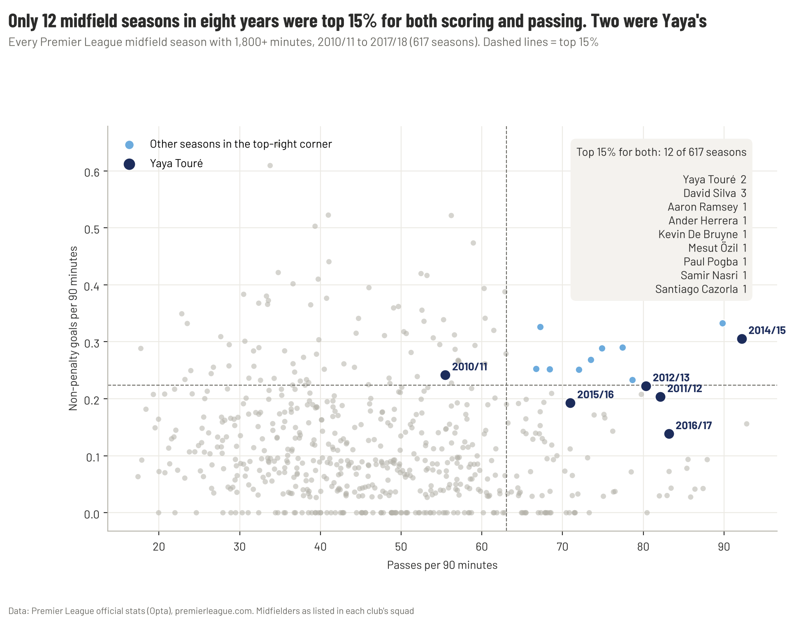

# 👤 Players

Projects about one player: what the numbers say about him, and how he compares with everyone else. Part of [**football-analytics**](../README.md).

| Project | Years | Question | Read |
| --- | --- | --- | --- |
| 🩵 [**Yaya Touré: Was He Under-Rated?**](Yaya-Toure-Man-City/) | Man City, 2010–2018 | Was Yaya Touré under-rated, and who really was? | [Report](Yaya-Toure-Man-City/docs/ARTICLE.md) · [PDF](Yaya-Toure-Man-City/reports/Yaya_Toure_article.pdf) |
| 🪄 [**David Silva: The Most Under-Rated Great?**](David-Silva-Man-City/) | Man City, 2010–2020 | Why is the decade's best creator left out of the all-time conversation? | [Report](David-Silva-Man-City/docs/ARTICLE.md) · [PDF](David-Silva-Man-City/reports/David_Silva_article.pdf) |
| 🎯 [**Christian Eriksen: The Most Productive Midfielder Nobody Talks About?**](Christian-Eriksen-Spurs/) | Spurs, 2013–2020 | More goals + assists than any midfielder of his time, and almost forgotten | [Report](Christian-Eriksen-Spurs/docs/ARTICLE.md) · [PDF](Christian-Eriksen-Spurs/reports/Christian_Eriksen_article.pdf) |

