# Yaya Touré: Was He Under-Rated?

Yaya Touré's eight seasons at Manchester City, compared with every Premier League midfielder of his era, plus a simple model of who the PFA Team of the Year voters reward, and who they overlook.

> Part of [**football-analytics**](../../README.md) › [**Players**](../README.md) · Author: **Hammad** · Python · pandas · scikit-learn · matplotlib · Jupyter

**📖 [Read the report](docs/ARTICLE.md)** ([PDF](reports/Yaya_Toure_article.pdf)) · closes repo issue #10 ("flag under-rated players with a simple model")

[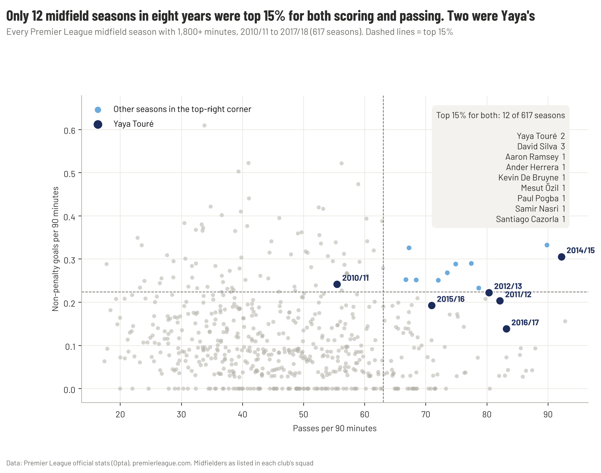](docs/ARTICLE.md)

## Key findings

- **2013/14:** 20 league goals and 9 assists. His 29 goals and assists were the most by any Premier League midfielder in a season from 2010/11 to 2017/18; only Gareth Bale (21) scored more goals.
- **But partly finishing:** those 20 goals came from chances worth 10.1 xG (Opta), and the next season he scored 10.
- **A rare profile:** of 617 regular midfield seasons, only 12 were top 15% for both scoring and pass volume. Two were his.
- **Big man, light feet:** only 20 of 617 regular midfield seasons were top third for dribbling and top quarter for passing and scoring. Six were his, at 188 cm; every other one but Pogba's 2017/18 came from a player 181 cm or shorter. From 2012/13 to 2015/16 he was never lower than 4th in the league for dribble success.
- **Unseen work:** in 2014/15 no Premier League midfielder did more build-up work (Understat xG build-up, rank 1 of 108).
- **The model:** voters reward minutes, dribbling, scoring and passing, not defending. By their own standards Touré was **not** under-rated: his numbers predicted about one Team of the Year place and he got two.
- **The all-time conversation:** he's outside the Premier League Hall of Fame and ranks behind the 2000s midfielders on most lists, yet his 0.41 goals + assists per Premier League game is level with Gerrard (0.42) and ahead of Scholes (0.32) and Vieira (0.21).
- **Who was under-rated:** Santi Cazorla and Mesut Özil (Opta model, 2010–18), and Özil and Roberto Firmino (Understat check, 2014–21): close to one expected selection each, none actual.

## Charts

| | |
| --- | --- |
| [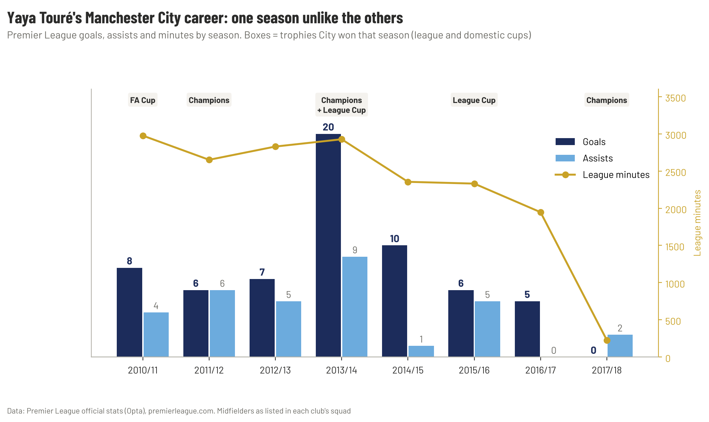](reports/figures/01_career_by_season.png) | [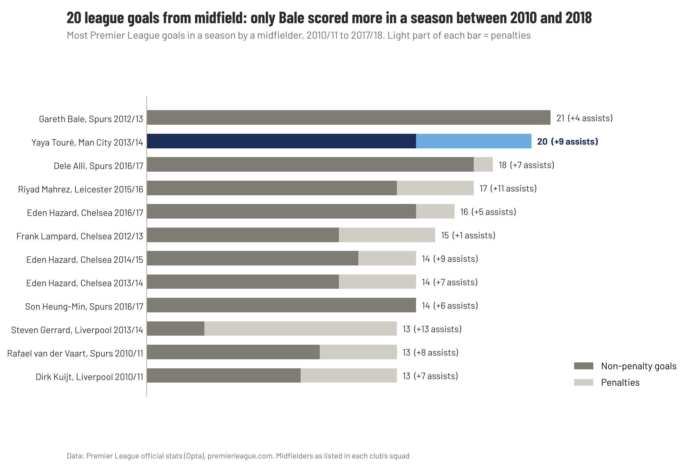](reports/figures/02_top_midfield_goal_seasons.png) |
| **1 ·** Eight seasons at City | **2 ·** Most goals in a season by a midfielder, 2010–18 |
| [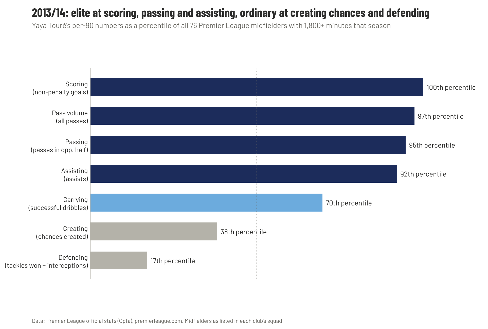](reports/figures/04_profile_2013_14.png) | [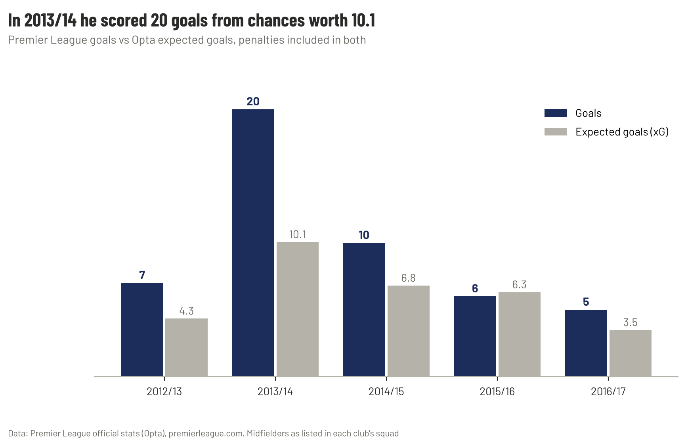](reports/figures/05_goals_vs_xg.png) |
| **4 ·** The 2013/14 profile in percentiles | **5 ·** Goals vs expected goals |
| [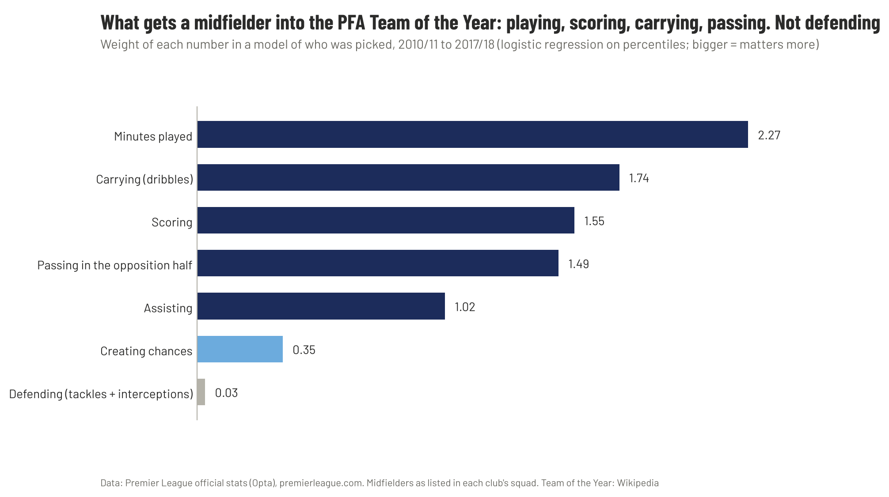](reports/figures/06_what_voters_reward.png) | [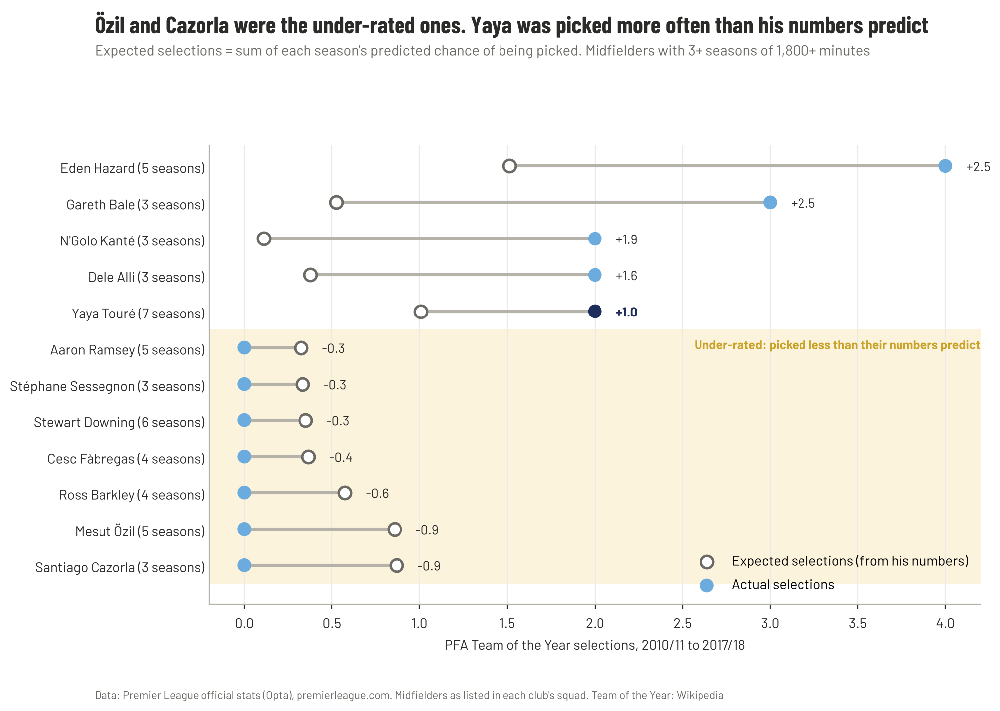](reports/figures/07_expected_vs_actual_selections.png) |
| **6 ·** What the Team of the Year rewards | **7 ·** Expected vs actual selections |

| [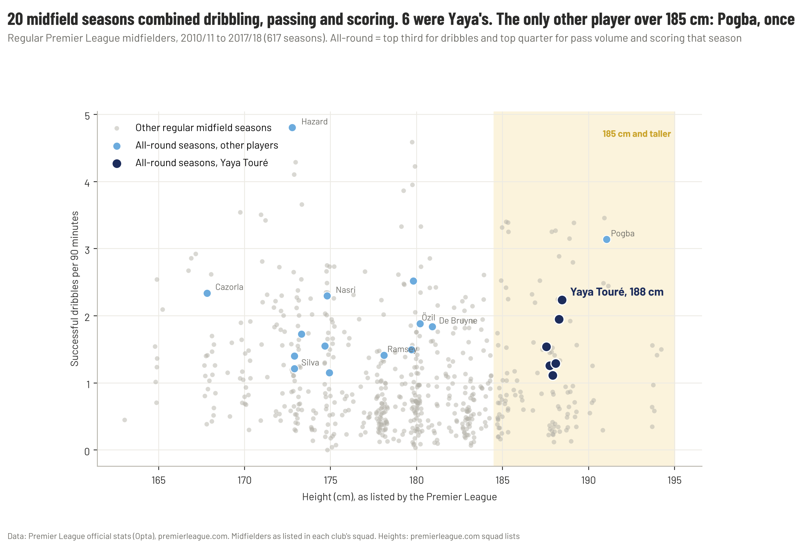](reports/figures/09_height_vs_dribbling.png) | [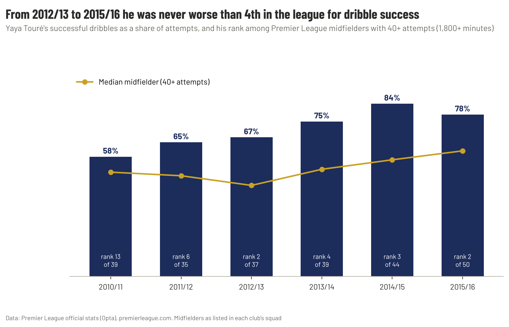](reports/figures/10_dribble_success.png) |
| **9 ·** 188 cm and an all-round dribbler, passer and scorer | **10 ·** Dribble success, rank among midfielders |
| [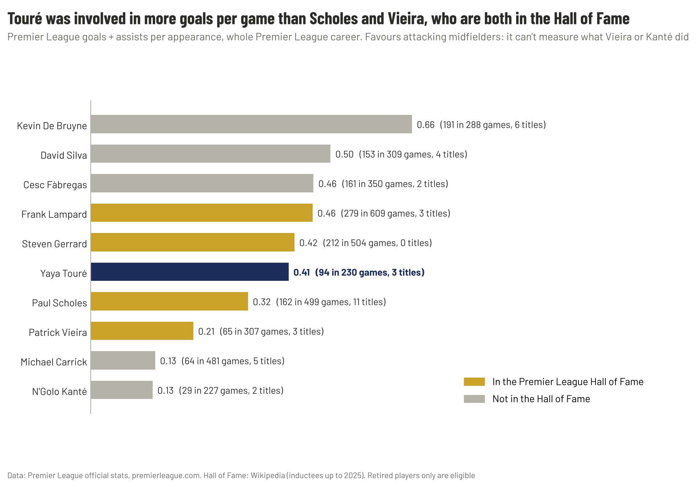](reports/figures/11_the_canon.png) | |
| **11 ·** Against the all-time greats, per game | |

[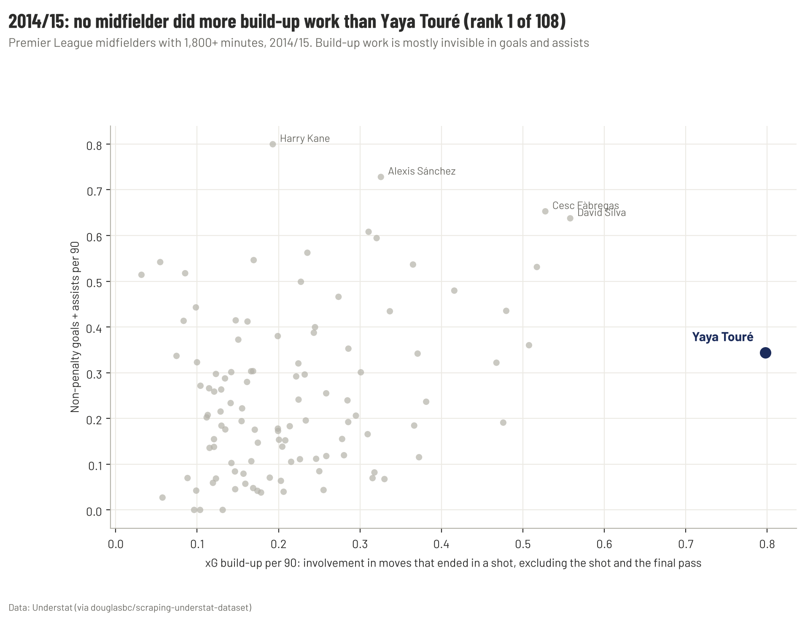](reports/figures/08_buildup_2014_15.png)

**8 ·** 2014/15: the most build-up work of any midfielder.

## Method

- **Opta data:** season stats for every player listed as a midfielder in a Premier League squad, 2010/11 to 2017/18 (1,629 player-seasons), from the public stats API behind premierleague.com. Saved in [`data/external/pl_midfielders_2010-2018.csv`](data/external/pl_midfielders_2010-2018.csv).
- **Heights:** listed height of each midfielder from the Premier League's squad lists ([`data/external/pl_midfielder_heights.csv`](data/external/pl_midfielder_heights.csv)).
- **Understat data:** xG, xA and xG build-up per player, 2014/15 to 2020/21.
- **Team of the Year:** midfielders picked each season, from Wikipedia ([`data/external/pfa_team_of_the_year.csv`](data/external/pfa_team_of_the_year.csv)).
- **The model:** logistic regression on six per-90 percentiles (scoring, assisting, creating, passing in the opposition half, dribbling, defending) plus minutes, held out by season. Expected selections = sum of each season's predicted probability.
- **Limits:** the model can't see team success or big moments; 30 selections is a small sample. See the report's appendix.

## How to run

From the repo root, after the [setup](../../README.md#setup):

```bash
python -m football_analytics.understat 14-15 15-16 16-17 17-18 18-19 19-20 20-21   # Understat data (~10 s)
cd Players/Yaya-Toure-Man-City
python notebooks/build_01_career.py && python notebooks/build_02_underrated_model.py && python notebooks/build_03_big_man_light_feet.py && python notebooks/build_04_the_canon.py
jupyter nbconvert --to notebook --execute --inplace notebooks/01_career.ipynb notebooks/02_underrated_model.ipynb notebooks/03_big_man_light_feet.ipynb notebooks/04_the_canon.ipynb
python reports/make_article_pdf.py
```

The Opta and Team of the Year data are already in `data/external/`, so the first notebook runs without any download.

## Folder structure

```
Yaya-Toure-Man-City/
├── README.md                               ← you are here
├── assets/fonts/                           ← Barlow (SIL Open Font License)
├── data/external/
│   ├── pl_midfielders_2010-2018.csv        ← Opta season stats, every PL midfielder 2010–18
│   ├── pfa_team_of_the_year.csv            ← Team of the Year midfielders, 2010/11 to 2021/22
│   ├── pl_midfielder_heights.csv           ← listed height of each midfielder
│   └── pl_career_midfield_greats.csv       ← career totals, ten all-time great midfielders
├── docs/
│   └── ARTICLE.md                          ← the report: 7 chapters, verdict and my take, 11 charts
├── notebooks/
│   ├── setup_cell.py                       ← shared first cell
│   ├── build_01_career.py / 01_career.ipynb                    ← charts 1–5
│   ├── build_02_underrated_model.py / 02_underrated_model.ipynb ← the model, charts 6–8
│   ├── build_03_big_man_light_feet.py / 03_big_man_light_feet.ipynb ← height and dribbling, charts 9–10
│   └── build_04_the_canon.py / 04_the_canon.ipynb  ← against the all-time greats, chart 11
└── reports/
    ├── Yaya_Toure_article.pdf
    ├── make_article_pdf.py
    └── figures/                            ← 11 charts
```
