# Yaya Touré: was he under-rated?

**Eight seasons at Manchester City, official stats for every Premier League midfielder of his era, and a simple model of who gets recognised. Eleven charts, and my own take at the end.**

*By Hammad · Data: Premier League official stats (Opta) for 1,629 midfielder-seasons, 2010/11 to 2017/18, and Understat xG, 2014/15 to 2020/21*

---

## The career in numbers

| | |
| --- | --- |
| **At City** | 2010–2018, eight Premier League seasons |
| **League goals / assists** | 62 / 32 |
| **Trophies** | 3 Premier League titles, FA Cup 2011, League Cups 2014 and 2016 |
| **Best season** | 2013/14: 20 goals and 9 assists from midfield |
| **PFA Team of the Year** | 2011/12 and 2013/14 |
| **African Footballer of the Year** | Four years running, 2011–2014 |

> **The short version.** Yaya Touré was a rare kind of midfielder: an elite scorer *and* an elite passer at the same time, with build-up work that goals and assists don't show, and, at 188 cm, one of the cleanest dribblers in the league. But by the standards the Premier League's players use when they vote, he wasn't under-rated: he made the PFA Team of the Year twice, when his numbers predicted once. The midfielders the voters really overlooked were Mesut Özil and Santi Cazorla. Where he *is* under-valued is now: outside the Hall of Fame and usually missing from the all-time conversation, even though his goal involvement per game matches Gerrard's.

## The question

I should say up front: Yaya Touré is one of my favourite players ever, and I loved watching him at City. There was something special about him. He was big and powerful, but he played with a calm and a grace that didn't seem to fit his size, as if the game moved a little slower for him than for everyone else. Players like that don't come along often.

So this report isn't neutral in where it starts. But I've tried to make it neutral in where it ends, and to let the numbers argue with me where they disagree.

Every few months someone posts a list of the greatest Premier League midfielders, and every time I go looking for Yaya Touré. Sometimes he's there, somewhere around tenth. Often he isn't. I wanted to find out whether that's fair, or whether he's one of those players everyone remembers as good and almost nobody remembers as great.

"Under-rated" is usually an opinion. This report tries to turn it into something I can measure:
- **Chapters 1–5:** what Yaya actually did, compared with every Premier League midfielder from 2010/11 to 2017/18, including what made him physically unusual: a 188 cm midfielder who moved like a small one.
- **Chapter 6:** a simple model of the PFA Team of the Year, which shows who the voters rewarded more, or less, than their numbers suggest.
- **Chapter 7:** how he's rated now, in the all-time conversation.

---

## Chapter 1 · Eight seasons

Touré joined from Barcelona in July 2010 for around £24 million. At Barcelona he had mostly played as a holding midfielder; Roberto Mancini pushed him further forward, and it changed his career. In his first season he scored the only goal in both the FA Cup semi-final against Manchester United and the final against Stoke, City's first major trophy since 1976. A year later City were champions for the first time in 44 years.

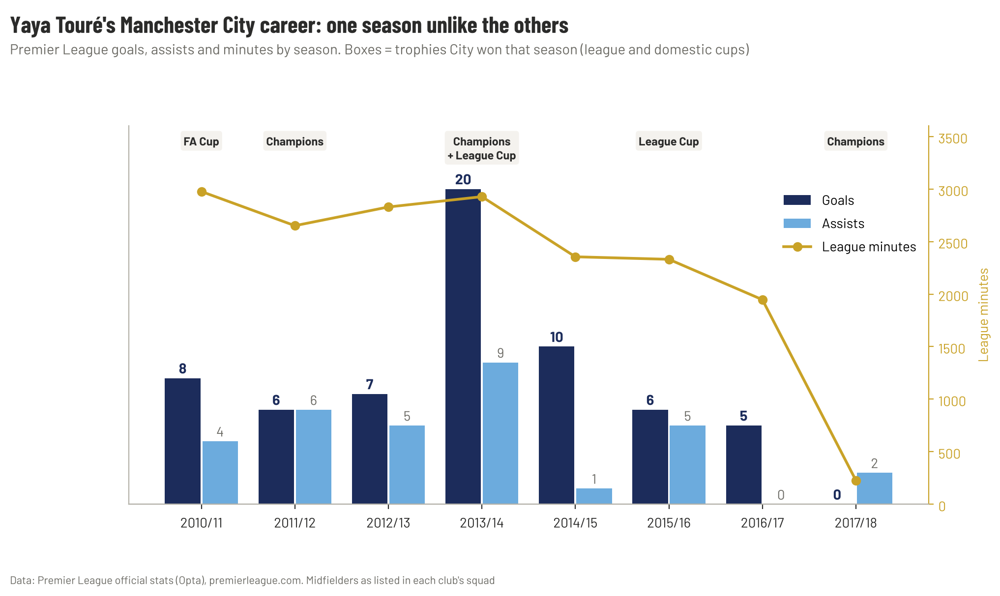

*Figure 1 · Premier League goals, assists and minutes, season by season, with the trophies City won.*

For three seasons he was a steady 6–8-goal midfielder who played almost every minute. Then came **2013/14: 20 goals and 9 assists**, more than double any other season of his. After that, his minutes fell every year. Under Pep Guardiola, the manager who had sold him at Barcelona, he was left out of the 2016/17 Champions League squad and played just 228 league minutes in his final season. It's a sad shape for a career: a long climb, one enormous peak, and a quiet slide out of the team.

---

## Chapter 2 · The 2013/14 season

If you only remember one Touré season, it's this one.

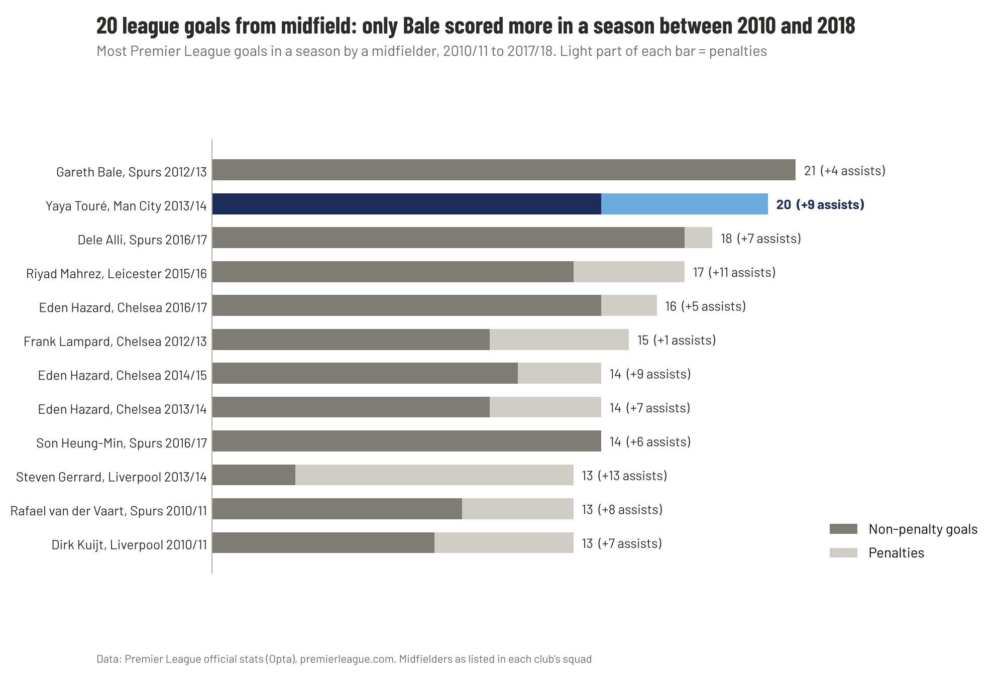

*Figure 2 · Most Premier League goals in a season by a midfielder, 2010/11 to 2017/18.*

Only one midfielder scored more league goals in a season in these eight years: Gareth Bale, with 21 for Tottenham in 2012/13. To be fair, six of Yaya's 20 were penalties, so on non-penalty goals (14) he drops behind Bale and Alli and level with Hazard and Son. But add his 9 assists and his **29 goals and assists were the most by any midfielder in a season in these eight years**, one ahead of Mahrez's 28 in Leicester's title season. City won the league and the League Cup, and Touré scored in the League Cup final.

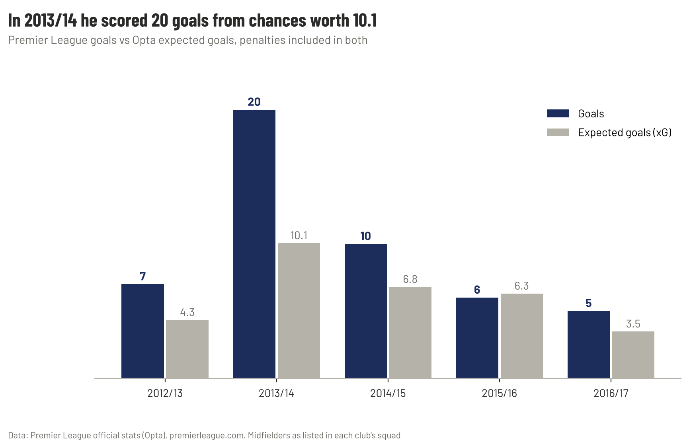

*Figure 3 · Goals vs Opta expected goals, 2012/13 to 2016/17 (penalties included).*

There's an honest caveat here. It was also a season of exceptional finishing: **20 goals from chances worth 10.1**. That's a rate expected goals doesn't expect to last, and it didn't: the next season he scored 10 from 6.8. Some of 2013/14 was skill, and some of it was a player in the form of his life.

He made the shortlist for the PFA Players' Player of the Year that season. Luis Suárez won it. His City teammate Micah Richards later said Touré "should have won it 100 per cent".

---

## Chapter 3 · A scorer and a passer at the same time

Most midfielders are one thing or the other. The ones who score don't see much of the ball, and the ones who see the most of it rarely score. Touré was both.

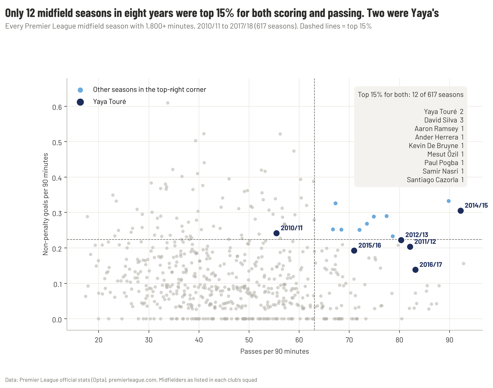

*Figure 4 · Every Premier League midfield season with 1,800+ minutes, 2010/11 to 2017/18: passes per 90 against non-penalty goals per 90.*

Of 617 regular midfield seasons, only **12** were in the top 15% for both scoring and pass volume. Two were Touré's (2013/14 and 2014/15). The rest belong to the great creative midfielders of the era: David Silva three times, plus Cazorla, Özil, De Bruyne, Pogba, Ramsey, Nasri and Herrera once each. In 2014/15 he made **92 passes per 90 minutes**, second only to Fernandinho's 93 in 2017/18 across all eight years, and still scored 10 goals.

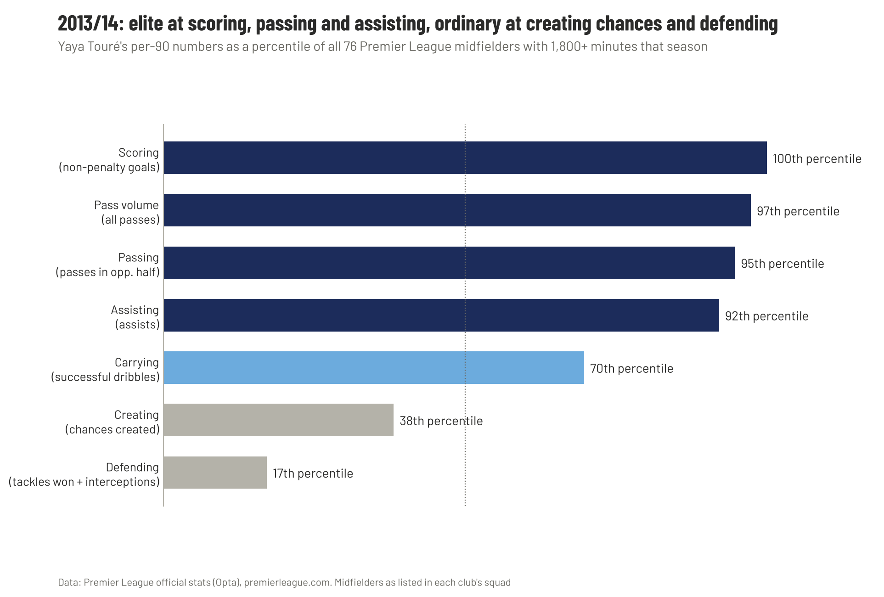

*Figure 5 · 2013/14: Touré's numbers as a percentile of the 76 midfielders with 1,800+ minutes that season.*

The profile is just as interesting for what he *wasn't*. In his best season he was in the **17th percentile for tackles and interceptions** and the 38th for chances created. So he wasn't a defensive midfielder, and he wasn't a classic number 10 either. He was a passer who arrived in the box and finished, with the strength to carry the ball through midfield himself. I can't think of a neat label for that, which is probably part of the point.

---

## Chapter 4 · Big man, light feet

What I remember most about watching Touré isn't a number. It's the sight of a 188 cm midfielder picking the ball up in his own half, leaning past one challenge, riding the next, and arriving in the opposition box a few seconds later. Big midfielders aren't supposed to move like that. They're supposed to win headers, hold position and pass sideways; the ones who glide past people are usually the small ones, the Silvas and Cazorlas.

I'm not the only one who noticed. Years before Touré came to England, his Ivory Coast teammate Didier Drogba called him "the new Patrick Vieira": tall and strong, but with great technique.

That's still a memory, though, and memories flatter. Luckily the Premier League lists every player's height in its squad data, so I could check it. At 188 cm, Touré was taller than about nine in ten regular Premier League midfielders of his era (the median was 180 cm).

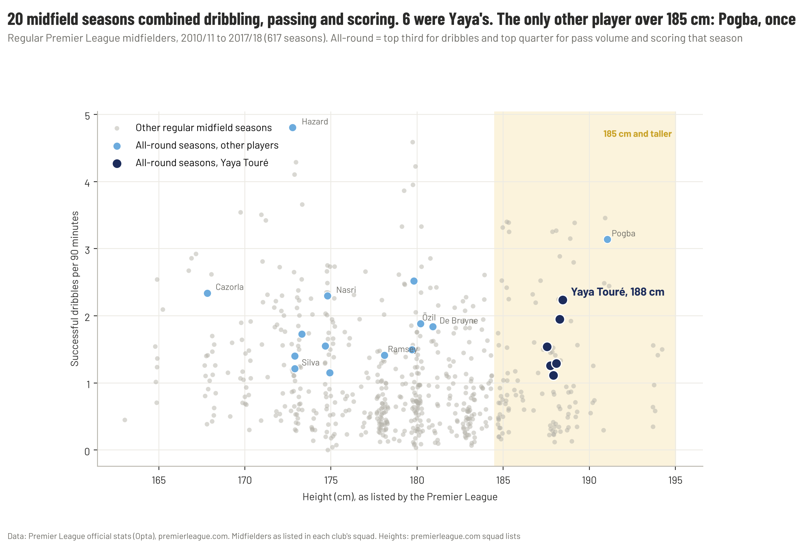

*Figure 6 · Every regular Premier League midfield season, 2010/11 to 2017/18: height against successful dribbles per 90. Highlighted: "all-round" seasons, top third for dribbling and top quarter for both pass volume and scoring.*

Only **20 of 617** regular midfield seasons were all-round in this sense: a midfielder who beat players, saw a lot of the ball *and* scored. **Six were Touré's, every season from 2010/11 to 2015/16.** Nobody else managed more than three. Now look at where the other 14 sit on the height axis: Silva (173 cm), Hazard (173), Nasri (175), Cazorla (168), Özil (180), De Bruyne (181), Ramsey (178). The only other player taller than 185 cm to have an all-round season was **Paul Pogba**, once, in 2017/18.

Tall midfielders who dribbled a lot did exist. Mousa Dembélé, Ross Barkley and Pogba all beat more players per 90 than Touré. But Dembélé didn't score, and Barkley didn't dominate the ball. Touré did all three, for six straight seasons.

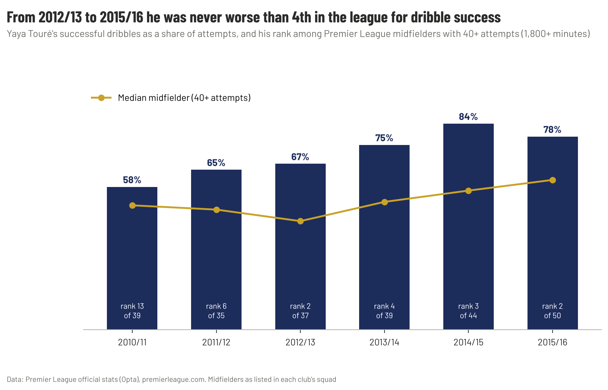

*Figure 7 · Touré's dribble success rate and his rank among midfielders with 40+ attempts.*

And it wasn't just how often he took players on, it was how rarely he lost the ball doing it. From 2012/13 to 2015/16 Touré completed **between 67% and 84% of his dribbles**, and was **never lower than 4th** among the league's regular midfielders for success rate. For a player built like the one who's supposed to get dribbled past, I find that remarkable.

One caveat: an Opta "dribble" is a take-on, an attempt to beat an opponent with the ball. It's the closest thing in the data to agility, but it misses a lot: the turn out of pressure, the long strides that carried him away from a challenge without a take-on ever being recorded. Watching him, those were half the point.

---

## Chapter 5 · The work nobody counts

Goals and assists only count the last two touches of a move. Understat's **xG build-up** measures everything before that: how involved a player was in moves that ended in a shot, leaving out the shot and the final pass.

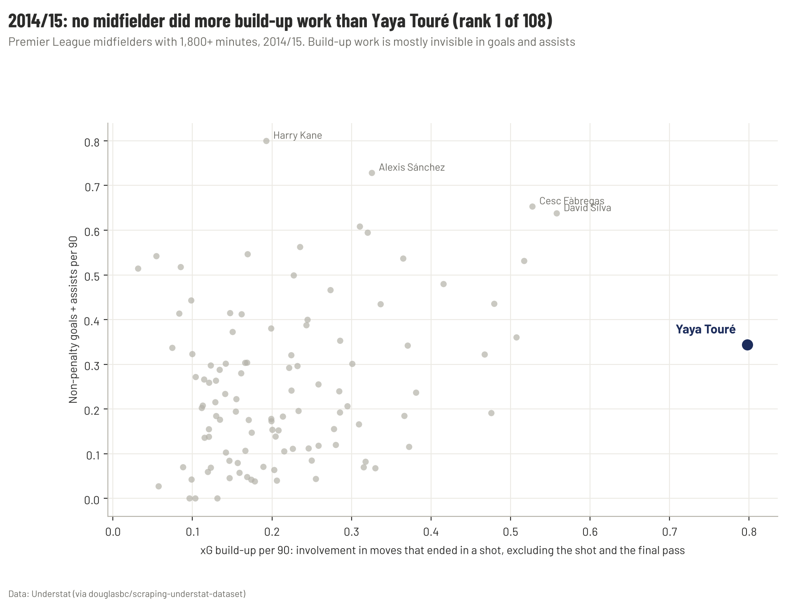

*Figure 8 · 2014/15: xG build-up per 90 against goals + assists per 90, every midfielder with 1,800+ minutes.*

In 2014/15, **no Premier League midfielder did more build-up work than Touré**: 0.80 xG build-up per 90, rank 1 of 108, well clear of David Silva and Cesc Fàbregas. His goals and assists that season (0.34 per 90) were good but not elite, which is exactly why this matters. This is the part of his game that box-score stats, and award votes, simply can't see.

---

## Chapter 6 · Was he under-rated? A model

So far this has been about what Touré did. Now for the harder question: was he given credit for it?

Every year, Premier League players vote for a PFA Team of the Year. If we learn what the voters usually reward, we can ask of any midfielder's season: *how likely was a player with these numbers to be picked?*

**The model.** A logistic regression that predicts selection from six per-90 numbers (scoring, assisting, creating chances, passing in the opposition half, dribbling, defending) and minutes played, all as percentiles within the season. Each season's predictions come from a model trained on the other seven seasons, so nobody is judged by a model that has already seen his own result. It separates selected and non-selected seasons well (held-out AUC 0.86).

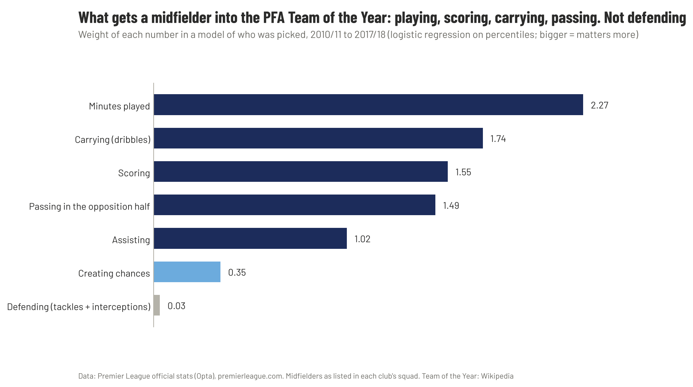

*Figure 9 · How much each number mattered in predicting selection, 2010/11 to 2017/18.*

The voters reward playing a lot, carrying the ball, scoring and passing high up the pitch. **Defending barely counts** (weight 0.03), which will surprise nobody who has ever watched a holding midfielder get left out of an awards team. The numbers are correlated with each other, so the weights show a pattern rather than exact causes, but the pattern is clear: the Team of the Year is built for attacking midfielders.

Adding up each player's predicted chances over his career gives his **expected selections**, which I can then compare with his **actual** selections:

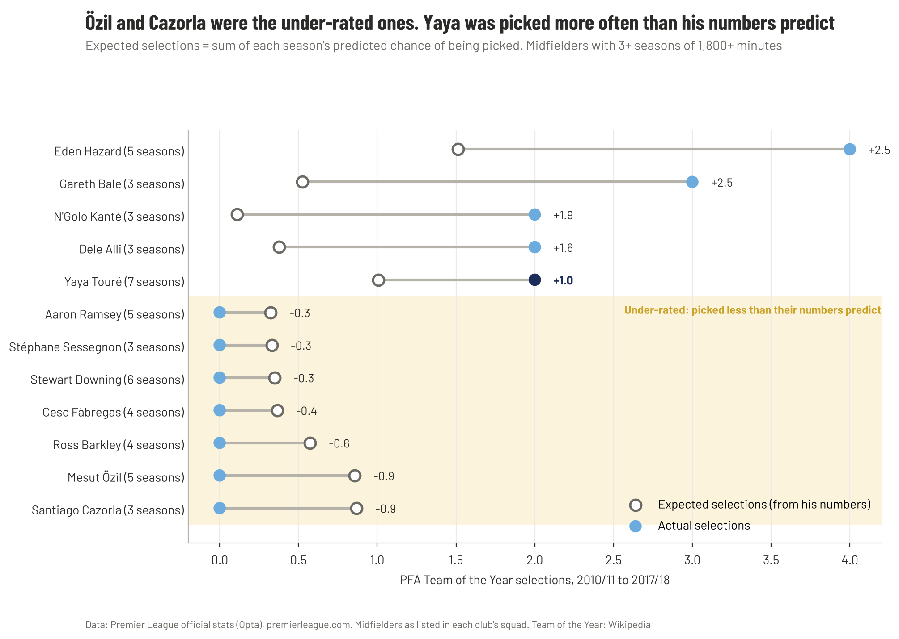

*Figure 10 · Expected vs actual PFA Team of the Year selections, midfielders with 3+ regular seasons, 2010/11 to 2017/18.*

This is where the result surprised me:
- **Yaya Touré was not under-rated by the voters.** His numbers predicted about **one** selection over seven seasons. He got **two**, in 2011/12 and 2013/14.
- **The most under-rated midfielders were Santi Cazorla and Mesut Özil.** Their numbers predicted almost one selection each (0.87 and 0.86). Neither was ever picked. Özil's 2015/16, with 19 assists, is the clearest miss.
- **The most over-rewarded were Eden Hazard and Gareth Bale** (2.5 selections more than predicted each) and **N'Golo Kanté**, whose defending the voters noticed even though the model, trained on what voters usually reward, didn't.

To make sure this wasn't a quirk of one data source, I ran the same model on Understat's xG-based numbers for 2014/15 to 2020/21. It came to the same conclusion: **Özil** and **Roberto Firmino** were the most under-rated (0.88 and 0.93 expected selections, none actual), and Touré's post-2014 seasons were nowhere near selection level.

I'll be honest: this isn't the answer I expected when I started. By the voters' own standards, Touré got his due.

---

## Chapter 7 · Missing from the conversation

But the model only asks whether Touré was rated fairly *at the time*. The question that started this report is a different one: how is he rated *now*, when people argue about the greatest midfielders the Premier League has had? On that, the record is much less kind to him.

**Where he shows up, and where he doesn't.**
- **The Hall of Fame.** The Premier League Hall of Fame has inducted Gerrard, Lampard and Keane (2021), and Vieira and Scholes (2022). Two of Touré's title-winning teammates, Agüero and Kompany, went in in 2022. Touré was on the 2022 nominee shortlist and has never been inducted.
- **The lists.** FourFourTwo ranked him 6th among the Premier League's best central midfielders in 2018, behind Keane, Lampard, Scholes, Gerrard and Vieira. By February 2026, Sports Illustrated's top 20 Premier League midfielders had him 12th, below Beckham, Rodri and Kanté. The usual "big five" of the 2000s are always ahead of him, and three other City midfielders, De Bruyne, Silva and Rodri, now rank above him too.

**What the players thought.** The people who played with and against him tend to rate him far more highly than the lists do. Some of the midfielders who sit above him on those lists have said so themselves:

> "He was an exceptional midfield player, he could do everything – scoring goals, defending on the transition." — **Patrick Vieira**, his City teammate in 2010/11

> "At his peak he could change games on his own … the best players are the ones you fear." — **Frank Lampard**, on Touré's last week at City, May 2018

> "One of the best central midfielders in the Premier League." He was "sensational" for three or four years. — **Gary Neville**, putting him in the same bracket as Keane, Gerrard, Lampard and Vieira, 2017

> "If you take that into account, then no one in the Premier League comes close to Yaya Toure." — **Patrick Vieira** again, arguing in 2014 that the PFA award shouldn't just be about goals and assists

> "If he wasn't African everyone will say he's the best midfielder in the world." — **Samir Nasri**, his City teammate

> "He was a top player, technically and tactically. He could run with the ball and he could score goals as well." — **Kolo Touré**, his brother, picking him in his all-time XI

> "Toure, like Zlatan Ibrahimovic, is one of those players who can make the difference." — **Roberto Mancini**, the manager who moved him forward at City, 2016

> "Yaya is a clever player with a technical ability to play quickly." — **Thierry Henry**, on Sky Sports, December 2016

Even Pep Guardiola, the manager who ended his City career, called him "without doubt one of the most important players in our history" in his final week at the club, and admitted that selling him at Barcelona was "maybe" a mistake.

**Does his record belong in that conversation?** Career totals don't help him: he played 230 Premier League games, about half as many as Gerrard, Lampard or Scholes. Per game is fairer.

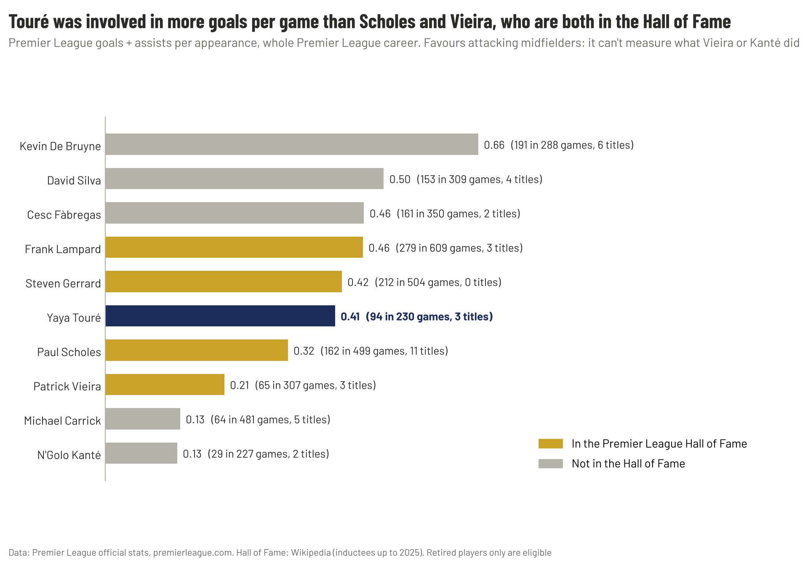

*Figure 11 · Premier League goals + assists per appearance over each player's whole Premier League career, with league titles and Hall of Fame status.*

Touré was involved in **0.41 goals per game**, level with Gerrard (0.42) and ahead of Scholes (0.32) and Vieira (0.21), and he won as many titles as Lampard or Vieira. This measure favours attacking midfielders and says nothing about what Vieira or Kanté were in the team to do, so I'm not using it as a ranking. But it does answer the idea that Touré's output wasn't at that level. It was.

**So why is he left out?** I think there are four reasons, and only one of them is about football:
1. **A short peak.** His great years were 2011 to 2015. Gerrard, Lampard and Scholes were elite for a decade.
2. **The club.** City's first titles are often filed under money rather than greatness, and the players who won them get judged the same way.
3. **The ending.** The 2014 row over his birthday, when his agent complained the club hadn't marked it, was mocked for years. Then came the public fall-out with Guardiola and 228 minutes in his last season. People remember the last chapter.
4. **The story.** The 2000s midfielders came with a narrative: the Gerrard-Lampard debate, Keane against Vieira. Touré arrived after that story had been written, and he's been treated as a footnote to it ever since.

---

## The verdict

> **Was Yaya Touré under-rated?** By the people who voted at the time, no: he was picked twice, more than his numbers predicted. But by the people who rank the Premier League's midfielders today, yes. He is outside the Hall of Fame, behind players with worse records on most all-time lists, and rarely in the conversation at all, even though his goal involvement per game matches Gerrard's and beats Scholes's and Vieira's. And the data shows why he was easy to miss: his best work was the kind box scores don't capture, from the most build-up of any midfielder in 2014/15 to an all-round game no other tall midfielder of his era matched.

**Under-rated in his time: no. Under-valued in the all-time conversation: yes.**

---

## My take

*This section is opinion, not analysis.*

I'll admit my bias again here: he's one of my favourite players, and I think he was genuinely special. Everything below comes from that place.

The numbers say the voters treated Touré fairly, and I accept that. But I don't think "under-rated" is really about award votes. It's about how a player is talked about now, and on that I think he's badly under-rated.

When people list the great Premier League midfielders, Touré tends to come after Gerrard, Lampard, Scholes, Vieira and Keane, if he makes the list at all. I think that's wrong. None of them combined his size, his touch and his running with the ball. At his best he could play as a holding midfielder, a box-to-box runner and a number 10 in the same match, and he did it while being one of the most reliable dribblers in the league at 188 cm. Chapter 4 backs up what my eyes told me: there wasn't another midfielder like him in that decade.

The Hall of Fame bothers me most. Agüero and Kompany are in it, and they deserve to be. But City don't win those first titles without Touré, and I'd argue he was the best player in the team in 2013/14. If the Hall of Fame can't find room for a midfielder with 62 goals, three titles and the highest-scoring season by a central midfielder between 2010 and 2018, it's measuring reputation, not football.

I also think he's the most important player of City's first title-winning era. Agüero scored the most famous goal, and Silva and Kompany were brilliant for longer. But in the seasons that turned City from big spenders into champions, Touré was the one who decided the big games: the FA Cup semi-final and final in 2011, the 20-goal season in 2013/14, the League Cup final goal that same year.

The way it ended still feels unfair to me. A player with that record deserved a better last chapter than 228 minutes and a public argument with his manager. That ending, more than anything in his numbers, is why I think he's remembered as a footnote to the Guardiola era rather than the player who made it possible.

So: not under-rated by the people who voted at the time. Under-rated, badly, by the people who talk about the Premier League now. I'd put him in the top ten midfielders the league has had, ahead of some of the names that are always on the list.

---

## What clubs can learn

1. **Awards follow minutes and attacking output.** A player who defends, or does his best work early in moves, will be under-rated by votes. Scouting shouldn't use awards as a shortcut.
2. **Look for rare combinations, not single numbers.** Touré was elite at two things that rarely go together. A percentile profile finds that; a goals table doesn't.
3. **Separate the peak from the finishing.** 20 goals from 10.1 xG was never going to repeat. Valuing a player on his best season's goals means paying for luck.
4. **Don't scout by body type.** A 188 cm midfielder gets projected as a ball-winner or a target man. Touré was one of the cleanest dribblers in the league. Measure what a player does, not what his frame suggests.
5. **Build-up is a skill.** xG build-up shows the players who make attacks happen without finishing them. Touré in 2014/15 is the example.

---

## Appendix

### Data and method

| Source | What it gives | Used for |
| --- | --- | --- |
| Premier League official stats (Opta), premierleague.com | Season stats for every Premier League midfielder, 2010/11 to 2017/18 (1,629 player-seasons; 617 with 1,800+ minutes) | Chapters 1–4 and 6 |
| [Understat](https://understat.com) (via douglasbc/scraping-understat-dataset) | xG, xA and xG build-up per player, 2014/15 to 2020/21 | Chapter 5 and the model check |
| Premier League squad lists, premierleague.com | Listed height of each midfielder (`data/external/pl_midfielder_heights.csv`) | Chapter 4 |
| Premier League career stats, premierleague.com | Appearances, goals and assists for ten all-time great midfielders (`data/external/pl_career_midfield_greats.csv`) | Chapter 7 |
| [PFA Team of the Year](https://en.wikipedia.org/wiki/PFA_Team_of_the_Year_(2010s)), Wikipedia | Midfielders picked each season, 2010/11 to 2021/22 (`data/external/pfa_team_of_the_year.csv`) | Chapter 6 |

- **Midfielder (Opta):** listed as a midfielder in his club's squad that season, so wide players such as Hazard, Bale and Mahrez are included. Players listed as forwards (Alexis Sánchez in 2014/15, Mohamed Salah in 2017/18) are not in the pool.
- **Midfielder (Understat):** played at least some of the season in midfield (position includes "M").
- **Regulars:** 1,800+ league minutes (about 20 full games).
- **Percentiles** are within each season, so every season counts equally.
- **The model:** scikit-learn logistic regression on seven percentile features. Predictions are held out by season (8-fold, one season per fold). Expected selections = the sum of a player's held-out probabilities.

### Limitations

- The model only knows what's in the numbers. It can't see team success, big-match moments, reputation or league position, all of which voters weigh.
- Thirty selections over eight seasons is a small sample, so player-level gaps under about 0.5 are noise.
- Opta expected goals only exist from 2012/13, and a few older Opta fields on premierleague.com (shots on target by zone, free kicks, game-winning goals) are unreliable for these seasons, so I didn't use them.
- Heights are as listed by the Premier League today, one value per player. Dribbles are Opta take-ons, which measure agility only partly.
- Chapter 7's career numbers cover goals and assists only, which favours attacking midfielders. Roy Keane isn't in the comparison because the API has no career record for players who retired before 2010. League title counts are from public records.
- The 2021/22 Understat season in the dataset is incomplete, so the check stops at 2020/21.

### Sources

- [Yaya Touré](https://en.wikipedia.org/wiki/Yaya_Tour%C3%A9), Wikipedia: transfer, honours, 2013/14 season, Guardiola dispute
- [Yaya should have won it 100 per cent: Richards](https://www.goal.com/en/news/yaya-should-have-won-it-100-per-cent---richards-says-man-city-players-overlooked-for-individual-awards/189aianxge7lq1kdfdz6j7npwk), Goal
- [Would Manchester City be where they are today without Yaya Touré?](https://africa.espn.com/football/story/_/id/37509002/would-manchester-city-where-today-yaya-toure), ESPN
- [Yaya Touré: Africa's greatest ever midfielder?](https://www.goal.com/en/news/yaya-toure-africas-greatest-ever-midfielder/1o76ufz5d5lp91ee1atp0z3yp2), Goal
- [Premier League Hall of Fame](https://en.wikipedia.org/wiki/Premier_League_Hall_of_Fame), Wikipedia: inductees 2021–2025, 2022 nominees
- [Ranked! The 10 best central midfielders in Premier League history](https://www.fourfourtwo.com/features/ranked-10-best-central-midfielders-cms-premier-league-history), FourFourTwo, November 2018
- [The 20 best Premier League midfielders of all time, ranked](https://www.si.com/soccer/best-premier-league-midfielders-all-time-ranked), Sports Illustrated, February 2026
- [Patrick Vieira praises "complete" Yaya Touré](https://www.inkl.com/news/patrick-vieira-praises-complete-yaya-toure-and-makes-managerial-prediction), Manchester Evening News, 2023
- [Frank Lampard: Yaya Touré one of the Premier League's greatest midfielders](https://www.sportsmole.co.uk/football/man-city/news/lampard-yaya-toure-one-of-prems-greatest_325465.html), Sports Mole, May 2018
- [Neville's Man City XI of the modern era](https://www.goal.com/en/news/best-in-the-premier-league-aguero-leads-nevilles-man-city-xi-of-the-modern-era/fmydicv5oifo1to25chxxrx2u), GOAL, April 2017
- [Vieira: Hazard and Suárez don't deserve PFA Player of the Year](https://sportskeeda.com/football/patrick-viera-eden-hazard-luis-suarez-dont-deserve-pfa-player-of-the-year-award-yaya-toure), Sportskeeda, 2014
- [Nasri: Touré under-rated because he is African](https://www.livesoccertv.com/news/9694/nasri-toure-is-underrated-because-he-is-african/), LiveSoccerTV
- [Kolo Touré picks his Perfect XI](https://fourfourtwo.com/person/player/yaya-toure-was-better-than-me-growing-up-i-dont-mind-that-my-brother-was-a-better-footballer-kolo-toure-picks-his-perfect-xi), FourFourTwo
- [Guardiola pays tribute to "beloved" Yaya Touré](https://fourfourtwo.com/news/guardiola-pays-tribute-beloved-yaya-toure) and ["Maybe I made a mistake"](https://www.fourfourtwo.com/news/maybe-i-made-a-mistake-guardiola-reflects-managing-toure), FourFourTwo, May 2018; ["Uncle" Yaya leaves City](https://www.thenationalnews.com/sport/football/uncle-yaya-toure-leaves-manchester-city-feeling-empty-after-his-pivotal-role-in-the-club-s-rise-1.728569), The National, May 2018
- [Mancini: Touré like Zlatan, Messi, Ronaldo](https://www.capitalfm.co.ke/sports/2016/09/08/toure-like-messi-ronaldo-says-mancini/), Capital FM, September 2016 (from *Corriere dello Sport*)
- [Henry on a fitter Yaya Touré](https://www.skysports.com/football/news/31969/10708993/henry-on-fitter-yaya-toure), Sky Sports, December 2016
- [Drogba: Yaya is the new Vieira](https://www.skysports.com/football/news/2354525/drogba-yaya-is-new-vieira), Sky Sports
- [Yaya Touré hit by tidal wave of scorn after "birthday snub"](https://www.theweek.co.uk/football/premier-league/58621/yaya-toure-hit-by-tidal-wave-of-scorn-after-birthday-snub), The Week, May 2014
- [PFA Team of the Year (2010s)](https://en.wikipedia.org/wiki/PFA_Team_of_the_Year_(2010s)) and [(2020s)](https://en.wikipedia.org/wiki/PFA_Team_of_the_Year_(2020s)), Wikipedia
