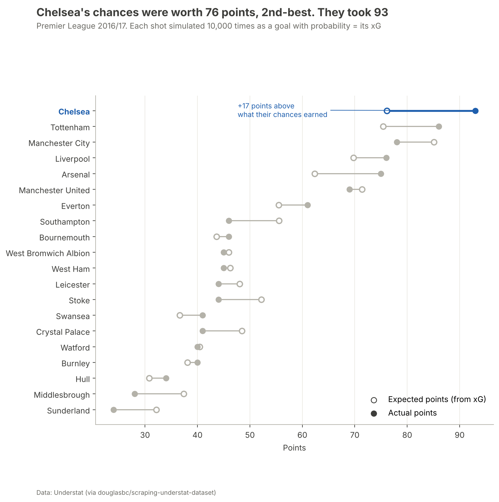

# From 10th to Champions: Chelsea 2016/17

A data analysis of how Antonio Conte's Chelsea went from 10th place to Premier League champions in one season, using xG for every shot of both seasons (Understat) and official Premier League (Opta) stats.

> Part of [**football-analytics**](../../README.md) › [**Premier League**](../README.md) · Author: **Hammad** · Python · pandas · matplotlib · Jupyter

**📰 Read the report: [The Back-Three Revolution](docs/ARTICLE.md)**: the season in ten chapters and 21 figures, including the managers before Conte, his tactics from Bari to Chelsea, a profile of every signing, and the players who were already there ([PDF version](reports/Chelsea_2016-17_article.pdf))

## The question

In 2015/16 Chelsea finished **10th** and sacked José Mourinho in December. A year later they won the league with **93 points** and a record **30 wins**. What changed?

## Key findings

| | Finding |
| --- | --- |
| 📈 | **2nd-best on chances, champions on points.** Their chances were worth 76 expected points (Man City's were worth 85). They took 93, the biggest gap in the league. |
| 🔁 | **The switch to 3–4–3 changed the defence, not the attack.** After 1 October 2016, xG created per match stayed at 1.64, but xG conceded fell from 0.96 to 0.72, and they won 13 in a row. |
| 🎯 | **The best finishing in the league.** 81 non-penalty goals from chances worth 59.4 (+21.6), almost twice the next team. Nine players beat their xG. |
| 🧱 | **Open-play chances conceded almost halved** from the 10th-place season (0.90 → 0.51 xG per match). Shots conceded fell from 12.8 to 8.6 per match. |
| ⭐ | **Hazard's goals per 90 rose 151%** (4 league goals → 16). Costa scored 20, joint-4th in the league. |
| 💷 | **Three of four big signings became regulars:** Kanté (£32m), Luiz (£30m) and Alonso (£23m). Batshuayi (£33.2m) played 6% of minutes; Moses, back from a loan, became the right wing-back. |
| 🧭 | **Conte's 3-4-3 conceded less than any Chelsea side of three seasons**, even Mourinho's 2014/15 champions (0.72 vs 0.84 xG per game). Hiddink had fixed the attack (1.60 xG) but not the defence (13.2 shots conceded per game). |
| ↔️ | **The new wing-backs carried 2–3 times the goal threat of the old full-backs:** Moses 0.24 npxG + xA per 90 vs Ivanović 0.13; Alonso 0.24 vs 0.09. |
| 🔁 | **Eight of the eleven title-winning starters were already at the club in the 10th-place season.** Hazard went from 4 league goals to 16 on twice as many shots; Courtois from 5 clean sheets to 16; Azpilicueta played every minute at right centre-back. |
| 🔄 | **Kanté changed jobs:** fewer tackles than at Leicester (5.2 → 3.6 per 90), far more passes (43 → 61) at 89% accuracy. |

## Explore the project

| Read | What's inside |
| --- | --- |
| 📰 [**The report**](docs/ARTICLE.md) · [PDF](reports/Chelsea_2016-17_article.pdf) | Ten chapters in season order: the wreckage, the managers before (Mourinho, Hiddink), Conte's tactics at Bari, Juventus and Italy, the summer and every signing's profile, the switch, 13 in a row, the goals, the players who were already there, the verdict |
| ✅ [Findings log](docs/results.md) | 35 numbered findings, each with its evidence and a confidence rating |
| 📓 [Notebooks](notebooks/) | Four notebooks, all re-runnable |
| 📊 [Chart gallery](reports/figures/README.md) | Every figure with a one-line takeaway |

[](docs/ARTICLE.md)

## Data

| Source | What it contains | Used for |
| --- | --- | --- |
| [Understat](https://understat.com) (via [a public copy](https://github.com/douglasbc/scraping-understat-dataset)) | xG for every shot and player season totals, 2014/15 to 2016/17; Serie A and Ligue 1 player totals, 2015/16 | Expected points, finishing, players, manager spells, signings |
| [Premier League stats](https://www.premierleague.com/en/stats) (Opta) | All 20 clubs' 2016/17 totals, Chelsea 2015/16, Kanté and nine returning players, both seasons (`data/external/`) | Team style, Kanté, returning players |
| [Wikipedia](https://en.wikipedia.org/wiki/2016%E2%80%9317_Chelsea_F.C._season) | Fees, formation-change date, records (`data/external/facts.md`) | Signings, timeline |

## Folder structure

```
Chelsea-2016-17-Conte/
├── README.md                  ← you are here
├── docs/
│   ├── ARTICLE.md             ← the main read: the season in ten chapters
│   └── results.md             ← 35 numbered findings with evidence
├── notebooks/                 ← 01–04 (+ the scripts that build them)
├── reports/
│   ├── figures/               ← all 21 figures
│   ├── Chelsea_2016-17_article.pdf
│   └── make_article_pdf.py    ← rebuilds the PDF from ARTICLE.md
└── data/external/             ← Opta stats and sourced facts
```

## How to run

From the repo root (one-time setup is in the [main README](../../README.md#setup)):

```bash
python -m football_analytics.understat 15-16 16-17   # download Understat shots and players (~5 s)
cd Premier-League/Chelsea-2016-17-Conte
python notebooks/build_01_how_they_won.py && python notebooks/build_02_players_and_style.py
jupyter nbconvert --to notebook --execute --inplace notebooks/0*.ipynb
python reports/make_article_pdf.py                    # rebuild the article PDF
```

## Skills used

| Area | What this project shows |
| --- | --- |
| **Statistics and modelling** | Monte Carlo expected points (10,000 replays per match); before/after comparison; per-90 rates; rolling averages |
| **Football metrics** | xG, expected points, finishing vs xG, xA, key passes, xGChain, xGBuildup |
| **Data collection and quality** | Official club pages read for all 20 clubs; a data error found and documented (shots = 2 × shots on target) |
| **Visualisation** | 21 figures: dumbbells, match-by-match bars, league strips, heatmap, leaderboards, a formation diagram (mplsoccer), manager-spell and before/after player comparisons, player cards, shot maps |
| **Communication** | A long-form report in season order with sourced tactical analysis, and a numbered findings log with confidence ratings |

## Acknowledgements

Shot data from [Understat](https://understat.com). Season statistics from the Premier League (Opta).
