# The Back-Three Revolution

**How Antonio Conte took Chelsea from 10th to champions in twelve months: a season told in ten chapters and 21 figures**

*By Hammad · Data: Understat (xG for every shot of 2014/15 to 2016/17), Premier League official stats (Opta), published tactical analysis*

---

## The season in numbers

| | 2015/16 | 2016/17 |
| --- | --- | --- |
| **Finish** | 10th | **1st** |
| **Points** | 50 | **93** (2nd-highest in Premier League history at the time) |
| **Wins** | 12 | **30** (a Premier League record) |
| **Manager** | Mourinho, then Hiddink (interim) | Conte |
| **Expected points** (what the chances were worth) | 60 (7th-best) | 76 (2nd-best) |
| **xG conceded per match** | 1.19 | **0.75** |
| **Non-penalty goals vs expected** | 51 from 51.0 | **81 from 59.4** |

> **The story in three lines.** Chelsea's chances in their 10th-place season were already worth 7th. Conte's switch to a back three on 1 October 2016 cut the chances they conceded without costing anything in attack. Then the finishing ran hot, +21.6 goals above expected, and a 2nd-best team on chances won the league by 7 points.

**Reading the data in this report:** *xG (expected goals)* is the chance a shot becomes a goal, based on thousands of similar shots. *Expected points* replays every match 10,000 times with each shot going in at its xG, and averages the points. *Per 90* means per 90 minutes played.

---

## Chapter 1 · The wreckage

On 17 December 2015, after nine defeats in sixteen league games, Chelsea sacked José Mourinho seven months after he had won them the title. Guus Hiddink steadied things as interim manager, but the club finished **10th**, its lowest Premier League finish since 1995/96 and the worst title defence in the league's history. For the first time since 1996/97, there would be no European football the following season.

Was the team really that bad? The chances say no.

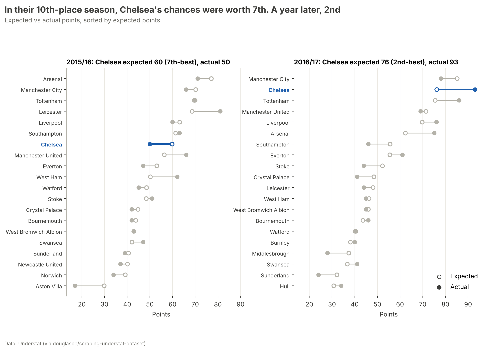

*Figure 1 · Expected (hollow) and actual (filled) points for every team, 2015/16 on the left and 2016/17 on the right. Chelsea in blue.*

On chances, the 2015/16 side was worth **60 points, the 7th-best total**, ten more than it actually won. Eden Hazard, the PFA Players' Player of the Year the season before, scored 4 league goals. Diego Costa scored 12, exactly in line with his chances. It was a decent team having a bad year.

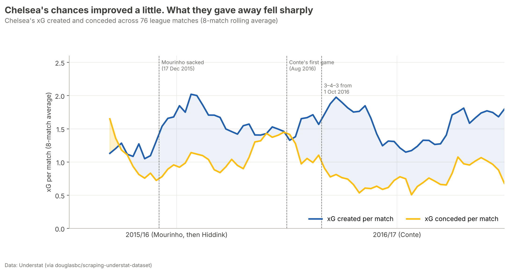

*Figure 2 · Chelsea's xG created (blue) and conceded (gold) over all 76 league matches of both seasons, as an 8-match average. Dashed lines: Mourinho's sacking, Conte's first game, the switch to 3–4–3.*

The left half of Figure 2 shows the problem. Chelsea created enough, about **1.44 xG per match**, but also gave a lot away: **1.19 xG and 12.8 shots per match**. Under Hiddink the two lines met. Whoever came next needed to fix the defence first.

---

## Chapter 2 · The men before him

To see what Conte changed, start with what he inherited. In the two seasons before he arrived, Chelsea had three managers' ideas of how to play, and the data shows each one clearly.

### José Mourinho, 2014/15: the champions

Mourinho's title side played a **4-2-3-1** with the ball and dropped into a **4-4-1-1 or 4-1-4-1** without it. Sports Illustrated's analysis at the time described the roles:
- **Matić** screened the back four; **Fàbregas** played deeper and created from there.
- **Hazard** stayed high on the left, an outlet for the counter-attack, while **Oscar** pressed from the No. 10 role.
- **The full-backs**, Ivanović and Azpilicueta (or Filipe Luís), pushed on to give width.
- Against the strongest teams, Chelsea sat in a **low block** and played on the break.

It worked on every measure: **2.29 points, 1.87 xG created and 0.84 xG conceded per game**, and the finishing was almost exactly level with the chances (+0.9 goals over the season). Costa scored 20 and Hazard 14. This was a team that won the league on its chances, not on luck.

### José Mourinho, 2015/16: the collapse

Mourinho kept the same shape and almost the same players, and it fell apart. Bleacher Report's tactical review of the first months listed the problems: the pressing stopped working, Ivanović was the only natural width, Fàbregas and Matić were left exposed in front of the defence, and Terry and Cahill were pulled apart by quicker forwards. Oscar was dropped.

The numbers fell on both sides of the ball at once. In 16 games, xG created dropped from **1.87 to 1.22 per game**, xG conceded rose from **0.84 to 1.19**, and open-play xG conceded from **0.60 to 0.92**. The finishing went cold as well (4.6 goals below the chances). Nine defeats later, he was sacked. Hazard later compared the two managers: "With Mourinho, he put in a system but we didn't work lots."

### Guus Hiddink, 2015/16: the repair

Hiddink, back for a second interim spell, made no sweeping changes. He kept the back four, calmed the dressing room, made the midfield more solid and got Costa scoring again (9 league goals in his 22 games).

He fixed half the problem. Chelsea went **unbeaten in his first 15 league games**, and xG created recovered to **1.60 per game**, close to the title-winning level. But the defence didn't improve at all: **1.20 xG and 13.2 shots conceded per game**, the most of any of the five spells. Eleven of his 22 games were draws.

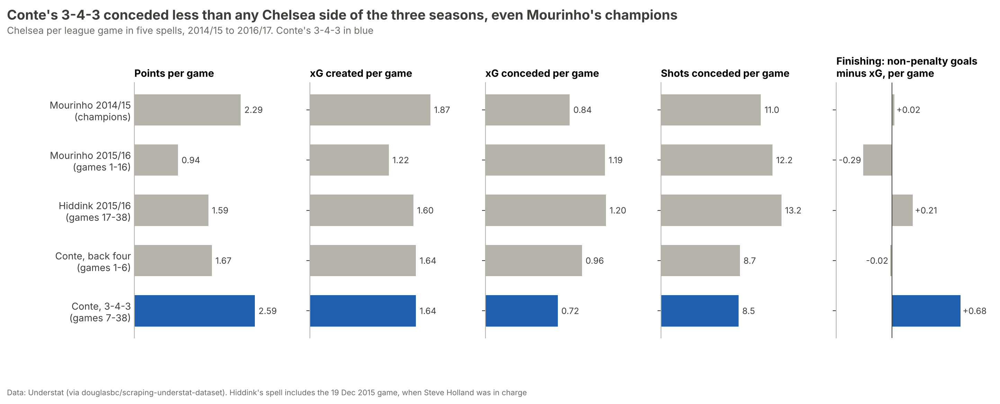

*Figure 3 · Chelsea per league game in five spells: Mourinho 2014/15, Mourinho 2015/16 (games 1–16), Hiddink (games 17–38), Conte with a back four (games 1–6) and Conte's 3-4-3 (games 7–38).*

Figure 3 puts the three managers next to Conte. Read the xG conceded column from top to bottom: 0.84, 1.19, 1.20, then 0.96 in Conte's first six games, then **0.72** with the back three. In open play the 3-4-3 conceded just **0.48 xG per game**, less than Mourinho's champions (0.60). Conte's team never created as much as Mourinho's title side (1.64 against 1.87 xG per game). It won the league by giving away less than any Chelsea side of the three seasons, and then by finishing far above its chances (+0.68 goals per game).

> **Key number · 13.2 to 8.5.** Shots conceded per game under Hiddink, then in Conte's 3-4-3. Hiddink fixed the attack and the mood; Conte fixed the defence.

### How different were they?

| | Mourinho 2014/15 | Mourinho 2015/16 | Hiddink 2015/16 | Conte 2016/17 |
| --- | --- | --- | --- | --- |
| **Shape** | 4-2-3-1 | 4-2-3-1 | 4-2-3-1, few changes | 3-4-3 from game 7 |
| **Without the ball** | 4-4-1-1, low block against big teams | Pressing broke down | More solid midfield | 5-4-1 mid-block |
| **Width** | Overlapping full-backs | Ivanović the only natural width | Full-backs | Two wing-backs, Moses and Alonso |
| **Hazard's role** | High on the left, counter outlet | 4 goals all season | | Inside forward, free to drift |
| **Points per game** | 2.29 | 0.94 | 1.59 | **2.59** |
| **xG created / conceded per game** | 1.87 / 0.84 | 1.22 / 1.19 | 1.60 / 1.20 | 1.64 / **0.72** |
| **Shots conceded per game** | 11.0 | 12.2 | 13.2 | **8.5** |

The biggest difference wasn't the formation. Mourinho and Hiddink both played with a back four and two full-backs; Conte added a centre-back and asked his wide players to cover the whole flank. Hazard put the change in training terms: "In tactics and training we do more with Conte."

---

## Chapter 3 · The manager

Antonio Conte arrived from the Italy national team with a clear tactical identity, built over a decade in Italy.

| Club | Years | Main shape | What it won |
| --- | --- | --- | --- |
| Bari | 2007–2009 | **4-2-4** | Serie B title and promotion (2008/09) |
| Siena | 2010–2011 | 4-2-4 | Promotion to Serie A |
| Juventus | 2011–2014 | Started 4-2-4; tried 4-1-4-1, 4-3-3, 3-3-4; settled on **3-5-2** | Three Serie A titles: unbeaten in 2011/12, a record 102 points in 2013/14 |
| Italy | 2014–2016 | **3-5-2** (3-3-4 attacking, 5-3-2 defending) | Euro 2016 quarter-final: beat Belgium and Spain, lost to Germany on penalties |

**The Serie B years.** At Bari and Siena, Conte played an attacking **4-2-4**: a 4-4-2 with wingers instead of wide midfielders, so the team attacked with four. It won him two promotions, and it was the shape he first wanted at Chelsea.

**Juventus and the 3-5-2.** At Juventus, he experimented through his first season before settling on the **3-5-2** that made his name and helped revive three-man defences across Europe:
- **Back three:** Barzagli, Bonucci and Chiellini, three ball-playing centre-backs in front of Buffon.
- **Pirlo** dropped between the centre-backs to start every attack.
- **Two runners:** Vidal broke forward between the lines; Marchisio dropped to help on the ball side.
- **Asymmetric wing-backs:** Asamoah attacked on the left, Lichtsteiner covered on the right.
- **A front two:** Tevez dropped deep to link play, Llorente won the ball in the air.

Juventus won three straight titles, the first unbeaten and the third with 102 points, and scored more every season (1.79, 1.87, then 2.10 goals per game).

**Italy.** With the national team, he kept the 3-5-2 and much of the Juventus defence. At Euro 2016, Italy pressed high even when winning: against Belgium they were still pressing near halfway at 1–0 late on, and won 2–0 with 45% of the ball. Conte rejected the "counter-attacking" label, saying his teams trained everything "except counter-attacks".

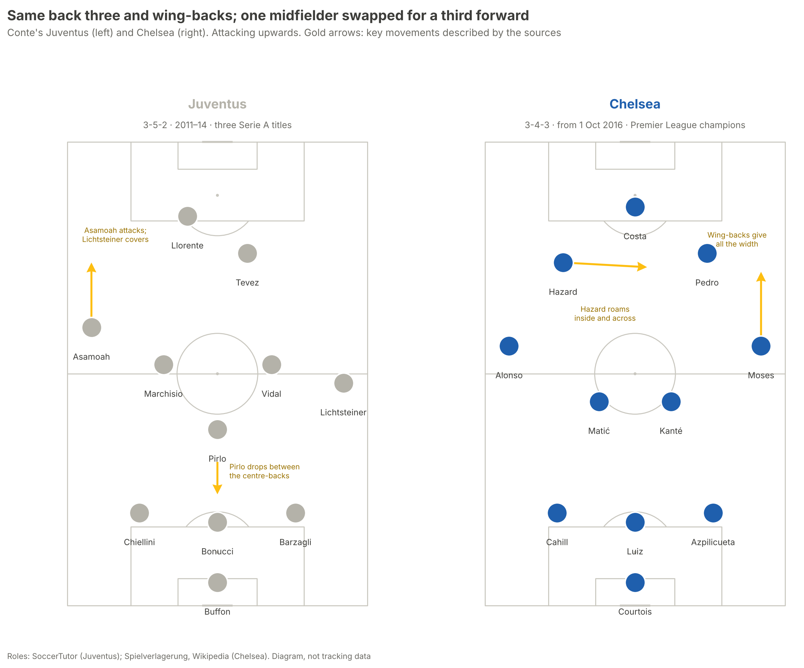

*Figure 4 · Conte's Juventus 3-5-2 (left) and Chelsea 3-4-3 (right), as described by the tactical sources. A diagram of roles, not tracking data.*

Figure 4 shows where this was heading. The back three and the wing-backs would survive the move to London. A midfielder would not.

---

## Chapter 4 · The summer

Conte added four big signings in summer 2016 (fees from the club's season record on Wikipedia):

| Player | From | Fee | Share of league minutes |
| --- | --- | --- | --- |
| N'Golo Kanté | Leicester City | £32m | **92%** |
| David Luiz | Paris Saint-Germain | £30m | **87%** |
| Marcos Alonso | Fiorentina | £23m | **79%** |
| Michy Batshuayi | Marseille | £33.2m | 6% |

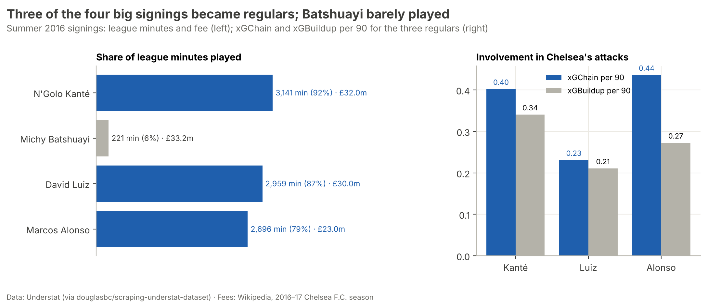

*Figure 5 · Left: each signing's share of league minutes and fee. Right: involvement in Chelsea's attacks (xGChain and xGBuildup per 90) for the three regulars.*

Three of the four became regulars; the most expensive, Batshuayi, barely played. Alonso became the most involved of them in Chelsea's attacks (**0.44 xGChain per 90**), with Kanté close behind (0.40). Just as important was a player who wasn't signed: **Victor Moses**, back from a loan at West Ham, became the right wing-back and played 2,519 league minutes.

The headline signing was Kanté, fresh from winning the league with Leicester. But Chelsea didn't use him the way Leicester had.

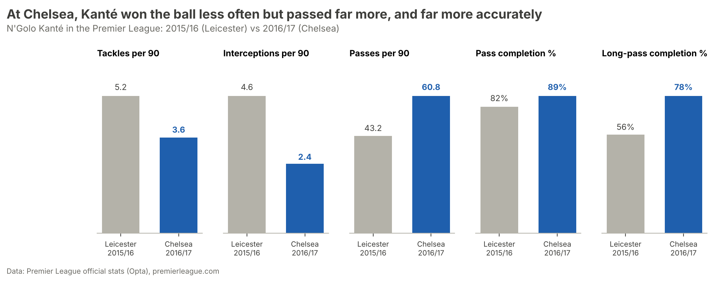

*Figure 6 · N'Golo Kanté per 90 minutes: 2015/16 at Leicester (grey) vs 2016/17 at Chelsea (blue). Official Premier League stats.*

> **Key number · 61 passes per 90.** At Leicester, Kanté made 43 passes and 5.2 tackles per 90. At Chelsea, 61 passes at 89% accuracy, and 3.6 tackles. Same player, different job.

At Leicester, a team with 42% possession, Kanté chased the ball across the pitch. At Chelsea, a team that had far more of the ball, he won it back less often and passed it far more; his long-pass completion rose from 56% to 78%.

### The new men, one by one

Why did the newcomers fit so quickly? Each was given a job close to something he had already done, with cover around him for the part he did badly.

**N'Golo Kanté · from Leicester · one of a midfield two.** At Leicester he was the ball-winner in a 4-4-2. At Chelsea he did the same job beside Matić, but in a team that kept the ball, so he also became a link in the build-up: his xGBuildup rose from **0.26 to 0.34 per 90**. He played 92% of league minutes and won the PFA Players' Player of the Year award.

**David Luiz · from Paris Saint-Germain · the middle of the back three.** He had played centre-back for Benfica, Chelsea, PSG and Brazil, but critics saw him as "often a liability" in a back two (The National). In the middle of three, with Azpilicueta and Cahill either side, he played almost as a sweeper and had time on the ball to start attacks. Signed on deadline day (31 August), he started against Hull a month later and played 87% of league minutes.

**Marcos Alonso · from Fiorentina · left wing-back.** At Fiorentina he was listed as a left-back and left midfielder, the two halves of a wing-back's job, after spells at Bolton and on loan at Sunderland. At Chelsea he scored **6 league goals** (3 the season before) and had the highest xGChain of any signing (0.44 per 90).

**Victor Moses · back from a loan at West Ham · right wing-back.** A winger at Crystal Palace and Wigan, then loaned to Liverpool, Stoke and West Ham, he had not played a competitive game for Chelsea since May 2013. Conte never asked him whether he wanted to play wing-back; Moses said later that the manager "just put me in there", against Hull, and coached him into the role in training. By December he was third in the squad for successful dribbles per 90 (Sky Sports), and his winner against Tottenham in November kept the 13-game run going. He played 2,519 league minutes.

**Michy Batshuayi · from Marseille · the back-up striker.** He scored 17 Ligue 1 goals in 2015/16, from chances worth almost exactly that (17.1 npxG). At Chelsea he was stuck behind Costa (3,101 minutes): 221 league minutes, mostly from the bench. He still scored 5, including the late winner at West Brom on 12 May 2017 that won the title.

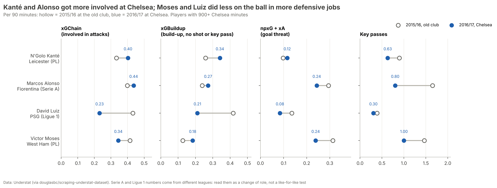

*Figure 7 · Each regular signing per 90 minutes: 2015/16 at his old club (hollow) vs 2016/17 at Chelsea (blue). Alonso's and Luiz's old numbers come from Serie A and Ligue 1.*

Figure 7 shows how each new job changed the player. **Kanté** and **Alonso** became more involved in Chelsea's attacks than they had been at their old clubs. **Moses** was less of a threat per 90 than in his attacking role at West Ham (0.24 against 0.31 npxG + xA) but played two and a half times the minutes. **Luiz** did half as much on the ball as at PSG (0.23 against 0.43 xGChain): at a team that dominated the ball he was a main builder; at Chelsea his first job was to defend.

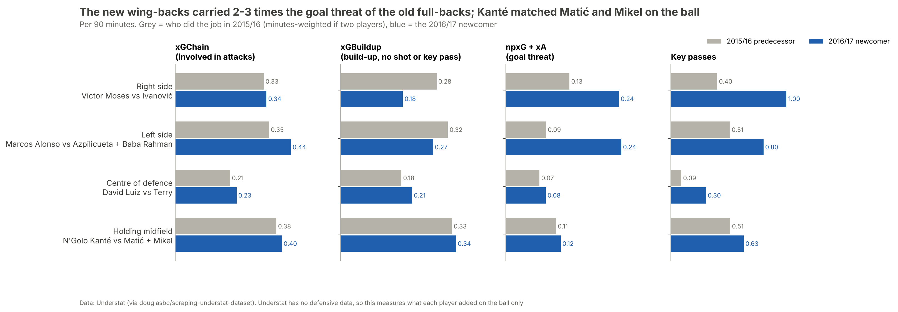

*Figure 8 · Each newcomer (blue) against the player who did that job for Chelsea in 2015/16 (grey; minutes-weighted where two players shared it).*

Figure 8 is the better test, because it compares players in the same team. The new wing-backs gave Chelsea far more from wide areas than the old full-backs: Moses **0.24 npxG + xA per 90 against Ivanović's 0.13**, and Alonso **0.24 against 0.09** for Azpilicueta and Baba Rahman. Moses made 2.5 times as many key passes as Ivanović. The cost was in the build-up: Ivanović and the old left-backs did more of the early passing, a job that moved to the back three. Kanté matched Matić and Mikel on the ball almost exactly (0.40 against 0.38 xGChain) while doing the defending he was signed for, and Luiz was slightly more involved than Terry, with three times the key passes.

> **Key number · 2.7×.** Alonso's goal threat per 90 (npxG + xA) compared with Chelsea's left-backs the season before. The wing-backs were the part of the 3-4-3 that changed the attack.

Understat has no defensive numbers for these seasons, so the charts measure only what each player added on the ball. The defensive half of the story is in the team numbers in Chapters 2 and 6.

---

## Chapter 5 · Six games, two defeats

Conte said later that his first idea was the 4-2-4 from his Serie B days, but he felt he didn't have the players for it. Chelsea began instead with a back four: Wikipedia describes it as a **4-1-4-1**, and Spielverlagerung as a **4-3-3**. He also tried the **4-2-3-1** the club had used the season before.

The results started well (three wins) and then went wrong: a draw at Swansea, then defeats to Liverpool and, on 24 September, **0–3 at Arsenal**.

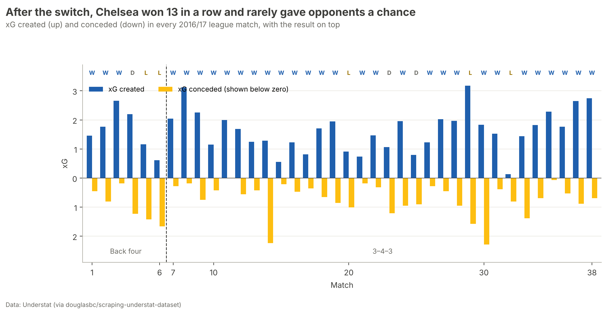

*Figure 9 · Every 2016/17 league match: xG created (blue, up) and conceded (gold, down), with the result on top. The dashed line marks the switch to three at the back.*

The first six columns of Figure 9 show what went wrong. Swansea, Liverpool and Arsenal all created more than a goal's worth of chances. Analysts at the time pointed to an empty centre: the wide players drifted out, the midfield was easy to play through, and Costa was often isolated. In those six games Chelsea conceded **0.96 xG per match**, and Conte said the team lacked "the right balance".

---

## Chapter 6 · Hull, 1 October

Against Hull on **1 October 2016**, Conte changed to a **3–4–3**. Wikipedia calls it a fluid 3-4-2-1, because the two wide forwards played inside. Chelsea won 2–0. He said he chose the shape because it suited his squad and his strikers, and expected it to improve the team at both ends.

**With the ball:**
- **The back three: Azpilicueta, David Luiz, Cahill.** Luiz switched play with long passes from the middle. The two outside centre-backs stepped forward into midfield, timing their runs to receive on the move. Azpilicueta was a converted full-back.
- **The midfield two: Kanté and Matić.** The one nearer the ball moved into the half-space to form a diamond with the wing-back and a centre-back, giving short and diagonal options.
- **The wing-backs: Moses and Alonso** gave all the width. That let the front three stay close together and combine over short distances.
- **The front three: Hazard, Pedro (or Willian), Costa.** Hazard had the most freedom, drifting across to overload one side; Pedro stayed high to stretch the defence. A common pattern: a wide forward dropped towards the ball, dragged a full-back with him, and let the ball run through to the wing-back sprinting outside.

**Without the ball:**
- **A 5-4-1 block.** The wing-backs dropped into a back five; Hazard and Pedro dropped beside Kanté and Matić.
- **Steering, not chasing.** Usually only the nearest midfielder stepped out to press. The aim was to slow the ball down and push it away from goal, not to win it back at once. This was very different from Italy's high press.
- **Guarding the edge of the box.** Kanté and Matić protected the space in front of the centre-backs.

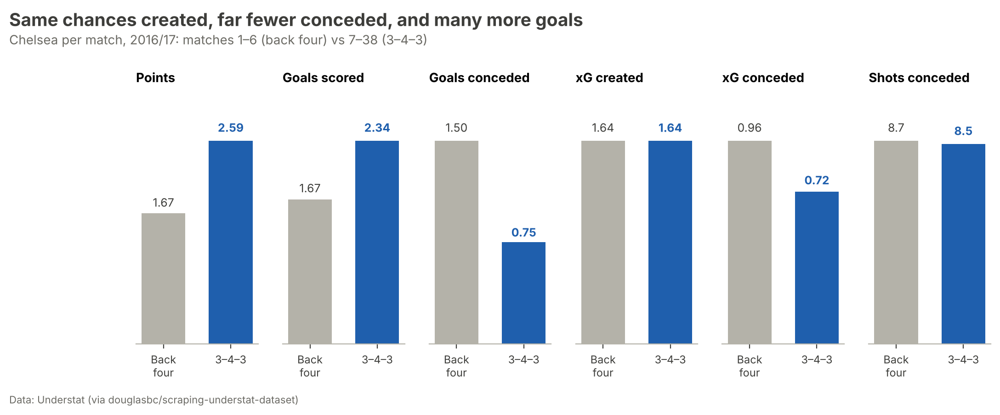

*Figure 10 · Chelsea's averages per match, matches 1–6 (back four, grey) vs 7–38 (3–4–3, blue).*

> **Key number · 1.64.** Chelsea's xG created per match before the switch, and after it. Identical. Everything else moved: xG conceded fell from 0.96 to 0.72, goals conceded halved (1.50 to 0.75), goals scored rose from 1.67 to 2.34, and points per match from 1.67 to 2.59.

Notice what didn't change: shots conceded (8.7 to 8.5 per match). Opponents shot just as often, but from worse places, so each shot was worth less. Six games is a small sample for the "before" numbers, but the season-long comparison points the same way.

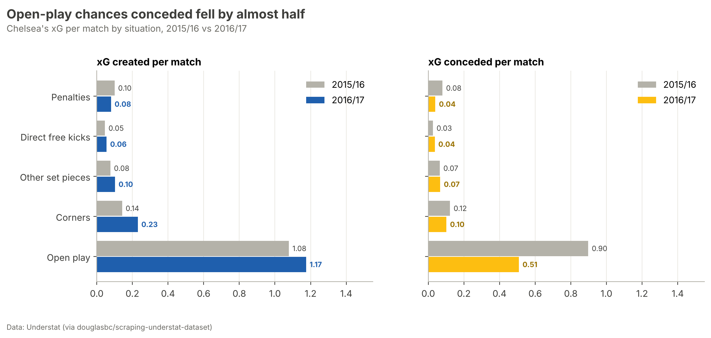

*Figure 11 · Chelsea's xG per match by situation, 2015/16 (grey) vs 2016/17 (colour): created on the left, conceded on the right.*

Compared with the 10th-place season, almost all of the defensive improvement came in **open play**, the part of the game the new shape changed: open-play xG conceded fell from **0.90 to 0.51 per match**. Set-piece chances conceded hardly moved. In attack, corners became a small extra weapon (0.14 to 0.23 xG per match).

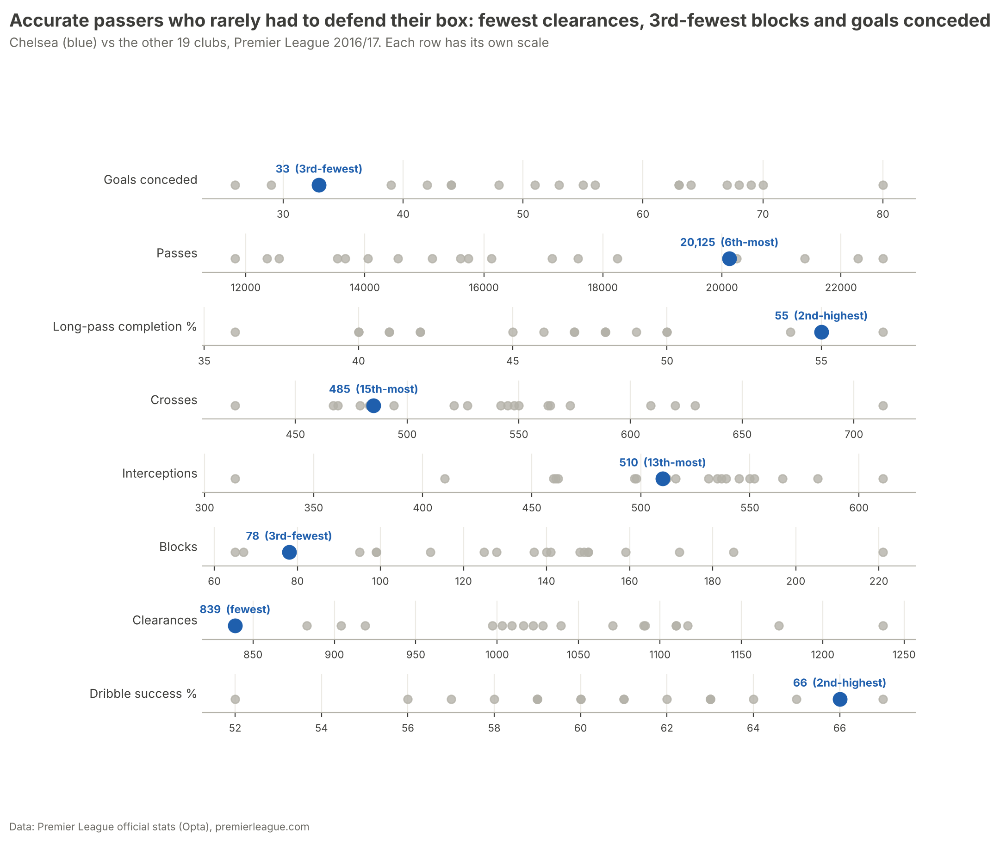

*Figure 12 · Eight official season totals for 2016/17. Each dot is a club; Chelsea in blue. Each row has its own scale.*

The official stats in Figure 12 show what the 5-4-1 achieved. Chelsea made the **fewest clearances** in the league (839), the **3rd-fewest blocks** (78) and conceded the **3rd-fewest goals** (33). Last-ditch defending is rare when opponents rarely get close. With the ball, they were accurate rather than dominant: 6th for passes, but 2nd for long-pass completion (55%) and dribble success (66%).

### What Conte kept, and what he changed

| | Juventus 2011–14 / Italy 2016 (3-5-2) | Chelsea 2016/17 (3-4-3) |
| --- | --- | --- |
| **Back three** | Barzagli, Bonucci, Chiellini | Azpilicueta, Luiz, Cahill; Luiz the long passer |
| **Wing-backs** | Asymmetric: one attacking, one covering | Both gave width; Moses a winger retrained |
| **Midfield** | Three: Pirlo between two runners | Two: Kanté and Matić, ball-winners who also passed |
| **Attack** | Two strikers | Three forwards: two inside forwards behind Costa |
| **Without the ball** | 5-3-2, high pressing | 5-4-1, a mid-block that steered play |
| **How it began** | Back four, changed during his first season | Back four, changed after six league games |

He **kept** the defensive base (three centre-backs, two wing-backs, a team that runs back into a back five) and his habit of changing shape once he understood his squad. He **changed** the front (two strikers became three forwards, to fit Hazard and Pedro), the midfield (with no Pirlo, the build-up came from the back three and a midfield pair) and the pressing (a compact block instead of a high press).

---

## Chapter 7 · Thirteen in a row

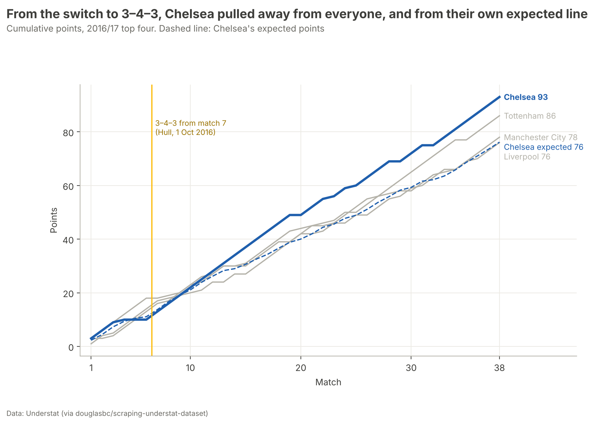

*Figure 13 · Cumulative points for the 2016/17 top four. Dashed blue line: Chelsea's expected points. Gold line: the switch to 3–4–3.*

From Hull on 1 October to Stoke on 31 December, Chelsea won **13 league games in a row**, equalling the Premier League record. The run included 3–0 against Leicester, 4–0 against Manchester United and 5–0 against Everton, a 2–1 win over Tottenham and a 3–1 win at Manchester City. Tottenham ended it on 4 January, but by then Chelsea were top, and they stayed there.

Figure 13 also shows something the table can't. From the switch onwards, Chelsea's real points (solid line) pull away from their expected points (dashed). The new shape made them better. Something else made them champions by 7 points.

---

## Chapter 8 · Where the goals came from

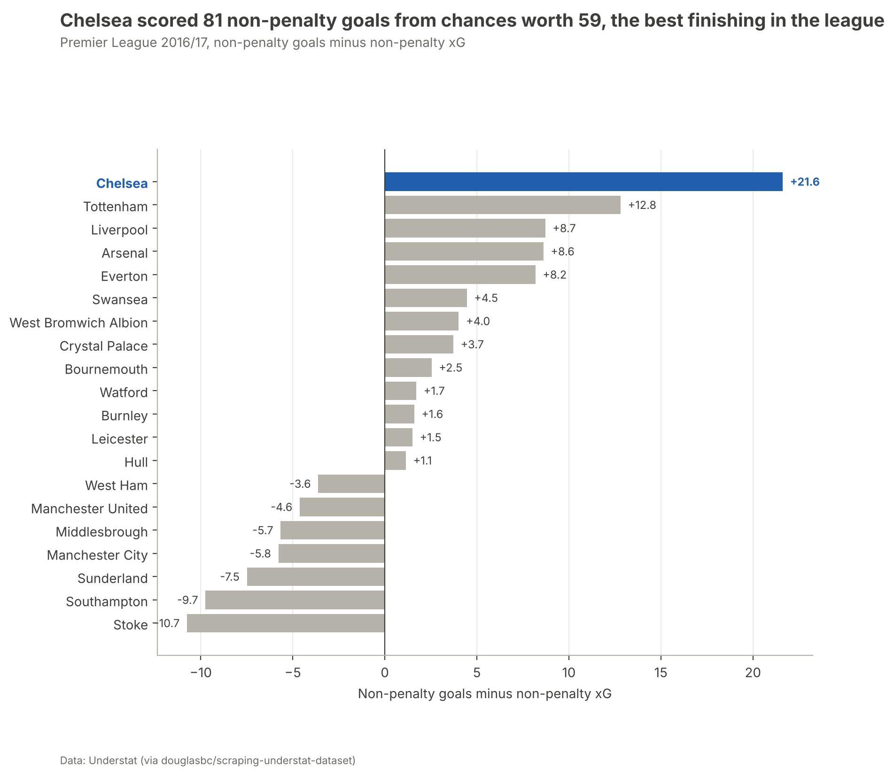

*Figure 14 · Non-penalty goals minus non-penalty xG for every 2016/17 team. Above zero: finishing better than the chances.*

> **Key number · +21.6.** Chelsea scored 81 non-penalty goals from chances worth 59.4, almost twice the next-best team (Tottenham, +12.8). Manchester City, who created the most, finished 5.8 goals *below* their chances.

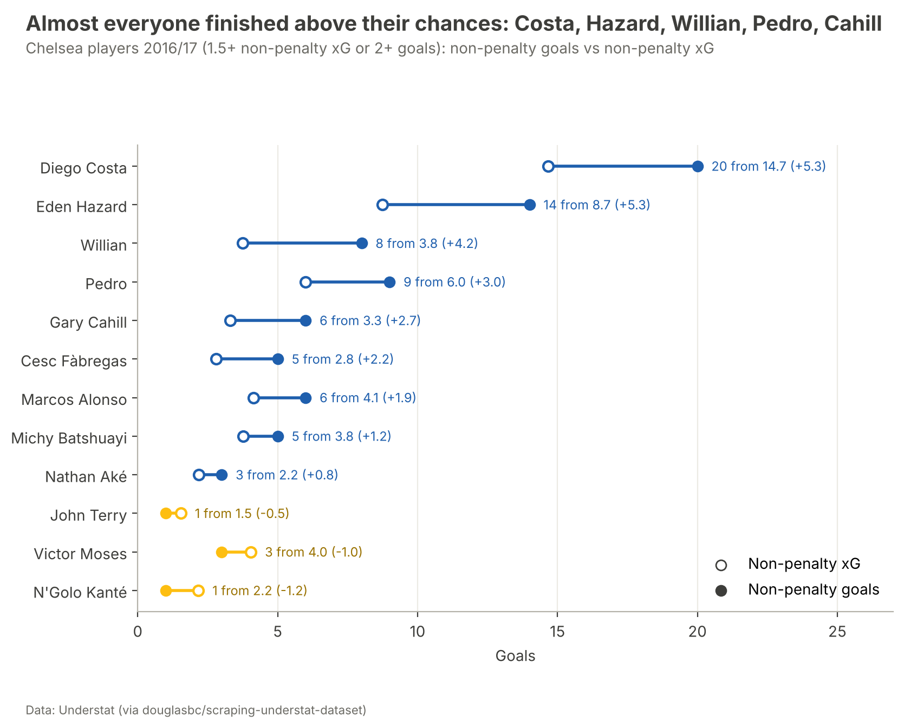

*Figure 15 · Each Chelsea player's non-penalty goals (filled) against non-penalty xG (hollow).*

It wasn't one striker on a hot streak. **Nine players** beat their xG: Costa (20 from 14.7, +5.3), Hazard (14 from 8.7, +5.3), Willian (8 from 3.8, +4.2), Pedro (9 from 6.0, +3.0), even centre-back Gary Cahill (6 from 3.3, +2.7). Only Moses, Kanté and Terry finished below their chances.

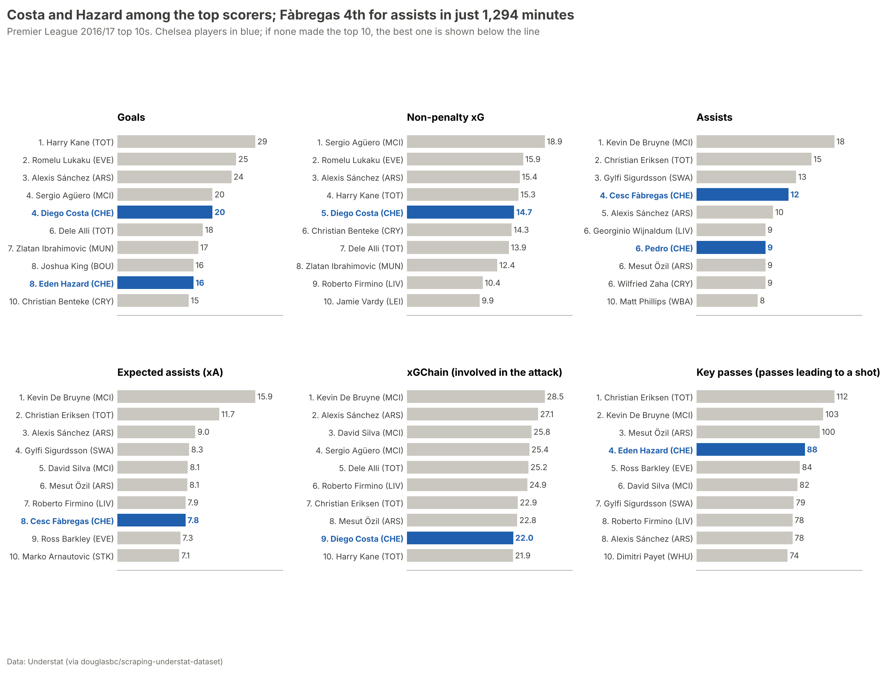

*Figure 16 · League top 10s for six attacking measures, 2016/17. Chelsea players in blue.*

Against the league, Chelsea had depth rather than one star. Costa was joint-4th for goals (20) and 5th for non-penalty xG. Hazard was 8th for goals and 4th for key passes (88). Fàbregas was 4th for assists (12) in just 1,294 minutes, and Pedro joint-6th (9). Kane, Lukaku, Agüero and De Bruyne topped the tables, but Chelsea had players in all of them.

---

## Chapter 9 · The men who were already there

Conte signed four players, but most of his title team was already at the club. Of the eleven who usually started in the 3-4-3, eight were Chelsea players during the 10th-place season: Courtois, Azpilicueta, Cahill, Matić, Pedro, Hazard, Costa, and Moses, who was on loan at West Ham. The same men who had finished 10th won the league a year later. This chapter looks at what changed for each of them.

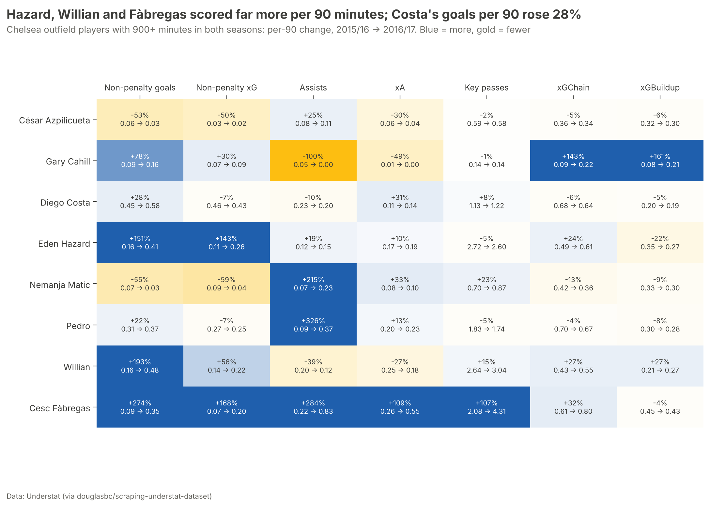

*Figure 17 · Per-90 change from 2015/16 to 2016/17 for Chelsea outfield players with 900+ minutes in both seasons. Blue = more, gold = fewer.*

The biggest individual turnaround was **Hazard's**: non-penalty goals per 90 up 151% (0.16 to 0.41), and his chances up 143%. So his recovery wasn't only finishing: he got into far better positions in his new inside-forward role. Costa's goals per 90 rose 28% while his xG per 90 fell slightly. In the back three, Cahill's involvement in attacks more than doubled.

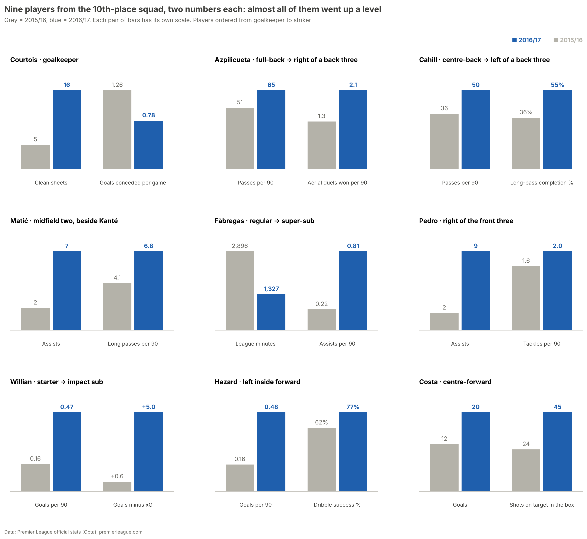

*Figure 18 · Nine players who were at Chelsea in both seasons, two official stats each: 2015/16 (grey) and 2016/17 (blue). Each pair of bars has its own scale.*

> **Key number · 8 of 11.** Regular starters in the title-winning 3-4-3 who were already Chelsea players in the 10th-place season. Conte changed the system far more than the squad.

### The defence: less defending, more football

**Thibaut Courtois · goalkeeper.** In 2015/16 he played 23 league games, kept **5 clean sheets** and was sent off twice. In 2016/17 he played 36, kept **16** and won the Golden Glove. Goals conceded per game fell from **1.26 to 0.78**. Look at his saves, though: 67 in 2015/16 and 68 in 2016/17, so about **2.9 per game fell to 1.9**. He had less to do. Most of his improvement came from the team in front of him, which is the point of a back three. His pass completion also rose from 48% to 66%, because he could play short to three centre-backs instead of kicking long.

**César Azpilicueta · from full-back to the right of the back three.** He played **every minute of the league season** (3,420), one of very few outfield players to do it for a title winner. He had played mostly at left-back in 2015/16. On the right of a three, he had a centre-back's job and a full-back's habits: he stepped forward into midfield with the ball and covered the space behind Moses without it. His passes per 90 rose from **51 to 65** at 87% accuracy, and his aerial duels won from **1.3 to 2.1 per 90**. His tackles fell (114 to 84), because the system meant he had less to put right. Conte called him one of the best defenders in the world.

**Gary Cahill · left of the back three.** He played 1,955 league minutes in 2015/16 and **3,296** in 2016/17. In a back two, his job had been to stop things in the box: 34 blocks in 2015/16. In a back three, he was asked to pass, and he did: passes per 90 up from **36 to 50**, and long-pass completion up from **36% to 55%**. His blocks fell to 19 in far more minutes, because opponents rarely reached the box. He also scored **6 league goals** from 3.3 xG, all six from corners and set pieces. John Terry, the club captain, played just 489 league minutes.

### The midfield: one stayed, one moved to the bench

**Nemanja Matić · midfield two, beside Kanté.** In 2015/16 Matić was the one who screened the defence, and he had been exposed doing it. In 2016/17 Kanté took that job: Matić's tackles fell from 3.1 to 1.7 per 90. That freed him to pass. His long passes per 90 rose from **4.1 to 6.8** at 69% accuracy, and his assists from **2 to 7**. Of the two midfielders, he was the one who switched the play.

**Cesc Fàbregas · from regular to super-sub.** There was no place for him in a two-man midfield of Kanté and Matić, and his league minutes more than halved (2,896 to **1,327**, 16 of his 29 appearances from the bench). He still made **12 assists, 4th in the league**: 0.22 per 90 in 2015/16, **0.81** in 2016/17. Per minute, he was the best creator in the squad: no Chelsea regular had more assists or more xA per 90.

### The attack: more shots, in better places

**Pedro · right of the front three.** In 2015/16, his first season, he was a winger in a 4-2-3-1. In 2016/17 he played inside, close to Costa, and stayed high to stretch the defence. His goals rose from 7 to 9, and his assists from **2 to 9**. He defended more too: tackles per 90 rose from 1.6 to 2.0, because the front three dropped into the 5-4-1 without the ball.

**Willian · from starter to impact sub.** Like Fàbregas, he lost his place: 2,749 minutes in 2015/16, 1,529 in 2016/17, with 19 of his 34 appearances from the bench. He scored more anyway: **8 league goals from chances worth 3.8**, and his goals per 90 rose from **0.16 to 0.47**. Between them, he and Fàbregas gave Conte 13 goals and 14 assists in 2,803 league minutes, less than one full season for a single player.

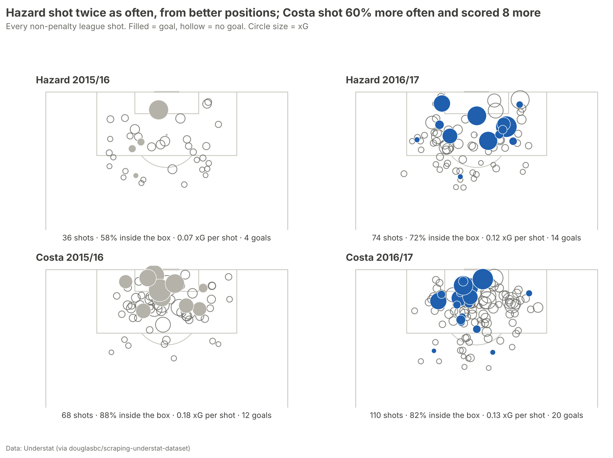

*Figure 19 · Every non-penalty league shot by Hazard and Costa, 2015/16 (grey goals) and 2016/17 (blue goals). Circle size = xG.*

**Eden Hazard · left inside forward.** In 2015/16 he scored **4 league goals**. In 2016/17 he scored **16**. Figure 19 shows why it wasn't luck. He took **twice as many shots** (36 to 74 non-penalty shots), more of them inside the box (58% to 72%) and from better positions (**0.07 to 0.12 xG per shot**). Behind him, Alonso held the width, so Hazard could come inside, which he said himself. His dribble success rose from **62% to 77%** (186 dribbles), and he had 219 touches in the opposition box. He even defended more: interceptions up from 13 to 28.

**Diego Costa · centre-forward.** He scored **12 goals in 2015/16 and 20 in 2016/17**. His shots weren't better on average (0.18 to 0.13 xG per shot), but there were far more of them: **68 to 110** non-penalty shots, 82% inside the box, and his shots on target inside the box almost doubled (24 to 45). With Hazard and Pedro close to him rather than out wide, he had more support, and he created more too: Opta's xA rose from 2.5 to 5.5.

### What the nine have in common

Two patterns run through Figure 18. **The defenders defended less and passed more.** Azpilicueta and Cahill passed far more, and they and Courtois had less emergency work to do (fewer tackles, blocks and saves), because the system did the defending: fewer shots and fewer chances reached them. **The forwards got more shots in better places.** Hazard, Costa and Pedro were closer together, with the wing-backs providing the width, so more of their touches came in the box. And the two who lost their places, Fàbregas and Willian, did more per minute from the bench than they had as starters. No player in this chapter was a new signing. The 3-4-3 got more out of men who were already there.

---

## Chapter 10 · Better, or luckier?

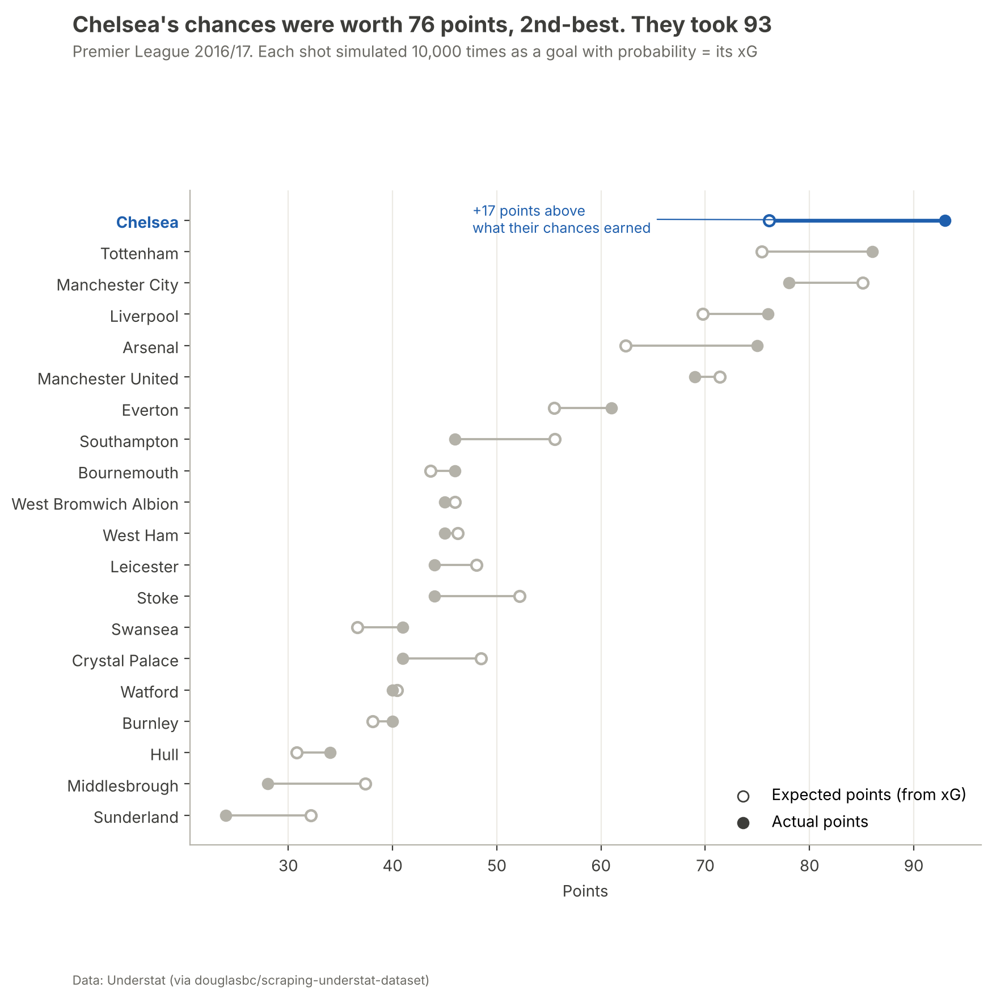

*Figure 20 · Expected (hollow) vs actual (filled) points, 2016/17.*

On chances alone, Chelsea's 2016/17 side was worth **76 points, 2nd-best** behind Manchester City (85). They won 93, a gap of **+17**, the biggest in the league. City, with the best chances, finished third.

Put the two seasons together and the jump from 50 to 93 points splits roughly in two:
- **About +16 points of real improvement:** the chances went from 7th-best (60 expected points) to 2nd-best (76), mostly through conceding far fewer.
- **About +27 points from luck turning:** from finishing 10 points *below* their chances in 2015/16 to 17 points *above* them in 2016/17.

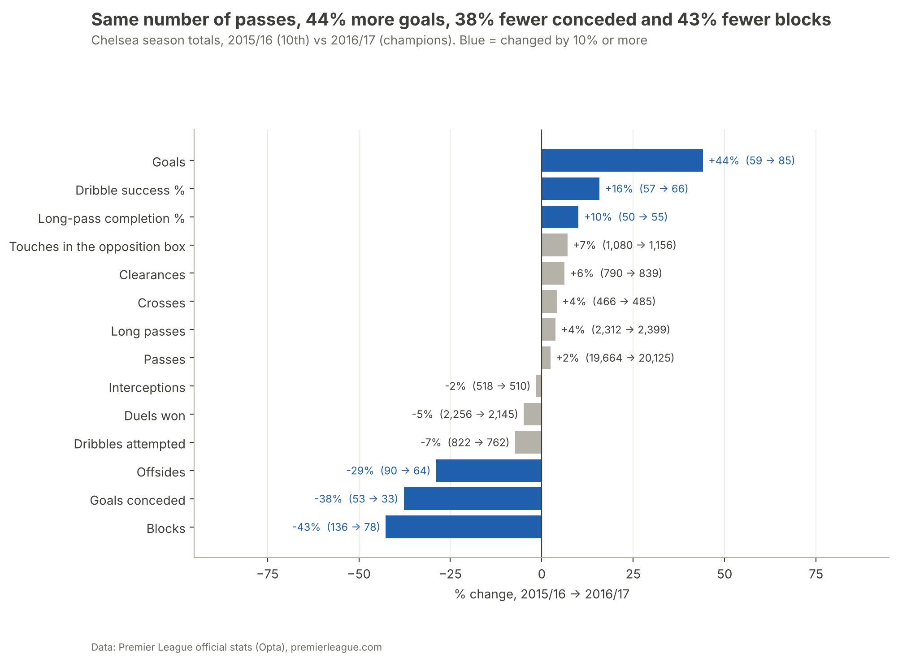

*Figure 21 · Change in Chelsea's official season totals, 2015/16 to 2016/17. Blue = changed by 10% or more.*

The official totals tell the same story from another angle. Chelsea made almost exactly the same number of passes (+2%) and crosses (+4%). They scored 44% more goals (59 to 85), conceded 38% fewer (53 to 33) and needed 43% fewer blocks (136 to 78). A year earlier, Leicester's new manager had done the same: kept the passing, changed the shape and the roles.

**The verdict:** a genuinely better team, made better by one tactical decision, which then finished its chances better than anyone in the league. The finishing didn't last: the following season Chelsea finished 5th.

---

## What clubs can learn

1. **A change of shape can fix a defence within weeks.** Same players, same chances created, but a quarter less xG conceded after one decision on 1 October.
2. **Judge a season on chances, not the table.** Both tables exaggerated how far apart the 10th-place and title-winning sides really were (7th-best vs 2nd-best on chances).
3. **Finishing streaks don't last.** +21.6 goals above xG was almost double any rival, and the next season brought 5th place. Plan for the expected level.
4. **Fit the system to the players.** Conte kept his back three but added a third forward because his best players were Hazard and Pedro, not a strike partnership.
5. **Look for players who fit a role, not a price tag.** A returning loanee (Moses) became a title-winning wing-back; the most expensive signing barely played.
6. **A caretaker can fix the mood, not the structure.** Hiddink brought the attack back to 1.60 xG per game, but conceded as much as the collapsing Mourinho side. The defence needed a new idea, not a calmer room.
7. **Sign for the job, then cover the weakness.** Luiz's passing came with a centre-back on each side; Alonso and Moses, half full-back and half winger, came with a back three behind them.
8. **Look at the system before the squad.** Eight of the eleven title-winning starters were at the club in the 10th-place season. A new shape can get more from the same players than a new set of players in the old shape.

**Compared with Leicester a year earlier:** both were top-four teams on chances that over-performed by 15–17 points. Leicester's extra came mainly from defence and goalkeeping ([read the Leicester report](../../Leicester-City-2015-16-Miracle/docs/ARTICLE.md)); Chelsea's came mainly from finishing.

---

*Every number, with its evidence: [findings log](results.md) · Code: [notebooks](../notebooks/)*

---

## Appendix: data, method and sources

### Data

| Source | What it contains | Used for |
| --- | --- | --- |
| [Understat](https://understat.com) (via [a public copy](https://github.com/douglasbc/scraping-understat-dataset)) | xG, location and situation for every shot; player season totals, 2014/15 to 2016/17; Serie A and Ligue 1 player totals, 2015/16 | Expected points, finishing, players, manager spells, signings, shot maps |
| [Premier League stats](https://www.premierleague.com/en/stats) (Opta) | Season totals for all 20 clubs in 2016/17 and Chelsea in 2015/16; season totals for Kanté and nine returning players, both seasons | Team style, Kanté, returning players |
| Wikipedia and tactical analysis (below) | Fees, dates, records, formations and roles | Signings, timeline, tactics |

Both Understat seasons are complete (380 matches each), and the points calculated from them match the official tables (Chelsea 50 and 93). Chelsea's 5th place in 2017/18 is from the same Understat dataset (70 points). StatsBomb's free event data, used in the Leicester project, doesn't cover 2016/17.

### Method

- **Expected points:** each match simulated 10,000 times (random seed 42); every shot is a goal with probability equal to its Understat xG.
- **Before/after the switch:** matches 1–6 (back four) vs 7–38 (3–4–3), split at Hull on 1 October 2016.
- **Per 90:** totals divided by minutes, times 90; players with 900+ minutes only.
- **Manager spells:** Mourinho 2014/15 (38 games); Mourinho 2015/16 (games 1–16); Hiddink (games 17–38, including the 19 December 2015 game when Steve Holland was in charge); Conte games 1–6 and 7–38.
- **Predecessors:** the 2015/16 Chelsea players who did each newcomer's job, minutes-weighted where two shared it (Matić and Mikel; Azpilicueta and Baba Rahman).

### Limitations

- **Different leagues:** Alonso's and Luiz's 2015/16 numbers come from Serie A and Ligue 1. Understat uses one xG model, but the opponents and teams were different, so those comparisons show a change of role, not of quality.
- **Six matches before the switch** is a small sample: the before/after numbers show a direction, not a precise effect.
- **xG models differ** between providers; all xG comparisons here use Understat only.
- **Official "Shots" figures** on the Premier League club pages are always exactly twice shots on target, which can't be right, so they aren't used.
- **No defensive event data** for 2016/17: pressing and tackle locations can't be measured. Tactical roles come from published analysis, and Figure 4 is a diagram, not tracking data.

### Sources

- Understat shot and player data via [douglasbc/scraping-understat-dataset](https://github.com/douglasbc/scraping-understat-dataset)
- Premier League club and player stats: [premierleague.com](https://www.premierleague.com/en/clubs/8/chelsea/stats?season=2016)
- [2016–17 Chelsea F.C. season](https://en.wikipedia.org/wiki/2016%E2%80%9317_Chelsea_F.C._season) and [2015–16 Chelsea F.C. season](https://en.wikipedia.org/wiki/2015%E2%80%9316_Chelsea_F.C._season), Wikipedia
- [Antonio Conte](https://en.wikipedia.org/wiki/Antonio_Conte), Wikipedia: career, formations, Euro 2016
- [Antonio Conte's 3-4-3](https://spielverlagerung.com/2016/12/25/antonio-contes-3-4-3/), Spielverlagerung (December 2016)
- [Juventus tactics under Conte and Allegri](https://www.soccertutor.com/blogs/inside-football-coaching/juventus-tactics-conte-allegri), SoccerTutor
- [Proactive or reactive: the tactics of Antonio Conte](https://theprideoflondon.com/2016/06/24/proactive-reactive-tactics-antonio-conte), The Pride of London (June 2016)
- [Conte reveals 3-4-3 was his plan D](https://www.sportskeeda.com/football/epl-2016-17-antonio-conte-reveals-chelseas-new-3-4-3-plan-d-initially), Sportskeeda
- [Juventus 2011/12 season review](https://www.footballcritic.com/season-reviews/conte-returns-to-make-juventus-unbeatable-serie-a-in-2011-12/98), Football Critic
- [How Jose Mourinho's tactics have Chelsea on top](https://www.si.com/soccer/2015/02/04/chelsea-jose-mourinho-tactics), Sports Illustrated (February 2015)
- [Tactically explaining Chelsea's terrible start to the 2015/16 season](https://bleacherreport.com/articles/2551060-tactically-explaining-chelseas-terrible-start-to-2015-16-premier-league-season), Bleacher Report
- [5 ways Guus Hiddink has changed Chelsea](https://bleacherreport.com/articles/2616734-5-ways-guus-hiddink-has-changed-chelsea-since-replacing-jose-mourinho), Bleacher Report
- [Hazard compares the Conte and Mourinho regimes](https://www.goal.com/en/news/in-tactics-and-training-we-do-more-with-conte---hazard-compares-current-chelsea-regime-to-mourinhos/1ryf1bo8n190x1pn4hlt8i8yvh), Goal
- [Moses: Conte didn't ask if I'd play wing-back](https://www.goal.com/en/news/moses-conte-didnt-ask-if-id-play-wing-back-he-just-put-me-there/191my92t5cv131urzraz4ax8hz), Goal
- [Victor Moses becomes an unlikely star](https://www.skysports.com/football/news/11668/10676972/victor-moses-becomes-an-unlikely-star-in-antonio-conte-s-chelsea), Sky Sports (December 2016)
- [David Luiz looks a natural fit in Chelsea's three-man defence](https://thenationalnews.com/sport/football/david-luiz-still-has-mistakes-in-him-but-looks-a-natural-fit-in-chelseas-three-man-defence-1.154889), The National
- [Scout report: Marcos Alonso](https://www.fantasyfootballscout.co.uk/2016/09/07/scout-report-marcos-alonso-2), Fantasy Football Scout; [2015–16 ACF Fiorentina season](https://en.wikipedia.org/wiki/2015%E2%80%9316_ACF_Fiorentina_season), Wikipedia
- [Chelsea's Thibaut Courtois wins the 2016/17 Golden Glove](https://www.espnfc.com/chelsea/story/3130925/chelseas-thibaut-courtois-wins-2016-17-premier-league-golden-glove-award), ESPN
- [Azpilicueta joins ever-present Premier League winners' club](https://www.eurosport.com/football/premier-league/2016-2017/cesar-azpilicueta-joins-ever-present-premier-league-winners-club_sto6175897/story.shtml), Eurosport; [Azpilicueta one of world's best – Conte](https://fourfourtwo.com/news/azpilicueta-one-worlds-best-conte), FourFourTwo
- [West Brom 0 Chelsea 1: Batshuayi the unlikely hero](https://fourfourtwo.com/news/west-brom-0-chelsea-1-batshuayi-unlikely-hero-secure-premier-league-glory), FourFourTwo
