# The 5000–1 Season, Chart by Chart

**How Leicester City won the 2015/16 Premier League, explained in 28 charts**

*By Hammad · Data: StatsBomb Open Data (1.3 million events), Understat, Premier League official stats (Opta), EA Sports via Sky Sports*

In August 2015, bookmakers gave Leicester City 5000–1 odds to win the Premier League. Twelve months earlier they had been bottom of the table for five months. They won the league by 10 points.

This article goes through every chart in the project. Each one comes with two short explanations: **what it shows** (how to read it) and **what it means** (why it matters for the story). The charts follow the story in order: how they won, how they played, the squad, the players, the money, the jump from 14th to 1st, and the change of manager.

A few terms used throughout:

- **xG (expected goals):** the chance that a shot becomes a goal, based on thousands of similar shots. A penalty is worth about 0.76 xG; a shot from 30 yards about 0.03.
- **Expected points:** every match replayed 10,000 times, with every shot going in with probability equal to its xG. The average points a team earns is its expected points.
- **Per 90:** a count divided by minutes played, times 90, so players with different minutes can be compared fairly.
- **Percentile:** a player's rank among players in the same position with 900+ minutes (100 = best).

---

## Part 1. How they won

### Chart 1 · Their chances were worth 66 points. They took 81.

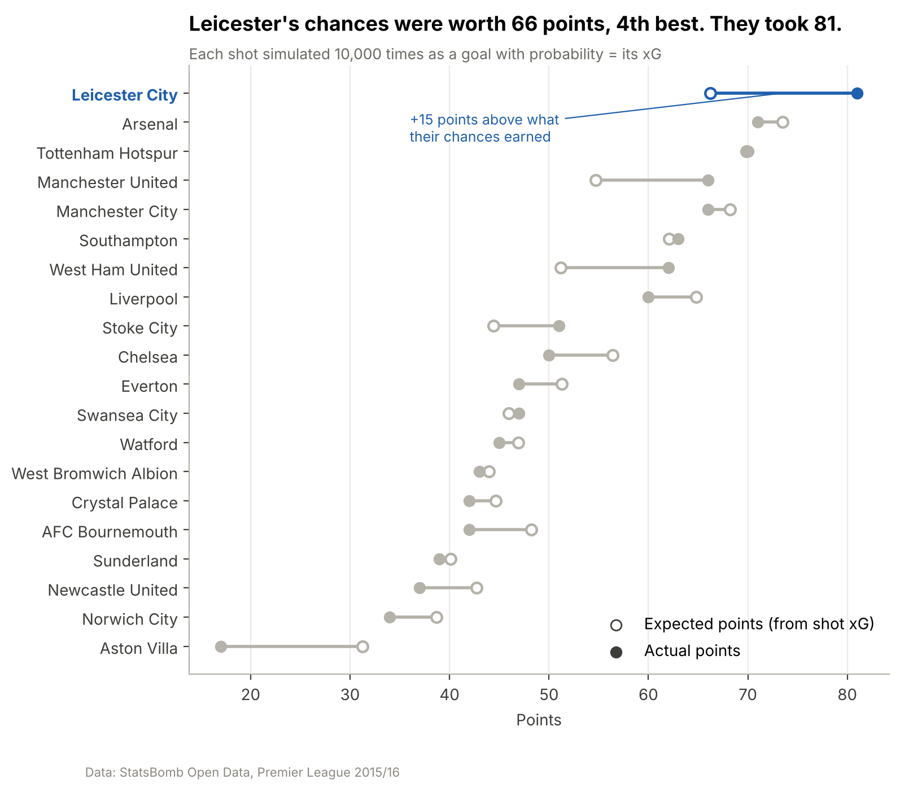

**What it shows.** Each row is a team. The hollow dot is the number of points its chances were worth (expected points); the filled dot is the points it actually won. The line between them is the gap. Leicester's chances were worth 66.2 points, the 4th-best total behind Arsenal, Tottenham and Manchester City. They won 81 points, a gap of +15, the biggest in the league.

**What it means.** On chances alone, Leicester were a top-four side, not a title winner. That is already remarkable for a team that nearly went down the year before, but it doesn't explain the title. The other 15 points are what the rest of this article tries to explain.

### Chart 2 · They stayed above their expected line all season, and finished 10 points clear

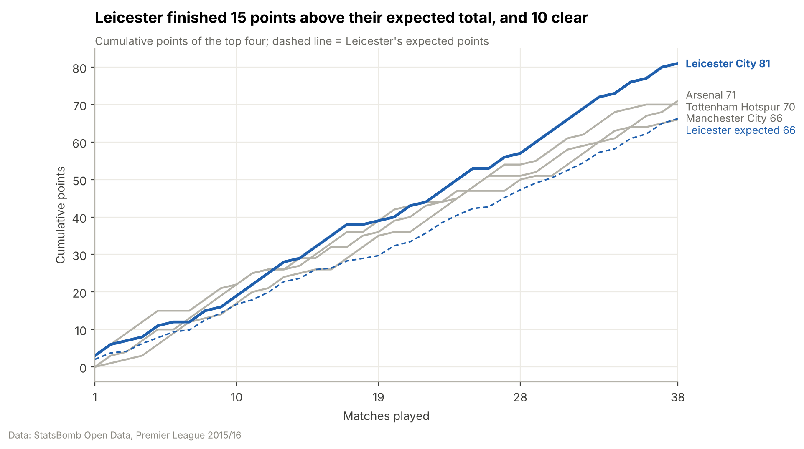

**What it shows.** Cumulative points over the 38 matches for the top four. The dashed blue line is the points Leicester's chances were worth. Leicester's solid line sits above the dashed line almost all season, and pulls away from Arsenal (71), Tottenham (70) and Manchester City (66) over the last ten matches.

**What it means.** The gap wasn't one lucky month; it built steadily. Almost all of it came from defence: they scored 68 goals from 66.3 xG (+1.7), but conceded only 36 from 46.1 xG against (−10.1). The reasons:

- **Blocks.** They blocked 34% of opponents' shots, 3rd-highest in the league (median 29%). xG values a shot before defenders get in the way, so a team that blocks this much regularly beats it.
- **Goalkeeping.** Kasper Schmeichel saved 73.5% of shots on target, 2nd-best in the league. xG doesn't account for the goalkeeper.
- **Scoring first.** They scored first in 26 of 38 games and took 66 points from them. Once ahead, they sat in a compact block: 196 of the 517 shots against them came while they were leading, so expected goals against piled up in games that were already won.
- **Finishing streaks.** In the first 19 matches they scored 37 goals from 31.0 xG, including Vardy's record run of scoring in 11 games in a row.
- **Goals in the right games.** 14 one-goal wins (Arsenal had 7, Spurs 6) and only 3 losses.
- **Luck.** Some of it is variance: Manchester United also finished 11 points above their expected total that season, and Aston Villa 14 below.

---

## Part 2. How they played

### Chart 3 · Little of the ball, and the fastest attacks in the league

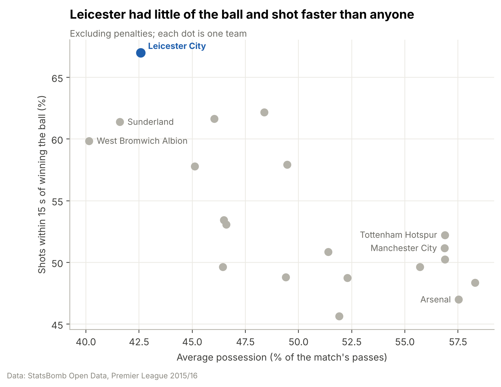

**What it shows.** Each dot is a team. Across is average possession; up is the share of shots that came within 15 seconds of winning the ball. Leicester sit alone in the top-left corner: about 42% possession, and 67% of their shots within 15 seconds of a turnover. The possession teams (Arsenal, Manchester City, Tottenham) sit bottom-right. Sunderland and West Brom also had little of the ball, but attacked far more slowly.

**What it means.** Leicester didn't try to control games with the ball. They let opponents have it, won it back, and went forward immediately, before the defence could reorganise. Their median shot came after only 3 passes, and their average non-penalty shot (0.110 xG) was the best quality in the league: they wasted very few shots from distance.

### Chart 4 · Their tactical fingerprint against the other 19 teams

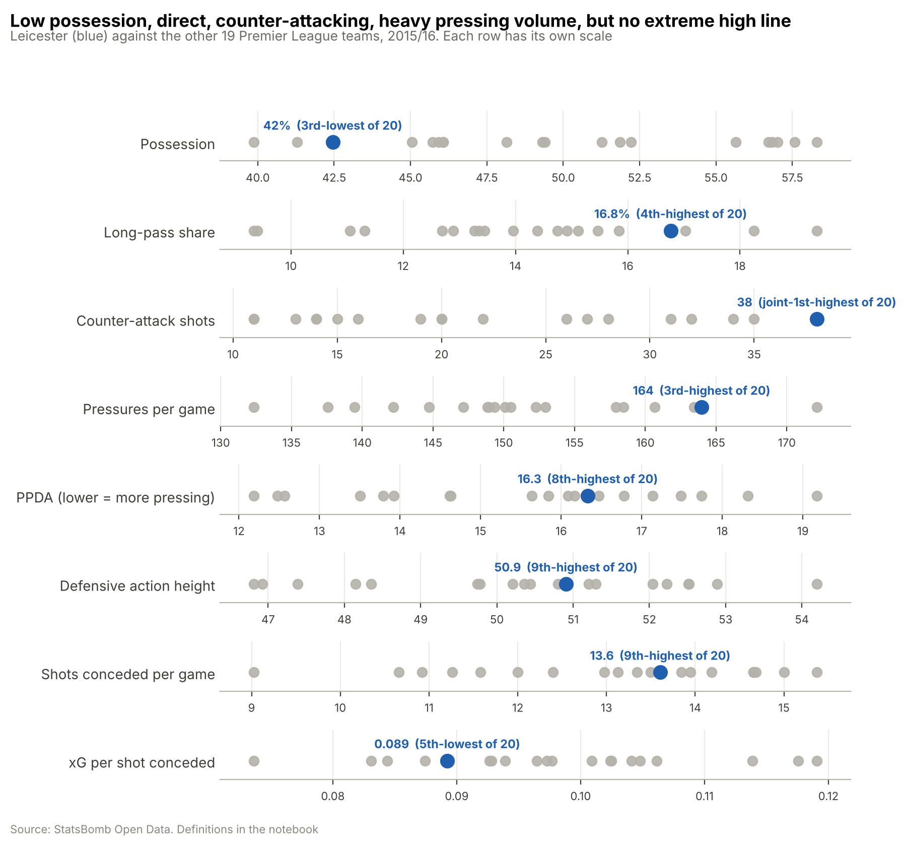

**What it shows.** Eight style measures, one per row, with every team as a dot and Leicester in blue. Each row has its own scale. Leicester were 3rd-lowest for possession (42%), 4th-highest for share of long passes (16.8%), joint-1st for counter-attack shots (38) and 3rd for pressures per game (164). But they were mid-table for pressing intensity (PPDA 16.3) and for how high up the pitch they defended. They allowed an average number of shots (13.6 per game) but low-quality ones: 0.089 xG per shot, 5th-lowest.

**What it means.** This was not a high-pressing team. It was a compact, hard-working mid-block that closed down a lot, then hit long balls and counter-attacks. Opponents got shots, but mostly poor ones from awkward angles or distance.

### Chart 5 · After Christmas they pressed harder and gave up worse chances

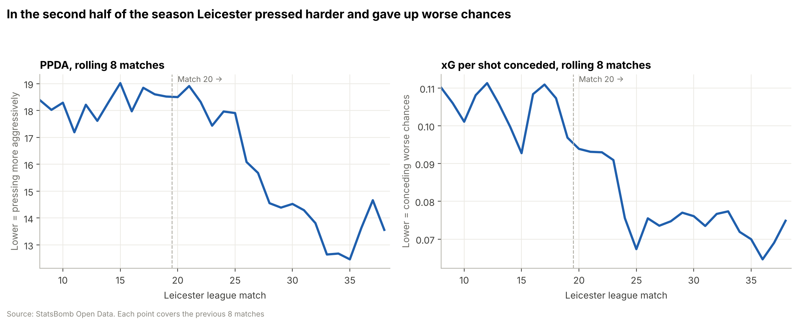

**What it shows.** Two lines across the season, each point averaging the previous 8 matches. Left: PPDA (opponent passes allowed per defensive action; lower means more aggressive pressing). Right: average xG of each shot Leicester conceded. Both lines drop sharply from around match 25. Comparing matches 20–38 with 1–19: PPDA fell from 18.4 to 14.5, pressures per game rose from 153 to 175, and xG per shot conceded fell from 0.104 to 0.076. The height of their defending did not change.

**What it means.** Ranieri's famous mid-season "tightening" wasn't sitting deeper. The team stayed in the same place but pressed harder, so opponents had less time and took worse shots. The result: in the second half of the season they conceded 11 goals from 20.2 xG against and kept 11 clean sheets. This is where most of the extra points came from.

---

## Part 3. The squad

### Chart 6 · The most stable line-up in the league

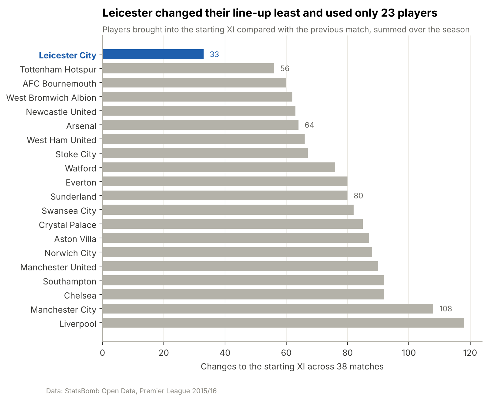

**What it shows.** For each team, the number of players brought into the starting XI compared with the previous match, added up over 38 matches. Leicester made 33 changes. The next most stable team, Tottenham, made 56. Arsenal made 64, Manchester City 108, and Liverpool the most of all.

**What it means.** Leicester used only 23 players all season (the fewest), and their best 11 played 86% of all minutes. They had the fewest injuries in the league (275 days lost, against 1,137 for Arsenal, the next-best, as reported), no European football and early cup exits. The same players played together every week, so the defensive organisation and the counter-attacking patterns became automatic.

### Chart 7 · They didn't out-run the league

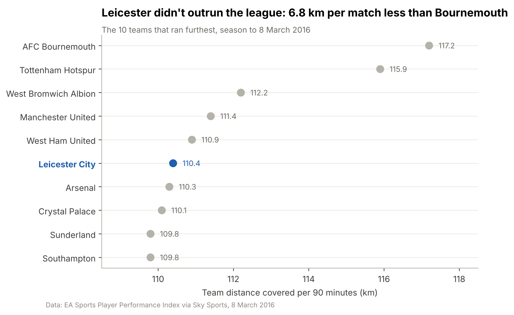

**What it shows.** Average distance covered per match for the ten teams that ran furthest (EA Sports data, up to 8 March 2016). Leicester ran 110.4 km per match, 6th of the ten. Bournemouth ran 117.2 km and Tottenham 115.9 km.

**What it means.** A popular story is that Leicester simply worked harder than everyone. The running data says otherwise: they covered less ground than Bournemouth, Spurs, West Brom, Manchester United and West Ham. No Leicester player was in the league's top 10 for distance either (Albrighton, their furthest runner, was 19th after 25 rounds). Their work rate showed in *where* they ran and when they pressed, not in how far.

---

## Part 4. The players against the league

Every chart in this part shows the league's top 10, with Leicester players in blue, so each "best in the league" claim can be checked against the competition.

### Chart 8 · Vardy and Mahrez against the league's best attackers

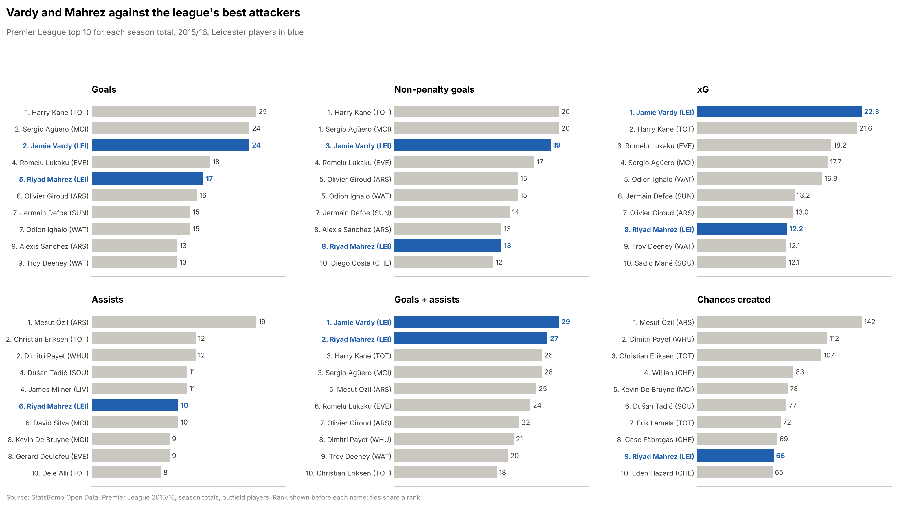

**What it shows.** Six league top-10 tables. Goals: Kane 25, then Agüero and Vardy joint-2nd on 24, with Mahrez 5th on 17. Expected goals: Vardy 1st (22.3), ahead of Kane (21.6). Goals plus assists: Vardy 1st (29) and Mahrez 2nd (27), ahead of Kane and Agüero (26 each). Mahrez was also 6th for assists (10) and 9th for chances created (66).

**What it means.** Leicester had the two most productive attackers in the league, from a team that spent less than most. Vardy got the best chances of any player, and Mahrez combined goals and assists at the same level as the stars of Arsenal, Spurs and Manchester City.

### Chart 9 · Vardy: 19 non-penalty goals from 17.6 xG

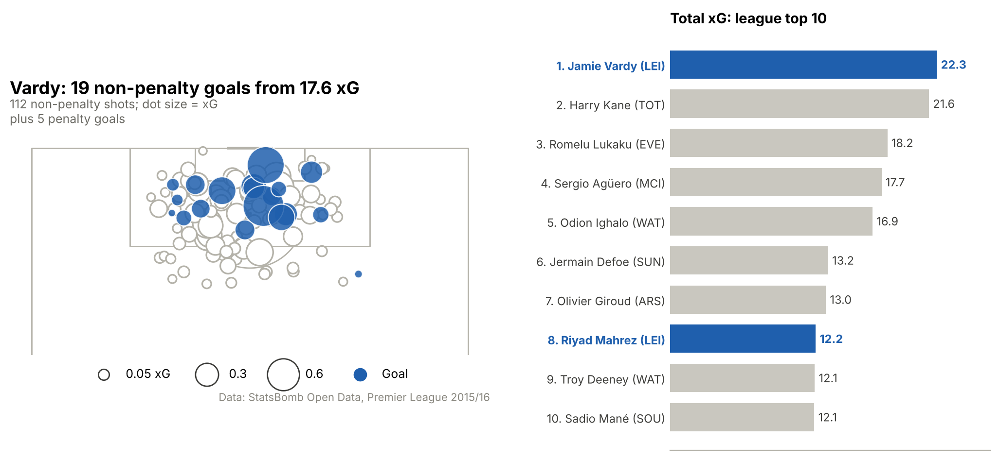

**What it shows.** Every non-penalty shot Vardy took (112), with dot size showing its xG and blue dots showing goals. Next to it, the league top 10 for total xG, where Vardy is 1st and Mahrez 8th.

**What it means.** Almost all of Vardy's goals came from inside the box, many from central positions close to goal. His average shot was worth 0.157 xG, against 0.111 for forwards overall: he got into better positions than other strikers, mostly by running in behind on the counter. He scored slightly more than his chances (19 from 17.6), plus 5 of 6 penalties.

### Chart 10 · Vardy and Mahrez were at the heart of the most dangerous moves

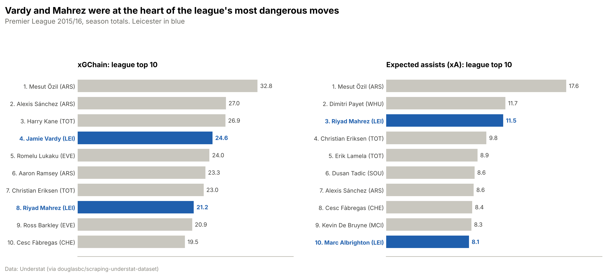

**What it shows.** Two Understat measures. xGChain adds up the xG of every attack a player was involved in at any point. Expected assists (xA) is the xG of the shots a player set up. Vardy was 4th for xGChain (24.6) and Mahrez 8th (21.2). Mahrez was 3rd for xA (11.5), and Albrighton 10th (8.1).

**What it means.** Goals and assists only count the last touch. xGChain shows that Vardy and Mahrez were involved in Leicester's dangerous attacks throughout, not just finishing them. Albrighton's place in the xA top 10 shows that the left side created chances too, not just Mahrez on the right.

### Chart 11 · Mahrez completed more dribbles than any player in the league

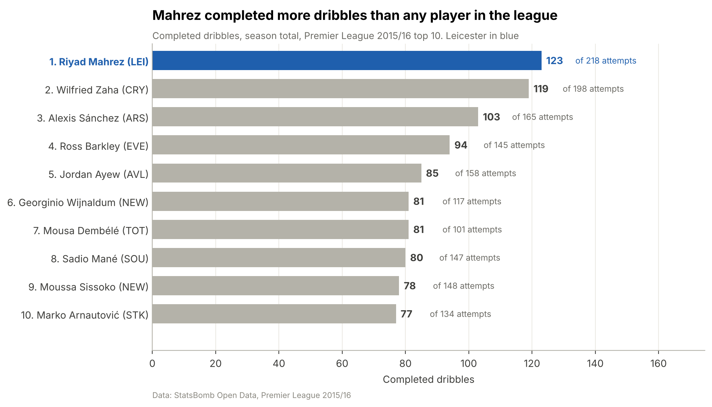

**What it shows.** The league top 10 for completed dribbles (taking on and beating an opponent) over the season. Mahrez is 1st with 123, from 218 attempts. Wilfried Zaha is 2nd with 119 and Alexis Sánchez 3rd with 103.

**What it means.** In a team that attacked quickly, Mahrez was the player who could beat a defender on his own and turn a counter-attack into a chance. Beating opponents also drew fouls: he won 92 of them, 2nd in the league.

### Chart 12 · Per 90 minutes, Mahrez was 3rd, about four times the league median

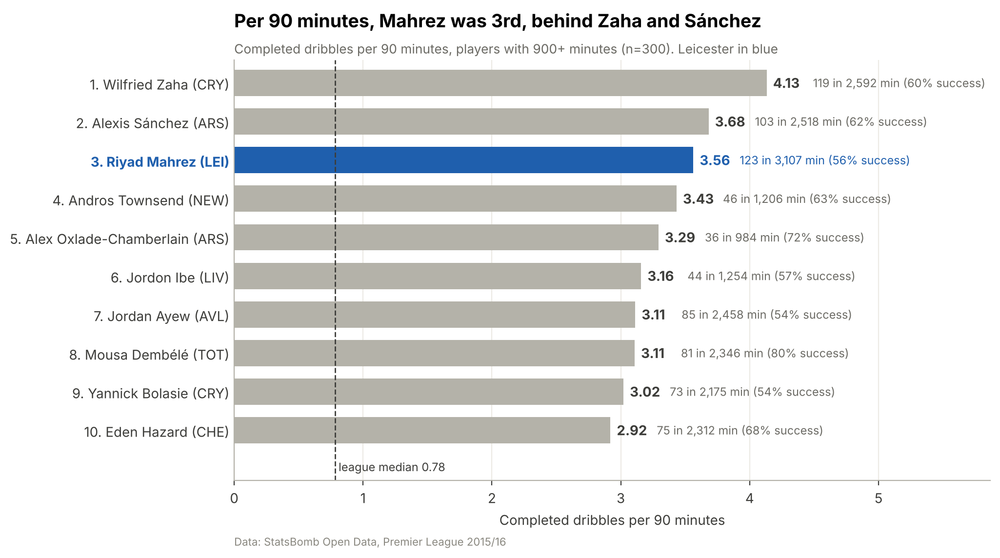

**What it shows.** The same stat per 90 minutes, for the 300 players with 900+ minutes. Mahrez completed 3.56 dribbles per 90, 3rd behind Zaha (4.13) and Sánchez (3.68). The dashed line is the league median, 0.78.

**What it means.** Per 90 is the fairer comparison, because it removes the effect of playing more minutes. Mahrez led on totals partly because he played more (3,107 minutes against Zaha's 2,592). But he was still among the top three dribblers in the league by rate, at more than four times what a typical player completed. He kept that level up for almost every minute of the season.

### Chart 13 · Mahrez's dribbling and Vardy's work rate against the league

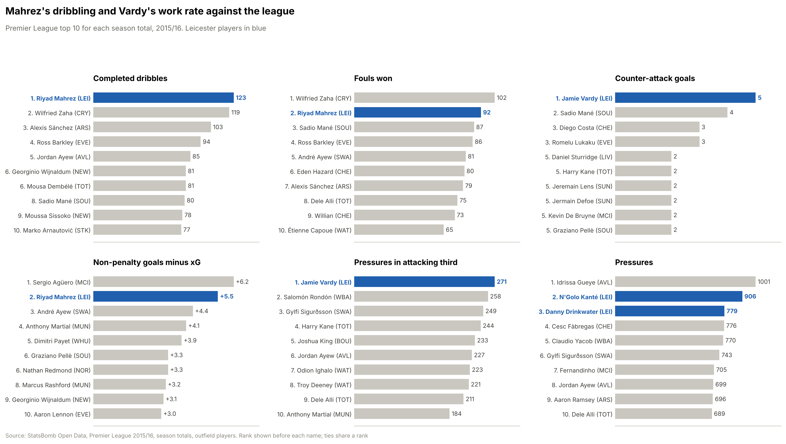

**What it shows.** Six more league top 10s. Mahrez: 1st for completed dribbles, 2nd for fouls won (92, behind Zaha's 102), and 2nd for non-penalty goals above xG (+5.5, behind Agüero's +6.2). Vardy: 1st for counter-attack goals (5) and 1st for pressures in the attacking third (271). Kanté (906) and Drinkwater (779) were 2nd and 3rd for total pressures, behind only Idrissa Gueye.

**What it means.** Two things stand out. Mahrez was an elite finisher that season, scoring 5.5 more non-penalty goals than his chances suggested. And Leicester's stars also defended: their top scorer pressed opponents' defenders more than any forward in the league, and their two central midfielders closed down more than almost anyone.

### Chart 14 · Kanté won the ball 274 times, more than any player in the league

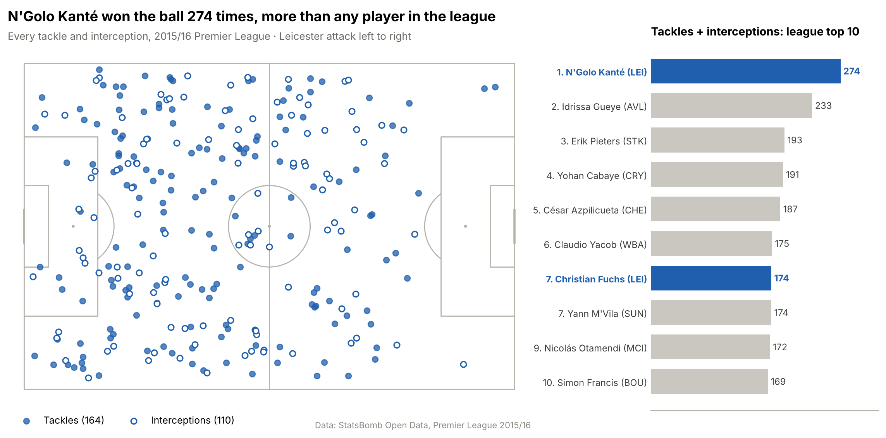

**What it shows.** Every tackle (filled dot, 164) and interception (hollow dot, 110) Kanté made, on a pitch where Leicester attack left to right. Next to it, the league top 10 for tackles plus interceptions: Kanté 274, Idrissa Gueye 233. Christian Fuchs is joint-7th with 174.

**What it means.** The dots cover almost the whole pitch, from his own box to the edge of the opponents'. Kanté didn't hold a position; he went to wherever the ball was. He was 41 ball-wins clear of the next player, and he gave Leicester's counter-attacks their starting point.

### Chart 15 · Kanté, Fuchs and Huth against the league's best defenders

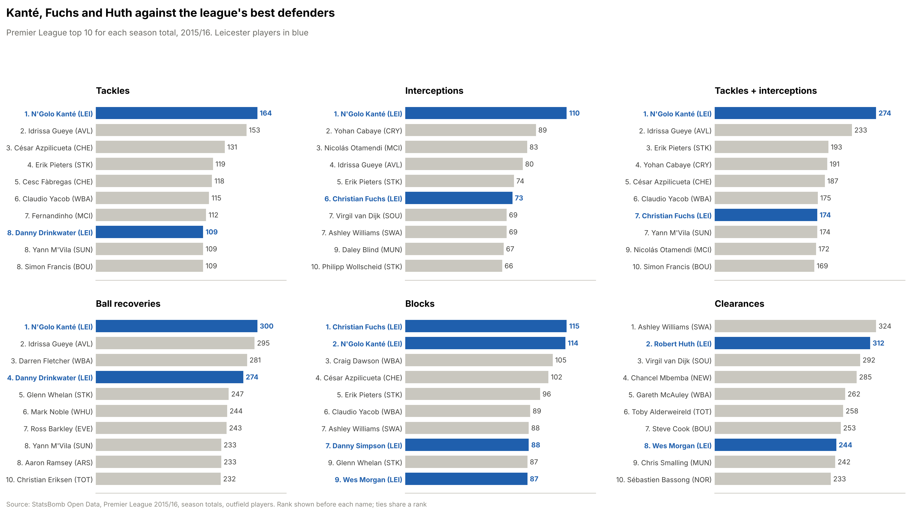

**What it shows.** Six defensive top 10s. Kanté was 1st for tackles (164), interceptions (110), tackles plus interceptions (274) and ball recoveries (300), and 2nd for blocks (114). Fuchs was 1st for blocks (115) and 6th for interceptions. Huth was 2nd for clearances (312). Drinkwater was 4th for ball recoveries and 8th for tackles; Simpson and Morgan were 7th and 9th for blocks; Morgan 8th for clearances.

**What it means.** Leicester players appear in every one of these six tables, and usually more than once. This is the defensive side of chart 2: the blocks, clearances and ball-wins behind conceding 10 fewer goals than their chances allowed.

### Chart 16 · Leicester players led the whole league in 10 measures

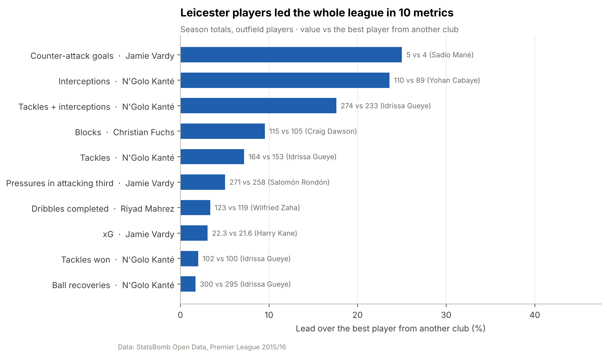

**What it shows.** Every season-total measure in which a Leicester player was 1st in the league. The bar shows how far ahead he was of the best player from another club. Kanté led five (tackles, tackles won, interceptions, tackles plus interceptions and ball recoveries), Vardy three (xG, counter-attack goals and attacking-third pressures), Mahrez one (completed dribbles) and Fuchs one (blocks). The biggest leads were Vardy's counter-attack goals (5 vs 4) and Kanté's interceptions (110 vs 89).

**What it means.** A team built on a small budget had four players who were the best in the league at something specific. Each was elite in exactly the role the system needed: winning the ball (Kanté), blocking (Fuchs), beating a man (Mahrez) and running in behind (Vardy).

---

## Part 5. Money and signings

### Chart 17 · They spent the 12th-most and won the league by 10 points

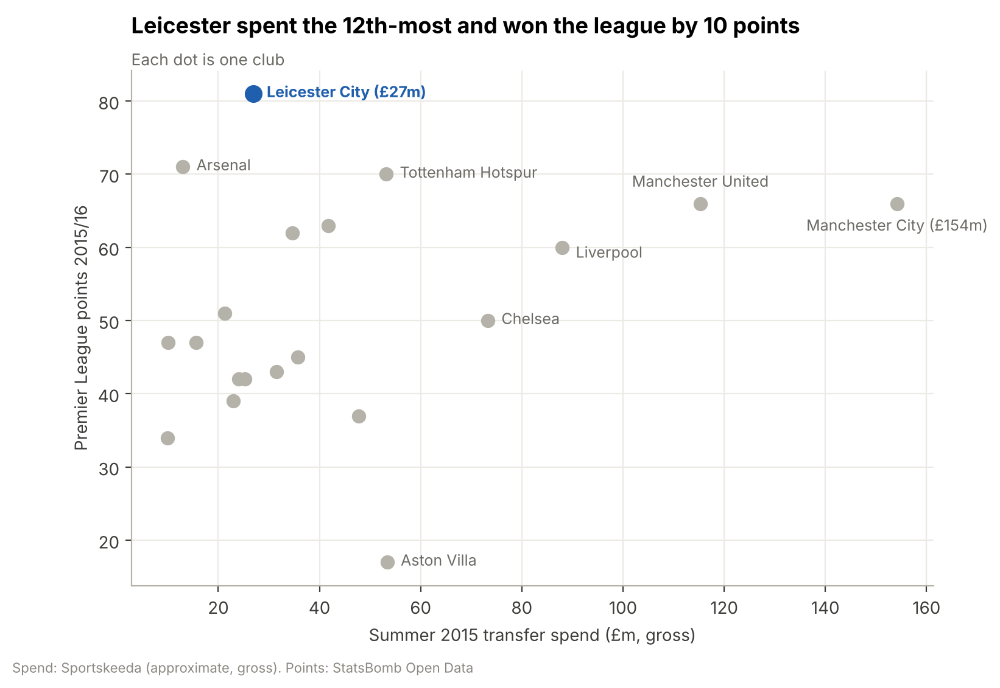

**What it shows.** Each dot is a club. Across is gross transfer spending in summer 2015; up is points won. Leicester spent about £27m, 12th of 20, and finished top on 81. Manchester City spent £154m and finished on 66. Manchester United spent about £115m (66 points), and Aston Villa about twice Leicester's budget, only to be relegated with 17 points.

**What it means.** There's no clear line from spending to points in this season. Kevin De Bruyne's fee alone (£54.5m) was double Leicester's whole summer. The rest of Leicester's core was even cheaper: Vardy cost £1m from non-league Fleetwood in 2012, and Mahrez about £450,000 from Le Havre in 2014.

### Chart 18 · Cheap specialists vs the summer's big-money buys

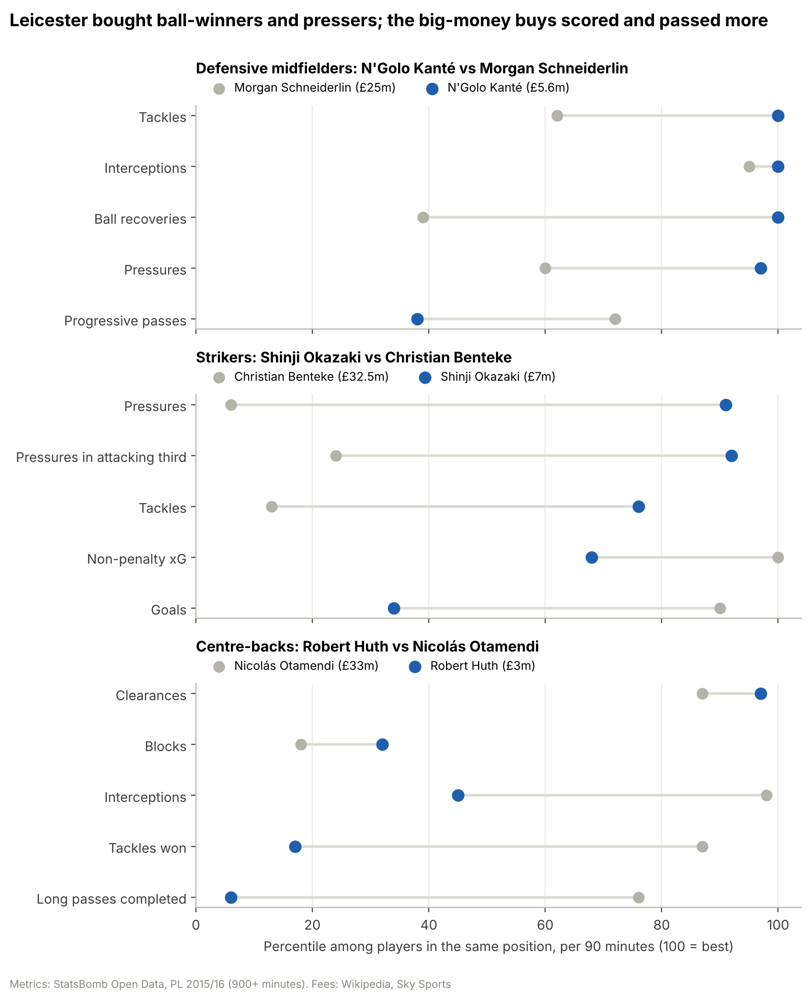

**What it shows.** Three Leicester signings against a big-money player in the same position, by percentile among players in that position (per 90, 100 = best). Kanté (£5.6m) vs Morgan Schneiderlin (£25m): Kanté higher for tackles, interceptions, ball recoveries and pressures; Schneiderlin better at progressive passes. Okazaki (£7m) vs Christian Benteke (£32.5m): Okazaki pressed at the 91st percentile, Benteke at the 6th; Benteke was far better at scoring. Huth (£3m) vs Nicolás Otamendi (£33m): Huth better for clearances and blocks; Otamendi for interceptions, tackles won and long passes.

**What it means.** Leicester didn't buy cheaper versions of star players. They bought specialists who were elite at the one job the system needed (winning the ball, pressing, clearing) and accepted weaknesses elsewhere. The four regular signings (£15.6m in total) made 579 tackles plus interceptions; the nine biggest summer deals in the league (£308m) made 639.

### Chart 19 · Each signing was elite at one job

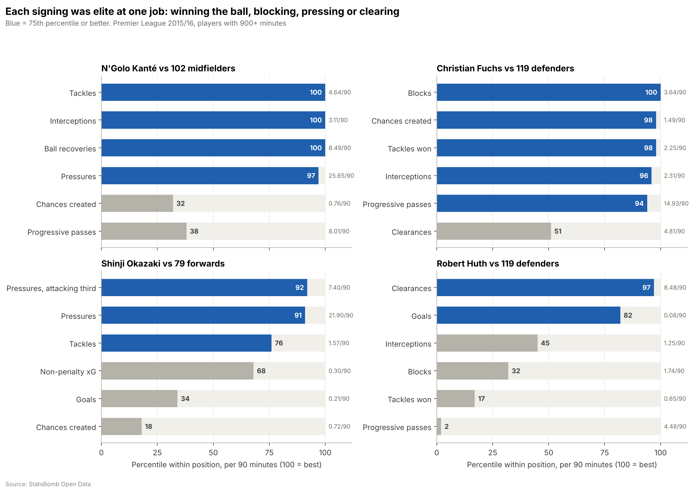

**What it shows.** Each regular signing's percentile in his position for six measures (blue = 75th percentile or better). Kanté was 100th percentile among 102 midfielders for tackles, interceptions and ball recoveries, and 97th for pressures. Fuchs was 100th among defenders for blocks, 98th for chances created and tackles won. Okazaki was 91st–92nd among forwards for pressing. Huth was 97th for clearances.

**What it means.** The weak spots are just as clear: Kanté was only 32nd–38th percentile for chances created and progressive passes, Okazaki 34th for goals, and Huth 2nd percentile for progressive passes. Each player had a narrow profile, and the team was set up so their weaknesses rarely mattered.

### Chart 20 · The signings vs the Leicester players they replaced or played beside

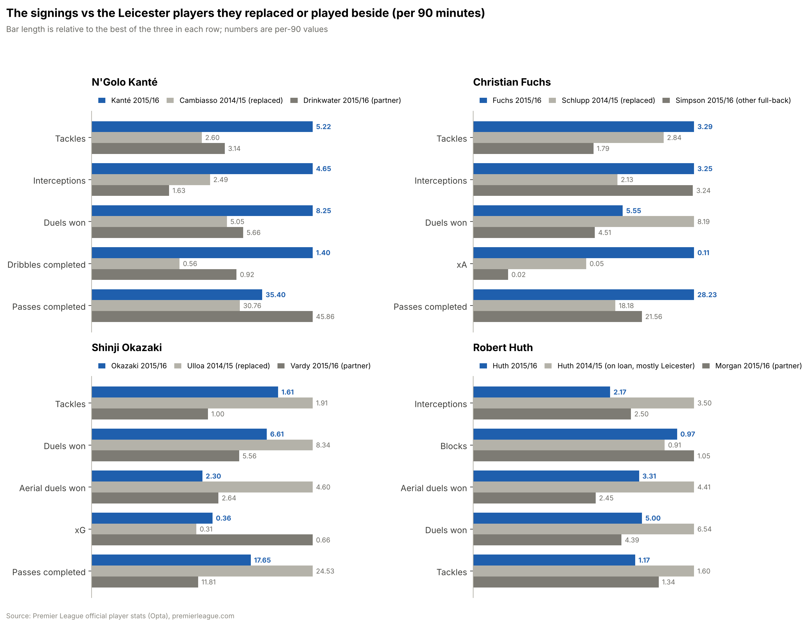

**What it shows.** Each signing (blue) against the player he replaced from 2014/15 and the teammate he played beside in 2015/16, all per 90 minutes (Opta). Kanté doubled Cambiasso's tackles (5.22 vs 2.60) and interceptions (4.65 vs 2.49). Fuchs made more tackles, interceptions and passes than Schlupp, and created more. Huth won more aerial duels than his partner Morgan (3.31 vs 2.45).

**What it means.** Three of the four signings were clear upgrades on paper. Okazaki is the honest exception: he won fewer duels (6.61 vs 8.34) and made fewer tackles than Ulloa had in 2014/15. His value was in pressing, which only shows in StatsBomb's 2015/16 data (chart 19) and doesn't exist for 2014/15.

---

## Part 6. From 14th to 1st

### Chart 21 · Vardy went from 5 league goals to 24, Mahrez from 4 to 17

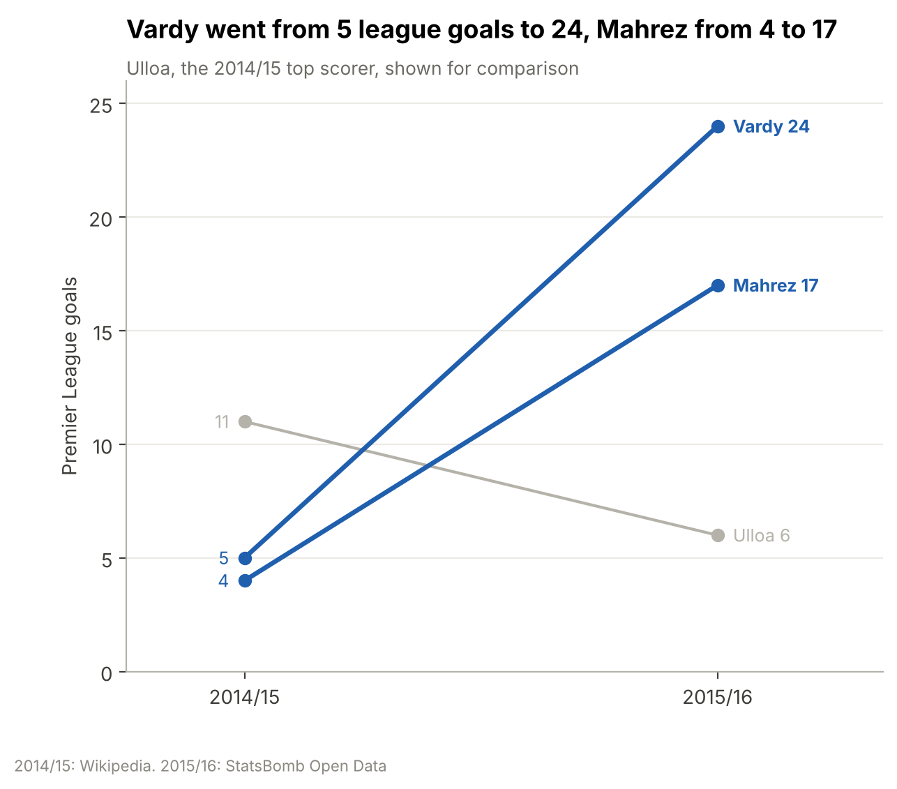

**What it shows.** League goals in each season for Vardy, Mahrez and Leonardo Ulloa, Leicester's top scorer in 2014/15. Vardy went from 5 to 24 and Mahrez from 4 to 17, while Ulloa went from 11 to 6.

**What it means.** The team went from 46 goals to 68, and two players who were already at the club account for 32 extra goals between them. Ulloa's drop shows the change in role: he lost his starting place as the target man when the team switched to playing Vardy through the middle.

### Chart 22 · Per-90 change for every returning player

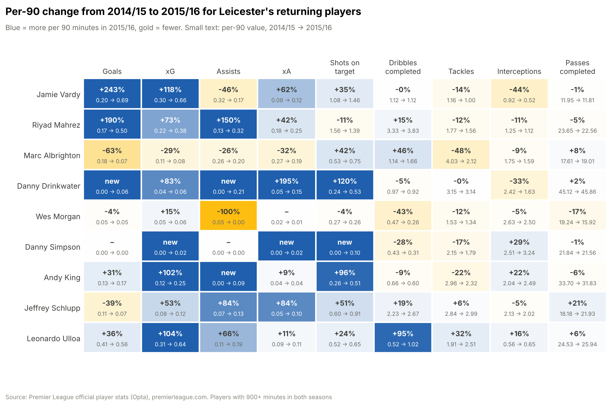

**What it shows.** A grid of returning players (900+ minutes in both seasons) against nine measures per 90 minutes. Blue means more in 2015/16, gold means fewer; the small text gives the actual values. Vardy's goals per 90 rose 243% (0.20 → 0.69) and his xG 118%. Mahrez's goals rose 190% and his assists 150%. Drinkwater went from no assists to 0.21 per 90 and nearly tripled his xA. Ulloa, off the bench, doubled his xG per 90.

**What it means.** The improvement wasn't just Vardy and Mahrez. Drinkwater became a creator, and Ulloa was more productive per minute as a substitute. Some measures went down too: Vardy assisted and intercepted less, likely because he now played as the central striker rather than sometimes out wide, and Albrighton's goals and tackles per 90 fell.

### Chart 23 · Vardy and Mahrez produced far more per 90 minutes, not just over more minutes

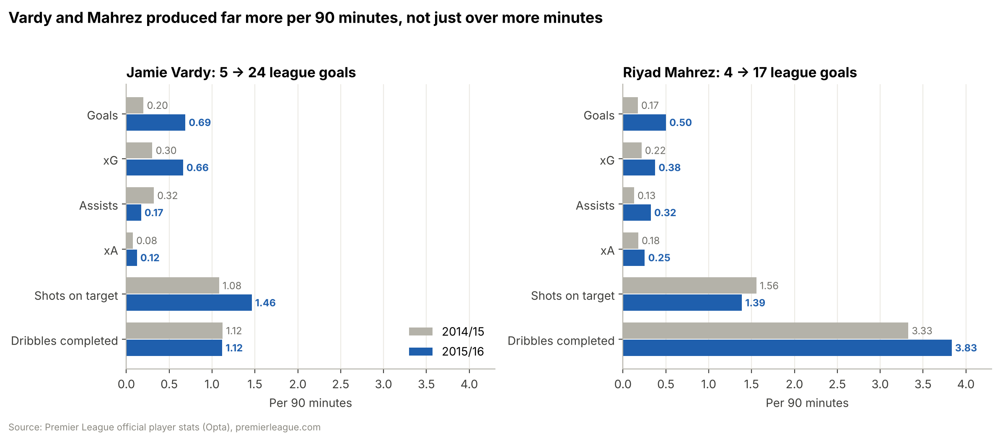

**What it shows.** Six per-90 measures for Vardy and Mahrez in both seasons (grey 2014/15, blue 2015/16). Vardy: goals 0.20 → 0.69, xG 0.30 → 0.66, shots on target 1.08 → 1.46. Mahrez: goals 0.17 → 0.50, assists 0.13 → 0.32, completed dribbles 3.33 → 3.83.

**What it means.** Because these are per 90, the jump isn't explained by playing more. Vardy more than doubled the chances he got every match. Mahrez also scored more than his chances (17 from 12.7 xG), so part of his jump was elite finishing that season.

### Chart 24 · On chances, they went from a 15th-place team to a 4th-place team in one summer

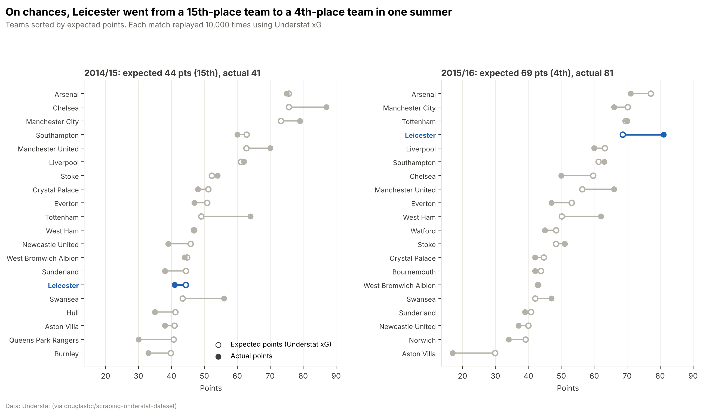

**What it shows.** Expected points (from Understat xG) and actual points for every team in both seasons. In 2014/15, Leicester's chances were worth 44 points, 15th-best; they took 41 and finished 14th. In 2015/16, their chances were worth 69 points, 4th-best; they took 81.

**What it means.** This splits the leap from 41 to 81 points into two parts. About +24 points was real improvement: the team created better chances and allowed worse ones. About +12 points was overperformance on top (explained under chart 2). Understat's expected points (69, 4th) also agree with the StatsBomb model in chart 1 (66, 4th), so the finding doesn't depend on one data provider.

### Chart 25 · They stopped conceding more than they created during the 2015 escape

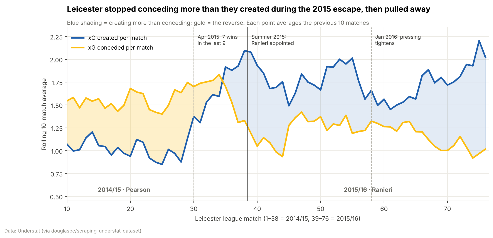

**What it shows.** Leicester's xG created (blue) and conceded (gold) over 76 matches across both seasons, each point averaging the previous 10 matches. Gold shading means they were conceding more than they created; blue shading means the reverse. The lines cross around April 2015, when they won 7 of their last 9 games, and the blue gap stays open under Ranieri, widening again from January 2016.

**What it means.** The turnaround started under Nigel Pearson, a season before the title. Counting that run, Leicester took 103 points from 47 matches (2.19 per match): title-winning form over more than a full season. Per match, xG created rose from 1.28 in 2014/15 to 1.83 in 2015/16, and xG conceded fell from 1.52 to 1.20.

### Chart 26 · Vardy's shots were no better on average. He took far more of them

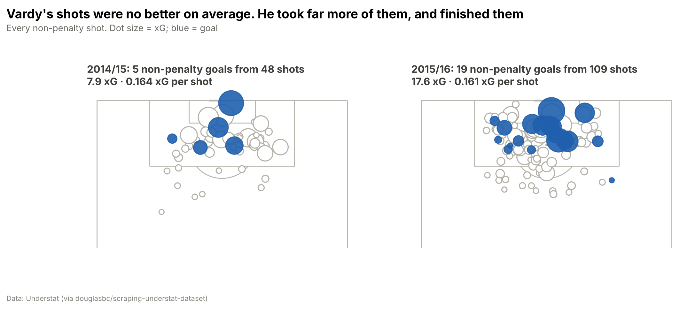

**What it shows.** Every non-penalty shot Vardy took in each season (Understat), sized by xG, with goals in blue. In 2014/15: 48 shots, 7.9 xG, 0.164 xG per shot, 5 goals. In 2015/16: 109 shots, 17.6 xG, 0.161 xG per shot, 19 goals.

**What it means.** A common explanation is that Vardy got better chances under Ranieri. The data doesn't support that: his average shot was almost identical. What changed was volume. As the central striker, he took more than twice as many shots (1.9 → 3.1 per 90), and he went from scoring below his xG to slightly above it.

### Chart 27 · Most of the change came from open play, plus three times as many penalties

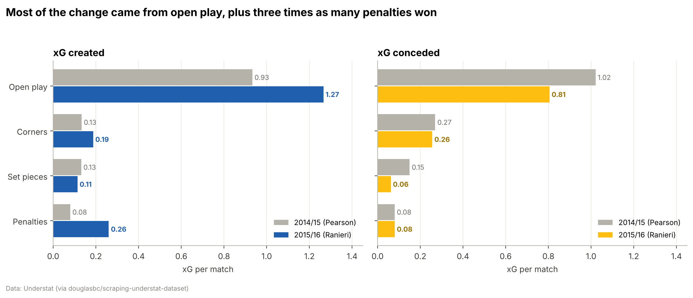

**What it shows.** xG per match created (left) and conceded (right), split by situation, for both seasons. Open-play xG created rose from 0.93 to 1.27 per match, and open-play xG conceded fell from 1.02 to 0.81. Penalty xG won rose from 0.08 to 0.26 per match. Set-piece xG conceded fell from 0.15 to 0.06.

**What it means.** The improvement was mainly in normal play, not set pieces: the new system created more and allowed less from open play. Penalties were a real extra weapon: Leicester won 13 that season, the most in the league, up from 4.

---

## Part 7. Pearson to Ranieri

### Chart 28 · Same passing volume, far more dangerous

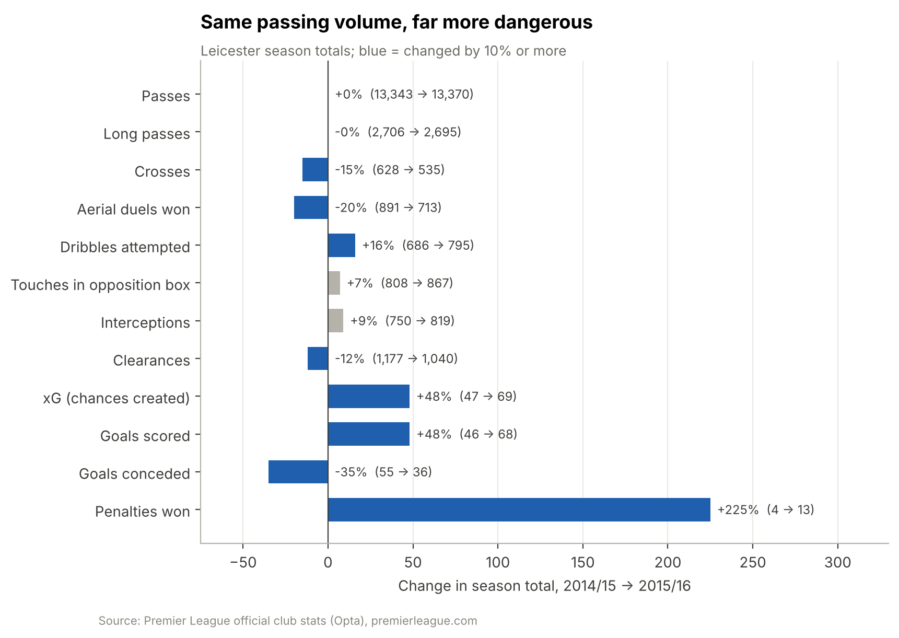

**What it shows.** The change in Leicester's season totals from 2014/15 (Nigel Pearson) to 2015/16 (Claudio Ranieri), from official Opta stats. Blue bars changed by 10% or more. Passes (13,343 → 13,370) and long passes (2,706 → 2,695) stayed almost identical. Crosses fell 15% and aerial duels won fell 20%. xG rose 48% (47 → 69), goals scored rose 48% (46 → 68), goals conceded fell 35% (55 → 36) and penalties won rose from 4 to 13.

**What it means.** Ranieri didn't change Leicester's identity: they were already a direct, low-possession side under Pearson. He changed what the same style produced. Instead of crossing to a target man (fewer crosses and headers), the team switched to a settled 4-4-2 with Vardy running in behind, Mahrez and Albrighton cutting inside from the wings, and Kanté and Drinkwater winning the ball in midfield. The same number of passes became 48% more xG.

---

## What clubs can learn from it

Leicester's season is history, but five lessons from the data still apply to any club today.

1. **Buy for a role, not a reputation.** Kanté, Fuchs, Huth and Okazaki cost £15.6m together, and each was in the top 10% of his position at one specific job (charts 18–19). The big-money buys of that summer were better all-round players, but Leicester's signings fitted the system exactly. A club with a clear style can recruit cheaply by searching for the one skill each role needs.
2. **Judge the team on chances, not the league table.** In spring 2015, the table said Leicester were bottom. Their xG said they had stopped conceding more than they created (chart 25), a full season before the title. Clubs that track expected goals can see a team improving, or declining, months before the results show it.
3. **Stability is a performance tool.** Leicester made 33 line-up changes all season, the fewest in the league by 23 (chart 6), with the fewest injuries and no European games. A settled XI made the defensive block and the counter-attacking patterns automatic. Rotation has a cost that rarely shows up in a squad list.
4. **Change the structure before changing the style.** Ranieri kept the same number of passes and the same direct approach as Pearson, but changed the shape and each player's role, and the same style produced 48% more xG (chart 28). A new manager doesn't need to rebuild the identity a squad already has.
5. **Be careful with overperformance.** About 12 of Leicester's 81 points came from beating their expected total (chart 24), through blocks, goalkeeping, game state and some luck. That is hard to repeat: the following season Leicester finished 12th. A club planning its next season should budget for the expected-points level, not the final table.

---

## Conclusion

Leicester won the 2015/16 Premier League in three layers:

1. **A real improvement.** Their chances went from 15th-best to 4th-best in one summer (charts 24 and 25). A settled 4-4-2 put each player in his best role, the same direct style created 48% more xG (chart 28), and the squad hardly changed all season (chart 6).
2. **Elite specialists.** Kanté, Vardy, Mahrez and Fuchs each led the league at a specific job (chart 16), and the signings who made that possible cost £15.6m (charts 18–19).
3. **Defence beyond the numbers.** From January they pressed harder and gave up only poor chances (chart 5), blocked shots and had a top goalkeeper, and kept scoring first. That turned a 4th-place team on chances into champions (charts 1 and 2), with some luck on top.

The data can't separate skill from luck exactly. But it shows the 5000–1 title wasn't a fluke built on one hot streak: it was a good team that got better through the season, and then defended like no one else.

---

*Findings log, with the evidence for every number: [`results.md`](results.md) · Tactics write-up: [`tactics_pearson_to_ranieri.md`](tactics_pearson_to_ranieri.md) · Notebooks: [`../notebooks/`](../notebooks/)*

---

## Appendix: data, method and sources

### Data

| Source | What it gives | Used for |
| --- | --- | --- |
| [StatsBomb Open Data](https://github.com/statsbomb/open-data) | Every on-ball event of the 2015/16 Premier League (380 matches, 1,305,608 events) with locations and xG | All 2015/16 player and team analysis |
| [Premier League official stats](https://www.premierleague.com/en/stats) (Opta) | Season totals per player and club, including 2014/15 | Comparing 2014/15 with 2015/16 |
| EA Sports Player Performance Index (via Sky Sports) | Distance covered | Running distance (StatsBomb doesn't track it) |
| [Understat](https://understat.com) (via a [public copy on GitHub](https://github.com/douglasbc/scraping-understat-dataset)) | xG for every shot in 2014/15 and 2015/16, plus player xGChain and xA | Comparing both seasons on one xG model |
| Published sources (Wikipedia, Sky Sports, Sportskeeda, Spielverlagerung, Coaches' Voice and others) | Fees, spending, tactics, context | Money, signings, tactics |

The full data dictionary, cleaning log and validation checks (e.g. 1,026 goals = 988 + 38 own goals) are in [`dataset.md`](../../../docs/dataset.md). Every number in this article is listed, with its evidence, in the [findings log](results.md).

### Limitations

- **Expected goals and expected points** treat shots as independent and ignore the score at the time. Part of the defensive overperformance is probably skill (blocks, positioning, Schmeichel) and part luck; this data can't separate them.
- **No 2014/15 event data.**
  - The season-on-season comparison uses Opta totals from premierleague.com.
  - Formation, pressing and line-height comparisons cover 2015/16 only.
- **Two data providers.** Opta and StatsBomb count some events differently (Kanté: 175 vs 164 tackles), so their numbers are never mixed in one chart.
- **Secondary sources.** Distance covered, transfer fees, spending and injury figures come from published reports, and some fees were undisclosed.
- **Possession** in the StatsBomb analysis is estimated as each team's share of passes in a match.
- **Understat data** comes from a public copy of Understat's data on GitHub, because Understat's own site was offline. Its goal totals match the official results in both seasons.
- **Tactical descriptions** come from published analysis. Where sources disagree, this analysis follows the more detailed one and marks data-backed claims separately.

### Sources

**Data**
- [StatsBomb Open Data](https://github.com/statsbomb/open-data), Premier League 2015/16
- [Understat](https://understat.com) shot and player data, 2014/15 and 2015/16, via [douglasbc/scraping-understat-dataset](https://github.com/douglasbc/scraping-understat-dataset)
- Premier League official stats (Opta): [player stats](https://www.premierleague.com/en/stats) and Leicester City club stats for [2014/15](https://www.premierleague.com/en/clubs/13/leicester-city/stats?season=2014) and [2015/16](https://www.premierleague.com/en/clubs/13/leicester-city/stats?season=2015)
- EA Sports Player Performance Index via Sky Sports: [team distance, 8 March 2016](https://www.skysports.com/football/news/10196163/tireless-tottenham-running-further-in-2016-than-any-other-premier-league-team) and [player distance, 9 February 2016](https://www.skysports.com/football/news/11661/10161166/which-premier-league-players-have-run-the-furthest-this-season)

**Seasons, fees and spending**
- Wikipedia: [2015–16 Leicester City season](https://en.wikipedia.org/wiki/2015%E2%80%9316_Leicester_City_F.C._season), [2014–15 Leicester City season](https://en.wikipedia.org/wiki/2014%E2%80%9315_Leicester_City_F.C._season), [2016–17 Leicester City season](https://en.wikipedia.org/wiki/2016%E2%80%9317_Leicester_City_F.C._season), [Jamie Vardy](https://en.wikipedia.org/wiki/Jamie_Vardy), [Riyad Mahrez](https://en.wikipedia.org/wiki/Riyad_Mahrez), [Robert Huth](https://en.wikipedia.org/wiki/Robert_Huth), [Christian Fuchs](https://en.wikipedia.org/wiki/Christian_Fuchs)
- [Sky Sports: the 10 most expensive deals of summer 2015](https://skysports.com/football/news/11096/9975549/the-10-most-expensive-deals-of-the-summer-transfer-window)
- [Sportskeeda: summer 2015 spending by club](https://widgets.sportskeeda.com/football/how-much-all-20-premier-league-clubs-spend-2015-summer-transfer-window)
- [Sky Sports: Vardy's record deal from Fleetwood](https://www.skysports.com/football/news/11712/7762163/Foxes-agree-record-Vardy-deal)
- [The Scotsman: Kanté sale to Chelsea](https://www.scotsman.com/sport/football/leicesters-aps26m-profit-sale-ngolo-kante-chelsea-1472042)

**Tactics and management**
- [Spielverlagerung: Smart as eleven foxes](https://spielverlagerung.com/?p=3393)
- [Premier League: How Ranieri masterminded Leicester's title](https://www.premierleague.com/en/news/2748139)
- [Coaches' Voice: Nigel Pearson](https://learning.coachesvoice.com/coach-watch-nigel-pearson/)
- [Sky Sports: five ways Ranieri changed Leicester](https://www.skysports.com/amp/football/news/30385/10083402/claudio-ranieri-five-ways-hes-changed-things-at-leicester-city)
- [Football Italia: Ranieri, my tactics explained](https://www.football-italia.net/84100/ranieri-my-tactics-explained)
- [AP via Dawn: Ranieri's winning blueprint](https://dawn.com/news/1256467)
- [Jonathan Wilson, New Statesman: Trust the tinkerman](https://www.newstatesman.com/culture/sport/2016/04/trust-tinkerman-fall-and-rise-claudio-ranieri)
- [The Set Pieces: Focus on Leicester City](https://thesetpieces.com/?p=5394)
- [The Hard Tackle: Leicester's multidimensional gameplay](https://thehardtackle.com/blogs/2016/02/14/leicester-city-the-sum-of-all-parts-killing-premier-giants-one-game-at-a-time/amp/)
- [The Tomkins Times: Leicester 2 Liverpool 0](https://tomkinstimes.com/?p=57636)
- [TBR Football: the tactics behind Leicester's success](https://tbrfootball.com/analysis-the-tactics-behind-leicesters-premier-league-success/)
- [The42: 7 key factors](https://the42.ie/7-key-factors-inspired-leicesters-title-triumph-2748883-May2016)
- [Computer Weekly: data analytics at Leicester](https://www.computerweekly.com/news/450296302/Foxy-Leicester-City-FC-won-Premiership-with-data-analytics)
- [Sportskeeda: Leicester's sports science](https://www.sportskeeda.com/football/secret-leicesters-success-sports-science)
- [theScore: the great escape](https://www.thescore.com/epl/news/1017760)
