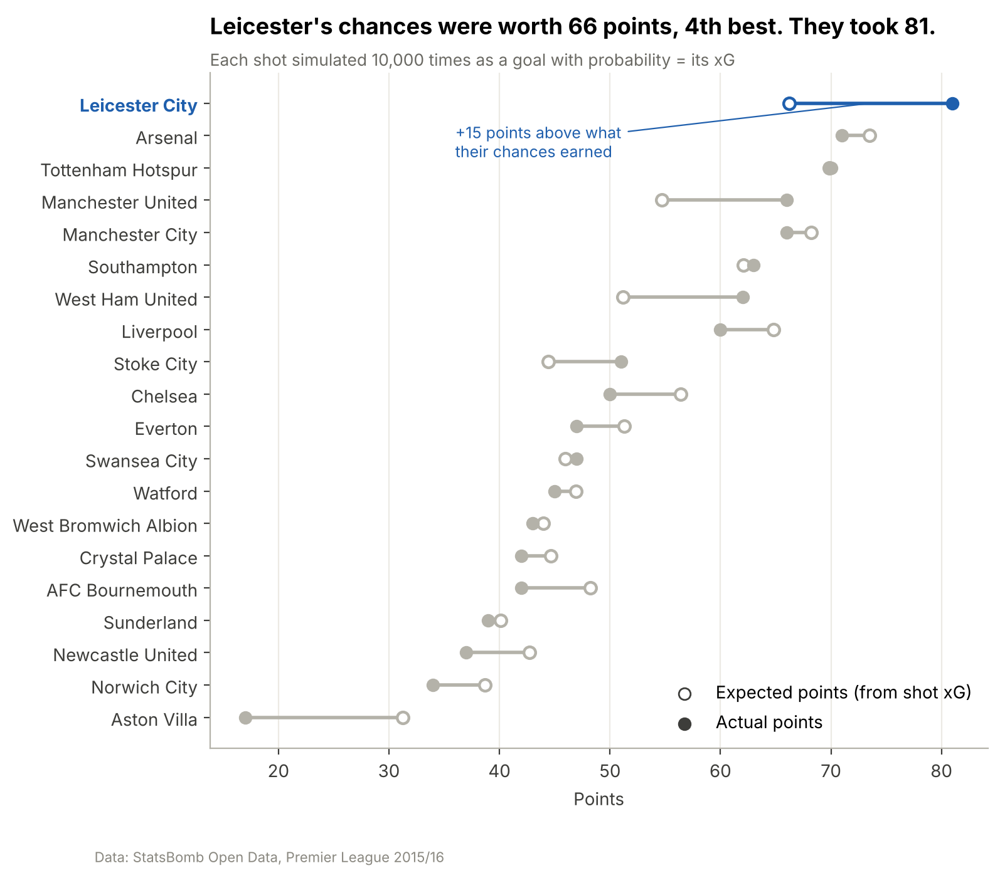

# 🏴󠁧󠁢󠁥󠁮󠁧󠁿 Premier League projects

Data analysis projects on the English Premier League. Part of [**football-analytics**](../README.md).

| Project | Season | Question | Read |
| --- | --- | --- | --- |
| 🦊 [**Leicester City 2015-16 Miracle**](Leicester-City-2015-16-Miracle/) | 2015/16 | How did a 5000–1 outsider win the Premier League? | [Article](Leicester-City-2015-16-Miracle/docs/ARTICLE.md) · [PDF](Leicester-City-2015-16-Miracle/reports/Leicester_2015-16_article.pdf) · [Findings](Leicester-City-2015-16-Miracle/docs/results.md) |
| _Next project_ | | _Coming soon_ | |

## Adding a project

1. Create a folder here named `Team-or-Topic-Season` (e.g. `Arsenal-2023-24-Title-Race`).
2. Give it the same layout as the Leicester project: `README.md`, `docs/`, `notebooks/`, `reports/figures/`, `data/`.
3. Add a row to the table above and to the [main README](../README.md).

The shared code in [`src/football_analytics/`](../src/football_analytics/) (data download, cleaning, chart helpers) works for any project in this folder.
