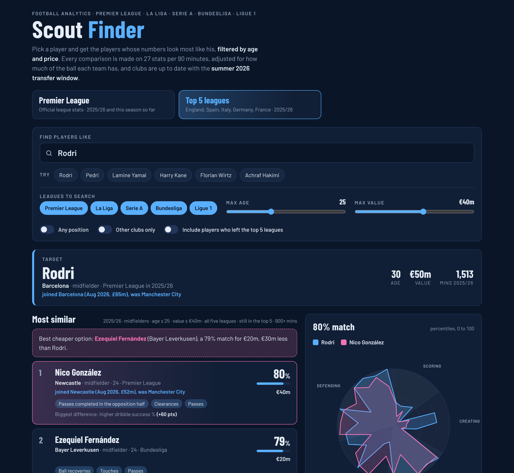

# Scout Finder

**Find players who play like someone else, for less: the Premier League in detail, or all of Europe's top five leagues.**

**[Open the live version](https://syedhammad07.github.io/football-analytics/Projects/Scout-Finder/)**: search in the browser, filter by age and price, and compare any match on a radar of all 27 stats. Or run it as a command-line tool (below).

Two ways to search:

| Mode | Players | Stats from |
| --- | --- | --- |
| **Premier League** | 491 players in 2025/26, 434 so far in 2026/27 | The Premier League's official stats (Opta) |
| **Top 5 leagues** | 2,474 players in the Premier League, La Liga, Serie A, Bundesliga and Ligue 1, 2025/26 | SofaScore season totals, one source for all five leagues |

[](https://syedhammad07.github.io/football-analytics/Projects/Scout-Finder/#leagues=top5&player=Rodri&age=25&value=40)

Ask for "a cheaper Rodri under 25" and Scout Finder ranks every Premier League midfielder by how closely his numbers match Rodri's, then shows his age, his Transfermarkt value, his club now and what the two have in common. Clubs are up to date with the summer 2026 window: Rodri shows at Barcelona, Nico González at Newcastle, and players who have left the league or gone down with their club are left out unless you ask for them.

```
$ python -m scout_finder find "Rodri" --max-age 25 --max-value 40 --top 3

Players most like Rodri (Barcelona (left PL), midfielder, 30, €50m, 1,513 mins in 2025/26)
  joined Barcelona (Aug 2026, £65m), was Man City
2025/26 Premier League stats · age ≤ 25, value ≤ €40m, midfielders only, still in the PL · 900+ minutes
Clubs as of now, summer 2026 moves included · values: Transfermarkt, June 2026

    Player                   Club now          Age   Value  Match
  1 Nico González            Newcastle          24    €40m    79%
      joined Newcastle (Aug 2026, £52m), was Man City
      also strong at: Passes completed in the opposition half, Passes, Ball recoveries
      biggest difference: fewer through balls (-56 pts)
  2 Lewis Miley              Newcastle          20    €25m    72%
      also strong at: Duels won %, Aerial duels won %, Aerial duels won
      biggest difference: fewer fouls won (-84 pts)
  3 Andrey Santos            Man Utd            22    €40m    70%
      joined Man Utd (Jul 2026, £48m), was Chelsea
      also strong at: Duels won %, Pass completion %, Tackles won
      biggest difference: fewer long passes completed (-80 pts)

Best cheaper option: Lewis Miley (Newcastle),
a 72% match for €25m, €25m less than Rodri.
```

Built as a small Python package with a command-line interface, a web version and tests, not a notebook.

## What it does

- **`find`**: the players most like a given player, with filters for age, value, position and club. Search last season (`--season 2025`, the default) or this season so far (`--season 2026`), which includes this summer's signings.
- **`profile`**: one player's percentiles in 27 stats across scoring, creating, passing, carrying and defending.
- **`fetch`**: downloads fresh data and matches Transfermarkt values to players.
- **`page`**: builds the web version, `index.html`: one self-contained page with both seasons' percentiles inside, doing the same search in the browser. Links can be shared, e.g. [`#player=Rodri&age=25&value=40`](https://syedhammad07.github.io/football-analytics/Projects/Scout-Finder/#player=Rodri&age=25&value=40).

Add `--top5` to search all five leagues, and `--league` to pick some of them:

```
$ python -m scout_finder find "Rodri" --top5 --max-age 25 --max-value 40 --top 3

  1 Nico González            Newcastle            Premier League   24   €40m    80%
      joined Newcastle (Aug 2026, £52m), was Manchester City
  2 Ezequiel Fernández       Bayer Leverkusen     Bundesliga       24   €20m    79%
  3 Mamadou Sangare          Brentford            Ligue 1          24   €40m    78%
      joined Brentford (Aug 2026, Undisclosed), was Lens

Best cheaper option: Ezequiel Fernández (Bayer Leverkusen),
a 79% match for €20m, €30m less than Rodri.
```

A few more searches:

| Search | Top answer |
| --- | --- |
| `find "Saka" --max-value 50 --other-clubs` | Kevin (Fulham), 80% match, €25m |
| `find "van Dijk" --max-age 26` | Jaydee Canvot (Crystal Palace), 81% match, €28m |
| `find "Palmer" --max-value 40 --other-clubs` | Harvey Barnes (Newcastle), 81% match, €32m |
| `find "Bruno Guimarães" --season 2026` | Shea Charles (Fulham), 82% match, €15m |
| `find "Harry Kane" --top5 --league seriea --league laliga` | Lautaro Martínez (Inter), 82% match, €85m |
| `find "Lamine Yamal" --top5` | Michael Olise (Bayern Munich), 91% match, €150m |

## How it works

| Step | Detail |
| --- | --- |
| **Data** | Official Premier League stats (Opta) from the Premier League's stats API, 45 season totals per player: 491 outfield players in 2025/26 and 434 so far in 2026/27. Goalkeepers are left out. |
| **Top 5 leagues** | `--top5` (and the second mode on the page) uses SofaScore season totals for 2025/26 from [m-mahadi/top5-football-dataset](https://github.com/m-mahadi/top5-football-dataset), so players in all five leagues are measured the same way: 2,474 outfield players, 1,451 of them with 900+ minutes. The same 27 stats, except three the source doesn't publish: shots inside the box, big chances created and passes completed in the final third stand in for touches in the box, through balls and forward passes. Team possession is estimated from each team's passes against an average opponent's. Position, date of birth and value come from Transfermarkt, matched by name and club (99.5% of players with 900+ minutes). |
| **Clubs now** | Every summer 2026 transfer and loan in English football (1,067 moves, from Wikipedia's list of English football transfers summer 2026) is applied on top of each player's 2025/26 club, then the official 2026/27 squad lists. A recorded move wins, because the squad lists lag behind: Rodri was still listed at Man City after joining Barcelona. Players at the three relegated clubs (Burnley, West Ham, Wolves) are marked as relegated. The top-five mode does the same with Wikipedia's Spanish, Italian, German and French lists as well (2,834 more moves), following a loan return and then a sale as two steps, and with the 16 clubs relegated from and 14 promoted to the five leagues. |
| **This season** | `--season 2026` uses 2026/27 so far, so new signings from abroad and promoted clubs (Coventry, Hull, Ipswich) can be found. While the season is under way, the minutes bar is 40% of the minutes played so far (360+ after ten games) instead of 900. A player with no minutes this season (Rodri) is compared using his last season. |
| **Values** | Transfermarkt market values from [dcaribou/transfermarkt-datasets](https://github.com/dcaribou/transfermarkt-datasets), current to June 2026, so prices are as of the summer 2026 transfer window. |
| **Matching** | Each Premier League player is found in the Transfermarkt data by date of birth plus name, never name alone. Most shared name words win, so twins with the same birthday (Jurriën and Quinten Timber) aren't swapped. Two careful fallbacks handle different spellings ("Yarmoliuk" / "Yarmolyuk") and birth dates a day apart. 490 of 491 players are matched; the one missing played 25 minutes. |
| **Per 90** | Totals become per-90-minute rates or success percentages. Success rates need a minimum number of attempts (15 dribbles, 30 duels, 15 aerial duels). |
| **Possession** | Players at teams with more of the ball make more passes and fewer tackles. On-ball volume is scaled by 50 ÷ team possession, defending by 50 ÷ opponents' possession, so a Man City midfielder (60% possession) and a West Ham one (43%) are compared fairly. |
| **Percentiles** | Every stat becomes a percentile (0 to 100) within the player's position and season, against players over the minutes bar, so a defender's tackles are compared with other defenders'. |
| **Match %** | 100 minus the average gap between two players' percentiles across all 27 stats. It measures how alike two players' numbers are, which includes their level as well as their style. |

## Run it

Python 3.10+. Part of [football-analytics](../../README.md): run everything from this folder.

```bash
cd Projects/Scout-Finder
pip install -e ".[dev]"                      # install the package and pytest

python -m scout_finder profile "Rodri"
python -m scout_finder find "Rodri" --max-age 25 --max-value 40
python -m scout_finder find "Saka" --other-clubs --top 5
python -m scout_finder find "Gvardiol" --any-position      # compare with every outfield player
python -m scout_finder find "Rodri" --season 2026          # this season so far, new signings included
python -m scout_finder find "Rodri" --include-departed     # also players who have left the league
python -m scout_finder find "Pedri" --top5 --max-age 23    # Europe's top five leagues
python -m scout_finder find "Harry Kane" --top5 --league seriea --league laliga
python -m scout_finder profile "Pedri" --top5

python -m scout_finder page                   # rebuild index.html after new data

python -m pytest                              # 37 tests
```

Options for `find`: `--top5`, `--league` (pl, laliga, seriea, bundesliga, ligue1; with `--top5`), `--season` (2025 or 2026), `--max-age`, `--max-value` (millions of euros), `--other-clubs`, `--any-position`, `--include-departed`, `--min-minutes`, `--top` (default 10).

To rebuild the data:

```bash
python -m scout_finder fetch --stats --season 2026   # Premier League stats (a few minutes)
python -m scout_finder fetch --values         # Transfermarkt file (about 4 MB), then match it
python -m scout_finder fetch --top5           # top-five-leagues stats, then match values and clubs
```

## Project structure

```
scout-finder/
  index.html        the web version (built by `page`)
  src/scout_finder/
    config.py       the 27 stats, the minutes bar and file paths
    features.py     per-90 numbers, possession adjustment, percentiles by position
    similarity.py   finding a player by name, match %, shared strengths, biggest difference
    data.py         loading, Transfermarkt matching, downloads
    transfers.py    each player's club now: summer moves, squads, relegation
    top5.py         Europe's top five leagues: stats, Transfermarkt matching, clubs now
    cli.py          the find / profile / fetch / page commands
    web.py          builds index.html from page_template.html
  tests/            pytest tests for the maths, the matching and the search
  data/
    pl_players_2025-26.csv          Premier League stats, last season
    pl_players_2026-27.csv          Premier League stats, this season so far
    pl_team_possession.csv          team possession, both seasons, for the adjustment
    pl_values_*.csv                 Transfermarkt value for each player
    pl_squads_2026-27.csv           the 20 squads now
    transfers_summer_2026.csv       every summer 2026 transfer and loan in English football
    transfers_summer_2026_europe.csv  the same for Spain, Italy, Germany and France
    top5_values_2025-26.csv         top five leagues: Transfermarkt position, birth date and value
    top5_clubs_now.csv              top five leagues: each player's club now
    (top5_players_2025-26.csv       top five leagues stats, downloaded by `fetch --top5`, not committed)
```

## Limitations

- The two modes use different sources, so a player's percentiles differ a little between them and shouldn't be mixed: the Premier League mode has official Opta stats and this season so far; the top-five mode has 2025/26 only. Opta's advanced stats for other leagues were removed from FBref in January 2026, which is why the top-five mode uses SofaScore totals from an open dataset. Those stats belong to SofaScore; only percentiles built from them are published here, and the raw file is downloaded, not committed.
- In the top-five mode a few players are missing (no Transfermarkt match), namesakes are settled by club, and possession is an estimate from passes.
- Clubs are current as of November 2026, from Wikipedia's summer 2026 transfer lists and the official Premier League squads. A move made after that, or one Wikipedia lists under a different spelling, won't show until the data is refreshed.
- "Midfielder", "Defender" and "Forward" are the positions in the club's squad list, so wingers can be listed as midfielders or forwards. Use `--any-position` to look across them.
- Transfermarkt values are estimates and they're from June 2026, before the summer window, so a player who has since moved for a big fee may be worth more now. A few players at promoted clubs aren't in the Transfermarkt dataset and show n/a.
- A match % describes the numbers, not the player: it can't see tactics, injuries, personality or how a player would fit a new team.
- Goals and assists are noisy over one season, so a big gap in them matters less than a big gap in, say, passes or tackles.

## Sources

- Premier League official stats (Opta), premierleague.com
- Transfermarkt values via [dcaribou/transfermarkt-datasets](https://github.com/dcaribou/transfermarkt-datasets)
- Top five leagues, 2025/26: SofaScore season totals via [m-mahadi/top5-football-dataset](https://github.com/m-mahadi/top5-football-dataset)
- Summer 2026 moves: Wikipedia's lists of [English](https://en.wikipedia.org/wiki/List_of_English_football_transfers_summer_2026), Spanish, Italian, German and French football transfers, summer 2026

Built by Syed Hammad Ovais · [LinkedIn](https://www.linkedin.com/in/syedhammadovais)
