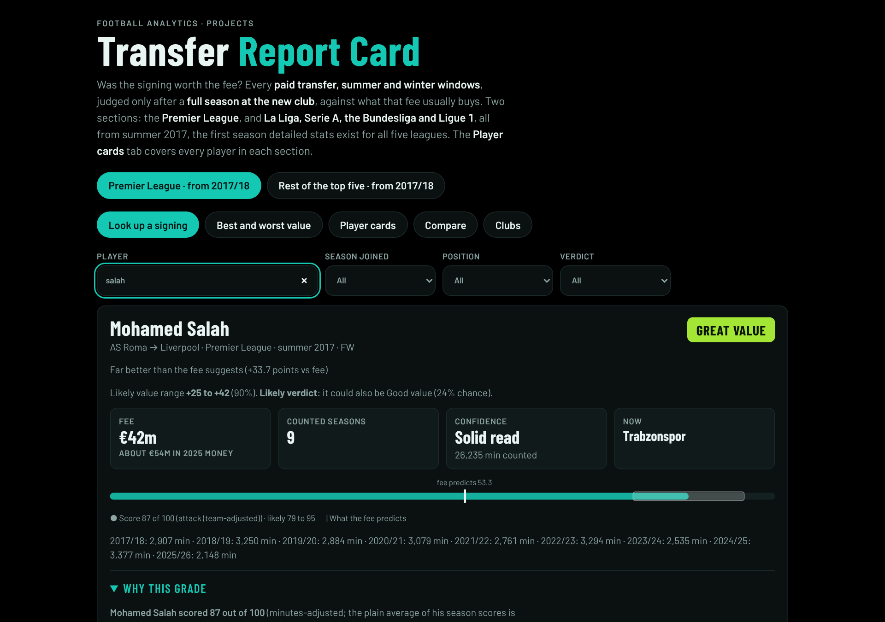
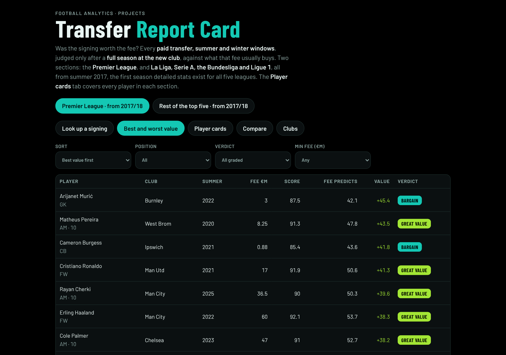
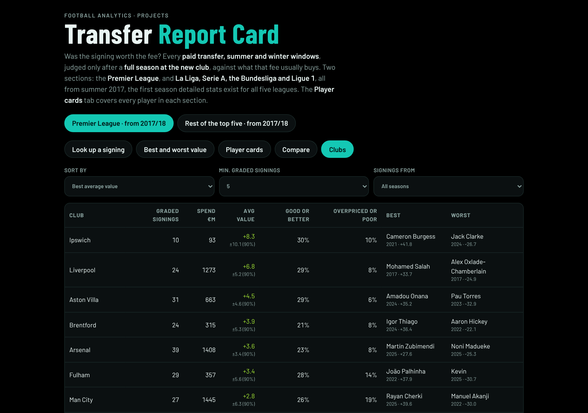
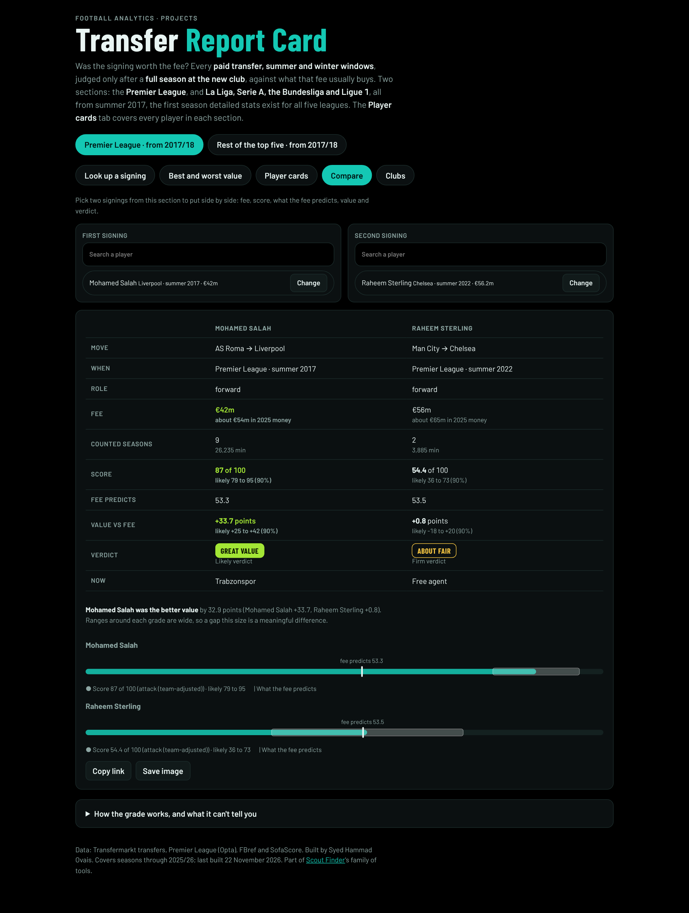
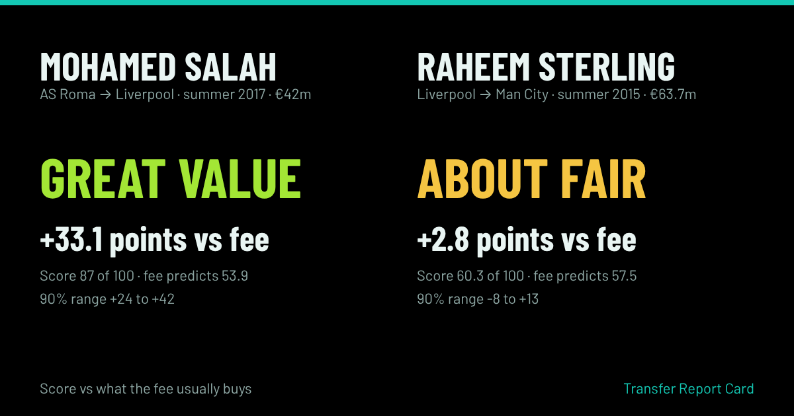

# Transfer Report Card

**Was the signing worth the fee?** Every paid transfer into the Premier League, La Liga, Serie A, the Bundesliga and Ligue 1 since summer 2017, graded after a full season at the new club and compared with what that fee usually buys.

**[Open the live version](https://syedhammad07.github.io/football-analytics/Projects/Transfer-Report-Card/)**: one self-contained page, no install, works on phones.

[](https://syedhammad07.github.io/football-analytics/Projects/Transfer-Report-Card/)

## What it does

| Tab | What you get |
| --- | --- |
| **Look up a signing** | Search a player: score out of 100, what the fee predicts, the gap (value), a verdict, a 90% range and how firm the verdict is |
| **Best and worst value** | Ranked boards by role, window and season |
| **Player cards** | Every player with 90+ minutes since 2017/18, by role, with season-by-season stats |
| **Compare** | Put two signings side by side, copy a share link, or save a share image |
| **Clubs** | Which clubs buy well: average value with a 90% range, share of good and poor signings, best and worst signing |

Two views: the **Premier League** on its own, or **all top five** leagues together. The Premier League gets its own fee slope because fees buy more there; the other four leagues share another.

| | |
| --- | --- |
|  |  |
|  |  |

## How a signing is graded

1. **Score (0 to 100).** For each season a player is ranked against everyone in the same role, season and data source (minimum 450 minutes). The roles are forward, attacking midfielder, central midfielder, defensive midfielder, centre-back, full-back and goalkeeper. Each has its own formula:
   - forwards and attacking midfielders: expected goals plus expected assists per 90, half against all players in the role and half against their own team's attacking rate;
   - defenders and defensive midfielders: team-adjusted defensive involvement, duel and aerial win rates, plus a bonus for goals and assists;
   - full-backs: 60% defence, 40% attacking output;
   - central midfielders: passing, recoveries and duels relative to team, plus a bonus;
   - goalkeepers: goals prevented per 90 (post-shot expected goals minus goals conceded).

   The season scores are averaged over the seasons that count and pulled toward 50 when they rest on few minutes.
2. **Which seasons count.** A season counts only if the player was at the club for all of it and was still there at the end. A summer signing counts from that season, a January signing from the next full season. Seasons under 450 minutes are left out.
3. **What the fee predicts.** A regression of score on the log of the fee (in 2025 money), with role, year, league and window adjustments, and a separate fee slope for the Premier League and the other four leagues. It explains little (R² about 0.05): a bigger fee buys only a slightly better player on average, which is the point of the project.
4. **Value** is score minus what the fee predicts. Verdicts: *Bargain* (fee under about €5m in 2025 money and value 15+), *Great* (30+), *Good* (15 to 30), *About fair* (within 15), *Overpriced* (-15 or lower, score 25+), *Poor* (-15 or lower, score under 25).
5. **Uncertainty.** Each grade comes with a 90% range that depends on minutes played and how loosely the fee predicts output, and a firm / likely / could-go-either-way label.

## Does it work? The backtest

If a signing is graded using only his first graded season, does that verdict predict his later seasons at the club (which are not in the grade)? Yes, moderately:

| | |
| --- | --- |
| Signings with 2+ graded seasons | 1,810 |
| Correlation, first-season value vs later value | **0.50** |
| Later value of the best fifth vs the worst fifth | +15.8 vs -13.4 |
| Gap between "good" and "poor" signings later | **27.2 points** (95% CI 24.9 to 29.5) |
| Fee alone predicting later score | R² 0.04, against 0.27 for the first-season value |

By role the correlation is strongest for central midfielders (0.63) and weakest for goalkeepers (0.31), so goalkeeper grades should be read loosely. Details: [`backtest/BACKTEST.md`](backtest/BACKTEST.md).

## Data

| What | Source |
| --- | --- |
| Premier League player stats 2019/20 onwards | Opta player statistics as published by the Premier League |
| Player stats, all five leagues 2017/18 onwards | [FBref](https://fbref.com) (via `worldfootballR_data`) |
| Goalkeeper save data, 2024/25 | SofaScore |
| Transfers and fees | [Transfermarkt](https://www.transfermarkt.com) files and the [ewenme/transfers](https://github.com/ewenme/transfers) dataset (through 2022) |

The signings and graded-signings CSVs and the other four leagues' stats are in [`data/`](data/). The Premier League's own player statistics are **not** included in this repository (the league's terms don't allow redistributing them), so the Premier League stats files are left out; the page shows the scores and season figures built from them. All data belongs to its original providers and is used here for non-commercial analysis.

## Limits

- **Everything starts in 2017/18**, the first season detailed stats exist for all five leagues. Premier League seasons before that were left out on purpose, so players who arrived earlier are not graded.
- Only transfers with a stated fee are included. Free transfers and loans with an option to buy are not.
- Only what is measured can be graded: off-ball work, leadership, injuries and tactical fit are not in the numbers. A "Poor" verdict means the output was low for the fee, not that the club was foolish.
- The fee model explains only a small share of the variation, so verdicts near the boundaries could go either way. The page says so on each card.
- Goalkeeper grades are the weakest (persistence 0.31).

## Rebuilding it

The scripts are in [`pipeline/`](pipeline/). [`pipeline/REFRESH.md`](pipeline/REFRESH.md) lists the inputs to add and the steps to run after each season. The scripts currently use hard-coded `/home/claude/...` paths that you set to your own folders.

```
bash pipeline/scripts/run_all.sh
```

A GitHub Action in `pipeline/.github/refresh-reminder.yml` can open a reminder issue each June (copy it to `.github/workflows/` to turn it on).

## Folder

```
Transfer-Report-Card/
├── index.html        ← the whole page (data inside)
├── data/             ← signings and graded signings (all leagues), other-league stats, 2017 to 2025
├── pipeline/         ← scripts, page template, refresh guide
├── backtest/         ← backtest script, results and report
├── examples/         ← share-image examples
└── screenshots/
```

Built by Syed Hammad Ovais.
