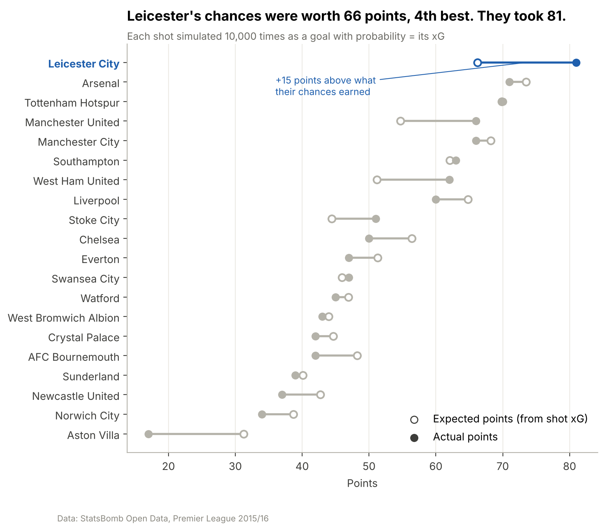

# ⚽ Football Analytics

> Data analysis projects on football, built with Python and open event data.
>
> Author: **Hammad** · BSc Computer Science (Data Science) · Python · pandas · matplotlib · mplsoccer · Jupyter

Each project lives in its own folder with its own report, notebooks and charts. The data pipeline and chart helpers in `src/` are shared.

## Projects

| Project | Question | Highlights |
| --- | --- | --- |
| 🦊 [**Leicester City 2015-16 Miracle**](Leicester-City-2015-16-Miracle/) | How did a 5000–1 outsider win the Premier League? | 1.3M events · 28 charts · 48 findings · [article](Leicester-City-2015-16-Miracle/docs/ARTICLE.md) |
| _Next project_ | _Coming soon_ | |

### Leicester City 2015-16 Miracle

[](Leicester-City-2015-16-Miracle/)

- Their chances were worth a **4th-place** total (66 points); they won the league with **81**.
- **42% possession**, but **67%** of their shots came within 15 seconds of winning the ball.
- **Vardy and Mahrez** were 1st and 2nd for goals + assists; **Kanté** was 1st for tackles, interceptions and ball recoveries.
- They spent the **12th-most** that summer (~£27m); Man City spent £154m and finished 15 points behind.
- Ranieri kept Pearson's direct style (the same number of passes) but it produced **48% more xG**.

**➡️ [Open the project](Leicester-City-2015-16-Miracle/)** · [Read the article](Leicester-City-2015-16-Miracle/docs/ARTICLE.md) · [Findings log](Leicester-City-2015-16-Miracle/docs/results.md) · [Chart gallery](Leicester-City-2015-16-Miracle/reports/figures/README.md)

## Repository structure

```
football-analytics/
├── README.md                          ← you are here
├── Leicester-City-2015-16-Miracle/    ← project 1: report, notebooks, charts, findings
├── src/football_analytics/            ← shared code
│   ├── data.py                        ← download StatsBomb open data
│   ├── clean.py                       ← clean events, compute minutes played
│   ├── pl_stats.py                    ← parse Premier League (Opta) stats
│   ├── understat.py                   ← download Understat shot and player data
│   └── viz.py                         ← shared chart helpers
├── docs/
│   ├── dataset.md                     ← data dictionary, cleaning log, validation
│   └── decisions/                     ← repo-wide decision records
├── data/                              ← raw/ and processed/ are rebuilt locally (git-ignored)
├── requirements.txt
└── pyproject.toml
```

## Setup

```bash
git clone https://github.com/syedhammad07/football-analytics.git
cd football-analytics
python -m venv .venv
source .venv/bin/activate              # Windows Git Bash: source .venv/Scripts/activate
pip install -r requirements.txt
pip install -e .                       # makes src/football_analytics importable

python -m football_analytics.data 2 27 # download Premier League 2015/16 (~4 min)
python -m football_analytics.clean     # clean events, compute minutes played (~15 s)
python -m football_analytics.understat # download Understat shots, 2014/15 and 2015/16 (~5 s)
```

Then open a project folder and follow its README.

## Data

- [StatsBomb Open Data](https://github.com/statsbomb/open-data): free event data for non-commercial use with attribution.
- [Premier League stats](https://www.premierleague.com/en/stats) (Opta): season totals, used where StatsBomb has no data.
- [Understat](https://understat.com) shot data (via [a public copy](https://github.com/douglasbc/scraping-understat-dataset)): xG for every shot from 2014/15.

See [`docs/dataset.md`](docs/dataset.md) for the data dictionary and cleaning log.

## Progress

Tracked on my GitHub Project board **Portfolio** (Area: Football analytics).

## Acknowledgements

Event data provided by [StatsBomb](https://statsbomb.com/) Open Data.
