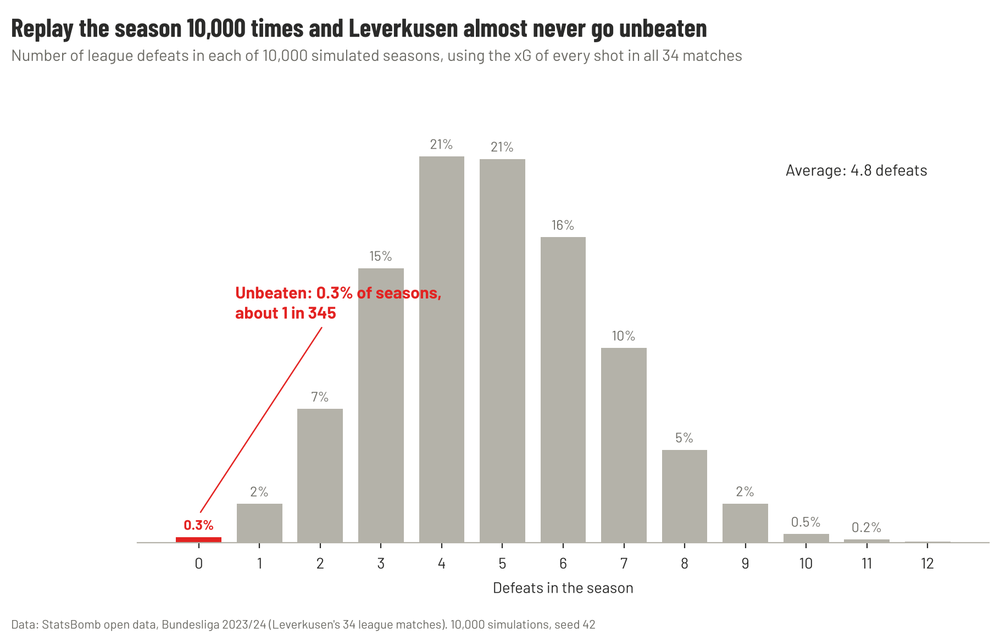
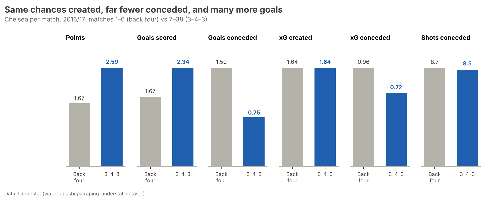

# ⚽ Football Analytics

> Data analysis projects on football, built with Python and open event data.
>
> Author: **Hammad** · BSc Computer Science (Data Science) · Python · pandas · matplotlib · mplsoccer · Jupyter
>
> [LinkedIn](https://www.linkedin.com/in/syedhammadovais) · findings from each project are posted there first

I pick a question people usually answer with opinions, then try to answer it with data: event data, xG and simulation, written up as an article with charts.

Projects are grouped by competition. Each project has its own folder with an article, notebooks and charts; the data pipeline and chart helpers in `src/` are shared.

## Projects

### 🏴󠁧󠁢󠁥󠁮󠁧󠁿 [Premier League](Premier-League/)

| Project | Question | Highlights |
| --- | --- | --- |
| 🦊 [**Leicester City 2015-16 Miracle**](Premier-League/Leicester-City-2015-16-Miracle/) | How did a 5000–1 outsider win the Premier League? | 1.3M events · 28 charts · 48 findings · [article](Premier-League/Leicester-City-2015-16-Miracle/docs/ARTICLE.md) |
| 🔵 [**Chelsea 2016-17: From 10th to Champions**](Premier-League/Chelsea-2016-17-Conte/) | How did Conte turn a 10th-place team into champions? | 21 figures · 35 findings · [report](Premier-League/Chelsea-2016-17-Conte/docs/ARTICLE.md) |

### 🧠 [Managers](Managers/)

| Project | Question | Highlights |
| --- | --- | --- |
| 🔴 [**Xabi Alonso 23-24**](Managers/Xabi-Alonso-23-24/) | How did Xabi Alonso's Leverkusen go a whole Bundesliga season unbeaten? | 12 charts · [report](Managers/Xabi-Alonso-23-24/docs/ARTICLE.md) · [PDF](Managers/Xabi-Alonso-23-24/reports/Leverkusen_2023-24_Alonso_article.pdf) · [one-page report](Managers/Xabi-Alonso-23-24/reports/Leverkusen_build_up_one_page.pdf) |

### 👤 [Players](Players/)

| Project | Question | Highlights |
| --- | --- | --- |
| 🩵 [**Yaya Touré: Was He Under-Rated?**](Players/Yaya-Toure-Man-City/) | Was Yaya Touré under-rated, and who really was? | 1,629 midfielder-seasons · under-rated model · 11 charts · [report](Players/Yaya-Toure-Man-City/docs/ARTICLE.md) |

## Highlights

### Xabi Alonso's Leverkusen 2023-24

[](Managers/Xabi-Alonso-23-24/)

- I replayed all 34 league matches **10,000 times** from the xG of every shot. Leverkusen went unbeaten in **29** of those seasons, about **1 in 345**.
- Their chances were worth **75 points**. They took **90**.
- They had the better chances in **29 of 34** games, so the title was deserved. Going unbeaten took finishing **16 goals above xG** and three draws rescued in stoppage time.
- The build-up runs through **Xhaka**: he took the ball into midfield more than anyone (83 times).

**➡️ [Open the project](Managers/Xabi-Alonso-23-24/)** · [Read the article](Managers/Xabi-Alonso-23-24/docs/ARTICLE.md) · [One-page build-up report](Managers/Xabi-Alonso-23-24/reports/Leverkusen_build_up_one_page.pdf)

### Chelsea 2016-17: From 10th to Champions

[](Premier-League/Chelsea-2016-17-Conte/)

- Conte's back three cut the chances Chelsea conceded from **0.96 to 0.72 xG per game**.
- It didn't make them more dangerous: **1.64 xG per game** before the switch and **1.64** after.
- On chances alone they were the **2nd-best** team (76 expected points, behind Man City). They won by finishing **+21.6 goals** above their xG, almost double any rival.

**➡️ [Open the project](Premier-League/Chelsea-2016-17-Conte/)** · [Read the article](Premier-League/Chelsea-2016-17-Conte/docs/ARTICLE.md) · [Findings log](Premier-League/Chelsea-2016-17-Conte/docs/results.md)

### Leicester City 2015-16 Miracle

[](Premier-League/Leicester-City-2015-16-Miracle/)

- Their chances were worth a **4th-place** total (66 points); they won the league with **81**.
- **42% possession**, but **67%** of their shots came within 15 seconds of winning the ball.
- **Vardy and Mahrez** were 1st and 2nd for goals + assists; **Kanté** was 1st for tackles, interceptions and ball recoveries.
- They spent the **12th-most** that summer (~£27m); Man City spent £154m and finished 15 points behind.
- Ranieri kept Pearson's direct style (the same number of passes) but it produced **48% more xG**.

**➡️ [Open the project](Premier-League/Leicester-City-2015-16-Miracle/)** · [Read the article](Premier-League/Leicester-City-2015-16-Miracle/docs/ARTICLE.md) · [Findings log](Premier-League/Leicester-City-2015-16-Miracle/docs/results.md) · [Chart gallery](Premier-League/Leicester-City-2015-16-Miracle/reports/figures/README.md)

## Repository structure

```
football-analytics/
├── README.md                          ← you are here
├── Premier-League/                   ← Premier League projects
│   ├── README.md
│   ├── Leicester-City-2015-16-Miracle/ ← article, notebooks, charts, findings
│   └── Chelsea-2016-17-Conte/          ← report, notebooks, charts, findings
├── Managers/                          ← projects about a manager's ideas
│   ├── README.md
│   └── Xabi-Alonso-23-24/              ← Leverkusen 2023/24: article, one-page report, charts
├── Players/                           ← projects about one player
│   ├── README.md
│   └── Yaya-Toure-Man-City/            ← was Yaya Touré under-rated? report + model
├── src/football_analytics/            ← shared code
│   ├── data.py                        ← download StatsBomb open data
│   ├── clean.py                       ← clean events, compute minutes played
│   ├── pl_stats.py                    ← parse Premier League (Opta) stats
│   ├── understat.py                   ← download Understat shot and player data
│   └── viz.py                         ← shared chart helpers
├── docs/
│   ├── dataset.md                     ← data dictionary, cleaning log, validation
│   └── decisions/                     ← repo-wide decision records
├── data/                              ← raw/ and processed/ are rebuilt locally (git-ignored)
├── requirements.txt
└── pyproject.toml
```

## Setup

```bash
git clone https://github.com/syedhammad07/football-analytics.git
cd football-analytics
python -m venv .venv
source .venv/bin/activate              # Windows Git Bash: source .venv/Scripts/activate
pip install -r requirements.txt
pip install -e .                       # makes src/football_analytics importable

python -m football_analytics.data 2 27 # download Premier League 2015/16 (~4 min)
python -m football_analytics.clean     # clean events, compute minutes played (~15 s)
python -m football_analytics.understat # download Understat shots, 2014/15 to 2016/17 (~5 s)
python -m football_analytics.data 9 281 # download Bundesliga 2023/24, Leverkusen's matches (~20 s)
```

Then open a project folder and follow its README.

## Data

- [StatsBomb Open Data](https://github.com/statsbomb/open-data): free event data for non-commercial use with attribution.
- [Premier League stats](https://www.premierleague.com/en/stats) (Opta): season totals, used where StatsBomb has no data.
- [Understat](https://understat.com) shot data (via [a public copy](https://github.com/douglasbc/scraping-understat-dataset)): xG for every shot from 2014/15.

See [`docs/dataset.md`](docs/dataset.md) for the data dictionary and cleaning log.

## Progress

Tracked on my GitHub Project board **Portfolio** (Area: Football analytics).

## Acknowledgements

Event data provided by [StatsBomb](https://statsbomb.com/) Open Data.
