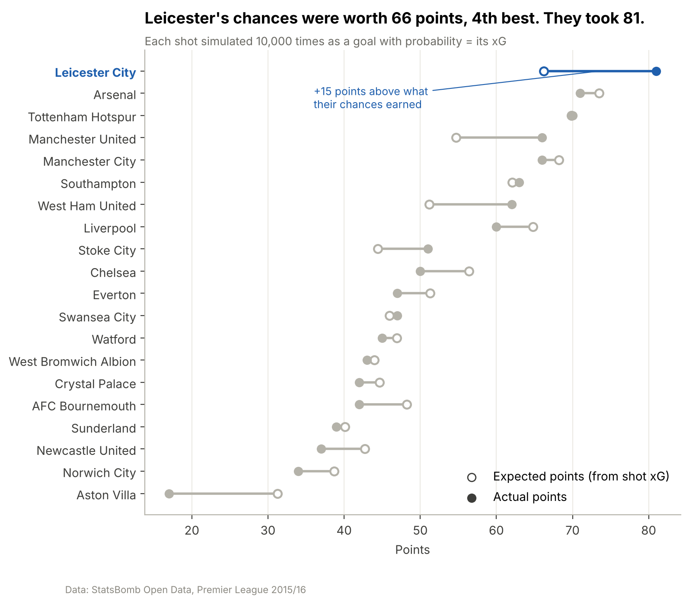
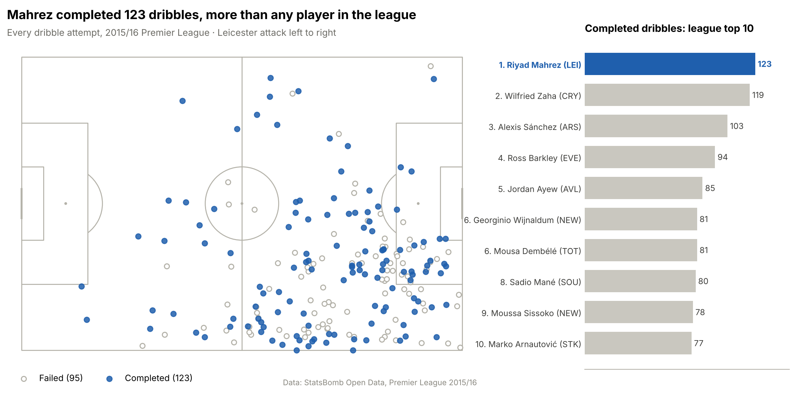
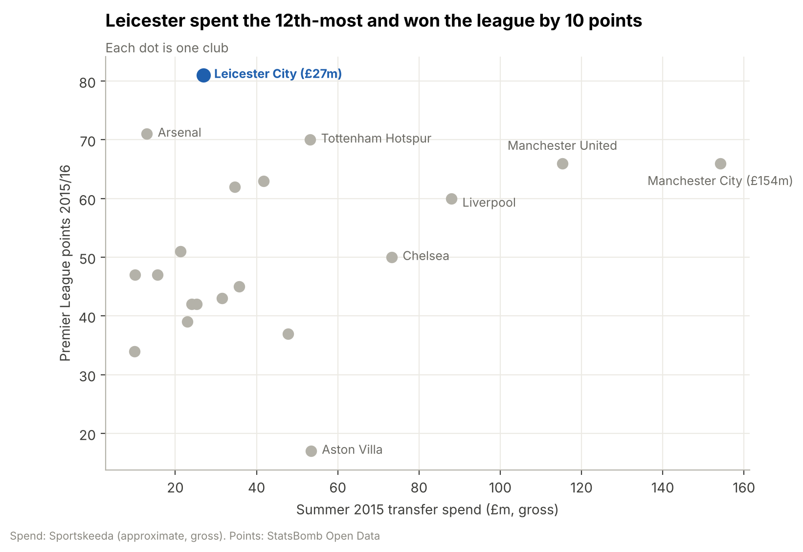
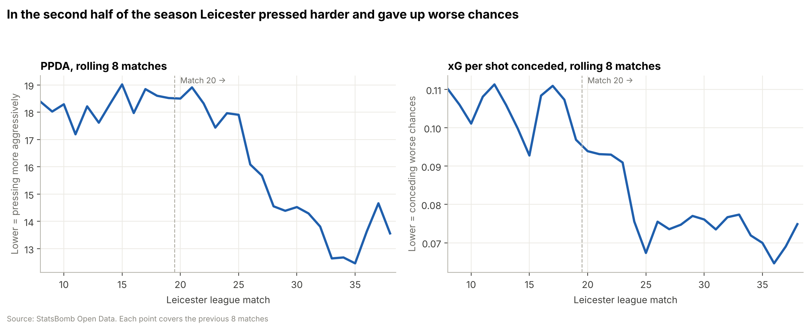

# The 5000–1 Season: how Leicester City won the Premier League

> **A data analysis of Leicester City's 2015/16 title**, using 1.3 million StatsBomb match events, official Premier League (Opta) stats and published tactical analysis.
>
> Author: **Hammad** · Python · pandas · matplotlib · mplsoccer · Jupyter

**📄 Read the full report: [`docs/REPORT.md`](docs/REPORT.md)**



---

## The question

Before the 2015/16 season, bookmakers gave Leicester City **5000–1** odds to win the Premier League. The previous season they had been bottom from November to April and finished 14th. Then they won the league by 10 points. **How?**

## Key findings

| | Finding |
| --- | --- |
| 📈 | **A 4th-place team on chances, champions on points.** Their shots were worth 66 expected points; they took **81**, the biggest gap in the league. |
| 🧱 | **Defence made the difference after Christmas.** They conceded **11 goals in the last 19 games** from chances worth 20 goals. From January they pressed harder and gave up only poor chances. |
| ⚡ | **Little of the ball, very fast attacks.** 42% possession (3rd-lowest), yet **67% of their shots came within 15 seconds** of winning the ball, the highest in the league. |
| 🔁 | **The same XI every week.** **33** line-up changes all season, the fewest in the league (next: Spurs, 56). |
| ⭐ | **Vardy and Mahrez were 1st and 2nd for goals + assists** (29 and 27), ahead of Kane and Agüero. |
| 🛡️ | **Kanté was 1st in the league** for tackles, interceptions and ball recoveries. Fuchs led for blocks; Huth was 2nd for clearances. |
| 💷 | **Spent 12th-most (~£27m).** Kanté, Fuchs, Huth and Okazaki cost **£15.6m** together, against **£154m** spent by Man City. |
| 🚀 | **Vardy went from 5 league goals to 24, Mahrez from 4 to 17.** Vardy's chances got far better; it wasn't lucky finishing. |
| 🧠 | **Ranieri kept Pearson's direct style but made it lethal.** The same number of passes (13,343 vs 13,370) produced **48% more xG**. |

## Explore the project

| Read | What's inside |
| --- | --- |
| 📄 [**Full report**](docs/REPORT.md) | The whole story in 11 sections, with all 23 charts |
| ✅ [Findings log](docs/results.md) | 38 numbered findings, each with its evidence and a confidence rating |
| ⚽ [Tactics: Pearson → Ranieri](docs/tactics_pearson_to_ranieri.md) | What Ranieri changed and kept, with every claim sourced |
| 📓 [Notebooks](notebooks/README.md) | Six notebooks, one per question, all re-runnable |
| 📊 [Chart gallery](reports/figures/README.md) | Every figure with a one-line takeaway |
| 🗂️ [Data dictionary](docs/dataset.md) | Sources, cleaning steps and validation checks |
| 🧭 [Decision records](docs/decisions/) | Why this data and this season |

## Highlights

| | |
| --- | --- |
|  |  |
|  |  |

## Data

| Source | What it contains | Used for |
| --- | --- | --- |
| [StatsBomb Open Data](https://github.com/statsbomb/open-data) | Premier League 2015/16: 380 matches, 1,305,608 on-ball events with locations and xG | All 2015/16 player and team analysis |
| [Premier League stats](https://www.premierleague.com/en/stats) (Opta) | Season totals for Leicester players and the club, 2014/15 and 2015/16 (`data/external/`) | Comparing the two seasons |
| EA Sports PPI via Sky Sports | Distance covered | Running analysis |

| Dataset | Size |
| --- | --- |
| Matches | 380 (20 teams) |
| On-ball events | 1,305,608 |
| Players | 550 (327 with 900+ minutes) |

Raw and processed data (~80 MB) aren't stored in the repo; the scripts below rebuild them in about five minutes. A sample is in [`data/sample/`](data/sample/player_season_2015_16.csv).

## Project structure

```
football-analytics/
├── README.md                  ← you are here
├── docs/
│   ├── REPORT.md              ← the full written report
│   ├── results.md             ← numbered findings with evidence
│   ├── tactics_pearson_to_ranieri.md
│   ├── dataset.md             ← data dictionary, cleaning log, validation
│   └── decisions/             ← decision records
├── notebooks/                 ← 02–07: one notebook per question (+ the scripts that build them)
├── reports/figures/           ← all 23 charts
├── src/football_analytics/
│   ├── data.py                ← download StatsBomb data
│   ├── clean.py               ← clean events, compute minutes played
│   ├── pl_stats.py            ← parse Premier League (Opta) stats
│   └── viz.py                 ← shared chart helpers
├── data/
│   ├── external/              ← Premier League stats (committed, small)
│   ├── sample/                ← sample of the season player table
│   ├── raw/ · processed/      ← rebuilt locally (git-ignored)
└── requirements.txt
```

## How to run

```bash
git clone https://github.com/syedhammad07/football-analytics.git
cd football-analytics
python -m venv .venv
source .venv/bin/activate              # Windows Git Bash: source .venv/Scripts/activate
pip install -r requirements.txt
pip install -e .                       # makes src/football_analytics importable

python -m football_analytics.data 2 27 # download Premier League 2015/16 (~4 min)
python -m football_analytics.clean     # clean events, compute minutes played (~15 s)
jupyter lab                            # open notebooks/ and run 02 → 07
```

## Progress

Tracked on my GitHub Project board **Portfolio** (Area: Football analytics).

## Acknowledgements

Event data provided by [StatsBomb](https://statsbomb.com/) Open Data. Season statistics from the [Premier League](https://www.premierleague.com/) (Opta). Tactical context from the sources listed in the [report](docs/REPORT.md#11-sources).
