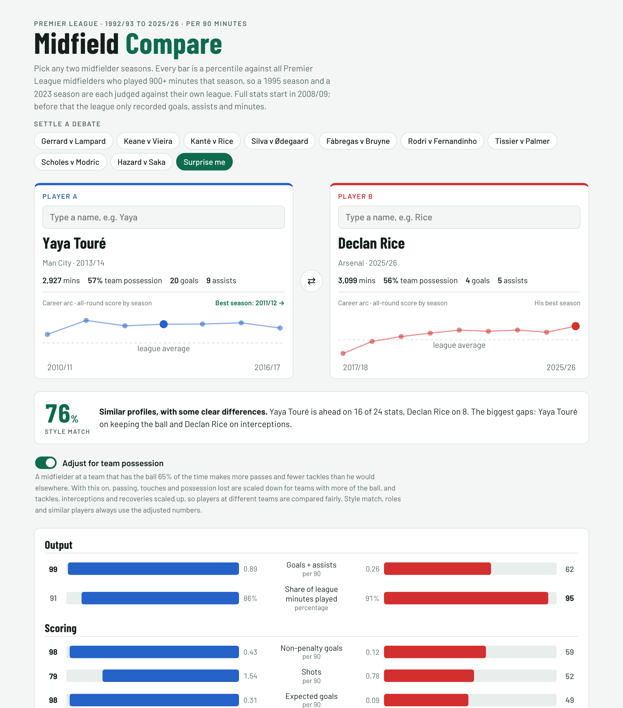

# Midfield Compare

**Pick any two Premier League midfielder seasons and compare them stat by stat, then find the players who played most like them.**

[**➡️ Open the tool**](https://syedhammad07.github.io/football-analytics/Tools/Midfield-Compare/)



## What it does

- **Two players, side by side.** Search any midfielder season since the Premier League began, 1992/93 to 2025/26. From 2008/09 every season has 22 stats across output, scoring, creating, passing, carrying and defending. Before that, the league only recorded goals, assists and minutes, so classic-era seasons (Keane, Vieira, Scholes, Le Tissier) are compared on those four numbers.
- **Percentiles, not raw totals.** Every bar shows where a player ranks against all Premier League midfielders with 900+ minutes *that season*, so a 1995 season and a 2023 season are each judged against their own league. The raw per-90 value sits next to it.
- **Style match.** A single score for how alike the two profiles are, plus the two biggest differences in plain words (2008/09 onwards; classic-era comparisons show how many of the four numbers each player leads).
- **Most similar players.** For each player, the six seasons by *other* midfielders with the closest profile. Tap one to load it.
- **Summary.** A short written reading of every comparison: whose season was stronger overall (scoring, creating, passing, carrying and defending each count equally, so the five passing stats can't outweigh the rest), what kind of midfielder each one was (a holding 6, a box-to-box 8, a creative 10 or a wide attacker, learned from 60 well-known example seasons), each player's clearest edges and standout numbers, and a one-line verdict such as "De Bruyne is the better 10, Touré the better 8".
- **Did you know?** Every player card shows the most remarkable thing in that player's numbers, found automatically, with up to three per player. Examples: Yaya Touré's 20 goals from 10.1 expected goals in 2013/14 (the biggest overperformance by a midfielder since 2013/14), Kanté's interceptions in 2015/16 (the most by any midfielder since 2008/09), Giggs's 21 regular seasons (more than any other midfielder). Every fact comes from the data on the page, so all of them can be checked.
- **Career arc.** A small chart on each player card shows his all-round score for every season, with a link to his best one. Tap any season to load it.
- **League map.** Both players placed on a map of every midfield season since 2008/09, by attacking and defending score, with four zones: does everything, attackers, ball-winners and quiet seasons.
- **Expected goals and all-time ranks.** From 2013/14 the summary says how each player's goals compare with his expected goals (Yaya 2013/14: 20 from 10.1). Standout numbers are ranked against every midfield season on record, for example "3rd of 4,449 since 1992/93".
- **Settle a debate.** One-click famous comparisons (Gerrard v Lampard, Keane v Vieira, Le Tissier v Palmer and more) and a "Surprise me" button.
- **Shareable.** The address updates with every comparison, so a link opens the same two players.

It grew out of my [Yaya Touré project](../../Players/Yaya-Toure-Man-City/): the same official data, extended back to 1992 and forward to 2025/26, and opened up so anyone can compare players.

## How it works

| Step | Detail |
| --- | --- |
| **Data, 2008/09 to 2025/26** | Official Premier League stats (Opta) from premierleague.com: every player listed as a midfielder in his club's squad. Saved in [`Players/Yaya-Toure-Man-City/data/external/`](../../Players/Yaya-Toure-Man-City/data/external/) (`pl_midfielders_*.csv`). |
| **Data, 1992/93 to 2007/08** | Goals and assists: the official Premier League figures. Minutes, appearances and penalties: [pssguy/epldata](https://github.com/pssguy/epldata), which logs every Premier League appearance with the minute a player came on and off. The two are matched by name and date of birth ([`build_classic.py`](build_classic.py)). A midfielder is a player listed as one in either source. |
| **Filter** | 900+ league minutes in the season (about ten full games): 4,449 player-seasons, 2,204 with full stats and 2,245 classic-era. |
| **Stats** | 24 numbers per 90 minutes or as percentages, including expected goals and expected assists from 2013/14 (complete on premierleague.com from that season), including share of league minutes played (42-game seasons until 1994/95). Possession lost is reversed, so a higher percentile means he lost the ball less. Dribble success needs 15+ attempts. |
| **Possession adjustment** | On by default, with a switch to turn it off. A team with more of the ball gives its midfielders more passes and touches and fewer chances to defend. Passes, passes in the opposition half, long and forward passes, touches and possession lost are multiplied by 50 ÷ team possession; tackles won, interceptions and recoveries by 50 ÷ opponents' possession. A 66% possession side's passes are scaled by 0.76 and its tackles by 1.47. Team possession is from the official Premier League team stats ([`pl_team_possession.csv`](../../Players/Yaya-Toure-Man-City/data/external/pl_team_possession.csv)), 2008/09 onwards. Style match, roles and similar players always use the adjusted numbers. |
| **Percentiles** | Ranked within each season, 0–100. |
| **Style match** | 100 minus the average gap between the two players' percentiles across the 20 style stats (everything except goals + assists and minutes). It measures *how alike* two players were, not who was better. Only for 2008/09 onwards. |
| **Roles** | Each season is labelled a holding 6, box-to-box 8, creative 10 or wide attacker by comparing the *shape* of its profile (percentiles minus the player's own average, so level doesn't decide style) with the average shape of 60 well-known example seasons, listed in [`build_page.py`](build_page.py). Left out one at a time, 44 of the 60 examples are put back in their own role; most misses are genuinely in between, such as Lampard 2009/10 (8 or 10) or Hazard 2014/15 (10 or wide). |
| **Page** | One self-contained HTML file with the data built in, no server needed. [`build_page.py`](build_page.py) turns the data into [`index.html`](index.html) using [`template.html`](template.html). |

```bash
# classic era: clone the appearance data into data/raw (ignored by git), then build
git clone https://github.com/pssguy/epldata data/raw/epldata
pip install pyreadr
python Tools/Midfield-Compare/build_classic.py
python Tools/Midfield-Compare/build_page.py
```

## Limitations

- "Midfielder" is the position in the club's squad list, so wide players listed as midfielders (Hazard, Mahrez) are in, and players listed as forwards are not.
- Detailed stats only exist from 2008/09. Earlier seasons are real comparisons, but only of goals, assists and minutes, which favours attacking midfielders: Keane and Vieira will look ordinary next to Lampard and Le Tissier on these numbers.
- About 250 classic-era player-seasons (mostly players with unusual name spellings) couldn't be matched between the two sources and are left out.
- A few Opta fields are missing for some seasons on premierleague.com (touches in the opposition box in 2015/16, forward passes in 2008/09 and 2009/10). Those show as n/a and are left out of the style match.
- Percentiles only compare players within the same season, so they don't adjust for league strength over time. The possession adjustment is a simple scaling: it can't tell a pressing team from a deep-defending one with the same possession.
- Players who changed club mid-season appear once, under the club whose squad listed them.
