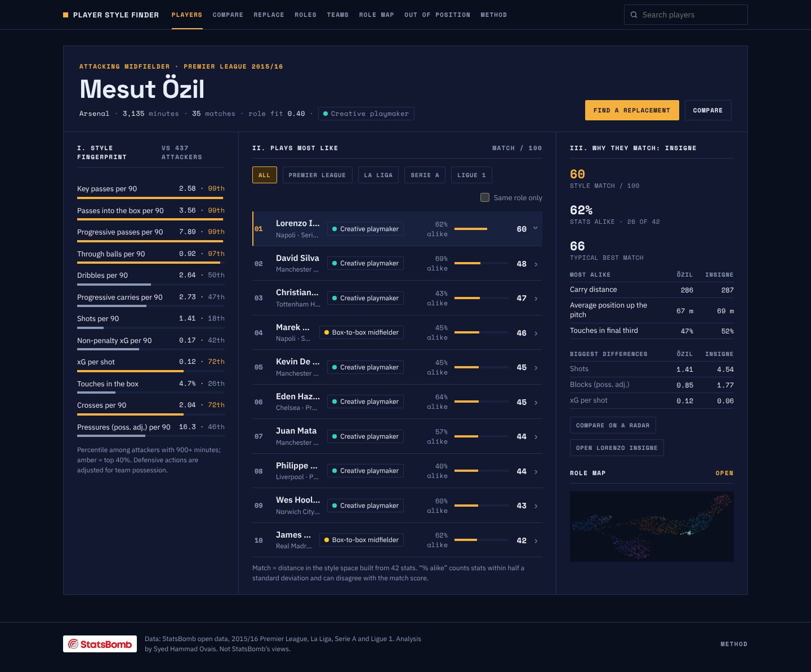

# Player Style Finder

**Find footballers who play alike, and see why: 1,350 players from the Premier League, La Liga, Serie A and Ligue 1, 2015/16, built from StatsBomb event data.**

**[Open the live version](https://syedhammad07.github.io/football-analytics/Tools/Player-Style-Finder/)**

Every player is described by how he plays: where he gets the ball, how he passes, carries, shoots and defends. Pick a player and the site ranks everyone else by how close their style is, then explains each match: the three stats where they are most alike, the three where they differ most, and how unusual the match is.

| Page | What it shows |
| --- | --- |
| **Player** | Style fingerprint (percentiles within his position), the 10 closest players with league and same-role filters, and why each one matches |
| **Compare** | Two players on a percentile radar, plus a stat-by-stat table |
| **Replace** | The closest styles at other clubs, filtered by league, role and minutes |
| **Roles** | 13 styles of play (five for attackers, two for every other position, goalkeepers included) and what defines each |
| **Teams** | League tables with team style: possession, pressing, long passing, xG for and against, and each squad's role mix |
| **Role map** | All 1,251 outfield players on one map, mouse or keyboard |
| **Out of position** | 64 players whose closest matches are mostly in another position group |
| **Method** | The machine learning, the checks and the limits |

## How it works

- **Features:** 42 per-90 stats for outfield players, 16 for goalkeepers, from StatsBomb's event data (1,517 matches). Defensive actions are adjusted for team possession. Players need 900+ minutes.
- **Machine learning (all unsupervised):** PCA to 8 dimensions (85% of variance) as the style fingerprint, nearest-neighbour search for similarity, k-means for roles (number of roles chosen with bootstrap stability, Gaussian mixture BIC and silhouette), UMAP for the 2D map. Goalkeepers have their own style space and are only compared with goalkeepers.
- **Checks:** split each player's season in half. From one half, his own other half is in his top 5 matches 66% of the time (chance: 0.5%), median rank 3 of 982. Roles agree between halves 86% of the time. For goalkeepers the top-5 rate is 44% (chance: 5%).

## Limits

- One season (2015/16) and four leagues: StatsBomb's free data has no second divisions, and its other seasons cover a single club each. The Bundesliga has only 34 open matches.
- Style is partly the team's system; only defensive actions are adjusted for possession.
- "Goals prevented" uses pre-shot xG; the free data has no post-shot xG.

## Files

- `index.html`: the whole site (no build step).
- `data/*.json`: derived per-player and per-team statistics and model results. No raw StatsBomb data is included.
- Tested with 147 automated checks: data integrity, the browser maths against the Python pipeline, every page and filter, five screen widths and accessibility.

## Data and credit

Data: [StatsBomb open data](https://github.com/statsbomb/open-data), used under the StatsBomb Public Data User Agreement. Analysis by Syed Hammad Ovais; not StatsBomb's views.

