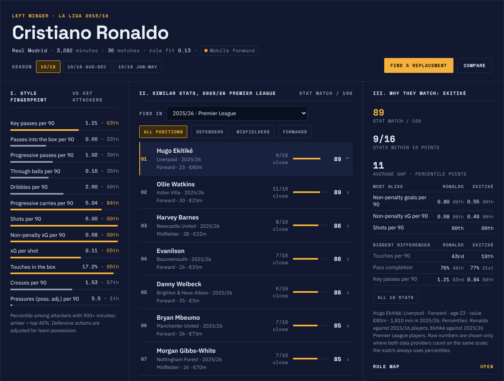
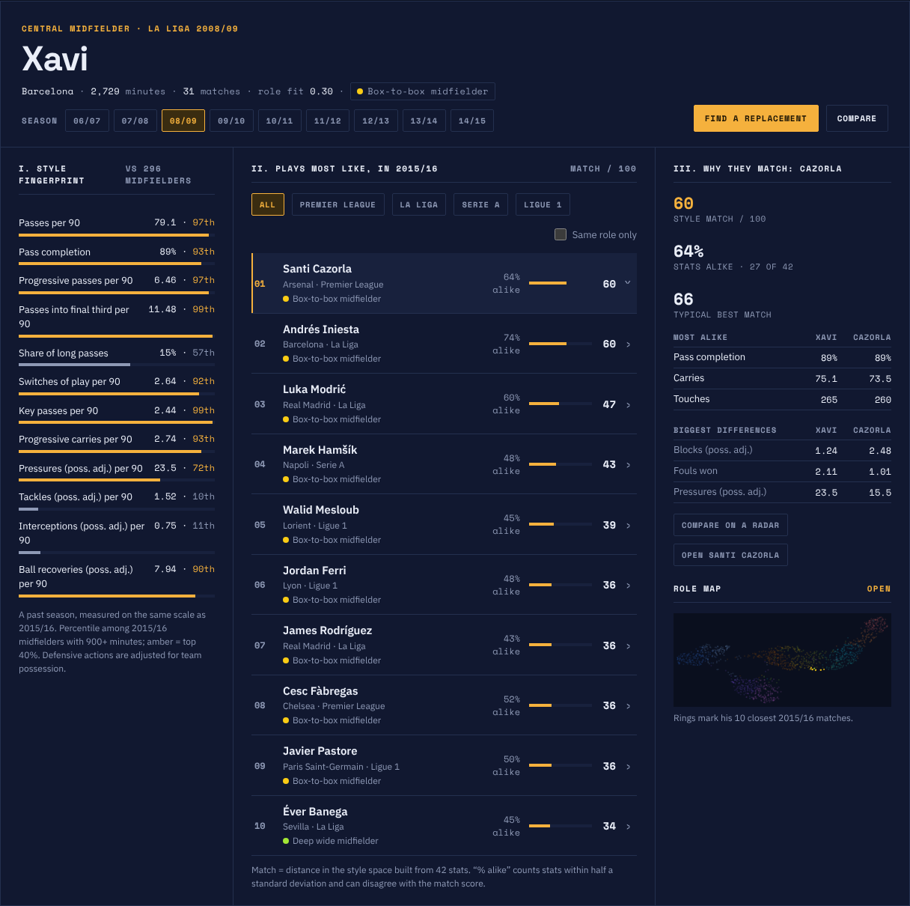
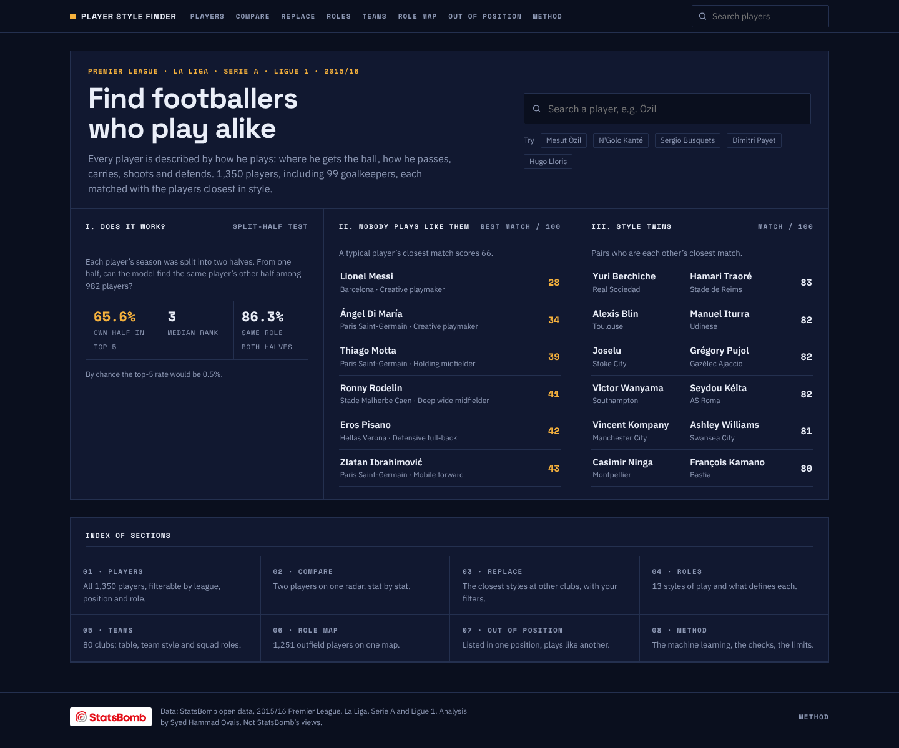
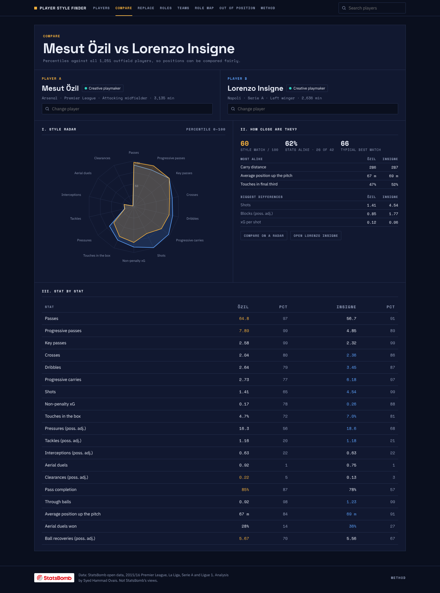

# Player Style Finder

**Find footballers who play alike, and see why: 1,350 players (99 of them goalkeepers) from the Premier League, La Liga, Serie A and Ligue 1 in 2015/16, plus 284 past seasons of Barcelona, Arsenal, PSG and Leverkusen players, built with machine learning on StatsBomb event data.**

**[Open the live version](https://syedhammad07.github.io/football-analytics/Tools/Player-Style-Finder/)**: no install, works on phone and desktop.

[](https://syedhammad07.github.io/football-analytics/Tools/Player-Style-Finder/)

Most "similar player" tools compare output: goals, assists, minutes. This one compares **how** a player plays: where he receives the ball, how far and how forward he passes, how much he carries and dribbles, where he shoots from and how he defends. Pick a player and every other player in his position is ranked by how close his style is, and each match comes with the reasons: the three stats where they are most alike, the three where they differ most, and what share of all stats they share.

**Find in any Premier League season.** A dropdown switches the search from 2015/16 to any **Premier League season from 2014/15 to 2026/27** (13 seasons, 3,843 player-seasons). Pick Cristiano Ronaldo 2015/16 and "2025/26" to see whose output and habits are closest now (Ekitiké, Watkins), with a stat match score, the stats that line up and the ones that don't, plus age and market value, so you can look for a cheaper player with similar numbers.

[](https://syedhammad07.github.io/football-analytics/Tools/Player-Style-Finder/)

Players can also be picked **season by season**. Xavi in 2008/09, Henry in 2003/04 or Messi in any of his 18 seasons each get their own profile, their own closest 2015/16 players and their own replacements.

[](https://syedhammad07.github.io/football-analytics/Tools/Player-Style-Finder/#seasons)

## What it does

| Page | What it shows |
| --- | --- |
| **Player** | His style fingerprint (percentiles within his position), the 10 closest players with league and same-role filters, a match score for each, and "why they match". A season picker switches between his seasons, a season-by-season table shows how his style changed, and **Find in** searches 2015/16 or any Premier League season from 2014/15 to 2026/27 |
| **Compare** | Any two players on a percentile radar, with a stat-by-stat table and the match score between them |
| **Replace** | The closest styles at other clubs, filtered by league, role and minutes played, for any of his seasons. **Find in** a Premier League season adds a position filter, and market values for 2025/26 and 2026/27 |
| **Roles** | 13 styles of play found by the model (five for attackers, two each for centre-backs, full-backs, midfielders and goalkeepers), what defines each, its most typical players and its extremes |
| **Teams** | All 80 teams: league table, team style (possession, pressing, long passing, defensive line, xG for and against) and each squad's mix of roles |
| **Role map** | All 1,251 outfield players on one map, coloured by role; works with mouse, touch or keyboard |
| **Out of position** | 64 players whose closest matches are mostly in another position group |
| **Seasons** | 19 club seasons (Barcelona 2004/05 to 2020/21, Arsenal 2003/04, PSG 2021/22 and 2022/23, Leverkusen 2023/24), each squad with the 2015/16 player who plays most like each man |
| **Method** | The model, the checks and the limits, in plain language |

Every page has its own link (for example `#compare-…`), so any view can be shared.

| Home | Compare |
| --- | --- |
| [](https://syedhammad07.github.io/football-analytics/Tools/Player-Style-Finder/) | [](https://syedhammad07.github.io/football-analytics/Tools/Player-Style-Finder/) |

## How it works

1. **Data.** Event data for all 1,517 open StatsBomb matches of 2015/16 (Premier League, La Liga, Serie A, Ligue 1, plus the 34 open Bundesliga matches). Every pass, carry, shot, pressure and tackle with its location.
2. **Style stats.** 42 per-90 and share stats for outfield players (for example: average pitch position, pass length, progressive passes, share of passes forward, dribbles, touches in the box, shot distance, pressures, tackles). Defensive actions are adjusted for team possession, so players in dominant teams aren't marked down for having less to defend. Goalkeepers get 16 of their own (save %, goals prevented against pre-shot xG, distribution length and accuracy, sweeping distance, crosses claimed). Distances are converted from StatsBomb's yards to metres. Players need 900+ minutes.
3. **Style fingerprint.** Counts are log-scaled, everything is standardised, and PCA compresses the 42 stats to 8 dimensions that keep 85% of the variation. Goalkeepers get their own 7-dimension space and are only compared with goalkeepers.
4. **Similarity.** Nearest neighbours in the fingerprint space. The distance becomes a 0–100 score, scaled so that a typical best match scores about 66.
5. **Roles.** k-means within each position group. The number of roles was chosen by how stable the clusters are when the data is resampled (bootstrap adjusted Rand index ≥ 0.7), checked against Gaussian mixture BIC and silhouette scores. Role names are tied to known players, so they stay correct when the model is re-run.
6. **Map.** UMAP draws the fingerprints in 2D.
7. **Other seasons.** StatsBomb also has every league match of a few clubs in other seasons. Those clubs' players with 900+ minutes get a profile per season, and every 2015/16 player gets an August–December and a January–May profile (600+ minutes). The model is not refitted: the 2015/16 scaler, PCA and role centres are applied unchanged, so every season sits in the same space and is matched against the 2015/16 players. Only the featured club's players are used, because their opponents appear just once or twice.

8. **Premier League seasons.** StatsBomb has no free data for whole leagues outside 2015/16, so the 13 Premier League seasons use the league's own (Opta) season stats: 2014/15 to 2024/25 collected from the Premier League's stats site (see [pipeline/sources](pipeline/sources/README.md)), and 2025/26 and 2026/27 from this repo's [Scout Finder](../Scout-Finder/) data. The two providers count some things differently, so players are compared on **16 stats both record** (non-penalty goals and xG, shots, key passes, through balls, dribbles and dribble success, touches, passes, pass completion, forward and long pass shares, possession-adjusted tackles and interceptions, recoveries, aerials won), each turned into a **percentile within its own season**. Stat match = 100 − the average gap in percentile points.

All of this is unsupervised: there is no "right answer" to train on, so the checks below test whether the results are stable and meaningful.

## How good is it

The main check splits every player's season into two halves and builds a fingerprint from each half separately. If the fingerprint really describes a player's style, his first half should find his own second half.

| Check | Result | By chance |
| --- | --- | --- |
| Own other half is the closest match | 36.9% | 0.1% |
| Own other half in the top 5 (of 982) | 65.6% | 0.5% |
| Median rank of own other half | 3rd | 491st |
| Same role in both halves | 86.3% | |
| Top match is a teammate | 2.6% | 1.2% |
| Goalkeepers: own other half in the top 5 | 43.9% | 5.1% |
| Goalkeepers: same role in both halves | 96.9% | |
| Barcelona players' 2014/15 or 2016/17 season finds his own 2015/16 in the top 5 (26 players) | 80.8% | 0.4% |
| August–December finds the same player's January–May in the top 5 (800 players) | 57.6% | 0.6% |
| Two providers, same season: a 2015/16 Premier League outfield player's StatsBomb profile finds his own Opta profile first (289 players) | 90.7% | 0.3% |

The last check is what makes the Premier League search trustworthy: 2015/16 is in both StatsBomb's and Opta's data, so the same players can be measured by both providers. Touches in the box failed an earlier version of it and was left out; every stat kept agrees at 0.72 or better. Where the two providers' raw numbers are on different scales (touches, shots, through balls, interceptions, aerials, forward and long pass shares), the site shows only the percentiles.

Matches are only slightly more likely to be teammates than by chance, so the model is picking up the player more than the team's system.

The site itself is checked by 189 automated tests: data integrity, the browser's maths against the Python pipeline, every page, filter and link, five screen widths from 320 px phones to wide desktops, and accessibility (contrast, keyboard use, labels). **189/189 pass**, including 21 checks of the season profiles and 20 of the Premier League search.

## Run it

The site is a single `index.html` that reads `data/*.json`. To view it locally:

```
cd Tools/Player-Style-Finder
python -m http.server 8000      # then open http://localhost:8000
```

To rebuild the data from scratch (downloads the StatsBomb events, about 4 minutes):

```
pip install -r requirements.txt
bash pipeline/run_all.sh        # writes data/*.json
```

To run the tests:

```
pip install playwright && playwright install chromium
python tests/suite.py           # prints a score per category; details in tests/results.json
```

## Project structure

```
Player-Style-Finder/
├── index.html                  ← the whole website (no build step)
├── data/                       ← derived stats and model results the site reads
│   ├── players.json            ← every player: club, role, fingerprint, 42 style stats
│   ├── teams.json              ← tables, team style, squads
│   ├── roles.json              ← the 13 roles, their defining stats and players
│   ├── extras.json             ← out-of-position players, most unique players, check results
│   ├── seasons.json            ← past-season and half-season profiles, season checks
│   └── now.json                ← 13 Premier League seasons (2014/15–2026/27) and everyone's shared-stat percentiles
├── pipeline/
│   ├── run_all.sh              ← runs every step in order
│   ├── build_features.py       ← download StatsBomb events → stats per player per match
│   ├── make_features.py        ← per-90 style stats
│   ├── explore_k.py            ← how many roles (BIC, silhouette)
│   ├── explore_family.py       ← how many roles per position (stability)
│   ├── roles.py                ← PCA fingerprint and k-means roles
│   ├── validate.py             ← split-half test and nearest neighbours
│   ├── explain.py              ← why each match: most alike and most different stats
│   ├── nicknames.py            ← common names (Özil, not Mesut Özil) from lineups
│   ├── map_extremes.py         ← UMAP map and the extremes of each role
│   ├── gk_features.py          ← goalkeeper stats
│   ├── gk_model.py             ← goalkeeper fingerprint, roles and split-half test
│   ├── site_data.py            ← export data/*.json for the site
│   ├── club_seasons.py         ← download the single-club seasons
│   ├── seasons.py              ← season profiles in the 2015/16 style space
│   ├── gk_model_space.py       ← the keeper style space, reused by seasons.py
│   ├── cross_season.py         ← Premier League seasons on 16 shared stats, and the two-provider check
│   ├── sources/                ← Premier League season stats 2014/15–2024/25 (how they were collected: sources/README.md)
│   └── METHOD.md               ← notes on every modelling choice
├── tests/suite.py              ← the 189 checks
├── img/statsbomb-logo.png
└── screenshots/
```

## Limitations

- **One full season, four leagues.** StatsBomb's free data has whole leagues only in 2015/16 (the Bundesliga has just 34 matches). There are no second divisions or English lower leagues. Its other free seasons follow a single club, so past seasons exist only for Barcelona, Arsenal, PSG and Leverkusen players.
- **Other leagues' seasons aren't covered.** La Liga, Serie A, Bundesliga and Ligue 1 have no free source with these stats outside StatsBomb's 2015/16 (Understat was down when this was built).
- **Premier League seasons use 16 stats.** They compare output and habits, not the full 42-stat style model, and a high stat match says nothing about level. 2026/27 is the season so far (10 rounds when the data was saved, players with 450+ minutes).
- **Past seasons are matched against 2015/16.** Xavi's 2008/09 is compared with 2015/16 players, not with the players of 2008/09. A player in a dominant side like Barcelona can look unlike anyone in an ordinary team.
- **Style is partly the system.** Defensive actions are adjusted for possession, but a full-back's position and passing still depend on how his team plays.
- **Style, not quality.** Two players can play the same way at very different levels. The match score says nothing about which is better.
- **Goalkeepers.** "Goals prevented" uses pre-shot xG, because the free data has no post-shot xG. With only 99 keepers, their matches are less sharp than outfield ones.
- **900-minute minimum.** Players with fewer minutes are left out, because their stats are too noisy.

## Sources

- Data: [StatsBomb open data](https://github.com/statsbomb/open-data), used under the StatsBomb Public Data User Agreement. This repository holds only derived statistics, no raw StatsBomb data.
- Premier League seasons: the Premier League's season stats (Opta); 2025/26 and 2026/27, with Transfermarkt market values, from this repo's Scout Finder data.
- Analysis and site: Syed Hammad Ovais. The views are mine, not StatsBomb's.


