# The 5000–1 Season: how Leicester City won the 2015/16 Premier League

*A data analysis by Hammad · StatsBomb event data (1.3M events, 380 matches) + Premier League official stats (Opta) + published tactical analysis*

---

## Contents

1. [Summary: ten things the data shows](#1-summary-ten-things-the-data-shows)
2. [Data and method](#2-data-and-method)
3. [How they won: results vs chances](#3-how-they-won-results-vs-chances)
4. [How they played: style and tactics](#4-how-they-played-style-and-tactics)
5. [The squad: stability and fitness](#5-the-squad-stability-and-fitness)
6. [The players vs the league](#6-the-players-vs-the-league)
7. [Money and signings](#7-money-and-signings)
8. [From 14th to 1st: 2014/15 vs 2015/16](#8-from-14th-to-1st-201415-vs-201516)
9. [Pearson to Ranieri: what changed and what didn't](#9-pearson-to-ranieri-what-changed-and-what-didnt)
10. [Limitations](#10-limitations)
11. [Sources](#11-sources)

---

## 1. Summary: ten things the data shows

| # | Finding | Key number |
| --- | --- | --- |
| 1 | Leicester's chances were worth a **4th-place** total, but they **won the league by 10 points**. | 66 expected points → **81** actual |
| 2 | The gap came mostly from **defence after Christmas**: far fewer goals conceded than the chances allowed. | 11 goals conceded in the last 19 games from 20.2 xG |
| 3 | They had **little of the ball and attacked faster than anyone**. | 42% possession; **67%** of shots within 15 s of winning the ball |
| 4 | They used the **most stable line-up** in the league. | **33** starting-XI changes (next best: Spurs, 56) |
| 5 | **Vardy and Mahrez were 1st and 2nd in the league for goals + assists.** | 29 and 27 |
| 6 | **Kanté was 1st in the league** for tackles, interceptions and ball recoveries. | 274 tackles + interceptions (next: 233) |
| 7 | They **spent the 12th-most** in summer 2015; four cheap signings became regulars. | ~£27m total; Kanté, Fuchs, Huth and Okazaki cost **£15.6m** |
| 8 | **Vardy and Mahrez exploded** from the year before. | Vardy 5 → **24** goals; Mahrez 4 → **17** |
| 9 | Ranieri **kept Pearson's direct style** but made it far more dangerous. | Same passes (13,343 vs 13,370), xG **46.9 → 69.3** |
| 10 | The mid-season "tightening" was **harder pressing, not a deeper line**. | Pressing intensity (PPDA) 18.4 → 14.5; xG per shot conceded 0.104 → 0.076 |

---

## 2. Data and method

| Source | What it gives | Used for |
| --- | --- | --- |
| [StatsBomb Open Data](https://github.com/statsbomb/open-data) | Every on-ball event of the 2015/16 Premier League (380 matches, 1,305,608 events) with locations and xG | All 2015/16 player and team analysis |
| [Premier League official stats](https://www.premierleague.com/en/stats) (Opta) | Season totals per player and club, including 2014/15 | Comparing 2014/15 with 2015/16 |
| EA Sports Player Performance Index (via Sky Sports) | Distance covered | Running distance (StatsBomb doesn't track it) |
| Published sources (Wikipedia, Sky Sports, Sportskeeda, Spielverlagerung, Coaches' Voice and others) | Fees, spending, tactics, context | Money, signings, tactics |

**Key definitions**
- **xG (expected goals):** the probability that a shot becomes a goal, based on thousands of similar shots.
- **Expected points (xPts):** each match is replayed 10,000 times, with every shot going in with probability equal to its xG. The average points earned is the team's expected points.
- **Per 90:** a count divided by minutes played, × 90. This lets players with different minutes be compared fairly.
- **Percentile:** a player's rank among players in the same position with 900+ minutes (100 = best).
- **PPDA (passes per defensive action):** opponent passes in their own 60% of the pitch ÷ our tackles, interceptions and fouls there. Lower means more aggressive pressing.

The full data dictionary, cleaning log and validation checks (e.g. 1,026 goals = 988 + 38 own goals) are in [`dataset.md`](dataset.md).

---

## 3. How they won: results vs chances

### 3.1 A 4th-place team on chances, champions on points

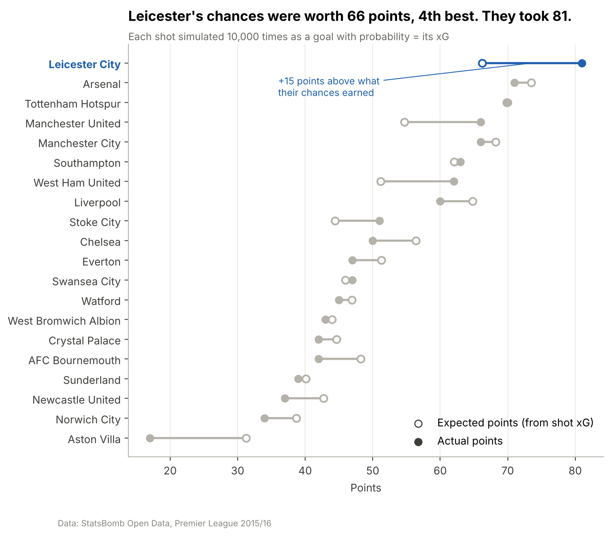

- Leicester's shots were worth **66.2 expected points**, the 4th-best total (behind Arsenal, Tottenham and Manchester City).
- They took **81**. That **+15** gap is the biggest overperformance in the league.

### 3.2 They led for most of the season, and pulled away late

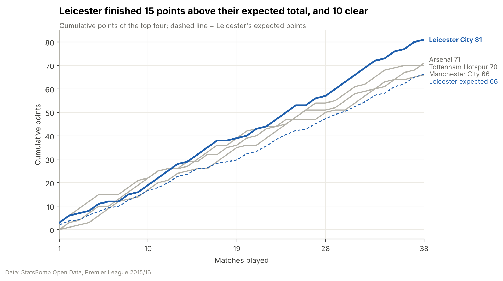

### 3.3 Where the extra points came from

| | Matches 1–19 | Matches 20–38 |
| --- | --- | --- |
| Goals for (xG) | 37 (31.0) | 31 (35.3) |
| Goals against (xG against) | 25 (25.9) | **11 (20.2)** |
| Clean sheets | 4 | **11** |
| Points (expected points) | 39 (29.7) | 42 (36.5) |

- **First half of the season:** the attack scored 6 more than its chances suggested.
- **Second half:** the defence conceded 9 fewer than its chances suggested.
- **Over the season:**
  - They conceded **10.1 goals fewer than expected**, the most in the league (next: Manchester United, 3.5).
  - Non-penalty finishing was about average (57 goals from 56.1 xG).
- **Fine margins:**
  - **14 one-goal wins** (Arsenal 7, Spurs 6) and only **3 losses**.
  - **13 penalties won**, the most in the league (10 scored).

---

## 4. How they played: style and tactics

### 4.1 Low possession, very fast attacks

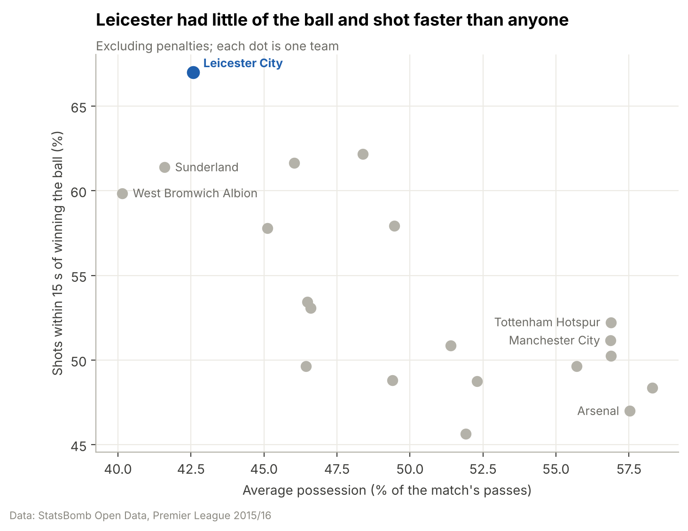

- About **42% possession**, 3rd-lowest in the league and the lowest of any Premier League champion since possession records began in 2003/04 (Premier League).
- **67% of their shots came within 15 seconds of winning the ball**, the highest in the league. Their median shot came after only 3 passes.
- Their non-penalty xG per shot (**0.110**) was the best in the league: few shots wasted from distance.

### 4.2 Their tactical fingerprint against the other 19 teams

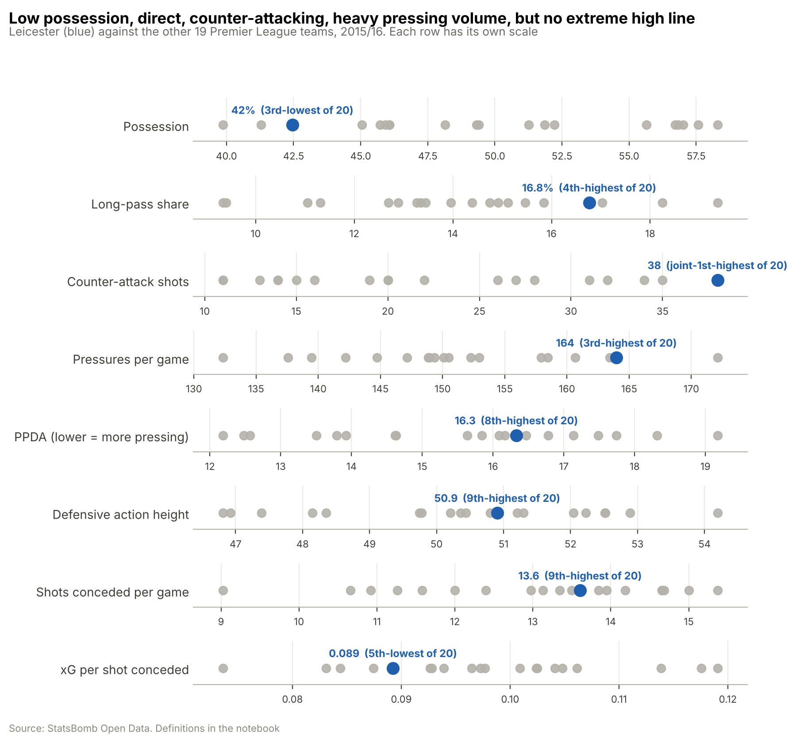

- **Shape:** a 4-4-2 starting shape in **33 of 38** matches.
- **In possession:** 4th-highest share of long passes, and joint-most counter-attack shots.
- **Without the ball:**
  - 3rd-most pressures (moments of closing down the player on the ball) per game.
  - But their pressing intensity and the height of their defending were **mid-table**. So this was a compact, hard-working mid-block, not a high press.
- **Defence:** they allowed an average number of shots but **low-quality ones** (5th-lowest xG per shot conceded).

### 4.3 The mid-season change

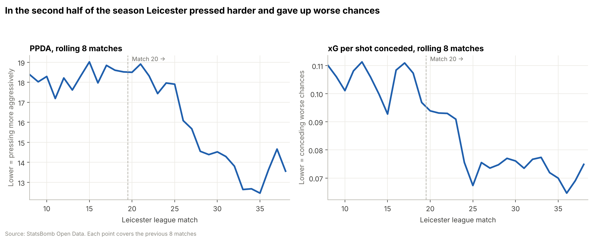

From match 20 onwards:
- They **pressed harder**: PPDA fell from 18.4 to 14.5, and pressures per game rose from 153 to 175.
- The chances they allowed **got much worse**: xG per shot conceded fell from 0.104 to 0.076.
- The height at which they defended **did not change**. Ranieri's "pragmatic" turn (Jonathan Wilson, New Statesman) was a tighter, harder-pressing block, not sitting deeper.

---

## 5. The squad: stability and fitness

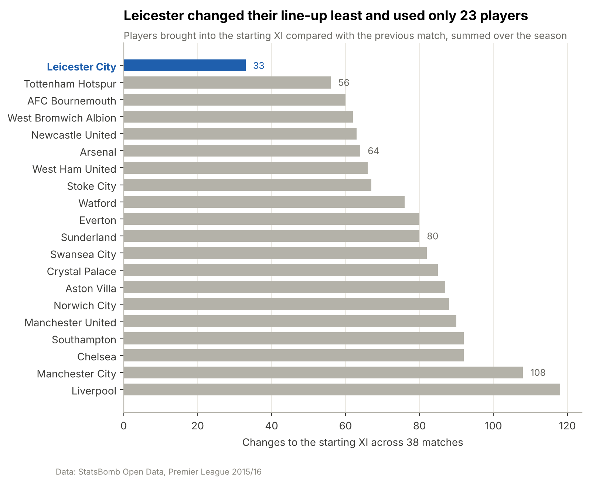

- **Fewest players used** (23) and **fewest line-up changes** (33). Their best 11 played **86%** of all minutes.
- **Fewest injuries in the league** (reported): 20 injuries and 275 days lost, against 1,137 days for Arsenal, who were next-best.
- **Fewer matches:** no European football and early cup exits.

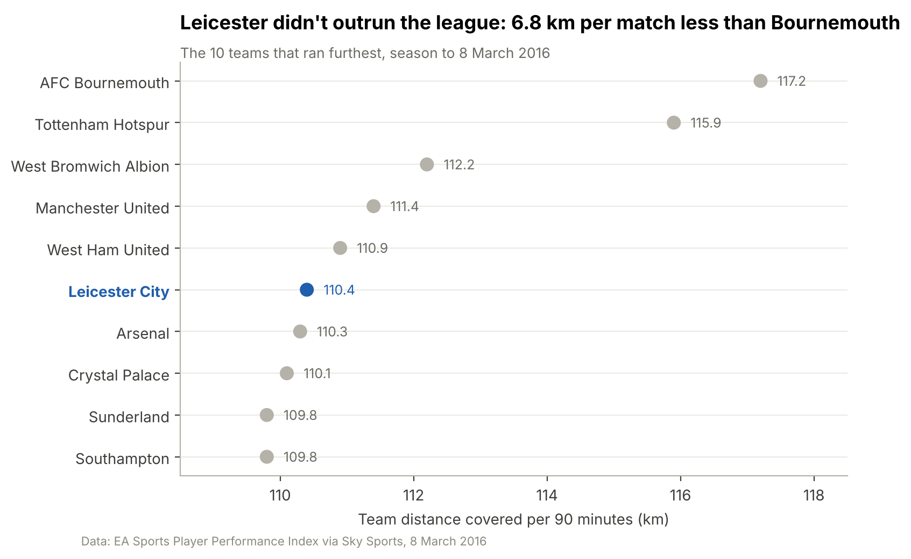

**They didn't out-run the league.**
- As a team, Leicester ran **110.4 km per match**, 6th of the 10 teams Sky listed, and 6.8 km less than Bournemouth.
- No Leicester player was in the league's top 10 for distance (see 6.4).

---

## 6. The players vs the league

Every chart in this section shows the **league top 10**, with Leicester players in blue.

### 6.1 Attack: Vardy and Mahrez

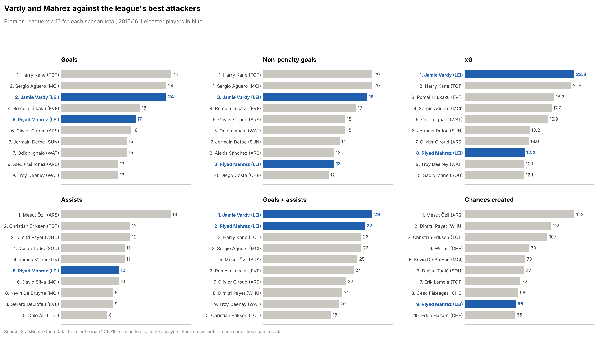

| Metric | Leicester player | League rank | Main rivals |
| --- | --- | --- | --- |
| Goals | Vardy 24 / Mahrez 17 | =2nd / 5th | Kane 25, Agüero 24, Lukaku 18 |
| Goals + assists | Vardy 29 / Mahrez 27 | **1st / 2nd** | Kane 26, Agüero 26 |
| xG | Vardy 22.3 | **1st** | Kane 21.6, Lukaku 18.2 |
| Assists | Mahrez 10* | =6th | Özil 19, Eriksen 12, Payet 12 |

\*StatsBomb count; the official figure is 11.

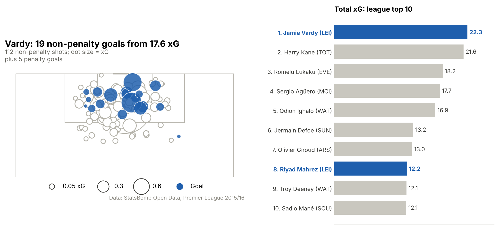

**Vardy**
- 19 non-penalty goals from 17.6 xG, plus 5 of 6 penalties scored.
- His average shot was worth **0.157 xG**, against 0.111 for forwards overall: he got into better positions than other strikers.

### 6.2 Dribbling, fouls won and finishing: Mahrez

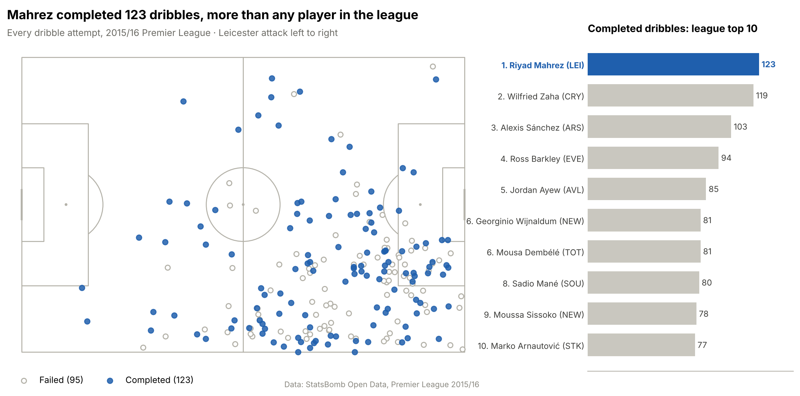

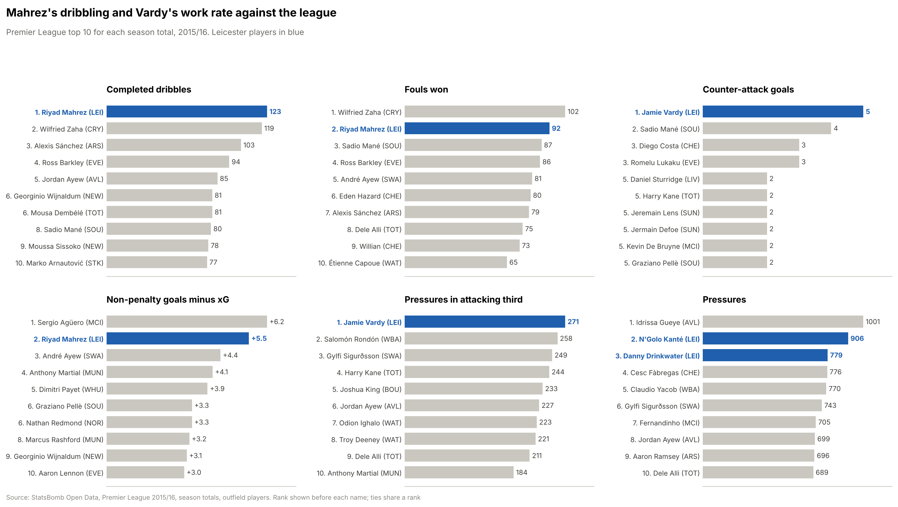

**Mahrez**
- **1st for completed dribbles** (123 of 218 attempts; Zaha 119).
- 2nd for fouls won (92).
- **2nd for scoring above his xG** (+5.5, behind Agüero).

**Pressing**
- **Vardy pressed more in the attacking third than anyone** (271 pressures).
- **Kanté and Drinkwater were 2nd and 3rd for total pressures**, behind only Idrissa Gueye.
- Vardy also scored the most counter-attack goals (5).

### 6.3 Defending: Kanté, Fuchs, Huth

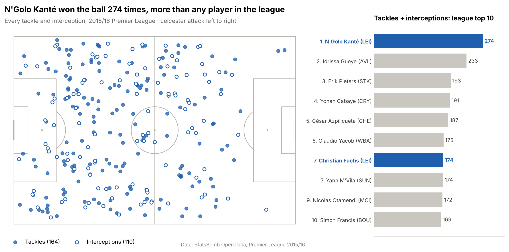

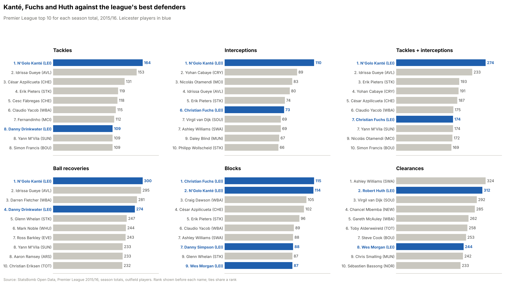

| Metric | Leicester player | League rank | Nearest rival |
| --- | --- | --- | --- |
| Tackles | Kanté 164 | **1st** | Gueye 153 |
| Interceptions | Kanté 110 | **1st** | Cabaye 89 |
| Ball recoveries | Kanté 300 | **1st** | Gueye 295 |
| Blocks | Fuchs 115 / Kanté 114 | **1st / 2nd** | Dawson 105 |
| Clearances | Huth 312 | 2nd | Williams 324 |

**Leicester players led the whole league in 10 season-total metrics:**

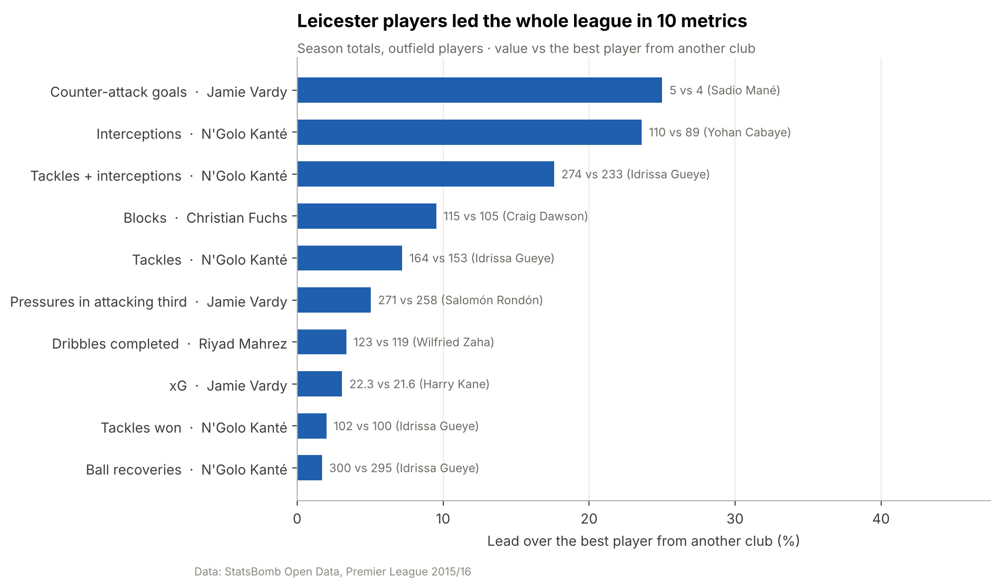

### 6.4 Distance: not where they won

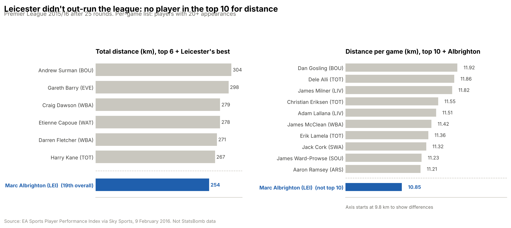

- After 25 rounds, **no Leicester player was in the top 10** for distance covered. Albrighton was their furthest runner (19th overall).
- Kanté's numbers came from **reading the game and winning the ball**, not from out-running people.

---

## 7. Money and signings

### 7.1 Spending

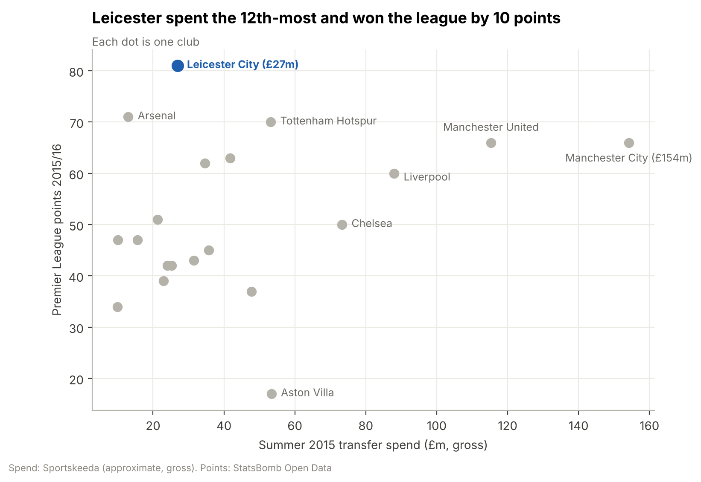

- Leicester spent **about £27m** in summer 2015, **12th of 20** clubs.
- Manchester City spent **£154m** and finished 15 points behind. De Bruyne's fee alone (£54.5m) was double Leicester's whole summer.

### 7.2 The signings and what they cost

| Signing | Fee | From | Role |
| --- | --- | --- | --- |
| N'Golo Kanté | £5.6m | Caen | Ball-winning central midfielder |
| Christian Fuchs | Free | Schalke | Left-back |
| Robert Huth | £3m | Stoke (on loan since Feb 2015) | Centre-back |
| Shinji Okazaki | £7m | Mainz | Second striker / presser |
| Gökhan İnler, Yohan Benalouane, Demarai Gray, Daniel Amartey, Nathan Dyer | — | — | Under 300 minutes each |

The rest of the core was even cheaper:
- **Vardy** cost £1m from non-league Fleetwood in 2012.
- **Mahrez** cost about £450,000 from Le Havre in 2014.
- **Kanté** was sold to Chelsea for a reported £32m a year later.

### 7.3 Cheap specialists vs the summer's big-money buys

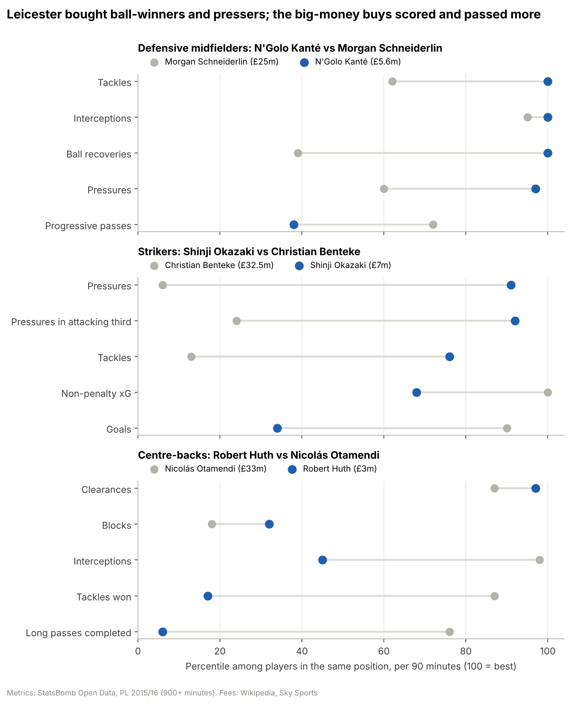

- **Kanté (£5.6m) vs Schneiderlin (£25m):** Kanté was better at tackles, recoveries and pressing.
- **Okazaki (£7m) vs Benteke (£32.5m):** Okazaki pressed at the 91st percentile, Benteke at the 6th.
- **Huth (£3m) vs Otamendi (£33m):** Huth made more clearances.
- **But the big-money players were better at scoring and passing.** Leicester bought specialists for specific jobs.
- **Scale:** the four Leicester regulars (£15.6m) made **579** tackles + interceptions; the nine biggest summer deals (£308m) made **639**.

### 7.4 How each signing ranked in his position

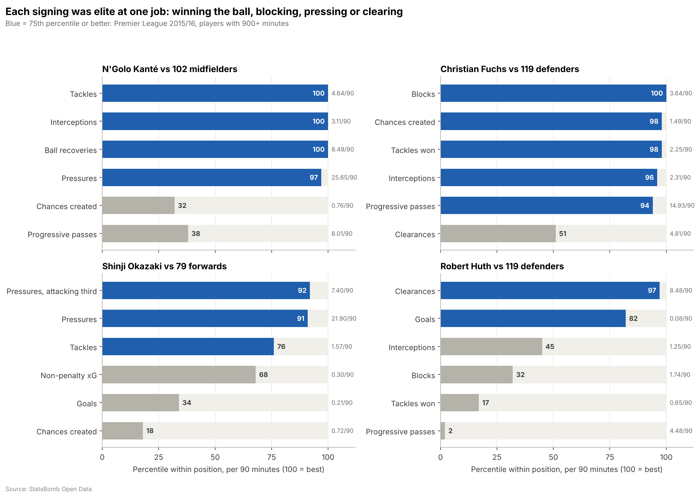

### 7.5 The signings vs the Leicester players they replaced or played beside

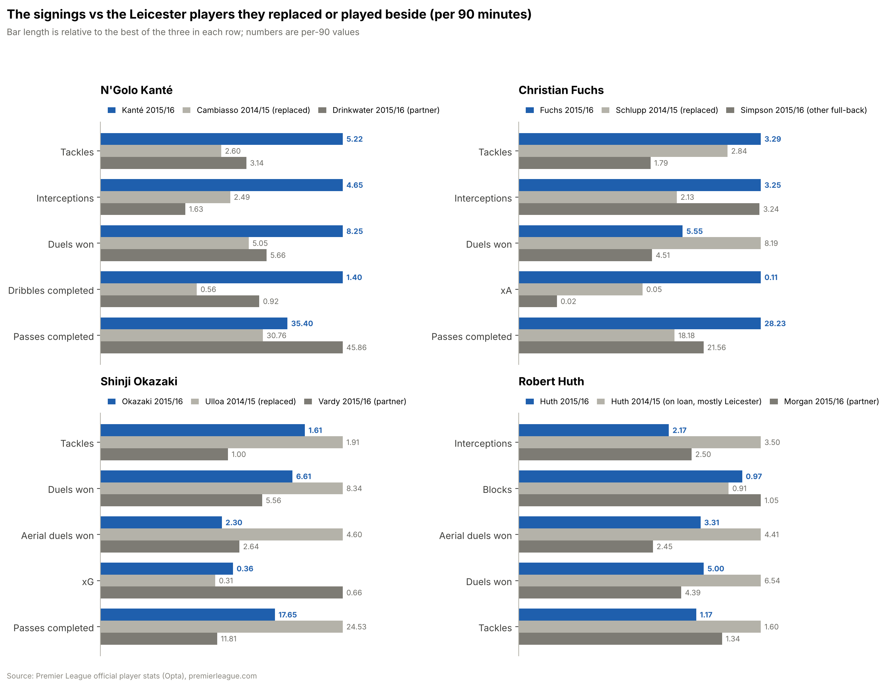

All figures per 90 minutes:
- **Kanté vs Cambiasso** (whom he replaced): tackles 5.2 vs 2.6, interceptions 4.7 vs 2.5.
- **Fuchs vs Schlupp:** more tackles, interceptions, passes and chances created; Schlupp won more duels.
- **Okazaki vs Ulloa:** an honest exception.
  - Okazaki won fewer duels (6.6 vs 8.3) and made fewer tackles than Ulloa had in 2014/15.
  - His value shows only in StatsBomb's pressing data, which doesn't exist for 2014/15.
- **Huth** won more aerial duels than his partner Morgan (3.3 vs 2.5).

---

## 8. From 14th to 1st: 2014/15 vs 2015/16

### 8.1 The team

| | 2014/15 | 2015/16 | Change |
| --- | --- | --- | --- |
| League position | 14th | **1st** | +13 |
| Points | 41 | **81** | +40 |
| Goals for | 46 | 68 | +22 |
| Goals against | 55 | 36 | −19 |
| Losses | 19 | 3 | −16 |

**The run started a season earlier.**
- In 2014/15 Leicester were bottom from November to April, then won 7 of their last 9 games.
- Counting that run, they took **103 points from 47 matches** (2.19 per match): title form over more than a full season.

### 8.2 The players who stayed

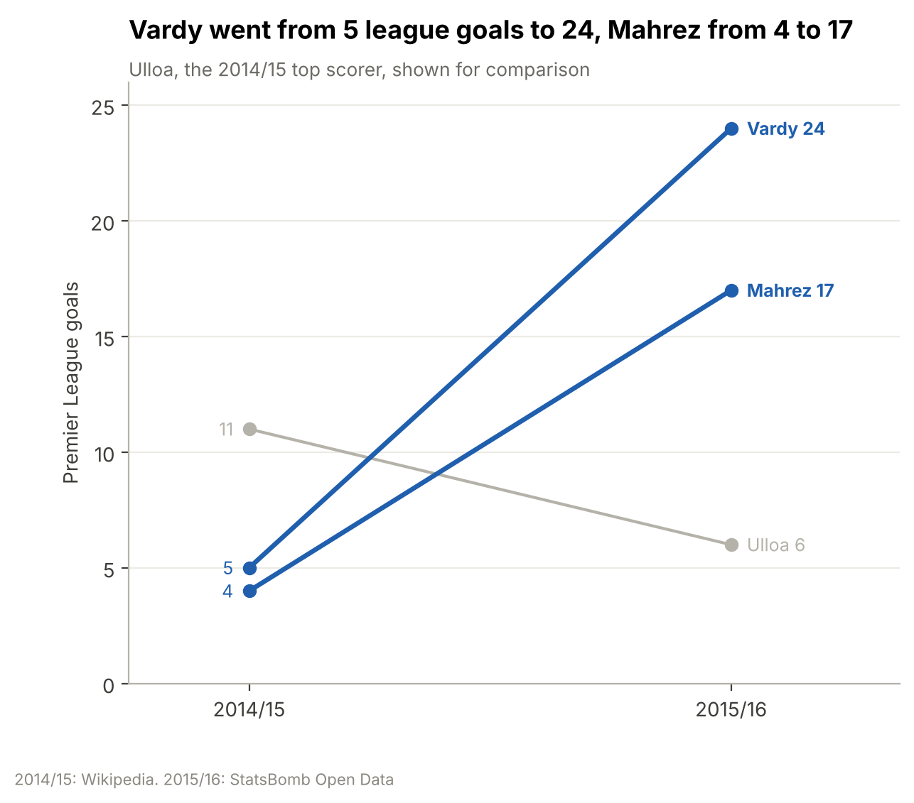

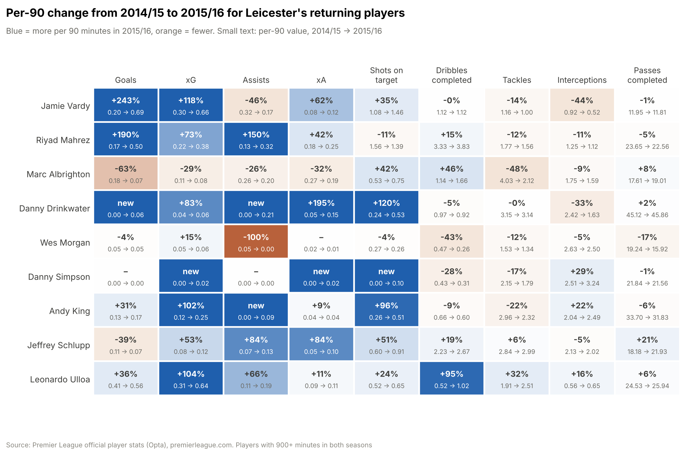

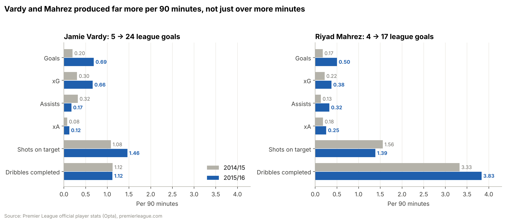

**Vardy**
- Goals per 90 went from **0.20 to 0.69**, and xG per 90 from **0.30 to 0.66**.
- In 2014/15 he scored 5 from 7.6 xG, *under* his chances. In 2015/16 he scored 24 from 23.1.
- So the jump came from **far better chances, not lucky finishing**.

**Mahrez**
- Goals per 90 went from 0.17 to 0.50, and assists per 90 from 0.13 to 0.32.
- He scored 17 from 12.7 xG, so part of the jump was elite finishing.

**Bigger roles for others**
- **Albrighton, Drinkwater and Simpson** roughly doubled their minutes.
- **Drinkwater** went from 0 to 7 assists and made the most passes in the squad.
- **Ulloa**, the 2014/15 top scorer, lost his starting place but produced more per 90 off the bench.

**Schmeichel** conceded 1.54 goals per game in 2014/15 and 0.95 in 2015/16. His clean sheets went from 25% of games to 39%.

---

## 9. Pearson to Ranieri: what changed and what didn't

> Ranieri did **not** manage Leicester in 2014/15. Nigel Pearson did, and he led the escape from relegation. Pearson was sacked in June 2015 and Ranieri appointed in July. Full write-up with sources: [`tactics_pearson_to_ranieri.md`](tactics_pearson_to_ranieri.md).

### 9.1 What didn't change: the style

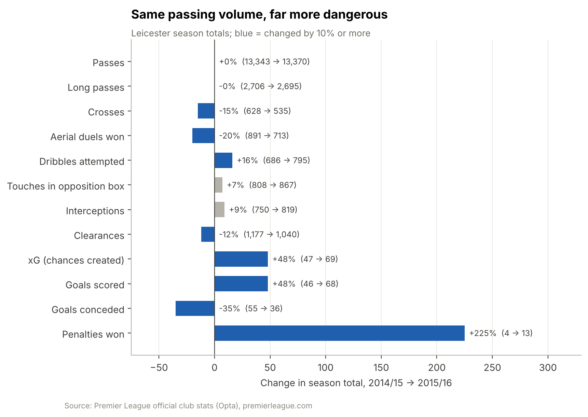

- Passes (13,343 → 13,370), long passes (2,706 → 2,695) and possession (about 42–43%) were almost identical. **Leicester were already a direct, low-possession side under Pearson.**
- What changed was **what those passes produced**: xG rose **48%** and penalties won rose from 4 to 13.
- Crosses fell 15% and aerial duels won fell 20%: less aiming at a target man, more running in behind on the ground.

### 9.2 What Ranieri changed

| Area | Pearson 2014/15 | Ranieri 2015/16 |
| --- | --- | --- |
| Formation | 11 different shapes; 3-5-2 for the April 2015 escape | A settled 4-4-2 (4-4-1-1 without the ball) |
| Centre-forward | Ulloa as the target man; Vardy sometimes on the left | **Vardy central**, Okazaki as the second striker and presser |
| Wide players | Wing-backs crossing early | **Inverted wingers**: Mahrez on the right, Albrighton on the left, cutting inside |
| Central midfield | Cambiasso, an experienced playmaker | **Kanté + Drinkwater**: energy, ball-winning, quick forward passes |
| Full-backs | Konchesky and Schlupp as attacking wing-backs | **Fuchs and Simpson** staying narrow beside slow, aerially strong Huth and Morgan |
| Without the ball | Back three protecting the box | Compact zonal 4-4-2 forcing play to the touchline; pressed harder from January |
| With the ball | Crosses for Ulloa | **Runs before the ball is won**, early balls for Vardy, counter-attacks |
| Management | Built the sports science and recruitment departments | Changed things slowly, kept the mood calm (pizza for clean sheets), gave regular rest days, made the fewest line-up changes |

### 9.3 Why it worked, in one line

Ranieri kept Pearson's identity (direct, low possession, hard-working) and gave it a **stable structure**, put **each player in his best role**, added **one elite ball-winner** (Kanté), and from January made the defence **press harder and concede only poor chances**.

---

## 10. Limitations

- **Expected goals and expected points** treat shots as independent and ignore the score at the time. Part of the defensive overperformance is probably skill (blocks, positioning, Schmeichel) and part luck; this data can't separate them.
- **No 2014/15 event data.**
  - The season-on-season comparison uses Opta totals from premierleague.com.
  - Formation, pressing and line-height comparisons cover 2015/16 only.
- **Two data providers.** Opta and StatsBomb count some events differently (Kanté: 175 vs 164 tackles), so their numbers are never mixed in one chart.
- **Secondary sources.** Distance covered, transfer fees, spending and injury figures come from published reports, and some fees were undisclosed.
- **Possession** in the StatsBomb analysis is estimated as each team's share of passes in a match.
- **Tactical descriptions** come from published analysis. Where sources disagree, the report follows the more detailed one and marks data-backed claims separately.

---

## 11. Sources

**Data**
- [StatsBomb Open Data](https://github.com/statsbomb/open-data), Premier League 2015/16
- Premier League official stats (Opta): [player stats](https://www.premierleague.com/en/stats) and Leicester City club stats for [2014/15](https://www.premierleague.com/en/clubs/13/leicester-city/stats?season=2014) and [2015/16](https://www.premierleague.com/en/clubs/13/leicester-city/stats?season=2015)
- EA Sports Player Performance Index via Sky Sports: [team distance, 8 March 2016](https://www.skysports.com/football/news/10196163/tireless-tottenham-running-further-in-2016-than-any-other-premier-league-team) and [player distance, 9 February 2016](https://www.skysports.com/football/news/11661/10161166/which-premier-league-players-have-run-the-furthest-this-season)

**Seasons, fees and spending**
- Wikipedia: [2015–16 Leicester City season](https://en.wikipedia.org/wiki/2015%E2%80%9316_Leicester_City_F.C._season), [2014–15 Leicester City season](https://en.wikipedia.org/wiki/2014%E2%80%9315_Leicester_City_F.C._season), [Jamie Vardy](https://en.wikipedia.org/wiki/Jamie_Vardy), [Riyad Mahrez](https://en.wikipedia.org/wiki/Riyad_Mahrez), [Robert Huth](https://en.wikipedia.org/wiki/Robert_Huth), [Christian Fuchs](https://en.wikipedia.org/wiki/Christian_Fuchs)
- [Sky Sports: the 10 most expensive deals of summer 2015](https://skysports.com/football/news/11096/9975549/the-10-most-expensive-deals-of-the-summer-transfer-window)
- [Sportskeeda: summer 2015 spending by club](https://widgets.sportskeeda.com/football/how-much-all-20-premier-league-clubs-spend-2015-summer-transfer-window)
- [Sky Sports: Vardy's record deal from Fleetwood](https://www.skysports.com/football/news/11712/7762163/Foxes-agree-record-Vardy-deal)
- [The Scotsman: Kanté sale to Chelsea](https://www.scotsman.com/sport/football/leicesters-aps26m-profit-sale-ngolo-kante-chelsea-1472042)

**Tactics and management**
- [Spielverlagerung: Smart as eleven foxes](https://spielverlagerung.com/?p=3393)
- [Premier League: How Ranieri masterminded Leicester's title](https://www.premierleague.com/en/news/2748139)
- [Coaches' Voice: Nigel Pearson](https://learning.coachesvoice.com/coach-watch-nigel-pearson/)
- [Sky Sports: five ways Ranieri changed Leicester](https://www.skysports.com/amp/football/news/30385/10083402/claudio-ranieri-five-ways-hes-changed-things-at-leicester-city)
- [Football Italia: Ranieri, my tactics explained](https://www.football-italia.net/84100/ranieri-my-tactics-explained)
- [AP via Dawn: Ranieri's winning blueprint](https://dawn.com/news/1256467)
- [Jonathan Wilson, New Statesman: Trust the tinkerman](https://www.newstatesman.com/culture/sport/2016/04/trust-tinkerman-fall-and-rise-claudio-ranieri)
- [The Set Pieces: Focus on Leicester City](https://thesetpieces.com/?p=5394)
- [The Hard Tackle: Leicester's multidimensional gameplay](https://thehardtackle.com/blogs/2016/02/14/leicester-city-the-sum-of-all-parts-killing-premier-giants-one-game-at-a-time/amp/)
- [The Tomkins Times: Leicester 2 Liverpool 0](https://tomkinstimes.com/?p=57636)
- [TBR Football: the tactics behind Leicester's success](https://tbrfootball.com/analysis-the-tactics-behind-leicesters-premier-league-success/)
- [The42: 7 key factors](https://the42.ie/7-key-factors-inspired-leicesters-title-triumph-2748883-May2016)
- [Computer Weekly: data analytics at Leicester](https://www.computerweekly.com/news/450296302/Foxy-Leicester-City-FC-won-Premiership-with-data-analytics)
- [Sportskeeda: Leicester's sports science](https://www.sportskeeda.com/football/secret-leicesters-success-sports-science)
- [theScore: the great escape](https://www.thescore.com/epl/news/1017760)
